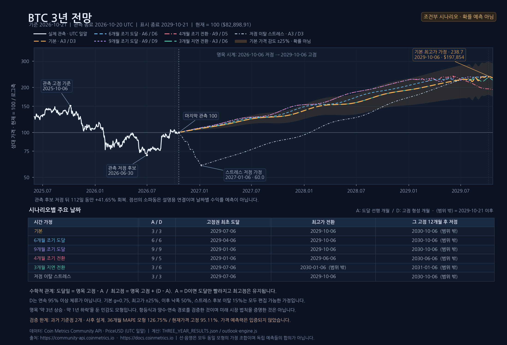

# Bitcoin Cycles — 3년 전망과 사이클 연구

**앞으로 3년의 조건부 경로, 역사 사이클 비교, 출처 우선순위, 일별 원자료를 네 페이지로 나눈 한국어 연구 도구**입니다. [원본 Bitcoin Cycles Comparison](https://www.bitcoincyclescomparison.com/)의 네 가지 역사 비교 방식에서 출발해 독립 구현했으며, Coin Metrics의 실제 UTC 일말 가격을 사용합니다.



기본 페이지는 **3년 전망**입니다. 이 배포 자료는 연구 기준일 **2026-10-21 KST**, 마지막 완료 가격 **2026-10-20 UTC**, 표시 종료 **2029-10-21**에 고정한 정적 연구 스냅숏입니다. 점선·파동·음영은 조건부 계산이며 특정 날짜·가격의 발생 확률이 아닙니다. 원자료 페이지에서 가격을 갱신해도 3년 전망의 분석 기준일과 사이클 기준점을 자동으로 바꾸지 않습니다.

## 실행 페이지 · 릴리스 · CI 상태

공개 저장소 **[twoimo/bitcoin-cycle-atlas](https://github.com/twoimo/bitcoin-cycle-atlas)**가 생성됐으며 기본 브랜치는 `main`입니다. GitHub Pages의 배포 소스는 **GitHub Actions**로 설정했습니다. **첫 CI·Pages·릴리스 실행은 대기 중이며, 라이브 페이지의 게시 성공은 아직 확인하지 않았습니다.** 실제 실행 URL과 성공한 워크플로 실행 기록은 게시 검증 후 추가합니다.

| 항목 | 제공 목적 | 현재 문서에서 확인 가능한 상태 |
|---|---|---|
| GitHub 저장소 | 코드·검증 결과·출처 이력 공개 | 공개 저장소 생성 완료, 기본 브랜치 `main` |
| GitHub Pages | `dist/`의 네 페이지를 브라우저에서 실행 | 소스 GitHub Actions 설정 완료, 첫 배포 실행 대기 |
| GitHub Actions | 테스트와 정적 산출물 생성을 반복 검증 | 첫 원격 CI 실행 대기, 성공 결과 미확인 |
| GitHub Release | 태그에 대응하는 단일 HTML·소스·도표 제공 | 첫 릴리스 실행·발행 대기 |

지금 재현하려면 아래 [실행과 재현](#실행과-재현)을 사용합니다. 모델 설명은 [THREE_YEAR_MODEL.md](docs/THREE_YEAR_MODEL.md), 검증 범위와 한계는 [THREE_YEAR_VERIFICATION.md](docs/THREE_YEAR_VERIFICATION.md)에 있습니다.

## 네 페이지 사용 방법

| 사이드바 페이지 | 주된 기능 | 확인할 구분 |
|---|---|---|
| **3년 전망** | 6개 시나리오, 고점권 도달 시차 A·형성 기간 D·가격 배수·낙폭 조절, 사건표, SVG·JSON | 고점권 첫 도달과 절대 최고가 날짜가 다름 |
| **사이클 비교** | 반감기·저점·고점·이전 최고가 돌파의 역사 경로와 기존 심층 분석 | 현재부터 3년을 보여 주는 새 모델과 별개의 보조 비교 |
| **리서치 자료** | 읽기 순서대로 50행을 추가 표시하는 무한스크롤 표와 더 보기 버튼, 자료 상세 | 순위·등급은 확률이나 투자 추천 순서가 아님 |
| **원자료** | 실제 일별 가격 탐색·필터·갱신·내보내기 | 날짜 라벨은 UTC 일말이며 미완료 당일은 제외 |

3년 전망에서는 현재=100과 USD 단위를 바꾸고, 2025년 고점 관측을 함께 표시하거나 다른 시나리오와 가격 가정 범위를 숨길 수 있습니다. 고점·저점 사건이 2029-10-21을 넘으면 **표시 범위 밖**으로 구분하며, 그래프의 끝점을 새 전환점으로 만들지 않습니다.

리서치 표는 50개 대표 자료를 한 행씩 보여 줍니다. 상세에는 원제·발행 시점·열람 상태·선정 이유·한계·같은 계보를 제공하며, 해당 자료에 연결된 **18개 보조 원문·하위 댓글·API 요청**도 상세 모달에서 열 수 있습니다. 자료 순서의 근거와 전체 링크는 [EVIDENCE_PRIORITY.md](docs/EVIDENCE_PRIORITY.md)에 있습니다.

## 새 3년 모델: 도달과 전환을 분리

명목 시계는 직전 관측 고점에서 **48개월 뒤의 최고점 N**과 약 **36개월 상승·12개월 하락** 구조를 가정합니다. 이 시계는 비교 기준이며, 실제 관측을 수정하는 법칙이 아닙니다. 예를 들어 명목 저점 2026-10-06을 사용하더라도 실제 후보 저점 2026-06-30 이후의 회복을 하락장으로 다시 그리지 않습니다.

- **A:** 명목 최고점 N에서 역산한 고점권 최초 도달 시차.
- **D:** 최초 도달부터 조건부 최고가까지의 고점 형성 기간. 중간 조정을 포함하며 95% 가격선 위에 연속 체류한다는 뜻이 아닙니다.
- **Z:** 고점권 최초 도달 날짜.
- **P:** 조건부 최고가 날짜.

```text
Z = N − A
P = N − A + D
P − N = D − A
```

**A=D이면 더 일찍 고점권에 도달해도 최고가 날짜는 유지됩니다. A>D이면 최고가도 앞당겨지고 D>A이면 늦어집니다.** 이것은 정의에서 따라오는 항등식이며 시장이 그렇게 움직인다는 증명이 아닙니다. 달력 월 이동은 같은 N에서 한 번 계산해 월말·윤년의 연속 이동 오차를 피합니다. UI는 최종 전환의 순이동을 ±6개월로 제한하며 이 제한도 조절 모델의 가정입니다.

과거 2025년을 일수로 분해하면 A=118일, D=85일, 순이동은 −33일입니다. 이전 연구의 **98일**은 2021년의 같은 95% 진입 사건을 4년 옮겨 비교한 값으로, 새 모델의 A와 기준점이 다릅니다. 역산한 항등식의 잔차가 0이라는 사실을 예측 적중률로 표시하지 않습니다.

### 기본 시나리오의 날짜

현재 스냅숏의 N은 **2029-10-06**입니다.

| 시나리오 | A / D | 고점권 도달 | 조건부 최고가 |
|---|---:|---|---|
| 기준 | 3 / 3개월 | 2029-07-06 | 2029-10-06 |
| 빠른 도달 | 6 / 6개월 | 2029-04-06 | 2029-10-06 |
| 더 빠른 도달 | 9 / 9개월 | 2029-01-06 | 2029-10-06 |
| 이른 전환 | 9 / 5개월 | 2029-01-06 | 2029-06-06 |
| 늦은 전환 | 3 / 6개월 | 2029-07-06 | 2030-01-06 · 표시 범위 밖 |
| 저점 이탈 | 3 / 3개월 | 2029-07-06 | 2029-10-06 · 중간에 추가 저점 가정 |

모든 날짜는 가정에 따른 UTC 날짜입니다. 스트레스 시나리오의 중간 하락도 추정한 확률이나 예고된 사건이 아닙니다. 다음 저점은 조건부 최고가에서 12개월 뒤로 계산하므로 대체로 3년 그래프 밖에 놓입니다.

### 새 가격 범위와 파동

기본 최고가 가정은 직전 두 최고값 사이의 **로그 상승폭을 75% 유지**한 약 **$197,854**입니다. 사용자는 최신 관측 가격 대비 배수로 바꿀 수 있습니다. 고점 이후 낙폭의 기본값은 50%이며 이 역시 독립된 가정입니다.

**새 화면의 음영은 선택한 고점 가격의 ±25%를 적용한 경로 범위**입니다. 기본 고점에서 약 **$148,391~$247,318**이며, 표준오차·신뢰구간·예측구간·적중 확률로 보정한 값이 아닙니다. 과거 자료로 추정된 손실 한도도 아닙니다.

경로는 양수인 로그가격 연결선에 양 끝에서 0이 되는 예시 파동을 더합니다. 파동 크기를 제한해 가정한 최고가를 넘지 않도록 하며, 고점 형성 중에도 첫 진입 가격 아래로 다시 내려갈 수 있습니다. 양수성·연속성·앵커 일치는 계산식의 성질입니다. **실제 일별 파동 시점을 예측하거나 검증한 것이 아닙니다.**

## 새 모델의 과거 검증: 불리한 결과도 공개

새 모델을 **2014-12-18와 2018-12-30** 두 시점에서 잘라 당시까지의 관측만으로 재생했습니다. 모형과 기준일은 사후에 선택했으므로 진정한 사전 실험은 아닙니다. 2025·2026년 현재 사이클은 이 검증 표본에 넣지 않았습니다.

| 이후 기간 | 새 모델 가격 MAPE | 가격 유지 MAPE | 평가 기점 |
|---|---:|---:|---:|
| 12개월 | 138.86% | 39.70% | 2개 |
| 24개월 | 377.72% | 73.54% | 2개 |
| 36개월 | 126.75% | 95.11% | 2개 |

MAPE는 실제 가격 대비 절대 오차율의 평균으로, 작을수록 좋습니다. **이 척도에서는 모든 기간에서 새 모델이 단순 가격 유지보다 나빴습니다.** 로그 오차의 상대 결과는 일부 기간에서 달라지므로 [전체 검증 JSON](docs/THREE_YEAR_RESULTS.json)에 함께 공개합니다. 유리한 지표만으로 검증된 예측기라고 제시하지 않습니다.

‘저점 유지’ 가정은 **2개 중 1개** 구간에서 깨졌고 그 실패를 제외하지 않았습니다. 같은 평가 기점의 12·24·36개월은 서로 겹치는 기간이므로 독립 실험 여섯 건이 아닙니다. 과거 절단이 미래 관측 누수를 줄여도 사후 설계·소표본·시장 구조 변화의 문제를 없애지는 않습니다. [FPP3 제5장](https://otexts.com/fpp3/toolbox.html)의 시간순 검증과 예측구간 원칙을 참고했습니다.

## 기존 분석은 사이클 비교의 보조 도구

기존 계산은 삭제하지 않고 **사이클 비교** 페이지 안에 보존했습니다.

| 보조 분석 | 내용 | 새 모델과의 차이 |
|---|---|---|
| 네 역사 비교 | 반감기·저점·고점·돌파에서 시작가격 정규화, D+경과일 | 실제 관측 기록이며 미래선이 아님 |
| 큰 사이클 · 2030 | 현재 저점 유지, +48개월, 추가 3·4·5개월 단축의 5개 가정 | 새 A/D 모델의 6개 시나리오와 다른 시간 가정 |
| 과거 경로 재생 | 현재=100, 같은 저점 경과일 이후의 730일 수익률 재생 | 새 3년 가격 연결식·파동·음영과 다른 모델 |
| 고점권 조기 진입 | 90·93·94·95·98% 최초 진입·지속·체류율 | 최종 관측 최고가를 분모로 쓰는 사후 비교 |
| 저점·추세 전환 | 저점 후보·200일 기하평균·14일 확인·실패 기록 | 사건 발생일과 당시 알 수 있었던 확인일을 분리 |

**가격 범위를 혼합하지 않습니다.** 기존 거시 모형의 약 **$169,693~$230,689**는 성장 유지 지수 α=0.50·0.75·1.00에 따른 최고가 민감도입니다. 기존 저점 약 **$26,261~$108,161**도 여러 역사 잔존비율의 조합입니다. 이 두 범위는 새 화면의 **선택 고점 ±25%**와 산식·표현 목적이 다릅니다.

기존 재생 검증의 기준일은 2019-03-31·2023-03-31, 기간은 90·180·365일입니다. 이는 새 모델의 2014·2018년 두 기점, 12·24·36개월 평가와 구분합니다. 기존 계산은 [CYCLE_TIMING.md](docs/CYCLE_TIMING.md)와 [FORECAST_RESULTS.json](docs/FORECAST_RESULTS.json)에 남아 있습니다.

## 문서와 배포 산출물

저장소에 포함된 설명·그림과, 빌드 또는 릴리스에서 생성하는 파일을 구분합니다.

| 자료 | 역할과 위치 |
|---|---|
| [3년 모델 설명](docs/THREE_YEAR_MODEL.md) | A/D 항등식·시나리오·가격 가정·실패를 포함한 검증 설명 |
| [구현 검증 기록](docs/THREE_YEAR_VERIFICATION.md) | 계산·브라우저·정적 스냅숏의 확인 범위와 재현 명령 |
| [3년 전망 도표](docs/figures/Bitcoin_Three_Year_Outlook.png) | 기본 모델과 시나리오의 조건부 경로 |
| [고점권 분석 도표](docs/figures/Bitcoin_Peak_Zone_Analysis.png) | 2025년 고점권과 과거 동일 임계값 비교 |
| [자료 읽기 순서](docs/EVIDENCE_PRIORITY.md) | 대표 자료 50개와 보조 링크 18개의 원문·계보·접근 제한 |
| `Bitcoin_Cycles_Comparison.html` | 빌드로 생성하는 단일 실행 파일. 네 페이지·가격 자료·JavaScript·CSS를 내장 |
| 태그별 소스와 릴리스 파일 | GitHub Release 자동화에서 제공할 배포 패키지. 실제 제공 목록은 발행된 릴리스에서 확인 |

새 모델의 고정 계산 결과는 [THREE_YEAR_RESULTS.json](docs/THREE_YEAR_RESULTS.json)에 있습니다. 이전 고점권·저점·거시 시나리오의 수식과 결과는 [CYCLE_TIMING.md](docs/CYCLE_TIMING.md)에 보존합니다. 기존 거시 범위를 새 모델의 결과로 읽지 않습니다.

## 실행과 재현

정적 HTML/CSS/JavaScript 사이트이며 별도 빌드나 패키지 설치 없이 HTTP로 실행할 수 있습니다.

```bash
python3 -m http.server 8000 --directory dist
```

브라우저에서 `http://localhost:8000`을 엽니다. 테스트와 빌드는 **Node.js 24 이상이 필요**하며, 재현 환경으로 **Node.js 24**를 권장합니다(`package.json`의 `engines.node >=24`). 다음 명령은 비교·데이터·전환·고점권·거시 전망·새 3년 모델의 테스트 모듈을 실행합니다.

```bash
npm test
```

전체 테스트 모듈 **7개 파일이 실패 없이 통과**했으며, 새 3년 모델 내부의 **11개 검증 항목**도 통과했습니다. 테스트는 달력 산술·관측값 보존·사후/당시 정보 구분·새 모델의 구조적 불변조건을 점검합니다. 별도로 대표 자료 50개와 보조 링크 18개의 연결·고유 URL 68개도 검사했습니다. 이 통과 여부를 금융 예측력의 증명으로 해석하지 않습니다. 새 모델의 예측 오차는 위와 같이 별도로 공개합니다.

단일 HTML 재생성:

```bash
node scripts/build-standalone.mjs build/Bitcoin_Cycles_Comparison.html
```

생성한 `build/Bitcoin_Cycles_Comparison.html`은 브라우저에서 열 수 있습니다. 출력 위치를 명시하므로 현재 작업 디렉터리 밖에 파일을 만들지 않습니다. 스냅숏의 기본 기능은 내장 자료로 실행되며, 외부 출처 열기와 가격 갱신에는 네트워크가 필요합니다.

### Python 도표 재생성 요건

PNG를 다시 그릴 때는 **Python 3, `matplotlib`, `numpy`와 한글 폰트**가 필요합니다. 정적 사이트 실행이나 Node.js 계산 테스트에는 Python 도표 환경이 필요하지 않습니다.

```bash
python3 -m pip install matplotlib numpy
```

한글 폰트는 `BCA_FONT_DIR`로 지정한 디렉터리에 준비하거나, Matplotlib에서 찾을 수 있는 한글 폰트를 운영체제에 설치합니다. 지정한 디렉터리에서는 하위 폴더를 포함해 `.ttf`·`.otf`·`.ttc` 파일의 한글 지원을 확인합니다. 같은 외형의 재현에는 **NanumGothic Regular·Bold**를 권장하며, 설치된 Noto Sans CJK KR·Noto Sans KR 등도 사용할 수 있습니다. 저장소에는 폰트 파일을 포함하지 않습니다.

도표의 기본 출력은 `build/`이며 `BCA_OUTPUT_DIR`로 변경할 수 있습니다. 3년 도표 스크립트는 `--font-dir`와 `--output`도 지원하고, `--font-dir`가 `BCA_FONT_DIR`보다 우선합니다. 새 도표는 `Bitcoin_Three_Year_Outlook.png`, 보조 분석은 `Bitcoin_Peak_Zone_Analysis.png`와 `Bitcoin_Cycle_Forecast.png`로 생성됩니다.

새 전망의 조건은 `dist/outlook-engine.js`와 `docs/THREE_YEAR_RESULTS.json`에 있습니다. `scripts/render-three-year-chart.py`는 새 전망 도표용이며, `scripts/render-analysis-charts.py`는 이전 고점권·2030 거시 분석용입니다. 두 도표의 모델과 가격 범위를 혼합하지 않습니다.

## 데이터와 갱신

번들은 **2010-07-18~2026-10-20의 5,939개 UTC 일말 관측**입니다. 내부 결측·날짜 중복은 없습니다. 주요 관측은 2025-10-06 고점 **$124,824.45**, 2026-06-30 저점 후보 **$58,525.08**, 2026-10-20 최신값 **$82,898.91**입니다. 2025년 7월 최고 일말값은 관측 최고가의 **96.19%**였습니다. 이 수치는 [원자료 및 메타데이터](dist/data/btc-daily.json)에서 재현할 수 있습니다.

원자료·역사 비교는 번들 또는 검증 캐시를 먼저 표시하고, 마지막 관측일이 UTC 오늘보다 2일 이상 오래됐으면 페이지를 열 때 갱신을 시도합니다. 수동 갱신도 가능하며, 스키마·정렬·중복·역사 범위·페이지네이션을 검사합니다. 오늘·미래의 미완료 값과 더 오래된 응답은 기존 검증 데이터를 대체하지 않습니다. 페이지가 닫혀 있을 때 자동으로 수집하는 서버는 없습니다.

**3년 전망은 별도의 고정 스냅숏입니다.** 새로운 기준일로 전망을 발행하려면 관측 범위·기준점·시나리오·계산 JSON·도표·검증 기록을 함께 갱신해야 합니다. 고점권의 최종 최고값과 역사 저점 선택에는 사후 정보가 들어갑니다. 원본 사이트의 데이터 공급자·정확한 계산 코드는 확보하지 못했으므로 원본과 모든 날짜·가격이 같다는 주장은 하지 않습니다.

## 소스 구성

| 파일 | 역할 |
|---|---|
| `dist/outlook-engine.js` · `outlook-view.js` | 새 3년 모델·항등식·시나리오·과거 재생 검증·화면 |
| `dist/evidence-catalog.js` · `evidence-view.js` | 50개 대표 자료와 EVIDENCE_SUPPLEMENTS 18개 연결·자료 표 |
| `dist/cycle-engine.js` · `data-source.js` | 네 역사 비교와 공개 데이터 검증 |
| `dist/cycle-timing.js` · `peak-zones.js` | 저점·추세 확인 및 고점권 민감도 |
| `dist/forecast-engine.js` | 기존 2030 거시 모형·730일 재생·보조 검증 |
| `dist/app.js` · `index.html` · CSS | 네 사이드바 페이지와 공통 조작 |
| `docs/EVIDENCE_PRIORITY.md` | 출처 순서·접근 제한·중복 계보·전체 68개 URL |
| `docs/*_RESULTS.json` | 모델별로 구분한 재현 결과 |

`dist/`가 정적 웹 루트입니다. [원본 조사·계산 기록](docs/RESEARCH.md)은 이전 분석과 복원 범위를 보존하는 문서이며, 기본 화면의 새 구성은 이 README와 새 모델 문서를 기준으로 합니다.

## 데이터 이용 조건

가격 자료는 **Coin Metrics**의 **[CC BY-NC 4.0](https://creativecommons.org/licenses/by-nc/4.0/)** 조건을 따릅니다. 재사용 시 출처·라이선스·변경 사항을 표시하고 비상업 조건을 준수해야 합니다. 변환은 BTC/USD 일별 추출·정렬·정규화·자체 통계 계산이며, 데이터 조건을 프로그램 코드의 별도 라이선스 선언으로 해석하지 않습니다.
