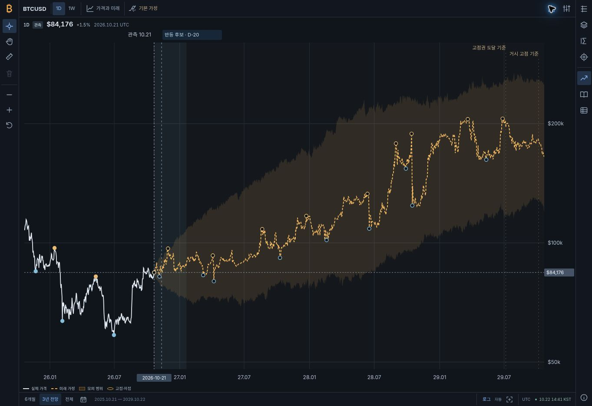
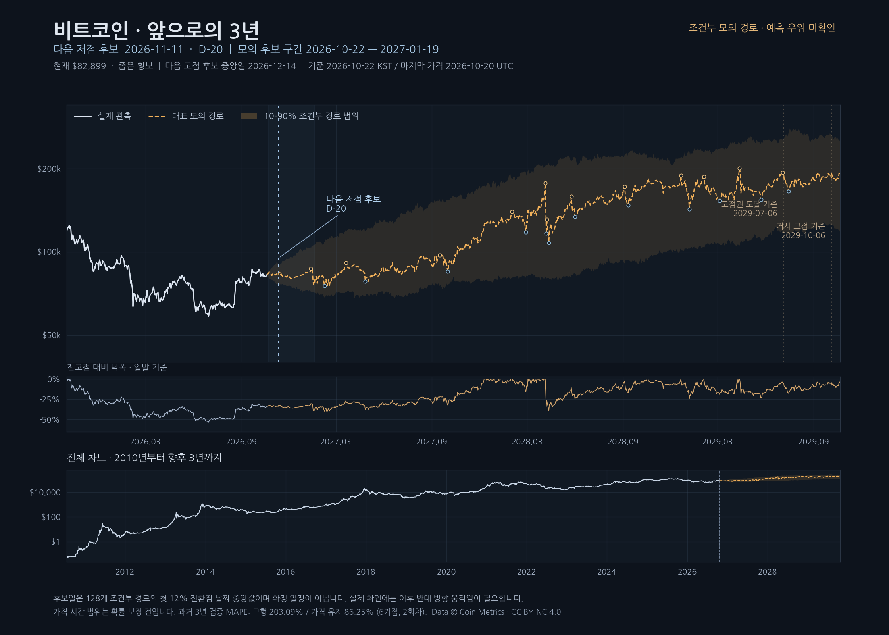
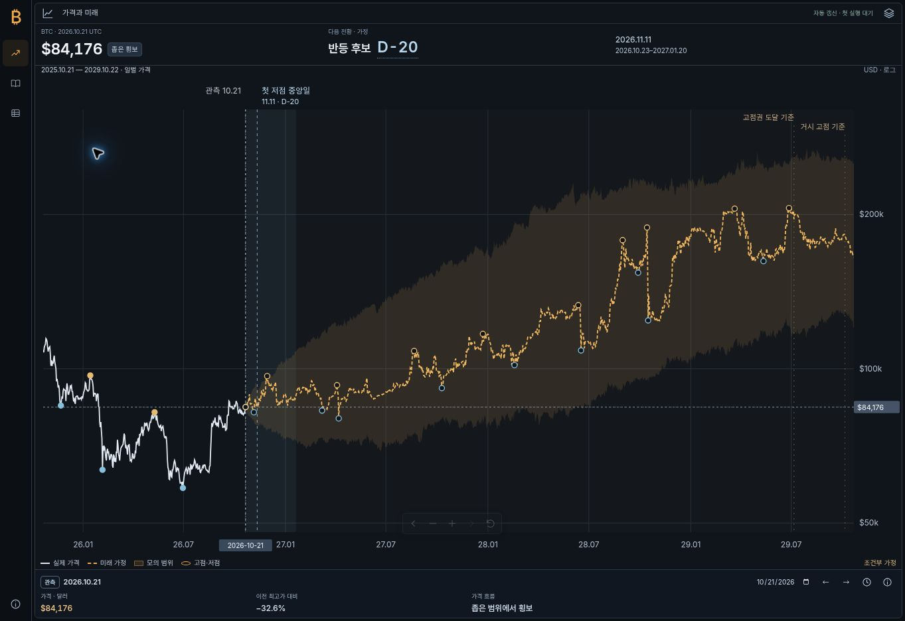

# Bitcoin Cycle Atlas

**비트코인·이더리움·스트래티지(MSTR)·비트마인(BMNR)의 실제 가격, 역사 사건, 연구 근거를 읽는 한국어 차트 사이트**입니다. BTCUSD는 장기 경제 가정과 사이클 기간을 비교하고, MSTR·BMNR은 공시된 과거 자본구조를 바탕으로 조건부 미래 경로를 계산합니다. ETHUSD는 관측 가격과 역사 사건을 제공합니다. 실제 관측과 미래 가정, 발행사 주장과 앱의 분석을 구분해 표시합니다.

BTC 첫 접속은 최신 관측일 앞뒤 약 **4년**을 보여 주며, ‘장기 전망’·‘전체’ 또는 축소·이동으로 검토한 출처의 마지막 목표 연도인 **2050년 말**까지 볼 수 있습니다. 미래 가격과 음영은 검증된 목표가·확률구간을 뜻하지 않습니다. [종목별 모델 범위](docs/MODEL_SCOPE.md) · [BTC 표시 종료일 규칙](dist/long-horizon-forecast.js)

## v1.26.0 · 공항 안내판 스타일의 다크 자산 비교표

기존 사이트의 다크 표면과 글자 색상을 유지하고, 노란 안내 색상·탭 정렬 숫자·얇은 구분선으로 자산 비교표를 정리했습니다. 복귀·제목·갱신·읽는 법·CSV는 모바일에서도 한 줄이며, 중복된 모바일 복귀 버튼과 그 여백을 제거했습니다.

BTC를 첫 행에 추가한 총 **18개 자산**입니다. BTC는 기존 Coin Metrics 원자료 5,942개(2010-07-18~2026-10-23)를 사용하고, UTC 달력일과 주식·ETF 거래일을 구분합니다. 기존 17개 원자료와 전체 계산 결과는 이전 main과 직접 대조하여 동일함을 확인했습니다. 계산은 기존의 과거 연도 동일 가중 방식이며 미래 가격 예측이나 검증된 투자 권유가 아닙니다.

- [원자료·계산 보존 검증](docs/asset-airport-preservation.json)
- [실제 브라우저·모바일 검증](docs/AIRPORT_BOARD_QA.md)
- [계산 방법](docs/ASSET_COMPARISON_METHODOLOGY.md)

## v1.25.1 · 17개 종목을 한눈에 읽는 자산 비교표

[자산 비교표](https://twoimo.github.io/bitcoin-cycle-atlas/?page=data)는 제공된 두 번째 이미지의 **17개 종목·열 구성**과 첫 번째 이미지의 **격자·회색 머리글·녹색/분홍색 셀**을 반영합니다. 한 페이지에 표 하나만 두고, 마지막 열에 **적극 매수 · 분할 매수 · 중립 · 분할 매도 · 적극 매도**를 표시합니다. 판단 버튼을 누르면 해당 종목의 실제 경계값과 근거를 확인할 수 있습니다.

- **실제 표본 확보:** 상장 초기부터 2026-10-23까지 97,987개 일별 종가를 수집했습니다. 2026년을 제외한 실제 관측 연도 수를 표시하고, 첫해 일부 기간은 별표로 알립니다. PDBC는 2014년부터 자료가 있어 12개 연도이며 이미지의 11을 복사하지 않습니다.
- **평균 범위와 현재 위치:** 각 과거 연도의 첫 종가를 기준으로 최고·최저 종가의 변화를 구해 연도별 같은 비중으로 평균합니다. 올해 첫 종가 대비 변화를 평균 상승·낙폭과 비교합니다. 평균 낙폭은 시간순 고점 이후의 MDD와 다른 값입니다.
- **다섯 단계의 명시적 기준:** 평균 낙폭 D, D/2, 평균 상승 U/2, U가 경계입니다. 계산에 반올림값을 사용하지 않고, 표본 부족·확인된 공백·오래된 자료는 판단 보류로 처리합니다. 이 단계는 과거 가격 범위에 대한 위치 분류이며 거래 수익성·확률을 입증한 신호가 아닙니다.
- **종가와 총수익 구분:** 모든 값은 분할을 반영한 USD 종가이며 배당·분배금은 제외합니다. PDBC 등 분배금 지급 상품의 가격 하락이 같은 크기의 투자 총손실을 뜻하지 않음을 설명합니다.
- **운영과 성능:** 표를 열 때만 자료를 읽고 같은 날짜의 모델을 재사용합니다. 동시 로드는 합치고 명시적 갱신은 새 자료를 요청합니다. 단일 HTML에도 17개 종목의 이력을 넣으며 자동 갱신·수치 검증에 포함합니다.

[변경 내용](docs/RELEASE_V1_25.md) · [자료 확보와 출처](docs/ASSET_COMPARISON_DATA.md) · [계산식·상태와 검증 범위](docs/ASSET_COMPARISON_METHODOLOGY.md)

## v1.24.1 · 이전 사이클 판단표 구현 기록

v1.24에서는 최근 4년의 BTC 기준점과 선택한 미래 가정을 하나의 표로 연결했습니다. **v1.25에서는 사용자가 새로 지정한 이미지에 따라 이 페이지를 자산 비교표로 교체했습니다.** 아래 내용과 연결된 검증 기록은 v1.24 당시의 화면 범위입니다. 기존 차트·사이클 계산과 회귀 검증은 보존합니다.

- **시간과 근거 중심:** 날짜·기간, 사이클 구간, 검토 단계, 이유, 같은 기간의 가격 변화·최대 낙폭만 남겼습니다. 날짜를 누르면 통합 차트의 같은 지점·구간으로 이동합니다.
- **매수·횡보·매도와 강한 단계:** 매수·매도는 고점·저점 등 기준 지점에서의 계획 해석입니다. 적극 단계는 검토 강도이며 수익 확률이나 주문량이 아닙니다. 횡보는 실제 가격 조건을 충족한 기간만 표시하고 근거가 부족하면 판단을 보류합니다.
- **과거와 가정 구별:** 사후 선택한 고점·저점을 당시 실행 가능했던 신호로 부르지 않습니다. 미래 행은 조건부 가정으로 표시하고 실현 수익률·MDD를 채우지 않습니다. 실제 가격이라도 미래 가정이 선택한 역할은 가정 분류를 유지합니다.
- **기간 MDD:** 각 행의 시작일부터 종료일까지 먼저 나온 고점 뒤의 최대 하락만 계산합니다. 전체 이력의 같은 낙폭을 모든 행에 반복하지 않습니다.
- **제거와 검증:** 기존 50·200일 이동평균 및 14일 RSI 조합과 해당 매매 판정을 계산부·페이지·CSV에서 제거했습니다. 같은 자료의 재표시는 모델을 재사용하며, 필터는 다른 자산의 원자료를 추가로 읽지 않습니다. [변경 내용과 검증](docs/RELEASE_V1_24.md) · [기간 가설의 교차 검토](docs/CYCLE_TABLE_RESEARCH.md) · [유한 검증과 상태 전이](docs/CYCLE_TABLE_VERIFICATION.md)

## v1.23.0 · 전체 시스템 감사와 재사용할 상태 검증

ETH 정보 창·페이지 복원·조회 중 사용자 선택, 일별 자료의 기간 경계와 극단 수치 연산을 수정했습니다. 공식 pstack 절차로 성능·수치·상태를 병렬 점검하고 별도 reviewer가 반례를 찾아 재검증했습니다. [전체 감사](docs/SYSTEM_AUDIT_2026_10_25.md) · [릴리스 노트](docs/RELEASE_V1_23.md)

- **반복 계산 감소:** 일별 80회 페이지 이동은 1,149.90 → 335.46 ms, 비교 화면 26회 redraw는 1,540.93 → 229.37 ms. 실제 controller·표/SVG 생성의 7회 교대 측정으로 각각 70.83%·85.11% 줄었습니다. 표시 출력 동등성을 대조했으며, 브라우저 네트워크·layout·paint 시간으로 확대하지 않습니다. [원시 표본과 범위](docs/SYSTEM_PERFORMANCE_AUDIT_2026_10_25.md)
- **독립 수치 검산:** 17,237개 관측의 MDD·SMA·RSI, 재무 보존식과 날짜 인과성을 대조했습니다. subnormal 로그 정보 손실과 MAX 경계 기울기의 중간 반올림까지 고쳤습니다. 정상 저장 자료의 전체 분석 결과는 기준 코드와 동일합니다. [수치 감사](docs/SYSTEM_NUMERICAL_AUDIT_2026_10_25.md) · [독립 반례 검토](docs/SYSTEM_INDEPENDENT_REVIEW_2026_10_25.md)
- **프로젝트용 형식 검증 스킬:** ETH 실제 initializer 17개, 실제 코드 변이 9개, TLA+ 2,243개 고유 상태의 안전성 검증을 함께 둡니다. 연속 refresh의 모델 누락과 skipped replay 처리도 cold review에서 보완했습니다. [공식 상태전이도](docs/formal-eth/statechart/chart.png) · [모델·한계](docs/formal-eth/README.md) · [독립 스킬 검토](docs/FORMAL_SKILL_REVIEW_2026_10_25.md)
- **최종 통합 977개 PASS:** 실패·skip·cancel 없이 통과했고, 수치·재무·연구·상태·정적·단일 HTML gate를 검증했습니다. 새 검사는 CI·Pages·릴리스에 포함됩니다. [정확한 소스·실행 결과](docs/data/system-integrated-verification-2026-10-25.json)

## v1.22 · 이전 일별 원자료 화면의 구현 기록

당시에는 네 자산의 일별·연간·월별 수익률과 전체 이력 MDD를 비교했습니다. **v1.24에서 이 화면과 기존 지표 신호를 사이클 판단표로 교체했습니다.** 아래 이전 감사의 성능·검사 수치는 해당 버전과 명시된 비교 범위에 관한 기록입니다.

## v1.21.0 · 성능·수학·상태 전이 심층 점검

자료 갱신의 과거 세션 누락, 원금 초과 지급과 극단값 되돌림 계산을 수정했습니다. MSTR·BMNR 관측 차트는 코인 응답과 전망 계산이 끝나기 전에 먼저 열리며, 날짜별 근거에 흡수 상태와 실제 모델 공식을 표시합니다. [전체 감사 보고서](docs/SYSTEM_AUDIT_SUMMARY.md) · [v1.21 릴리스 노트](docs/RELEASE_V1_21.md)

- **중복 계산 축소:** 동일 입력의 MSTR 세 조건 계산과 첫 SVG 생성 중앙값이 933.31 → 699.94 ms로 줄었습니다. 7회 교대 측정과 전체 금융 출력·SVG 동등성을 확인한 Node 계산 수치이며 브라우저 로딩 시간은 아닙니다.
- **단일 HTML 82.30% 축소:** 고정 입력에서 46.33 → 8.20 MB. 모듈 93개·JSON 6개를 보존하고 실제 생성물의 소스·연결·자료와 모듈 실행을 검증합니다.
- **실행 가능한 상태 검증:** pstack 절차로 프로젝트 스킬·TLA+·실제 UI 재생·코드 변이를 함께 만들었습니다. [상태 전이도](docs/formal-equity/comparison/chart.png)와 [모델의 46,252개 구별 상태·한계](docs/formal-equity/README.md)를 확인할 수 있습니다.
- **908개 통합 검사 통과:** 재무 일별 전이 53,010회·ETH 잔차 26,505회 검산, 연구 보존, 정적·패키징 검사와 별도 독립 검토를 수행했습니다. 수학적 전제와 수치 경계, 화면 상태 검증을 미래 가격 정확도의 증명으로 확대하지 않습니다.

## v1.20.0 · MSTR·BMNR의 일별 자산 연동 경로

MSTR·BMNR 기본 미래 경로를 코인의 **매일 가격과 회사 재무 상태가 함께 움직이는 계산**으로 바꿨습니다. [v1.20 릴리스 노트](docs/RELEASE_V1_20.md) · [기초자산 경로](docs/TREASURY_ASSET_PATHS.md) · [일별 재무 계산과 전후 비교](docs/TREASURY_PATH_MODEL.md)

- **MSTR는 실제 BTC 엔진 재사용:** 같은 자료·조건·seed의 BTC 경로를 주식의 보유량·현금·청구권·희석 계산에 넣습니다. 세일러의 별도 목표 숫자를 종착값으로 강제하지 않습니다.
- **BMNR는 별도 ETH 경로:** Merge 이후 ETH 수익률의 28일 블록을 사용합니다. 최근 90일 변동성 유지·730일 잔차 반감기·2030년 이후 기준선 유지는 앱 가정입니다. BTC의 4년 주기를 복사하지 않습니다.
- **선과 모의 경로봉:** 일별 평가값의 움직임을 선으로 보고 같은 경로의 값으로 일·주 구간봉을 집계합니다. 미래 경로봉은 비어 있는 형태로 구별하며 실제 거래소 장중 OHLC나 거래량을 예측한 값이 아닙니다. 음영은 세 재무 조건의 최소·최대입니다.
- **날짜별 계산 근거:** 모의 고저점·상환 선택권·가격조건 표식에서 그 날짜의 코인 가격, 보유량, 현금, 청구권, 주식 수, 프리미엄과 출처를 확인합니다. 12% 반전 표식은 경로를 사후 요약한 후보이며 실제 미래 전환점 예언이 아닙니다.
- **재현 가능한 독립 검산:** 여섯 경로의 2050년까지 일별 재무 전이 53,010회, BTC 원 엔진과의 날짜·가격 동등성, ETH 원래 블록과 잔차의 연결을 검산합니다. [입력·소스 해시와 결과](docs/data/treasury-path-verification-2026-10-24.json)를 제공합니다. 화면과 내려받는 JSON은 같은 자산 연동 계산을 사용합니다.

주가 예측 정확도·최신 NAV·보정된 확률을 입증한 변경은 아닙니다. 기존 목표 가격 보간 결과는 명시적인 비교 모드로 보존합니다. 연구 요약 490개와 허용된 CC0 원문 두 개의 보존 범위도 유지합니다.

## v1.19.0 · 재무 시나리오 검증과 허용 원문 읽기

이미 게시된 v1.18.0을 기준으로 재무 수량·현금의 일관성, BTC 기간별 평가와 미래 차트 열람을 보완합니다. 이전 작업의 로컬 파일이나 테스트 보고를 이어받았다고 가정하지 않고 현재 소스에서 재현한 문제를 수정했습니다. [복구 기록](docs/RECOVERY_2026-10-24.md) · [v1.19 릴리스 노트](docs/RELEASE_V1_19.md)

- **보유량·발행·현금이 연결된 재무 조건:** MSTR의 BTC 최종 공급 경계와 BMNR의 명시적 5% 보유 조건을 반영해 무제한 축적을 막습니다. 마지막 매입의 발행량·조달액을 함께 줄이고 초과 스테이킹 보상은 비용을 반영해 현금화합니다. 프로토콜 공급 경계, 경영진 전략, 앱의 고정 수량·현금화 가정을 구분합니다.
- **BTC 평가의 일관성:** 긴 평가 기간을 추가해도 기존 짧은 기간의 표본·결과가 바뀌지 않도록 수정합니다. 잘못된 날짜·배열의 빈 슬롯과 지원 달력 밖 값을 명시적으로 거부합니다. [실패 반례와 검증 범위](docs/BTC_RECOVERY_VERIFICATION.md)를 공개합니다.
- **확대한 미래 경로와 주봉 연결:** MSTR·BMNR 계산점 사이로 확대했을 때 미래선이 사라지는 문제를 보완합니다. 표시용 값은 ‘조건부 가정·보간’으로 구분하며 주봉 시작일 대신 실제 모델 기준일에 연결합니다. 로그축에서 0 경계를 임의의 양수로 연결하지 않고 선형축 안내를 표시합니다. 실제 OHLC 캔들과 조건부 미래선을 분리합니다.
- **요약과 원문을 따로 읽기:** 이번 복구에서 공식 CC0 자료인 EIP-1559와 EIP-3675를 선정했습니다. ‘연구 요약 / 보관 원문’ 선택, 서로 다른 MD 다운로드, 고정 판본·라이선스·원문 해시를 제공합니다. [허용 범위와 원문 증거](docs/RESEARCH_SOURCE_READER.md)를 확인할 수 있습니다.
- **경영진 주장과 모델 가정 분리:** SEC 공시·회사 보유량 보고·세일러와 톰 리의 조건부 전망·앱의 분석 가정을 대조해 읽습니다. MSTR와 BMNR의 과거 재무 기준일을 유지하며 최신 NAV나 검증된 목표가로 표시하지 않습니다. [공식 근거와 전후 계산](docs/TREASURY_RECOVERY_RESEARCH.md)을 함께 제공합니다.

보유량 경계를 지키더라도 조달 가능성이나 예측력이 입증되지는 않습니다. 특히 MSTR 장기 확대 조건은 매우 큰 누적 조달을 요구합니다. 이번 생성 결과의 자체 요약은 **490개**이며 허용 원문은 **두 개**입니다. 정확한 요약 목록·해시는 [요약 명세](dist/research/manifest.json), 원문 범위·해시는 [원문 명세](dist/research-sources/manifest.json)에서 별도로 확인합니다. **89개 테스트 파일·연구 생성물·정적·사이클·성능·요청 소유권 형식 검사와 단일 HTML 생성·검증을 통과**했습니다. 최종 배포와 릴리스 상태는 해당 커밋의 [Actions](https://github.com/twoimo/bitcoin-cycle-atlas/actions)와 [릴리스](https://github.com/twoimo/bitcoin-cycle-atlas/releases)를 따릅니다.

## v1.18.0 · MSTR·BMNR 차트와 근거를 읽는 미래 전망

MSTR·BMNR의 실제 주가, 역사 사건, 재무 기반 조건부 모델과 통합 리서치 리더를 추가했습니다. 연구 검토 기준일은 **2026-10-24**입니다. 아래는 이 버전의 구현 범위이며 공개 배포·릴리스 완료 여부는 해당 커밋의 Actions와 GitHub 릴리스에서 확인합니다.

- **두 주식의 실제 차트:** 종목 선택에서 MSTR·BMNR로 이동하고 일·주봉, 선·캔들, 로그·선형축을 사용합니다. 주가 자료는 미국 거래 세션과 주식분할 조정을 명시하며, 미래 경로를 실제 OHLC 캔들로 만들지 않습니다.
- **54개 관련 출처와 역사 사건 43건:** SEC 공시, 회사 발표, 세일러·톰 리의 발언과 공개 자료를 대조했습니다. 발표·발행·거래·재무 기준일을 구별하고, 직접 열람·발췌·메타데이터 확인 범위와 미확인 사항을 남깁니다. 모든 영상·게시물의 전문을 확인했다는 뜻은 아닙니다.
- **자본구조를 반영한 조건부 모델:** 보유 코인, 현금·기타 자산, 부채·우선주 등 청구권, 발행주식 수, 비용·희석·프리미엄을 계산합니다. BMNR은 스테이킹 배치·수익률·수수료 가정도 구분합니다. 날짜가 맞는 과거 재무 구조와 확인된 후속 조정을 사용하고 관측 주가에 연결하므로, 이를 최신 절대 NAV나 검증된 공정가치로 표시하지 않습니다.
- **미래선의 클릭 가능한 근거:** BTC의 기존 장기 모형에는 가까운 미래의 방법 설명과 장기 원문 가정으로 연결되는 표시를 추가했습니다. MSTR·BMNR의 전망에서도 적용한 재무·자금조달·경영진 주장과 한계를 읽을 수 있습니다. 출처의 가격 가정, 앱이 파생한 스트레스, 날짜가 없는 목표를 구별합니다.
- **488개 연구 글의 통합 열람:** 기존 BTC·ETH 자료와 새 MSTR·BMNR 자료를 종목·분류·주장으로 검색하고 읽기 전용 글 화면에서 대조합니다. 자체 요약·판정·출처·미디어 링크를 Markdown으로 보존하며, 리더의 MD 다운로드와 저장 파일을 같은 직렬화 함수·SHA-256으로 검증합니다. 외부 원문·이미지·영상의 전체 복제본은 포함하지 않습니다.

ETHUSD의 화면에는 독립된 미래 가격 모형을 추가하지 않습니다. BMNR 계산에 사용하는 ETH 가격 가정과 실제 ETH 차트는 별도로 읽습니다. 시나리오 사이 음영은 확률을 보정한 신뢰구간이 아니며, 자동 검사는 산술·자료 경계·표시·출처 연결을 확인합니다. 예측 정확도나 경영진 목표의 실현 확률을 입증한 결과는 아닙니다.

**차트:** [BTCUSD](https://twoimo.github.io/bitcoin-cycle-atlas/?symbol=BTCUSD) · [ETHUSD](https://twoimo.github.io/bitcoin-cycle-atlas/?symbol=ETHUSD) · [MSTR](https://twoimo.github.io/bitcoin-cycle-atlas/?symbol=MSTR) · [BMNR](https://twoimo.github.io/bitcoin-cycle-atlas/?symbol=BMNR) · [리서치 읽기 순서](https://twoimo.github.io/bitcoin-cycle-atlas/?page=evidence)

**설명·검증:** [v1.18 릴리스 노트](docs/RELEASE_V1_18.md) · [재무 기반 모델](docs/TREASURY_MODEL.md) · [검증과 한계](docs/TREASURY_VERIFICATION.md) · [보존·다운로드 안내](docs/RESEARCH_PRESERVATION.md) · [전체 보존본 목록](docs/TREASURY_RESEARCH_INDEX.md) · [MSTR 연구](docs/research/mstr-2026-10-24.md) · [BMNR 연구](docs/research/bmnr-2026-10-24.md)

## v1.17.0 · 이더리움 정책·금융·지정학 역사 확장

ETHUSD의 역사 사건을 **149건**으로 확장했습니다. **2014-07-22~2026-09-16**의 초기 이더 판매부터 프로토콜, 보안, 시장·금융, 생태계, 정책·거시, 규제·제도, 지정학까지 포함합니다. **트럼프 관세와 미중 무역분쟁, 금리 전환, 규제 변화, 신용·스테이블코인 위기, 주요 전쟁과 보안 사고**의 당시 기록을 407개 사건별 출처 연결·330개 고유 URL로 뒷받침합니다. 검토 기준일은 2026-10-24입니다.

- 관세의 발표·시행·유예·합의·법원 판단, 공격 발생·공개, 법률 성립·시행, 서비스 중단·파산 신청을 구분합니다. 완화와 복구 등 후속 변화도 포함합니다.
- **목록 연도와 최근순·오래된순**을 추가했습니다. 검색·분류와 함께 사용하며, 연도·정렬은 목록을 정리하고 분류는 차트 표식에도 적용합니다.
- 사건 상세의 **정책·결정, 당시 시장 해석, 후속 변화**를 분리해 읽을 수 있습니다. 기관 발표의 주장과 독립적인 시장 해석을 구분하고, ETH 가격과의 직접 관계가 확인되지 않은 사건은 그 한계를 표시합니다.
- **주변 가격 기록**은 Coinbase ETH-USD의 완료 UTC 일봉으로 사건 날짜를 포함한 1·3·7일 구간의 종가 변화를 보여 줍니다. 기준은 사건 전일 종가이며, 누락 일봉·가격 수집 전 사건·아직 끝나지 않은 구간에는 수치를 만들지 않습니다. 발표 직후 수익률이나 사건의 단독 인과 효과를 추정하는 모델이 아닙니다.
- 검토 입력과 배포용 카탈로그가 다르면 `npm run verify:eth-events` 및 CI·Pages 검사가 실패하도록 했습니다. BTC와 공통으로 다루는 관세 사건은 정책 날짜를 대조하되 자산별 설명과 가격 자료를 별도로 유지합니다.

[전체 범위·검증 방법](docs/ETHEREUM_EVENTS_RESEARCH.md) · [관세 조사](docs/research/ethereum-tariffs-2026-10-24.md) · [정책 조사](docs/research/ethereum-policy-2026-10-24.md) · [시장·보안·지정학 조사](docs/research/ethereum-context-2026-10-24.md) · [ETH 차트](https://twoimo.github.io/bitcoin-cycle-atlas/?symbol=ETHUSD)

## v1.16.0 · 이더리움 역사 사건

ETHUSD에 **프로토콜·보안 사건·시장·제도·생태계**의 역사 기록을 추가했습니다. 일·주봉의 점과 이름을 누르면 사건 설명, 날짜 기준, 교차 확인 내용, 원문 링크를 볼 수 있습니다. 확대 수준에 따라 이름을 줄이며 사건 자체를 가격 예측이나 매매 신호로 해석하지 않습니다.

- 상단 **역사 사건** 아이콘에서 전체 목록, 검색, 분류, 차트 표시 켜기·끄기를 제공합니다. `차트에서 보기`는 해당 사건 주변의 실제 일봉으로 이동합니다.
- 머지·런던·샤펠라·덴쿤·펙트라·후사카와 후속 BPO, DAO·Parity 사건, Uniswap 공개, 미국 현물 ETH ETP 승인·거래 개시 등을 조사했습니다.
- 공식 공지의 예정 시각, 적용 블록의 실제 시각, 발표일, 첫 거래일을 구분합니다. 같은 조직의 문서 여러 개를 독립된 검증으로 세지 않습니다.
- 분·시간봉에서는 날짜 단위 역사 표식을 숨기고 목록에서 확인합니다. 가격 자료 시작 전 사건은 목록에만 남기며 가격을 만들어 붙이지 않습니다.
- 목록은 모바일에서도 처음에는 닫혀 있습니다. 가격 차트에 별도 분석 패널이나 예측 경로를 추가하지 않았습니다.

[ETH 역사 사건 조사·검증 기록](docs/ETHEREUM_EVENTS_RESEARCH.md) · [ETH 차트](https://twoimo.github.io/bitcoin-cycle-atlas/?symbol=ETHUSD)

## v1.15.0 · ETHUSD 실제 가격

좌측 상단 **BTCUSD → 종목 검색 → ETHUSD**에서 이더리움으로 전환합니다. `ETH`, `Ethereum`, `이더리움`으로 검색할 수 있으며, BTCUSD로도 돌아갈 수 있습니다.

- **Coinbase Exchange 현물 ETH-USD**의 실제 가격을 선·캔들로 표시합니다. **1m·5m·15m·30m·1h·4h·1D·1W**, 이동·확대·십자선·로그/선형축을 지원합니다.
- 새 ETH 링크는 **일봉 가격선·최근 약 4년**으로 시작합니다. 일·주 화면에서 **전체**를 누르면 거래소의 전체 수집 이력을 볼 수 있습니다.
- 초기 수집본은 **2016-05-18~2026-10-23 완료 일봉 3,809개**입니다. 실제 빈 날짜와 미완료 봉을 채우지 않습니다. 종목 전환은 현재 간격·선/캔들·가격축 선택을 유지합니다.
- ETH에는 **수학적 가격 모델·사이클 분석·미래 예측을 추가하지 않습니다.** 역사 사건과 주변 가격 기록은 확인한 과거 자료입니다. 아래의 사이클·경제 가정·장기 전망 설명은 BTCUSD 대상입니다.
- 새로고침과 데이터 정보 버튼을 제공합니다. 저장본은 기존 정기 작업에서 하루 네 번 갱신을 시도하며, 열린 ETH 화면은 자동 폴링하지 않습니다.

[ETH 데이터·집계·갱신·검사 안내](docs/ETHUSD_PRICE_CHART.md) · [ETH 화면 주소](https://twoimo.github.io/bitcoin-cycle-atlas/?symbol=ETHUSD)

## 기존 BTC 차트 변경 안내

**v1.14.0은 모바일에서 가격을 가리는 정보를 줄이고 목록·연구 창·하단 도구의 공간을 정리합니다.** 구현 범위와 남은 기기 검증은 [G01–G08 모바일 개선 보고서](docs/MOBILE_WORKFLOWS_2026-10-23.md), 변경 요약은 [v1.14 릴리스 노트](docs/RELEASE_V1_14.md)를 참고하세요. 최종 로컬 검증은 **73개 파일·684개 케이스/명명된 검사 통과**이며, 실제 CSS 화면·수신 PNG와 남은 실물 검증을 해당 보고서에 구분했습니다. 공개 배포는 해당 변경 PR의 최종 체크·Actions 결과를 따릅니다.

**v1.14.1 모바일 정책:** 뷰포트 폭 620px 이하에서는 지표 제목·값 목록을 항상 접습니다. `indicator-list=open` 링크·템플릿·초기화도 목록을 펼치지 않으며, 지표 자체의 표시/숨김·추가/삭제와는 별개입니다. 지표 관리는 인디케이터 라이브러리에서 합니다. 모바일 입력 검증 범위와 한계는 [2026-10-24 보완 기록](docs/MOBILE_TOUCH_THUMBNAIL_2026-10-24.md)에, v1.13.0 당시 보고서의 역사적 기록은 [이전 연구 작업 흐름 보고서](docs/RESEARCH_WORKFLOWS_2026-10-23.md)에 구분해 두었습니다.

**2026-10-24 후속 검수:** 실제 Gboard 검색 IME 가림·다중 연구 창 헤더 겹침과 Android의 빈 PNG 출력을 수정했습니다. Chrome 156 AVD의 실제 터치, 파일별 수신 바이트·픽셀, 656개 회귀 검사와 남은 실물·iOS·TalkBack 범위는 [후속 QA 기록](docs/MOBILE_QA_RECEIPTS_2026-10-24.md)에 구분합니다.

이전 v1.13.0의 연구 작업 흐름, 최대 축소 이동, **616개 자동 회귀**와 당시 브라우저 검수는 [B01–B12 구현 보고서](docs/RESEARCH_WORKFLOWS_2026-10-23.md)에 보존합니다. 이 수치를 v1.14의 검사 합계로 재사용하지 않습니다.

**[통합 차트 열기](https://twoimo.github.io/bitcoin-cycle-atlas/)** · **[사용 안내](docs/GRAPH_WORKSPACE_GUIDE.md)** · **[장기 전망 리서치](docs/LONG_HORIZON_RESEARCH.md)** · **[모델의 반영 범위](docs/MODEL_SCOPE.md)** · **[리서치 표](https://twoimo.github.io/bitcoin-cycle-atlas/?page=evidence)** · **[릴리스](https://github.com/twoimo/bitcoin-cycle-atlas/releases)** · **[Actions](https://github.com/twoimo/bitcoin-cycle-atlas/actions)**

## TradingView 심층 사용법 조사

[공식 문서 24개·단계별 사용 흐름 32개·실제 UI 캡처 70장](docs/research/tradingview-2026-10-23/README.md)을 정리했습니다. 이 원본 조사는 당시 v1.12.0에서 해결된 기능과 개선 후보 12개를 구분한 고정 기록입니다. 메뉴 확인·실제 실행·플랜 제한·모바일 미검증 범위를 보존하며, 당시 증거를 이번 구현의 검증 결과로 바꾸어 쓰지 않습니다. 이후 변경은 [새 구현 보고서](docs/RESEARCH_WORKFLOWS_2026-10-23.md)에 따로 기록합니다.

### 모바일 후속 조사

[공식 모바일 문서 8개·단계별 시나리오 25개·Android 캡처 56장·실제 PNG/CSV 수신 검증](docs/research/tradingview-mobile-2026-10-23/README.md)을 별도로 정리했습니다. Android 14 에뮬레이터·Chrome 113에서 확인한 Atlas v1.12.1 모바일 웹의 결함·개선 후보 8개와 이미 구현된 기능을 구분합니다. 실물 갤럭시·TradingView 네이티브 앱·iOS·동시 두 손가락 pinch는 당시 미검증입니다. 원본 조사와 캡처는 그대로 보존하고, v1.14의 구현·자동 회귀·CSS 화면 검수와 남은 실물 검증은 [후속 구현 보고서](docs/MOBILE_WORKFLOWS_2026-10-23.md)에 분리합니다.

## v1.14.0 모바일 개선

- **간결한 화면:** D-day HUD와 지표 항목을 제거했습니다. 옛 링크·템플릿에서도 되살리지 않습니다. 모바일에서는 가격·여섯 색 범례 묶음을 숨기며, 관측 가격·OHLC·출처와 실제 색 원·기간선은 각각의 표시 설정을 따릅니다.
- **값 목록과 연구 창:** 좌상단 목록은 이름·값 중심의 한 줄로, 내용에 맞는 폭을 사용합니다. 전체 접기, 목록 높이 선택, 연구 창 이동·최소화·숨김·삭제를 구분합니다. 짧고 넓은 화면에서는 목록과 연구 창을 나란히 배치합니다. **차트 집중 보기**는 정보를 일시 감추고 **정보 다시 표시**로 기존 상태를 복원합니다.
- **표시 기본값과 가격 의미:** 새 접속·초기화의 거래량은 숨김으로 시작하며, 사용자가 저장한 명시적 표시 선택은 유지합니다. SVG 범례는 실제 보이는 관측 가격선·완료 캔들을 구분하고, 혼합 화면은 두 출처와 각 자료의 종료일을 함께 읽습니다.
- **모바일 조작:** 정보 트레이 아이콘 크기, 닫기, 저장·공유 진입점, 키보드가 열린 대화상자 영역을 정리했습니다. 하단의 사건·기간·축·상태는 한 줄로 통합하고 추가 내용은 위로 펼칩니다. 추가 목록·팝오버를 펼쳐도 가격 차트 높이를 바꾸지 않습니다.
- **입력 회귀:** 20개 합성 포인터 시나리오로 긴 드래그의 마지막 위치, 축·추적·두 손가락 전환, 취소·잔여 접촉을 검사합니다. AVD Chrome의 CDP 두 접점과 실제 단일 터치 복구는 후속 QA에 구분합니다. Android OS·실물·iOS의 동시 두 손가락 수락은 여전히 별도이며 완료를 주장하지 않습니다.

구현 파일·G01–G08 대응·검증 경계는 [모바일 개선 보고서](docs/MOBILE_WORKFLOWS_2026-10-23.md)에 정리했습니다. 장기 가격 모형이나 경제 가정을 바꾸는 작업은 아닙니다.

## v1.13.0 변경 이력

이 버전은 가격·시간·출처를 유지하면서 화면을 이동하고, 설정을 비교하고, 결과를 저장하는 작업 흐름을 넓힙니다. 장기 경제 가정이나 예측 성능을 변경하는 작업은 아닙니다.

- **이동과 복구:** 최대 축소에서도 차트를 좌우·상하로 이동합니다. 자료가 없는 날짜에도 축과 이동 도구를 유지합니다. 간격을 바꿀 때 UTC 중심·표시 기간·수동 가격 범위를 보존하고, 대상 간격의 봉 수 한도로 기간을 줄이면 안내합니다. **실행 취소·다시 실행**으로 명시적으로 바꾼 화면 상태를 복원합니다.
- **날짜와 가격축:** `Alt+G`의 **날짜·기간으로 이동**에서 UTC 날짜·시각 또는 시작–끝을 입력합니다. 가격축 반전, **가격 자료만 자동 맞춤**, **표시 시작 대비 %**, **표시 시작 = 100**을 추가했습니다. 기존 **최근 관측 = 100**은 별도 모드로 유지합니다. 날짜축을 직접 드래그해 시간 간격도 조절합니다.
- **지표와 연구 창:** 실제로 조절할 수 있는 지표에만 설정 버튼을 제공합니다. 값 표시·축 숫자·선 굵기·투명도·채움·표시 간격과 기존 계산 입력을 각각 관리합니다. 연구 창은 최대화·복원·순서 이동·경계 높이 조절을 지원하며, 각 연구의 독립 축을 유지합니다.
- **터치와 측정:** 십자선에서 길게 눌러 값을 추적하고, 다시 탭하면 끝냅니다. 두 손가락 확대와 구분하며 `M` 측정은 **지원하는 여덟 간격 모두**에서 사용합니다. 완료한 두 점 측정은 **저장한 연구 측정**에 좌표·출처·메모와 함께 보존하고 편집·잠금·숨김·삭제할 수 있습니다.
- **내보내기:** PNG·SVG에서 **현재 가격 화면** 또는 **현재 가격 + 보이는 연구 창**을 선택합니다. CSV는 Coin Metrics 관측 가격, Bitstamp·Coinbase OHLC, 조건부 경로, 개별 연구 자료를 별도로 고릅니다. 저장 전에 출처·UTC·단위·실제 저장 범위·행 수를 확인합니다. 이미지 복사는 브라우저가 지원할 때 제공합니다.

설정·창 배치는 공유 링크와 저장한 작업 화면·지표 템플릿에 포함합니다. 연구 측정은 현재 브라우저에 별도로 저장하며 공유 링크에는 넣지 않습니다. 실행 취소 기록은 현재 탭에서만 유지합니다. 구현 파일·저장 계약·지원 제한은 [B01–B12 대응표](docs/RESEARCH_WORKFLOWS_2026-10-23.md#2-b01b12-구현-대응표)에 정리했습니다.

## 현재 차트 배치와 전체 접기

데스크톱의 **우측 상단**에는 가격 범례와 **CYCLE TOP · PIT STOP · FIRST TOP · ATH · MID-TOP · BOTTOM** 여섯 색 범례를 간결하게 묶습니다. 가격선·완료 캔들을 SVG 견본으로 구분하고, 원·기간선의 실선·점선 설명을 유지합니다. **폭 620px 이하, 또는 폭 950px 이하이면서 높이 500px 이하에서는 범례 묶음을 숨깁니다.** 색 원과 기간선 자체를 제거하는 설정은 아니며, 넓은 화면으로 돌아오면 원래 범례 표시 설정을 따릅니다. D-day는 표시하지 않습니다. [범례 의미](dist/price-legend.js) · [반응형 배치](dist/cycle-milestones.css)

데스크톱에서 지표 목록의 화살표는 **제목과 값을 전체 접기·펼치기** 합니다. 대표 지표 한 행을 남기지 않으며, 거래량 하나만 있을 때도 접을 수 있습니다. 접어도 차트 도형과 가격·OHLC는 유지합니다. **뷰포트 폭 620px 이하에서는 모바일 목록을 항상 접습니다.** 이 폭에서는 `indicator-list=open` 링크·작업 화면·템플릿·초기화도 펼침을 열지 않으며, 지표 자체의 표시/숨김·추가/삭제와 목록 접힘은 별개입니다. 지표 관리는 인디케이터 라이브러리에서 합니다. 데스크톱에서는 `indicator-list=open/closed`와 작업 화면·템플릿에 선택을 보존합니다. 눈 아이콘의 지표 숨김, 값만 숨기는 설정, 연구 창의 최소화는 별도 상태입니다. 좁거나 짧은 화면의 펼친 목록은 **작게·보통·넓게**로 높이를 조절하고 내부에서 스크롤합니다. 집중 보기는 현재 화면의 가림만 잠시 없애며 저장한 지표 상태를 바꾸지 않습니다. [상태](dist/indicator-state.js) · [목록 UI](dist/indicator-workbench.js) · [공간 배분](dist/compact-chart-layout.js)

**기간선과 기간 숫자는 확대·축소해도 가격 그래프 안의 하단에 배치**합니다. 별도 하단 기간 패널을 만들거나 가격 차트 높이를 늘리지 않습니다. 상단 **기간선 → 전체 사이클**은 여섯 색 기준점과 아홉 기간 관계를 관측 역사부터 현재 가정의 근거리 사이클까지 보여 줍니다. 같은 메뉴에서 관계 필터와 숨기기·보이기를 선택합니다. 기간을 선택하면 두 끝 원과 날짜 안내선을 강조하고, **전체 구간 보기**로 양 끝점을 함께 봅니다. 원을 선택하면 연결된 기간도 강조합니다. 좁은 구간의 전체 문구는 마우스 올림·키보드 초점·선택으로 읽습니다. 주봉에서도 기준점의 실제 일별 날짜·가격을 보존합니다. [선정 규칙과 원본 이미지 비교](docs/CYCLE_MILESTONES.md)

### v1.11까지의 변경 이력

v1.11은 명령 검색(`Ctrl/⌘ K`), 저장·공유, 지표 즐겨찾기·템플릿, 십자선의 가격·OHLC 구분, 차트 안 기간선을 도입한 버전입니다. 당시 대표 지표·기본 펼침·하단 범례 설명은 현재 배치와 구분합니다. [당시 비교와 검증](docs/TRADINGVIEW_UX_AUDIT.md) · [v1.12 후속 감사](docs/TRADINGVIEW_PARITY_AUDIT_2026-10-23.md)

## v1.10 변경

v1.10.5에서는 첫 접속부터 차트와 도구 영역의 틀을 표시하고 간단한 스켈레톤으로 준비 상태를 보여 줍니다. 요청한 화면이 실제로 준비되면 전환하며, 초기 실패에는 다시 불러오기 버튼을 제공합니다. 수학·논리 감사의 10개 결함군 수정과 요청 상태전이 형식 검증도 포함합니다. [초기 로딩](docs/INITIAL_LOADING.md) · [심층 감사](docs/MATH_STATE_AUDIT.md) · [상태전이도](docs/formal-state/README.md)

당시 v1.10에서는 지표 이름과 값을 텍스트 행으로 표시하고 D-day를 두 줄로 간소화했습니다. **이 D-day 설명은 변경 이력이며, v1.14의 UI에서는 제거했습니다.** v1.10.4 모바일 검수 당시에는 대표 지표 1개만 남겼으며, v1.11의 기본 펼침 목록을 거쳐 v1.12에서 전체 접기와 모바일 기본 접힘으로 바뀌었습니다. 당시 대표 지표 개수·겹침·창 조작의 실제 측정은 버전을 명시해 보존합니다. 고정 좌우 레일을 접는 도구·설정 트레이, 한 손가락 이동과 두 손가락 확대·축소는 계속 제공합니다. [모바일·표시 개선과 이전 검증](docs/MOBILE_WORKSPACE_IMPROVEMENTS.md) · [자석과 측정](docs/MAGNET_MODE.md) · [분·시간봉 과거 조회](docs/INTRADAY_HISTORY.md)

## 처음 사용할 때

1. **실제 자료와 미래 가정을 구분합니다.** 과거 가격선의 실선은 Coin Metrics의 완료된 UTC 일말 가격입니다. 미래 가격선의 점선은 선택한 경제 가정과 역사 수익률을 결합한 예시이며, 음영은 경제 가정 사이의 범위입니다. 색 원·기간선의 점선은 잠정 기준 또는 가정이므로, 이미 관측된 가격의 사후 후보도 점선일 수 있습니다. 데스크톱 우측 상단 범례와 선택 정보의 출처·관측/가정 구분을 확인합니다. 모바일은 범례 묶음을 숨깁니다.
2. **분·시간 간격이나 캔들로 바꿉니다.** 상단에서 `1m · 5m · 15m · 30m · 1h · 4h · 1D · 1W`를 고르고 캔들 아이콘으로 선·캔들을 전환합니다. 분·시간 화면은 Coinbase BTC-USD의 완료된 실제 봉만 보여 줍니다. 일·주 화면은 Bitstamp BTC/USD의 완료 캔들과 장기 미래 점선을 함께 표시합니다. 거래량은 새 접속에서 숨김이며 필요할 때 인디케이터의 눈 아이콘으로 켭니다. 저장한 명시적 표시 선택은 유지합니다.
3. **날짜를 눌러 값을 고정합니다.** 일반 클릭·키보드 선택은 우측 패널을 자동으로 열지 않습니다. 닫힌 패널은 닫힌 채, 이미 연 설정·거래량 등은 같은 내용으로 유지합니다. 우측 데이터 아이콘을 누르면 고정한 날짜의 상세를 엽니다. 선택 상세가 이미 열려 있으면 값만 갱신합니다. 실제 봉의 O/H/L/C·거래량과 미래 가정의 가격·가치평가·변동성·조건부 거래량을 구분합니다. 사건·분석 요약은 설명을 직접 요청하는 조작이므로 상세를 엽니다.
4. **첫 화면은 약 4년이며, 최대 축소 후에도 자유롭게 이동합니다.** 기본 보기와 맞춤 아이콘은 최근 2년 + 앞으로 2년을 표시합니다. 하단 ‘장기 전망’·‘전체’는 2050년까지 넓힙니다. 가격 영역을 드래그해 날짜·가격 위치를 옮기며, 최대 축소나 자료가 없는 구간에서도 이동을 이어 갑니다. 터치의 상하 이동은 `H` 이동 도구를 사용합니다. 분·시간봉의 과거 구간은 실제 봉을 추가 조회합니다. 날짜를 직접 지정하려면 `Alt+G`를 누릅니다. [화면 연결](dist/lab-view.js)
5. **상단 ‘인디케이터’ 라이브러리에서 필요한 항목을 관리합니다.** 검색 창에서 항목을 누르면 차트에 추가되고 다시 누르면 제거됩니다. 폭 620px 이하에서는 지표 제목·값 목록이 항상 접혀 있으며, `indicator-list=open` 링크·템플릿·초기화로 펼쳐지지 않습니다. 이 접힘은 지표 자체의 표시/숨김·추가/삭제와 별개입니다. 눈 아이콘은 숨김·보임, ×는 제거이고, 목록 접기는 도형을 유지합니다. 설정 버튼에서 값만 숨기거나 실제 지원하는 스타일·계산 입력·표시 간격을 바꿉니다. 별도 축 연구 창은 추가했을 때만 표시되며 최대화·순서 이동·경계 높이 조절을 지원합니다.
6. **역사 사건과 원문을 확인합니다.** 43개 사건의 점·이름을 표시하며 확대하면 더 많은 이름이 보입니다. 전체 사건 목록에서 `관세빔`을 검색하면 검증한 2025년 관세 사건 4개를 찾습니다. 발표·시행·시장 반응 날짜와 출처를 구별합니다. [사건 조사 기록](docs/BITCOIN_EVENTS_RESEARCH.md)
7. **모바일의 가림을 직접 조절합니다.** 폭 620px 이하에서는 지표 제목·값 목록을 항상 접으며, 지표 관리는 인디케이터 라이브러리에서 합니다. **정보와 설정 → 차트 집중 보기**는 정보·값 목록·연구 창을 잠시 감추며 **정보 다시 표시**로 복원합니다. 연구 창이 여러 개면 창 선택과 이동 버튼으로 접힌 제목과 조작에 접근합니다. 현재 입력·수신 파일 검증과 한계는 [2026-10-24 후속 QA 기록](docs/MOBILE_QA_RECEIPTS_2026-10-24.md), 화면 조작은 [현행 사용 안내](docs/GRAPH_WORKSPACE_GUIDE.md)를 참고하세요.
8. **일·주 화면의 상단 ‘기간선’에서 사이클 구간을 비교합니다.** 가격 그래프 안 하단의 가로선은 실제 두 날짜 사이의 경과 기간을 뜻합니다. 선의 높이는 주석 배치이며 가격 수준이 아닙니다. 확대해도 하단 배치와 차트 높이를 유지합니다. 관계 필터·전체 사이클·숨기기/보이기를 제공하고, 기간을 선택한 뒤 **전체 구간 보기**로 양 끝점을 함께 확인합니다. [기간선 사용법](docs/CYCLE_MILESTONES.md#1-화면에서-확인하는-방법)
9. **측정과 변경을 보존합니다.** `M`으로 두 점을 고른 뒤 **저장한 연구 측정**에서 보존합니다. 단순 이동·축·지표·설정 변경을 되돌리려면 상단 실행 취소 또는 `Ctrl/⌘ Z`, 다시 실행하려면 `Ctrl/⌘ Shift Z`를 사용합니다. 작업 화면·지표 템플릿·브라우저 연구 측정·탭 내 변경 기록은 저장 범위가 서로 다릅니다. [보존 범위](docs/RESEARCH_WORKFLOWS_2026-10-23.md#6-저장과-복구의-경계)
10. **저장 전에 자료 종류를 확인합니다.** 모바일 **정보와 설정 → 차트 내보내기**에서 PNG·SVG·CSV와 자료 범위를 고릅니다. **작업 화면·공유**는 저장·공유 탭을 직접 엽니다. 관측 CSV는 화면의 %·지수 변환을 적용하지 않은 원 USD이며, 미래 경로와 연구 계산은 별도 파일입니다. [내보내기 계약](docs/RESEARCH_WORKFLOWS_2026-10-23.md#7-내보내기와-자료-정체성)

## 차트와 조작

| 위치 | 현재 소스에서 제공하는 것 |
|---|---|
| **상단** | 8개 분·시간·일·주 간격, 선·캔들 전환, 인디케이터 검색·즐겨찾기·설정·템플릿, 다섯 경제 가정, 기간선 메뉴, 저장·공유·명령 검색, 실행 취소·다시 실행, PNG·SVG·CSV 내보내기 |
| **좌측** | 전체 간격의 십자선(`C`)·이동(`H`)·두 점 측정(`M`), 약한/강한 자석, 저장한 연구 측정, 확대·축소·기본 범위 복원 |
| **차트 안** | 좌측 상단 가격·OHLC·출처, 전체 접기·높이 선택이 가능한 간결한 지표 목록, 데스크톱 우측 상단 가격·여섯 색 범례, 실제 날짜·가격의 색 원, 가격 그래프 하단 기간선·숫자, 실제·조건부 거래량, 사건 이름·일별 사이클 보정 띠, 선택한 연구 창 |
| **우측** | 선택 데이터·사건·거래량 출처, 레이어, 장기 모형·발행량·연도별 가정·원문 비교, 리서치·원자료·도움말 |
| **하단·축** | 사건·기간·날짜 이동·로그·선형·Auto·상태를 한 줄로 통합. 모바일은 기간 선택 메뉴와 더보기를 사용하며 사건 목록은 위로 펼침. 가격축·시간축 직접 조절. 별도 사이클 기간 패널·분석 탭 없음 |

상단 간격은 **값을 묶는 시간 단위**, 하단 기간은 **화면에 보이는 날짜 범위**입니다. 기본 ‘4년’은 최신 관측일의 전후 24개월입니다. ‘6개월’은 계산 기준일의 45일 전부터 6개월 뒤까지, ‘장기 전망’은 마지막 일말 관측의 1년 전부터 2050년 말까지, ‘전체’는 전체 관측 이력부터 2050년 말까지 보여 줍니다. 현재의 2050년은 원문 목표 연도에서 도출한 값이며 모든 자료에 고정하는 예측 상수가 아닙니다. [범위 계산](dist/lab-view.js), [출처 선정](dist/long-horizon-forecast.js)

분·시간 화면에서는 장기 시나리오와 일·주 전용 기간 버튼을 숨깁니다. **이동·측정(`M`)·자석은 여덟 간격 모두**에서 사용할 수 있습니다. 축소하거나 이전 구간으로 이동하면 실제 과거 봉을 추가로 조회합니다. 조회한 완료 봉을 선 또는 캔들로 선택하고, 방향키로 이전·다음 봉을 읽을 수 있습니다. 작은 화면에서는 8개 간격을 선택 메뉴로 제공하며, 좌상단 값 목록을 간결하게 배치하고 가격·여섯 색 범례 묶음은 숨깁니다. D-day UI는 제거했습니다. 이는 [현재 UI 구현](dist/workbench-chrome.js)과 [반응형 스타일](dist/cycle-milestones.css)의 설명이며, 모든 기기의 검수를 완료했다는 뜻은 아닙니다.

가격 단위는 **USD · 최근 관측 = 100 · 표시 시작 대비 % · 표시 시작 = 100**을 구별합니다. 표시 시작 모드의 기준은 현재 화면에서 처음 표시할 수 있는 가격이며 이동하면 기준 날짜도 달라집니다. 두 시작 기준 모드는 선형 눈금을 사용합니다. 수동 가격 범위와 저장한 측정 좌표는 원 USD로 유지하고, CSV도 표시 단위와 원 단위를 명시합니다. [단위 변환](dist/price-display.js)

이전 공유 링크의 `cycle-panel=closed`는 현재 차트 안의 기간선을 숨기는 설정으로 유지합니다. SVG 저장에는 가격 그래프 안에 현재 표시한 기간선이 함께 포함되며, 이전 방식의 하단 기간 패널을 덧붙이지 않습니다. 과거 문서의 두 패널 저장·스크롤 점검 결과는 당시 구현의 이력입니다.

주 가격과 선택한 연구 인디케이터는 각각의 축을 사용합니다. 예를 들어 ‘반감기 이후 경과일’과 실제 달력 날짜를 같은 가격축으로 겹치지 않습니다. 연구 창은 차트 내부의 제한된 영역에만 표시하고, 시작 화면에서는 추가하지 않습니다.

가격 아래의 거래량·전고점 대비 낙폭·사이클 시계·시장 국면 영역도 각 제목과 단위를 구분합니다. 시장 국면에는 **‘시장 국면 · 관측 / 가정’** 제목을 기존 여백에 표시하며, 제목 추가로 관측값이나 패널 크기를 바꾸지 않습니다.

| 그래프 | 확인할 내용 |
|---|---|
| **가격과 미래** | 실제 가격·거래소 OHLC와 출처 기반 장기 경제 가정 |
| **4년 비교** | 저점·반감기·달력 구간의 출발값을 100으로 맞춘 실제 가격 |
| **구간 길이** | 큰 상승·하락의 실제 일수와 내부 신고가·반등·횡보·되돌림 |
| **고점권 도달** | 최고값의 95% 첫 진입과 최종 최고값 사이의 시간·낙폭 |
| **월·분기** | 수익률·최대 하락·가격 변동성·새 최고가 일수 |
| **CryptoCon 검증** | 공개된 최초·수정 주장과 실제 결과, 근접 기준에 따른 차이 |

## 장기 전망을 만드는 근거와 가정

기본 가치평가 틀은 WisdomTree의 금·통화량 시나리오입니다. 원문의 구조는 다음과 같습니다.

$$
\text{BTC 가격}=\frac{\text{세계 통화량}\times\text{경화자산 비중}\times\text{경화자산 중 BTC 비중}}{\text{BTC 공급량}}.
$$

현재 앱은 이 식에 실시간 거시 자료를 다시 넣어 적합하는 회귀모형이 아닙니다. **원문이 발표한 2030·2050년 낮음·기준·높음 가격을 가치평가 기준으로 보존**하고, 마지막 실제 가격에서 기준점 사이를 로그가격으로 연결합니다. Bitwise의 2035년·VanEck의 2050년 전망은 다른 전제의 비교값으로 보여 줍니다. 기관 전망들을 평균해 합의 가격으로 만들지 않습니다. [원문과 수치 교차 검증](docs/LONG_HORIZON_RESEARCH.md), [구현](dist/long-horizon-forecast.js)

| 경제 가정 | 앱에서의 정의 |
|---|---|
| **통화·금 기준** | WisdomTree의 기준 수요 가정 |
| **채택 확대** | 같은 원문의 높은 채택 가정 |
| **완만한 채택** | 원문의 낮음·기준 가격의 기하평균인 앱의 중간 가정 |
| **낮은 채택** | 원문의 낮은 수요 가정; 채택 실패나 최악의 손실은 아님 |
| **수요 훼손** | 첫·마지막 목표 연도에 현재 가격의 60%·30%를 놓는 자체 스트레스; 발행사 목표나 최악값은 아님 |

미래 점선은 가치평가 기준에 단기 주기 성분과 역사 수익률 블록의 잔차를 더한 **재현 가능한 한 가지 경로**입니다. 원문의 목표 연도는 연말에 배치하는 표시 규칙이며, 그 날짜의 고점·저점이나 대표선의 정확한 종점을 강제하지 않습니다. 음영은 같은 잔차 경로에 다른 경제 가정을 적용한 범위로, 10–90% 분위수나 보정된 확률구간이 아닙니다. [모형의 입력·수식·한계](docs/MODEL_SCOPE.md)

### 4년 주기가 끝나는 연도와 금의 변동성

**가격의 4년 주기가 끝나는 확정 연도는 확인되지 않았습니다.** Bitcoin Core의 210,000블록마다 줄어드는 보조금은 수량으로 계산하지만, 발행 감소만으로 가격 주기의 종료 시점이 결정되지는 않습니다. 앱은 발행 감소에서 착안한 약 4년 반감기의 가중치를 선택한 모형 가정으로 공개하고, 단기 주기 성분 이후에 새로운 4년 고점·저점을 반복 배치하지 않습니다. [공급 일정과 반대 증거](docs/LONG_HORIZON_RESEARCH.md), [공급·주기 계산](dist/long-horizon-forecast.js)

변동성은 최근 90일의 실현 변동성에서 장기 연 20%로, 차이가 8년마다 절반이 되도록 설정합니다. **20%·8년은 앱의 가정**이며 BTC가 특정 연도에 금의 변동성에 도달한다는 연구 결과가 아닙니다. 원문별 변동성의 기간·단위, 금과의 유사점·차이, 채택 실패의 반론을 함께 기록합니다. 과거 3년 모형의 평가 수치도 이 새 장기 모형의 적중률로 재사용하지 않습니다. [변동성 교차 검증](docs/LONG_HORIZON_RESEARCH.md), [현재 모델 범위](docs/MODEL_SCOPE.md)

### 일별 사이클 보정과 과거 D-day 기록

새 보정은 각 날짜까지 관측된 자료만 순서대로 처리합니다. 깊은 하락이 확인된 과거 반감기 구간을 다음 실제 반감기 이후에 참조로 편입하고, 현재 저점 후보의 반등 확인 후 과거 하락 기간과 비교합니다. 적은 표본을 0일 보정 쪽으로 축소하고 30일 반감기로 완화하며, 동일 기준에서는 하루 최대 2일·총 ±180일로 제한합니다. 빨강은 단축 가정, 초록은 ±21일 기준 부근, 파랑은 연장 가정, 회색은 근거 부족입니다. 미래 날짜에는 관측된 색인 것처럼 띠를 그리지 않습니다. [전체 식·가정·반례·순차 검증](docs/CYCLE_CALIBRATION_MODEL.md)

보정은 근거리 미래 단계 시계에 연결되며 기관 원문의 2030·2050 평가 기준값은 바꾸지 않습니다. **2026-10-21 관측 스냅샷의 적용값은 −52일**입니다. 이는 정밀한 미래 고점 예측이 아닙니다. 회고 평가에서 점수를 산출할 수 있는 서로 다른 완료 결과가 1개뿐이어서 예측 우월성을 주장하지 않습니다. 이전 버전의 D-day는 동일한 보정 이후의 대표 경로에서 계산했고, 관측 기준일과 한국 달력 기준 남은 날짜를 구분했습니다. v1.14는 해당 UI를 제거하며 이 사이클 보정 모형은 유지합니다.

**이전 버전의 고정 스냅샷:** 운영 기본값은 128개 후보에서 선택한 대표 경로였으며, 경로 개수·가정·자료에 따라 대표 경로와 D-day가 달라졌습니다. 당시 2026-10-21 관측·2026-10-22 한국 날짜의 통화·금 기준은 다음 하락 구간 후보가 **2027-01-18, D-88**이고, 현재 연속 횡보 구간은 2027-01-12까지입니다. 이는 해당 고정 스냅샷의 재현 결과입니다. 16개로 축소한 개발 검사의 D-33을 운영값으로 사용하지 않습니다. [운영 설정과 실제 플롯의 일치 검사](tests/scenario-countdown.test.mjs)

### 성능과 복잡도

날짜 창 탐색은 `O(N)` 전체 순회에서 `O(log N + V)`로, 측정 도구의 반복 탐색은 `O(log N)`으로 바꿨습니다. `N`은 전체 행, `V`는 보이는 행입니다. 조밀한 선은 픽셀별 첫점·끝점·최저·최고값으로, 캔들·거래량은 원래 도형을 색별 SVG 경로로 묶어 표시합니다. 선택·OHLC·거래량 조회는 원자료를 유지합니다. 전체를 한 화면에 그리는 계산은 여전히 `O(N)`입니다.

동일 자료·경로·1280×720·Node SVG 경계 측정에서 전체 캔들 생성 중앙값은 **883.27→64.84ms**, SVG 요소는 **33,705→450개**였습니다. 이 값은 브라우저 paint나 전체 사용자 입력 지연이 아닙니다. CI는 실행 시간 대신 날짜 탐색 읽기 수·SVG 수·정확한 원자료 선택을 검사합니다. [측정 조건·원시 결과·제한](docs/CHART_PERFORMANCE.md)

## 실제 가격·캔들·갱신 상태

- **Coin Metrics 일말 가격**은 장기 관측 이력, 국면 비교, 미래 점선의 출발값입니다.
- **Bitstamp BTC/USD OHLCV**는 일·주 화면의 실제 캔들과 BTC 거래량입니다. 주봉은 연속된 완료 일봉 7개로 집계하며, 부분 주와 누락을 채우지 않습니다.
- **Coinbase Exchange BTC-USD OHLCV**는 분·시간 화면의 실제 캔들과 BTC 거래량입니다. 30분·4시간은 누락 없이 이어진 실제 기초 봉으로 집계합니다. 일말 가격 한 개에서 시가·고가·저가를 만들지 않습니다.
- **완료된 일·주 캔들이 없는 관측 구간**은 Coin Metrics 일말 가격선으로 남깁니다. 완료 주봉 이후의 부분 주도 여기에 포함하며, 캔들 화면에서 가격선과 캔들이 함께 보이면 두 범례와 각 자료의 종료일을 구분합니다. 장기 모형의 마지막 관측일 이후 거래소 봉을 미래 가정에 섞지 않습니다. 거래소와 일말 지수의 가격 차이는 출처와 함께 표시합니다.
- **분·시간 봉은 완료 자료만** 표시합니다. 진행 중인 봉·미래 캔들·없는 구간의 보간값은 만들지 않습니다. 초기 표시는 검증한 저장본을 우선 사용하고 명시적 새로고침으로 새 조회를 시도하며, 자동 폴링은 없습니다.
- **조회 실패 시** 검증한 저장 봉 또는 이전 조회를 쓰며 원래 수집 시각을 유지합니다. 사용할 자료가 없으면 실패 상태를 보여 줍니다. [분·시간 OHLC 처리](docs/OHLC_CHART_METHOD.md), [일·주 OHLC·거래량 검증](docs/VOLUME_METHOD.md)
- **미래 거래량**은 Bitstamp BTC/USD의 일평균 BTC 수량을 대상으로 한 조건부 모형값입니다. 실제 막대와 다른 점선·음영으로 장기 가격과 같은 끝 연도까지 표시하며, 미래 체결·캔들을 만들지 않습니다. 현재 순차 검증은 최근 90일 활동을 유지하는 기준모형을 선택했으므로 중앙 BTC 수량은 평평합니다. 가격·변동성·거래소 점유율 등 가정의 범위는 별도이며 보정된 확률구간이 아닙니다. 세계 전체 거래량이나 발행량과도 다릅니다. [모형·실제 검증 결과](docs/VOLUME_FORECAST_MODEL.md), [문헌과 시장구조 대조](docs/VOLUME_FORECAST_RESEARCH.md)

일말 자료와 거래소 봉의 마지막 관측 시각, 조회 시각, 연구 검토일은 서로 다릅니다. 자동 배포 작업은 매일 03:20·09:20·15:20·21:20 KST에 완료 일말 자료를 확인하고 거래소 저장 봉 갱신을 시도하도록 구성돼 있습니다. 새 관측은 결정적인 사이클 보정 산출물로 재계산하고 실제 미래 모형과 일치하는지 검증한 뒤 같은 작업에서 배포합니다. 열린 웹 페이지는 보이는 상태에서 6시간 간격으로 공개 스냅샷을 재확인하며 가격이 같으면 모형을 다시 계산하지 않습니다. 실제 예약 실행은 지연될 수 있으며, 실패 시 마지막 유효 자료와 날짜를 보존합니다. 과거 연구 보고서·검증표는 자동으로 다시 쓰지 않습니다. [브라우저 갱신](dist/app.js), [갱신 워크플로](.github/workflows/refresh-data.yml)

## 현재 문서와 구현

| 파일 | 역할 |
|---|---|
| [v1.14.0 모바일 개선](docs/MOBILE_WORKFLOWS_2026-10-23.md) / [릴리스 노트](docs/RELEASE_V1_14.md) | G01–G08 대응, 간결한 표시·공간 배분·하단 조작·20개 제스처 회귀와 최종 검증·기기 검증 경계 |
| [v1.13.0 연구 작업 흐름](docs/RESEARCH_WORKFLOWS_2026-10-23.md) | B01–B12 구현·API·지원 범위와 당시 616개 검사·브라우저 검증의 고정 기록 |
| [모바일 원본 조사](docs/research/tradingview-mobile-2026-10-23/README.md) | v1.12.1·Android 에뮬레이터의 25개 시나리오·56장 캡처·8개 개선 후보. 새 버전 검증으로 재사용하지 않는 원본 증거 |
| [TradingView 원본 조사](docs/research/tradingview-2026-10-23/README.md) | 당시 공식 문서·32개 사용 흐름·실제 관찰·12개 개선 후보의 고정 증거 |
| [수학·논리 심층 감사](docs/MATH_STATE_AUDIT.md) | 재현한 10개 결함군의 수정, 기존 결과 비교, 수학적 항등식과 경험적 가정의 구분 |
| [요청 상태전이와 형식 검증](docs/formal-state/README.md) | 실제 제어기와 연결한 TLA+ 모형, 정상 상태도·반례 상태도, 유한 탐색 범위와 재실행 절차 |
| [사이클 기준점과 기간 비교](docs/CYCLE_MILESTONES.md) / [화면 검증](design-qa.md) | 가격 그래프 안의 여섯 색 원·아홉 기간선, 표시 메뉴·연결 선택·정확한 날짜 정렬, 원본 비교·선정 규칙·미래 상태, 초기 및 후속 검증 이력 |
| [사용 안내](docs/GRAPH_WORKSPACE_GUIDE.md) | 간격·캔들·기간·선택·출처·갱신 읽기 |
| [장기 전망 심층 리서치](docs/LONG_HORIZON_RESEARCH.md) | 가격·금·변동성·주기 종료 주장, 판본·산술·반론 대조 |
| [장기 모형 기술 설명](docs/LONG_HORIZON_MODEL.md) | 학술·프로토콜 근거와 계산 구조의 영문 설명 |
| [현재 모델의 범위](docs/MODEL_SCOPE.md) | 실제 입력, 경제 기준, 자체 가정, 미반영 요소와 검증 한계 |
| [실제 OHLC 방법](docs/OHLC_CHART_METHOD.md) / [일·주 거래량 검증](docs/VOLUME_METHOD.md) | Coinbase 분·시간, Bitstamp 일·주 공급자·완료 봉·집계·공백·실패 처리 |
| [거래량 모형](docs/VOLUME_FORECAST_MODEL.md) / [문헌 대조](docs/VOLUME_FORECAST_RESEARCH.md) | 조건부 미래 수량·순차 검증·기준선 선택·불확실성의 범위 |
| [역사 사건 조사](docs/BITCOIN_EVENTS_RESEARCH.md) | 43개 사건·관세 4개·날짜 해석·원문·편집 우선순위 |
| [v1.9 통합 검증](docs/INDICATOR_WORKSPACE_VERIFICATION.md) / [성능 측정](docs/CHART_PERFORMANCE.md) | 당시 인디케이터·패널 선택·D-day·사이클 보정의 브라우저 및 자동 검사 이력 |
| [이전 작업공간 검증](docs/WORKBENCH_VERIFICATION.md) / [TradingView 조사](docs/TRADINGVIEW_DEEP_AUDIT.md) | v1.8의 브라우저 관측과 공개 접근 범위의 이력; 현재 변경은 위 v1.14 보고서 참조 |
| [장기 모형](dist/long-horizon-forecast.js) / [출처 원장](dist/long-horizon-evidence.js) | 표시 종료일·연도별 가정·발행량과 출처 메타데이터 |
| [시장 자료 제어](dist/market-data-controller.js) / [OHLC 처리](dist/ohlc-data.js) | 요청 취소·저장 자료·수치 검증·집계 |
| [사이클 보정](dist/cycle-calibration.js) / [일별 산출물](dist/data/cycle-calibration.json) / [과거 D-day 계산](dist/scenario-countdown.js) | 관측 접두 구간의 시점 보정·미래 경로 적용. D-day 계산 모듈은 이력으로 남기며 현재 UI에는 표시하지 않음 |
| [성능 분석](docs/CHART_PERFORMANCE.md) / [CI 검사](scripts/verify-chart-performance.mjs) | 동일 입력 비교·복잡도·DOM 예산·원자료 선택 보존 |
| [가격 차트](dist/atlas-price-chart.js) / [분·시간 차트](dist/intraday-chart.js) | 실제·미래 구분, 캔들·선·선택 정보 |
| [통합 화면](dist/lab-view.js) / [인디케이터 목록](dist/indicator-workbench.js) / [연구 창](dist/analysis-dock.js) / [도구 모음](dist/workbench-chrome.js) | 상시 주 가격·선택한 인디케이터·개별 표시 상태·기간·조작 연결 |

## 재현

Node.js 24 이상으로 실행합니다. 정적 사이트에는 패키지 설치가 필요 없습니다.

```bash
npm test
npm run verify:static
npm run verify:cycle
npm run verify:performance
npm run verify:formal
npm run build:standalone
python3 -m http.server 8000 --directory dist
```

형식 검증에는 Java 11 이상이 추가로 필요합니다. `verify:formal`은 SHA-256을 고정한 TLC 1.7.4를 처음 실행할 때 내려받습니다. 이미 받은 동일 파일은 `TLA2TOOLS=/path/to/tla2tools.jar`로 지정할 수 있습니다. 정상 모형 검사뿐 아니라 소유권 검사를 의도적으로 제거한 모형·실제 제어기에서 예상 반례가 발생하는지도 확인합니다. [검증 범위와 상태도](docs/formal-state/README.md)

실제 거래소 저장 봉을 새로 수집하려면 다음을 실행합니다. 네트워크 접근이 필요하며 완료 봉만 검증해 저장합니다.

```bash
node scripts/refresh-ohlc.mjs
node scripts/refresh-volume.mjs
```

저장된 거래량 원문을 이용한 오프라인 재검증은 `node scripts/refresh-volume.mjs --verify`로 실행합니다.

단일 HTML은 `build/Bitcoin_Cycles_Comparison.html`에 생성됩니다. CSS·모듈·일말 자료·거래소 저장 봉·거래량 자료를 내장하며, 새 자료 조회와 외부 원문 열기에는 네트워크를 사용합니다. 테스트와 정적 검사는 구현·자료의 계약을 확인하며 장기 예측 정확도나 모든 브라우저의 검수를 대신하지 않습니다. 배포·릴리스의 실제 완료 여부는 해당 커밋의 [Actions](https://github.com/twoimo/bitcoin-cycle-atlas/actions)와 [릴리스](https://github.com/twoimo/bitcoin-cycle-atlas/releases)에서 확인합니다.

원본 [Bitcoin Cycles Comparison](https://www.bitcoincyclescomparison.com/)의 역사 비교 개념에서 출발한 독립 구현입니다. Coin Metrics 가격 자료에는 제공자의 [CC BY-NC 4.0](https://creativecommons.org/licenses/by-nc/4.0/) 조건이 적용됩니다. 거래소 캔들과 거래량은 Bitstamp·Coinbase의 별도 출처이며, 데이터 조건을 코드 전체의 라이선스 선언으로 해석하지 않습니다.

## ARCHIVED — 이전 연구 스냅샷과 화면 기록

**아래는 v1.5 이하의 발행 연구·화면 기록입니다.** ‘3년’, D-day, 128개 경로의 10–90% 범위와 평가 수치는 당시 모형·스냅샷을 설명합니다. 현재의 표시 기간, 경제 가정 범위 또는 장기 모형 성능을 뜻하지 않습니다. 당시 가격 연구는 2026-10-20 UTC 자료를 사용했고 웹 화면의 갱신 자료와 다를 수 있습니다.

이전 보고서: [3년 상세 모형](docs/DETAILED_FORECAST_METHOD.md) · [계산 결과](docs/DETAILED_FORECAST_RESULTS.json) · [v1.0 모형](docs/THREE_YEAR_MODEL.md) · [시장 구조 방법](docs/MARKET_STRUCTURE_METHOD.md) · [시장 구조 결과](docs/MARKET_STRUCTURE_RESULTS.json) · [교차 검증](docs/STRUCTURE_CROSS_VALIDATION.md) · [CryptoCon 감사](docs/CRYPTOCON_AUDIT.md) · [리서치 우선순위](docs/RESEARCH_PRIORITY.md).

이전 UI 기록: [v1.5 다섯 영역 검증](docs/FIVE_REGION_VERIFICATION.md) · [TradingView 구성 조사](docs/TRADINGVIEW_WORKSPACE_RESEARCH.md) · [v1.4 패널 검증](docs/RIGHT_PANEL_VERIFICATION.md) · [시장 구조 검증](docs/STRUCTURE_VERIFICATION.md). 아래 이미지는 해당 이전 버전이며 v1.8 화면 캡처가 아닙니다.



### CryptoCon 원문과 결과 대조

공식 연도별 목록 **492개 항목의 제목**을 검토하고, **65개 서로 다른 원본 URL**을 접근 수준별로 기록했습니다. 공개 본문 5개, 공개 도입부·영상 소개 30개, 저자 사이트의 AI 생성 영상 요약 4개, X 색인·동시대 재현 25개, 별도 2차 보도 1개입니다. 목록의 모든 본문이나 X 계정 전체를 읽었다는 뜻은 아닙니다. 원래 전망과 수정 전망, 가격 목표와 시기 전망을 분리했습니다. [종합 감사 보고서](docs/CRYPTOCON_AUDIT.md).

2025년 95% 고점권 최초 진입은 **7월 13일**, 최종 최고 일말값은 **10월 6일**로 85일 차이입니다. 하지만 그 창의 86일 중 95% 이상인 날은 16일이며, 내부 최대 하락은 −12.25%입니다. ‘조기 진입’은 관측되지만 ‘3개월 내내 고점권 횡보’나 일정한 3~5개월 가속을 증명하지 않습니다. 근접 기준을 99%로 바꾸면 선행일은 0일입니다. [정의·계산·출처](docs/CRYPTOCON_AUDIT.md).


### 발행 스냅샷의 데이터에서 확인된 것

#### 큰 상승 구간은 지속적으로 짧아지지 않았다

Coin Metrics UTC 일말 기준이며, 아래 거시 경계는 **사후에 구분한 값**입니다.

| 저점 → 고점 → 다음 저점 | 상승 기간 | 하락 기간 | 해석 |
|---|---:|---:|---|
| 2010-07-18 → 2011-06-08 → 2011-11-18 | 325일 | 163일 | 시작 전 자료가 없는 초기 구간 |
| 2011-11-18 → 2013-12-04 → 2015-01-14 | 747일 | 406일 | 초기 시장·완료 구간 |
| 2015-01-14 → 2017-12-16 → 2018-12-15 | 1,067일 | 364일 | 완료 구간 |
| 2018-12-15 → 2021-11-08 → 2022-11-09 | 1,059일 | 366일 | 완료 구간 |
| 2022-11-09 → 2025-10-06 → 2026-06-30 후보 | 1,062일 | 267일 | 최근 저점 미확정·사이클 미완료 |

최근 세 상승 기간의 Theil–Sen 기울기는 **−2.5일/사이클**입니다. 한 사이클을 제외하면 **−8~+3일**로 부호가 바뀝니다. 매번 3~5개월 빨라진다는 일반법칙은 확인되지 않았습니다. 반면 내부의 횡보·조정·신고가 발견 일수는 달라졌습니다. 세부 변화는 정의와 임계값에 민감하므로 합계 기간과 따로 봅니다.

2025년 7월 최고 일말값은 10월 최고값의 **96.19%**였습니다. 고점권 조기 진입과 최종 최고가 시점은 다른 사건입니다. 2013년·2021년의 중간 급락과 이중 고점도 같은 방식으로 분리해 비교합니다.

#### 제공자와 시간 단위에 따라 전환일이 달라진다

2022년 11월 Coin Metrics의 가장 낮은 일말 값은 **11월 9일**, Coinbase의 가장 낮은 종가는 **11월 21일**입니다. Coin Metrics에서 두 날짜의 가격 차이는 약 **0.125%**이지만 날짜 차이는 12일입니다. 2021년 최고 종가는 두 제공자 모두 **11월 8일**, Coinbase 장중 최고가는 **11월 10일**입니다.

일말 자료를 재집계한 주·월·분기 O/H/L/C는 **실제 장중 캔들이 아닙니다**. 2026년 10월과 4분기는 20일만 관측됐으며 완료 기간과 구분합니다. [정의와 검산](docs/MARKET_STRUCTURE_METHOD.md), [독립 API 대조](docs/STRUCTURE_CROSS_VALIDATION.md).

#### 피보나치의 독자적 예측 우위는 입증하지 못했다

이미 확인된 스윙으로 23.6·38.2·50·61.8·78.6% 비율을 고정하고, 20·35·45·65·80% 대조 비율과 비교합니다. 50%는 전통적으로 함께 쓰는 수준이며 피보나치 수열에서 직접 유도되는 비율은 아닙니다.

완료된 세 사이클·일봉 12% 반전·선형 가격 조건에서 거부 사례는 **피보나치 63/233(27.04%)**, **대조 비율 53/221(23.98%)**입니다. 사이클별 차이를 평균하면 **+3.34%p**지만 로그 가격에서는 **−1.40%p**로 뒤집힙니다. 여러 임계값·빈도·눈금의 결과는 일관적이지 않았습니다. 접촉 수를 독립 실험 수로 세거나 이를 유의한 매매 우위라고 해석하지 않았습니다. [검증 설계와 전체 결과](docs/MARKET_STRUCTURE_METHOD.md).

### 3년 경로와 D-day의 계산



위 이미지는 2026-10-20 자료의 발행 연구 그래프입니다. 웹 화면의 최신 관측과 구분해서 읽습니다.

거시 시계는 이전 관측 최고가의 **48개월 뒤**를 기준으로 합니다. 약 36개월 상승·12개월 하락은 사용자가 유지한 **조건부 가정**입니다.

```text
N = 이전 관측 최고가 + 48개월
Z = N − A
P = N − A + D
```

A는 고점권에 먼저 도달하는 기간, D는 그 뒤 머무는 기간입니다. A=D라면 도달은 빨라져도 최종 고점 기준일은 같고, A>D면 최종 고점도 빨라집니다. 이는 정의에 따른 항등식이며 시장의 반복을 증명하지 않습니다.

| 시나리오 | A / D | 고점권 기준 | 거시 고점 기준 |
|---|---:|---|---|
| 기준 | 3 / 3개월 | 2029-07-06 | 2029-10-06 |
| 빠른 도달·이른 전환 | 9 / 5개월 | 2029-01-06 | 2029-06-06 |
| 빠른 도달·긴 고점권 | 9 / 9개월 | 2029-01-06 | 2029-10-06 |
| 늦은 전환 | 3 / 6개월 | 2029-07-06 | 2030-01-06 · 3년 밖 |
| 저점 이탈 | 3 / 3개월 | 2029-07-06 | 2029-10-06 · 중간 하락 기준 추가 |

기존 사인파 예시 대신 **실제 역사 수익률의 잔차를 연속 블록으로 재표본**합니다. 기하분포의 기본 평균 모수는 28일이고 실제 블록은 7–84일로 제한하며 국면·반감기 시대·최근 변동성을 사용합니다. 거시 상승 내부를 나누는 비율과 상태 적격 규칙도 모형 선택으로 공개합니다.

```text
log P*(t) = log B(t) + R(t) − (t/T)R(T)
```

B는 거시 기준선, R은 재표본한 잔차 누적값입니다. 현재 가격과 표시 범위 밖의 다음 거시 저점 가격은 연결 조건에 의해 고정됩니다. 중간 최고가·저점은 강제하지 않고, 현재 저점 이탈·고점 기준 가격 초과도 허용합니다. 기본 거시 고점 **$186,496**은 이전 완료 반감기 시대의 고가(2024-03-13 포함)를 분모로 한 가격 가정입니다. 과거 v1.0의 2021년 고가 분모와 다르며 가격 목표가 아닙니다.

차트는 128개 실제 생성 경로 중 하나를 대표선으로 사용합니다. 음영은 날짜별 10·90 분위수이며 확률 보정 전입니다. 대표선이 음영 밖에 나갈 수도 있습니다.

#### 2026-10-20 자료 스냅샷의 가까운 전환 후보

| 후보 | 모의 날짜 중앙값 | 2026-10-22 기준 | 모의 날짜 10–90% 범위 | 반전 확인일 중앙값 |
|---|---|---:|---|---|
| 첫 국지 저점 | 2026-11-11 | D-20 | 2026-10-22~2027-01-19 | 2026-12-03 |
| 첫 국지 고점 | 2026-12-14 | D-53 | 2026-10-30~2027-04-11 | 2027-01-18 |

**이 날짜는 시장의 확정 일정이 아닙니다.** 각 모의 경로에서 12% 반대 방향 움직임으로 확인된 첫 극값의 날짜 분포입니다. 확인은 발생 이후입니다. 고점 가격·시점은 대표선의 특정 극값과도 다를 수 있습니다. 변동성 배율을 0.75에서 1.25로 바꾸면 첫 고점 중앙일이 **2027-01-31에서 2026-11-19**로 73일 달라집니다. [새 모형·D-day·민감도](docs/DETAILED_FORECAST_METHOD.md).

#### 과거 시점 평가: 일관된 예측 우위 미확인

각 기점까지의 관측으로 잔차 풀과 평균을 계산했지만, 모형과 평가 시점 선택 자체는 사후 설계입니다. 독립적인 사전 검증은 아닙니다. 평가는 9개 기점·3개 거시 회차이며 3년 평가에서는 6개 기점·2회차만 남습니다. 2025~2026년 결과는 평가에 넣지 않았습니다.

| 평가 기간 | 모형 중앙경로 MAPE | 당시 가격 유지 MAPE | 경로 범위 안의 실제값 | 기점 / 거시 회차 |
|---|---:|---:|---:|---:|
| 30일 | 22.76% | 16.83% | 3/9 | 9 / 3 |
| 90일 | 50.06% | 22.45% | 2/9 | 9 / 3 |
| 180일 | 80.47% | 35.54% | 3/9 | 9 / 3 |
| 1년 | 156.75% | 45.40% | 4/9 | 9 / 3 |
| 2년 | 330.33% | 79.73% | 3/7 | 7 / 3 |
| 3년 | 203.09% | 86.25% | 2/6 | 6 / 2 |

MAPE는 낮을수록 좋습니다. **모든 기간에서 모형의 MAPE가 가격 고정 기준선보다 컸고, 10–90% 범위도 80%의 실제값을 포괄하지 못했습니다.** 다만 평균 절대 로그오차는 2년에서 모형 1.184 / 가격 고정 1.747, 3년에서 0.964 / 2.688로 모형이 더 작았습니다. MAPE는 과소예측 오차가 100% 미만으로 제한되는 반면 과대예측에는 상한이 없어 비대칭적입니다. 같은 거시 가정을 쓰는 단순 연결 기준의 2·3년 로그오차는 1.128·0.926으로 새 모형보다 더 작았습니다. 두 척도를 함께 보고, 2–3회차의 작은 표본에서 일관된 예측 우위를 입증했다고 해석하지 않습니다. 세밀한 그래프를 정확한 예측으로 바꾸어 부르지 않습니다. 이전 모형의 실패 기록도 [v1.0 문서](docs/THREE_YEAR_MODEL.md)에 남겨 두었습니다.

### 지정한 X 차트와 외부 교차검증

[ilay_vp의 2024-08-06 글](https://x.com/ilay_vp/status/1820906371669168600)은 사용자 첨부 차트와 2024년 공개 재게시 이미지로 분석했습니다. X 전체 본문·TradingView 원문·전체 수정 이력은 확인하지 못했습니다. 차트는 주봉 Bitcoin Liquid Index를 사용하므로 이 사이트의 일말 Coin Metrics 값과 직접 같지는 않습니다.

- **2025-10-06 주차 고점** 표시는 실제 고점 시기와 부합했습니다.
- **$140,000~160,000 목표**는 실제 일말 최고 $124,824와 장중 최고 $126,296 모두 미달했습니다.
- **2025-03-10 주차 첫 고점** 표시는 실제 하락·저점 구간과 맞지 않았습니다. 다만 3월 2일 Coinbase 장중 가격은 $95,128.88에 도달했으므로 ‘3월 내내 95k 미도달’이라고 평가하지 않습니다.
- 첫 152주 구간은 2011년 11월 저점보다 이른 시작점을 택합니다. 모든 거시 저점→고점이 152주라는 동일 규칙의 검증으로 옮길 수 없습니다.
- 2026년 10월 저점은 월이 아직 끝나지 않았고 미래에 더 낮아질 수 있으므로 최종 성패를 단정하지 않았습니다.

Galaxy의 1,062일·진폭 축소 분석, Bitwise의 조기 저점 가능성, Rekt Capital의 맞은 전망과 빗나간 후속 월별 방향, Reddit의 기한 있는 피보나치 주장 등을 함께 점검했습니다. 서로 인용한 글을 독립적인 증거 여러 개로 세지 않았습니다. 규제·선물 개시·코로나 대응·긴축·FTX·현물 ETP 같은 사건은 동시성·가능한 경로와 인과 입증을 구분합니다. [전체 교차검증](docs/STRUCTURE_CROSS_VALIDATION.md).


### 이전 연구 산출물 재생성

다음 스크립트는 보존한 과거 연구 모형을 재현합니다. 현재 장기 화면의 2050년 예시와 구분합니다.

```bash
node scripts/analyze-market-structure.mjs
node scripts/analyze-detailed-forecast.mjs
python scripts/render-detailed-chart.py --font-dir /path/to/fonts --output build/Bitcoin_Detailed_Outlook.png
```

정적 PNG 재생성에는 Python·matplotlib와 한글 폰트가 필요합니다.

### v1.4의 이전 화면 기록

v1.4에서는 상단 상태·날짜 카드와 하단 정보줄을 없애고, 값·근거·설정·그래프 선택을 하나의 오른쪽 패널에 모았습니다. 당시 작은 화면 겹침 기준은 600px이었으며, v1.5에서는 900px로 조정했습니다. 모형의 입력과 가정을 구분하는 [모델 범위 설명](docs/MODEL_SCOPE.md)도 v1.4에서 추가했습니다. 당시의 검수·공개 배포 기록은 [v1.4 검증 문서](docs/RIGHT_PANEL_VERIFICATION.md)에 보존합니다.


