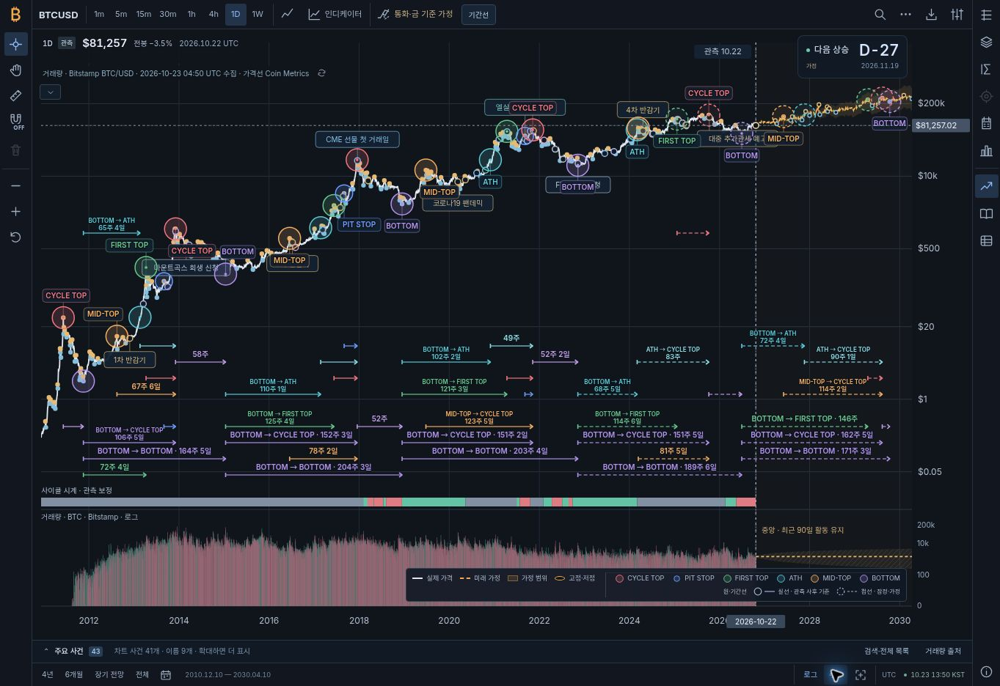
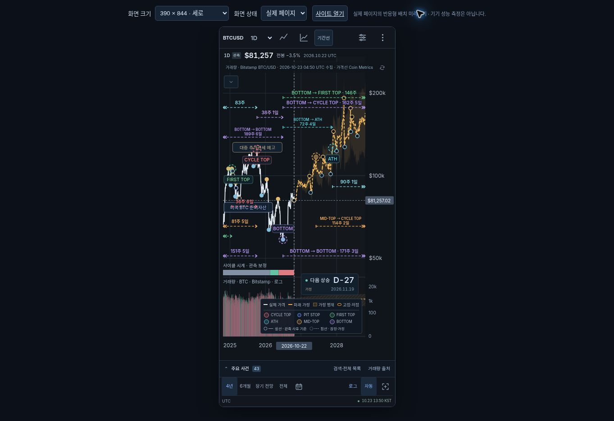

# TradingView 동작 비교에 따른 차트 개선 검증

final result: passed

검토일: **2026-10-23 UTC** · 자산: **`1.12.0-tv-parity.1`** · package: **`1.12.0`**

이번 검증은 TradingView와의 차이를 조사한 뒤 반영한 지표 접기, 보조 창 축소, 수동 가격축, 값 읽기와 이미지 저장을 대상으로 한다. **현재 작업 트리의 구현·검증 결과이며 PR 게시와 공개 배포는 대기 중이다.** 이전 가격 그래프 내부 기간선·가로 범례 검증은 [기준 커밋 `0827b66`의 QA](https://github.com/twoimo/bitcoin-cycle-atlas/blob/0827b66c3be5028cc6945416d49cfe3764eaea16/design-qa.md)에 보존한다.

공식 근거와 기준 버전의 차이 18개는 [TradingView 비교 감사](docs/TRADINGVIEW_PARITY_AUDIT_2026-10-23.md)에 있다. 아래에서는 **자동 검사**, **실제 브라우저 조작**, **검증하지 않은 범위**를 구분한다.

## 1. 사용자 요구와 반영 결과

| 요구·발견한 차이 | 이번 반영 | 검증 |
|---|---|---|
| “보조 지표 접는 것도 실제 트레이딩뷰랑 좀 다른데?” | 대표 지표 한 행을 남기던 동작을 전체 제목·값 행 접기로 통일. 지표 한 개도 접으며 복구 화살표와 차트 도형 유지 | 실제 TradingView·Atlas 캡처 비교, 단일/여러 지표 UI 조작, 상태·UI 회귀 검사 통과 |
| 모바일에서 가격 영역 확보 | 명시적 접힘 상태가 없는 620px 이하 화면은 접힌 상태로 시작. URL·템플릿·사용자 선택 보존 | 390×844·320×740에서 초기 접힘·Enter 전환·가로 넘침 없음 확인 |
| 보조 pane의 축소와 숨김이 같은 동작 | 본문 축소·복구 상태를 지표 숨김·삭제 및 legend 접기와 분리 | 실제 UI에서 제목줄 34px, 복원 330px, 숨겼다 표시해도 축소 상태 보존 |
| 가격축 직접 조절과 Auto 없음 | 오른쪽 축 드래그, 축 더블클릭 Auto, Auto 버튼, 원본 USD 수동 범위의 URL·작업 화면 저장 | 실제 축 조작·저장/공유 UI, 경계·좌표·초기화 회귀 검사 통과 |
| 좁은 로그 범위가 지나치게 압축됨 | 변동 범위에 비례한 여백과 구분 가능한 tick. 수동 화면 밖 데이터는 정확한 좌표에서 잘림 | 좁은 범위·단일 가격·수동 범위·단위 전환·숫자 경계 검사 통과 |
| 주봉 선과 선택 점, OHLC 변화율 의미가 다름 | 주봉 표시 꼭짓점과 커서를 일치시키고 일별 사이클 기준점 유지. 변화율은 동일 간격·출처 직전 종가 기준 `전봉`으로 통일 | 렌더러·읽기 검사 통과. 시가 대비 값과 봉 색은 별도 유지 |
| 주석 위 조작과 지표 내부 스크롤 충돌 | 사건·원·기간선의 Enter/Space 선택과 휠 탐색을 분리. 목록 스크롤은 차트 조작에서 제외 | 키보드·휠·제스처 회귀 검사 통과 |
| 주 가격 차트의 이미지 저장 | PNG 저장 추가, SVG 유지. 단위·축 모드·시나리오·UTC·출처 설명 포함 | 실제 UI 다운로드 후 파일 직접 열어 확인, 변환·오류 처리 검사 통과 |

`모두 숨김`은 보조 지표에 적용하고 메인 가격/OHLC·출처·범례의 독립 설정은 보존한다. 기존 즐겨찾기·템플릿·작업 화면·관측 전용 CSV의 동작도 관련 회귀 검사에 포함했다.

## 2. 실제 TradingView 비교

데스크톱의 **Bitstamp BTCUSD · 4h · Vol 한 개**를 직접 조작했다. 펼친 상태에는 Vol 제목·값과 위쪽 화살표가 있었고, 접으면 제목·값 행이 사라지며 아래쪽 화살표만 남았다. 거래량 막대는 유지됐다. 복구 버튼은 관찰한 화면에서 약 **29×21 CSS px**였다.

[03 — TradingView 펼침](docs/screenshots/tradingview-20261023/03-tradingview-legend-expanded.png), [04 — TradingView 접힘](docs/screenshots/tradingview-20261023/04-tradingview-legend-collapsed.png), [10 — Atlas 최종 데스크톱](docs/screenshots/tradingview-20261023/10-atlas-final-desktop.jpg)을 함께 열어 비교했다. DOM에 있던 숫자 `1`은 캡처에서 표시되지 않아 **화면에 지표 개수가 보인다고 주장하지 않는다.** 관찰한 크기와 화면을 모든 기기의 고정 규격으로 일반화하지 않는다.

모바일 TradingView는 실제 조작하지 않았다. 공식 문서의 모바일 동작과 이번 Atlas의 반응형 검증은 별개다. 과거 사이클 참고 이미지를 이번에 새로 비교한 것으로 기록하거나 원본 이미지·TradingView 전체와 완전히 같다는 주장을 하지 않는다.

## 3. 실제 Atlas 브라우저 검증

### 지표 접기·복원과 기존 차트 유지

| 조건 | 실제 결과 |
|---|---|
| 1363×936 데스크톱 | 주 가격 plot 높이 **833px** |
| 지표 8행 접기 | 표시 행 **0**, 복구 버튼 **29×21px**. 거래량 batch 2개·사이클 원 30개·기간선 44개 유지 |
| 접힌 상태 새로고침 | `indicator-list=closed`와 접힘 유지 |
| Vol 한 개만 있는 상태 | 접힌 뒤 표시 행 **0**, 거래량 막대 **45개** 유지 |
| 키보드 | 복구 버튼에서 **Enter**로 접기·펼치기 전환 |
| 작업 화면 저장·공유 UI | 링크에 `price-min`, `price-max`, `indicator-list=closed` 함께 보존 |

지표 수와 거래량 도형 수는 각 테스트 화면의 결과다. 모든 시간 범위·표시 유형에서 같은 개수가 나와야 한다는 기준은 아니다.

### 가격축과 보조 pane

| 실제 조작 | 관측 결과 |
|---|---|
| 오른쪽 가격축 위아래 드래그 | `manual`, min **67070.30814500689**, max **112451.4507136674** |
| 가격축 더블클릭 | **Auto 복귀**, 기존 X축 시간 범위 유지 |
| 하단 Auto 버튼 | 수동/자동 전환 동작 확인 |
| UI에서 4년 비교 추가 후 축소 | 제목·복구 진입점을 남기고 높이 **34px** |
| 같은 pane 복원 | 본문 포함 높이 **330px** |
| 축소 상태에서 눈으로 숨김→표시 | **0px→34px**, 축소 상태 유지 |

자동화 검사에서는 수동 가격 범위가 USD와 Indexed 표시에서 같은 원본 좌표를 유지하는지, 화면 밖 원·가격 태그를 화면 경계로 옮기지 않는지, 가격층의 잘림이 거래량·분석 영역을 침범하지 않는지도 확인했다.

### 모바일 반응형 측정

브라우저의 모바일 크기 앱 화면에서 확인했다. 물리 기기 성능 또는 모바일 TradingView 실측을 뜻하지 않는다.

| 화면 | body width / scrollWidth | 가격 plot 높이 | 초기 복구 버튼 |
|---|---:|---:|---:|
| 390×844 | **390 / 390px** | **693px** | **32×28px**, 접힘 |
| 320×740 | **320 / 320px** | **589px** | **32×28px**, 접힘 |

390px 화면에서 8행을 펼친 뒤 ResizeObserver 반영을 기다리고, 실제 DOM의 기간 라벨과 지표 manager·D-day·하단 범례 사각형을 대조했다. **겹침 0건**, plot 높이 **693px 유지**를 확인했다. 접기·펼치기에 맞춰 기간선의 라벨 배치를 다시 계산하며 차트 높이를 늘리지 않는다.

### 실제 PNG 다운로드

실제 저장 UI로 [09 — PNG 결과물](docs/screenshots/tradingview-20261023/09-atlas-export.png)을 다운로드했다. 파일은 **2562×1970px, 851,073 bytes**이며 직접 열어 글자·기간선·범례를 확인했다. 단위·자동/수동 축·선형/로그·선택 시나리오·UTC·자료 출처 설명이 함께 저장된다. 현재 주 가격 차트의 기간선을 한 번 포함하며, 제거한 하단 기간 패널을 덧붙이지 않는다.

PNG는 비동기 폰트 대기 전에 차트와 메타데이터를 함께 캡처한다. 변환 도중 화면이 바뀌는 코드 재현에서도 새 도형이 이전 설명과 섞이지 않았다. 실패 안내, SVG 대체 경로, Blob URL과 canvas 자원 정리를 자동 검사했다. Intraday Indexed의 내보내기 기준 날짜를 현재 거래소 마지막 완료 봉으로 수정한 내용은 코드 리뷰로 확인했다. 추가 실제 브라우저 조작에서 **1h + Indexed의 header 100.0**, **Coinbase 완료 봉 2026-10-23 03:00 UTC**, O/H/L/C와 `전봉` 변화를 확인했다. 이 조합의 SVG 다운로드 추가 시도는 브라우저 다운로드 이벤트 감지 timeout으로 파일을 확인하지 못했다. 페이지 오류는 관측되지 않았으며, 이를 실제 SVG 다운로드 통과로 기록하지 않는다. 위 PNG 파일 다운로드는 완료·열람까지 확인한 별도 결과다.

## 4. 자동 검증

이번 변경에 대해 실행한 결과다. 관련 부분집합 재실행은 아래 합계에 중복으로 더하지 않는다.

| 검사 | 결과 | 범위·근거 |
|---|---|---|
| 전체 테스트 | **55개 파일 모두 exit 0**. node:test **464/464** + 기존 custom **44/44** = **508개 통과** | `node --test tests/*.test.mjs` 및 각 파일 실행 집계 |
| 정적 자산 참조 | **86 files, 163 refs**, 통과 | [verify-static.mjs](scripts/verify-static.mjs) |
| Standalone 빌드 | **13,816,775 bytes, 61 modules**, 통과 | [build-standalone.mjs](scripts/build-standalone.mjs), 생성 산출물 정적 검사도 통과 |
| 사이클 자료 | 관측 **5,941개**, asOf **2026-10-22**, 통과 | `npm run verify:cycle` |
| 성능 경계 | 기본 렌더러 **104 SVG elements**, budget **120** 이하, 통과 | [verify-chart-performance.mjs](scripts/verify-chart-performance.mjs). Node 경계 검사이며 브라우저 프레임 속도·입력 지연·모바일 성능 측정이 아님 |
| 요청 소유권 formal | 아래 정상 모델·음성 대조·실제 변이 모두 기대 결과, 최종 gate 통과 | [verify-market-state.mjs](scripts/verify-market-state.mjs) |

이번 기능과 직접 관련된 검사: [지표 상태](tests/indicator-state.test.mjs) · [실제 legend 모듈](tests/indicator-workbench.test.mjs) · [템플릿](tests/indicator-preferences.test.mjs) · [pane](tests/analysis-focus.test.mjs) · [가격축](tests/price-axis.test.mjs) · [URL 가격 범위](tests/workspace-price-axis.test.mjs) · [탐색](tests/chart-navigation.test.mjs) · [렌더러·OHLC](tests/chart-tradingview-parity.test.mjs) · [내보내기](tests/chart-data-export.test.mjs).

### Formal 검증의 실행과 한계

공식 릴리스의 **TLC 1.7.4**를 checksum으로 고정한 실행을 이번에 새로 완료했다. 초기 제한된 sandbox에서는 Java 실행이 `EPERM`으로 막혔으나, 승인된 실행에서 검증 스크립트가 **exit 0**으로 종료했다. 이전 실행 결과 재사용으로 대체하지 않았다.

- 정상 [MarketRequests 모델](verification/market-state/MarketRequests.tla): **5,955 generated states, 2,081 distinct states**, invariant 위반 없이 완료.
- 의도적으로 guard를 제거한 [음성 대조 모델](verification/market-state/MarketRequestsBroken.tla): 예상한 **`NoStaleDisplay` invariant violation**으로 실패. 도구 오류를 성공 근거로 취급하지 않는다.
- 실제 컨트롤러의 소유권 guard 제거 변이: 예상한 **assertion failure** 발생. 정상 코드의 관련 회귀 검사는 통과.

이 검증은 요청 세대 3개와 `1m`·`5m` 간격으로 제한한 비동기 요청 소유권 모델이다. 전체 프로그램, 가격 계산 정확성, 전체 이력 페이지 처리, 실시간 지연 또는 liveness에 대한 증명으로 확대하지 않는다.

## 5. 검토 중 바로잡은 문제

1. **극단적인 수동 가격 URL:** subnormal 최소값은 단위 변환 때 0이 되어 로그 tick 반복이 끝나지 않았고, 거의 같은 두 경계는 로그 좌표를 `NaN`으로 만들 수 있었다. 숫자 범위·변환 간격 검증과 유한 tick 경계를 추가했다. `price-min=1e-323&price-max=100000` 및 `price-min=100000&price-max=100000.00000000001`을 다시 실행해 수동 범위 제거→Auto 복귀와 정상 좌표를 확인했다.
2. **Intraday Indexed 이미지 설명:** 100 기준은 거래소의 마지막 완료 봉인데 제목은 일별 Coin Metrics 날짜를 사용하던 부분을 수정했다. 현재 봉 날짜·시각을 사용하며, 일별 기준과 혼합하지 않는다.
3. **접기 이후 기간 라벨 배치:** legend/HUD 높이가 달라진 뒤 가격 차트를 다시 그려 장애물 위치를 갱신한다. 모바일에서 접었다 펼친 상태의 DOM 겹침 검사로 확인했다.
4. **비동기 PNG 화면 일관성:** 폰트 준비를 기다리기 전에 SVG와 설명을 함께 고정해 저장 도중 화면 변경이 섞이지 않도록 했다.

수정 뒤 수행한 독립 코드 리뷰에서 남은 **P0/P1 문제는 발견하지 못했다.** 이는 아래 미구현 기능까지 완료했다는 뜻은 아니다.

## 6. 남은 차이와 검증 범위

- 모바일 TradingView 실제 비교, 물리 기기 터치·성능 검증은 하지 않았다. **long-press tracking과 hold tooltip은 미구현**이다.
- 시간축 직접 드래그, **가격축 반전·Percent 축**, 표시 시작값=100, 가격만 Auto 맞춤, 세부 축 메뉴는 남아 있다. Atlas Indexed는 계속 **최근 관측값=100**이다.
- 지표별 값·축 라벨·파라미터 표시, pane 최대화·재정렬·경계 크기 조절, 임의 간격 입력, intraday 날짜·시각 이동은 이번 범위에 포함하지 않았다.
- PNG 다운로드를 추가했다. 이미지 clipboard·이미지 링크 호스팅까지 구현한 것은 아니다. 관측 전용 CSV 정책도 유지한다.
- 완료 관측과 조건부 가정을 다루는 앱이다. 실시간 quote, 미완성 봉, 거래 연결·주문·서버 알림·Pine·리플레이를 복제하거나 금융 예측 정확도를 개선했다는 주장은 하지 않는다.
- 공개 배포 성공은 추후 PR·배포 실행에서 별도로 확인해야 한다.

## 7. 실제 캡처

| 번호 | 증거 |
|---|---|
| 03 / 04 | [TradingView 펼침](docs/screenshots/tradingview-20261023/03-tradingview-legend-expanded.png) / [접힘](docs/screenshots/tradingview-20261023/04-tradingview-legend-collapsed.png) |
| 05 | [Atlas 지표 전체 접힘](docs/screenshots/tradingview-20261023/05-atlas-legend-collapsed.jpg) |
| 06 | [수동 가격축](docs/screenshots/tradingview-20261023/06-atlas-manual-price-axis.jpg) |
| 08 | [보조 pane 축소](docs/screenshots/tradingview-20261023/08-atlas-pane-minimized.jpg) |
| 09 | [실제 PNG 다운로드](docs/screenshots/tradingview-20261023/09-atlas-export.png) |
| 10 / 11 | [최종 데스크톱](docs/screenshots/tradingview-20261023/10-atlas-final-desktop.jpg) / [최종 모바일](docs/screenshots/tradingview-20261023/11-atlas-final-mobile.jpg) |

### 최종 데스크톱

### 최종 모바일

