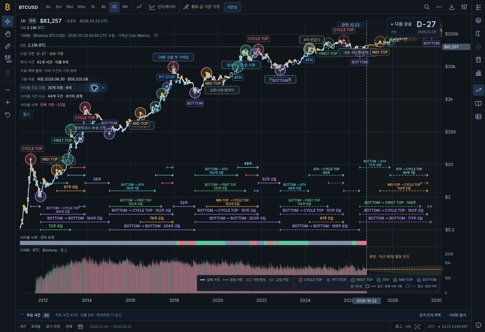
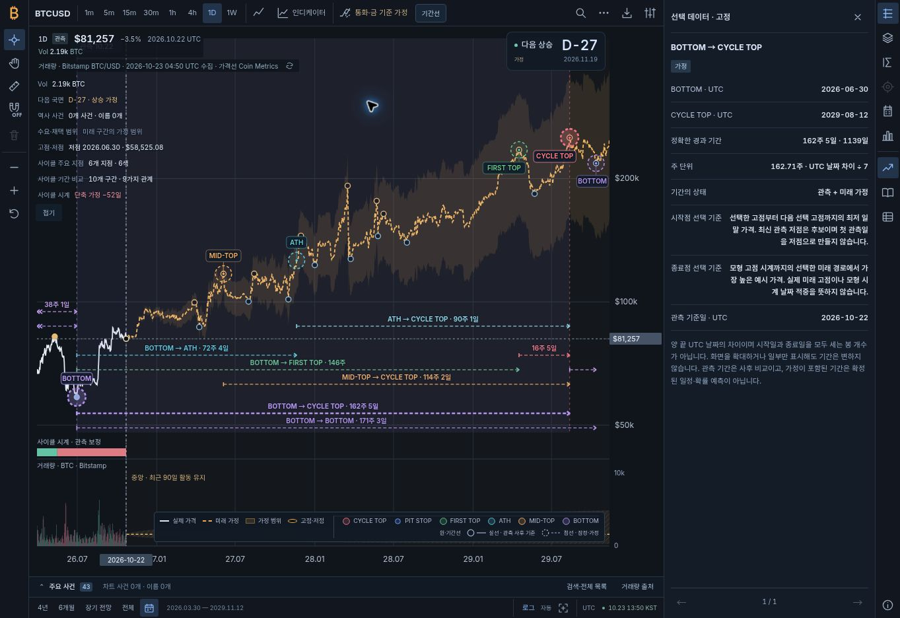

# 가격 그래프 안의 사이클 기간선·가로 범례 검증

final result: passed

검토일: 2026-10-23 UTC · 자산 버전: `1.11.0-milestones.4`

사용자의 후속 요청은 별도 하단 기간 패널을 없애고 가격 그래프 안에 기간선을 표시하며, 화면 높이를 늘리지 않고 가로 공간을 활용하는 것이다. 이 기록은 해당 변경의 실제 브라우저 검증이다. 이전 `milestones.3`의 하단 패널 검증 결과와 구분하며, 배포 성공 여부는 해당 변경의 GitHub Actions에서 별도 확인한다.

## 원본 이미지와 실제 렌더링 비교

2024-08-06에 게시된 `Insights from Bitcoin Halvings (v.3)` 원본, 사용자가 제공한 현재 하단 패널·범례 캡처, 새 구현 캡처를 직접 비교했다. 원본과 새 렌더링을 같은 이미지 검토 입력에 함께 표시해 위치·관계·색상·밀도를 확인했다. 원본의 BLX 주봉 숫자는 출처 주장으로 보존하며, 실제 기간 계산에 강제하지 않는다.

| 요청한 의미 | 현재 표시와 검증 | 결과 |
|---|---|---|
| 가격 그래프 안의 기간선 | 주 가격 SVG 내부에 44개 기간, 9종 관계. 별도 기간 SVG·하단 패널·날짜축 없음 | 통과 |
| 너비 활용 | 겹치지 않는 날짜 구간은 같은 높이 사용. 충분한 폭이면 관계와 기간 한 줄, 좁으면 관계/기간 두 줄 | 통과 |
| 높이 유지 | 1363×936 화면에서 body와 scrollHeight 모두 936px. 기간선 켜기/끄기 전후 가격 SVG 높이 833px 동일 | 통과 |
| 여섯 색 원 | CYCLE TOP 빨강, PIT STOP 파랑, FIRST TOP 초록, ATH 청록, MID-TOP 주황, BOTTOM 보라 | 통과 |
| 원·범례 일치 | 동일 색상 정의 사용. PIT STOP은 다른 단독 원의 78% 반지름이며 범례도 4.68/6 비율 | 통과 |
| 관측·잠정·가정 구분 | 원·기간선의 실선/점선 견본과 설명 제공. 금색 미래 가격 점선과 의미 구분 | 통과 |
| 오른쪽 아래 가로 범례 | 실제 가격·미래 가정·가정 범위·고점·저점과 여섯 색 원을 가로로 함께 배치 | 통과 |
| 기간선만 표시 | 원을 숨겨도 44개 기간선과 여섯 범례·상태 설명 유지 | 통과 |

넓은 화면의 전체 보기는 원 30개, 기간 44개를 표시했다. 기간 라벨은 전체 한 줄 10개, 관계/기간 두 줄 12개, 기간만 8개, 겹침 방지를 위해 상시 글자만 생략한 14개였다. **44개 선과 실제 끝점은 모두 유지**한다. 생략된 관계·날짜·주·일·상태는 선에 포인터를 올리거나 키보드 초점을 주고 선택하면 확인할 수 있으며, 관계 필터나 확대 시 가용 너비에 맞춰 다시 표시한다. 모든 글자를 무조건 겹쳐 그리거나 차트 높이를 늘리지 않는다.

## 실제 브라우저 확인

Chrome의 실제 개발 미리보기와 `mobile-preview.html`의 앱 iframe을 사용했다. 모바일 iframe은 반응형 배치 검증이며 실기기 성능 측정은 아니다.

| 확인 항목 | 실제 관측 결과 |
|---|---|
| 전체 사이클 | 2010-12-10–2030-04-10. 원 30개·유형 6개·기간 44개·관계 9개 |
| 가격 SVG | 데스크톱 너비 1281px, 높이 833px. 페이지 전체 높이 936px 유지 |
| 하단 패널 제거 | `atlas-cycle-timeline`, `atlas-cycle-body` 없음. 기존 상단 도구줄에 기간선 메뉴 배치 |
| 미래 구간 키보드 선택 | Enter로 `BOTTOM → CYCLE TOP`, 2026-06-30 → 2029-08-12, 1,139일 = 162주 5일 선택 |
| 선택 범위 맞춤 | `전체 구간 보기`로 2026-03-30–2029-11-12 표시. 선택 구간·두 원·날짜 안내선 유지 |
| 날짜 좌표 일치 | 상세를 연 961px SVG에서 기간 x=72.290249/818.709751, 원과 안내선 x=72.29/818.71. 표시 정밀도 차이만 있음 |
| 숨기기/보이기 | 기간선 0개로 숨기고 다시 표시. 가격 SVG 833px·body 936px 유지 |
| 원만 숨기기 | 원 0개, 기간 44개, 범례 6개 유지 |
| 640px 메뉴 | x=52–594, 너비 542px, 높이 220px. 화면 안에서 제목·관계 필터·조작부 접근 가능 |
| 앱 오류 | 앱 코드 오류 미관측. 수집된 오류는 `chrome-extension://` 메타데이터 전송 오류로 별도 구분 |

### 반응형 실측

| 화면 | body / scrollWidth | 범례 너비×높이 | 추가 확인 |
|---|---:|---:|---|
| 1363×936 | 1363 / 1363px | 682.56×46px | 기존 도구줄 높이 40px 유지, 가격과 원의 범례를 가로 배치 |
| 390×844 | 390 / 390px | 225.69×78px | 여섯 원은 3열×2행, D-day와 범례 사이 8px |
| 320×740 | 320 / 320px | 225.69×78px | 도구줄 마지막 조작부 오른쪽 306.05px, 지표 목록 내부 높이 96px |
| 640×800 | 640 / 640px | 가용 폭에 따른 반응형 | 기간선 메뉴 왼쪽 52px·오른쪽 594px |

## 검토 중 수정한 문제

1. 초기 압축 배치에서 숫자만 보이는 기간이 많아 관계를 읽기 어려웠다. 관계/기간의 두 줄 라벨을 추가하고, 선택한 라벨을 우선 배치하며 마지막 충돌 검사를 적용했다.
2. 기존 전역 CSS의 `!important` 2열 규칙이 새 범례에도 적용됐다. 이전 차트 ID에만 한정하여 새 모바일 범례의 3열 배치를 복구했다.
3. 320px 도구줄 오른쪽 버튼이 약 12px 잘렸다. 작은 화면의 간격·버튼 너비를 조정하여 마지막 버튼이 306.05px 안으로 들어오도록 했다.
4. 펼친 모바일 지표 목록이 그래프를 지나치게 덮었다. 기간선 표시 중에는 96px 안에서 내부 스크롤하며 모든 지표 조작은 유지한다.
5. 621–680px에서 기간선 메뉴가 상위 영역 밖으로 잘릴 수 있었다. 621–1000px 메뉴를 화면 안의 고정 좌우 경계로 배치하고 640px에서 확인했다.
6. 원을 숨기면 기간선의 범례도 사라졌다. 화면과 SVG 저장 모두 기간선 표시 상태도 범례 조건에 포함했다.
7. PIT STOP 범례 원의 비율과 미래 MID-TOP 설명을 실제 렌더러·선정 규칙에 맞췄다. 기존 ‘아래 기간 차트’ 설명도 현재 위치에 맞게 수정했다.

## 자동 검증

[기계 판독 검증 기록](docs/data/cycle-in-chart-verification.json)에 실행 시점, 결과와 소스 해시를 보존한다.

- 전체 직접 실행: **51개 파일, node:test 421개 + custom 44개 = 465개 통과**. 실패·취소·건너뜀 없음.
- 최종 CSS·문구 수정 후 관련 **9개 파일 105개 사례 재실행 통과**. 전체 465개의 부분집합이므로 합산하지 않는다.
- `verify:cycle`, `verify:performance`, `verify:static`, standalone 빌드와 standalone 정적 검증, `git diff --check` 통과.
- 최종 standalone: 13,681,407 bytes, 60개 모듈, 관측치 5,941개. 현재 12개 CSS 모두 포함.
- 성능 게이트: 기본 렌더러 SVG 98개로 120개 미만 기준 충족, 관측 캔들·거래량 자료 각 5,545개 보존. 전체 주석 화면의 DOM 개수 또는 실제 브라우저 지연 측정값은 아니다.
- 기간선 켜기/끄기의 가격 좌표·SVG 크기 불변, 끝점·윤년·화면 잘림, 9종 관계, 좁은 배치, hover/focus·키보드 선택, SVG 단일 포함을 회귀 검사한다.
- 소유권 formal 검증은 관련 소스·모델·테스트 무변경 및 컨트롤러 해시 일치 확인 후 이전 실제 실행 기록을 재사용했다. 이번 로컬 반복에서 새로 실행했다고 주장하지 않는다.

## 검증 한계와 의미

SVG 저장은 주 가격 SVG의 현재 기간선을 한 번 포함하고 별도 하단 기간 패널을 추가하지 않는다. hover 전용 설명을 제외하며 원 또는 기간선이 보이면 범례를 포함한다. 이 구조는 자동 검증했다. 이번 반복에서는 브라우저 파일 다운로드를 다시 실행하지 않았으므로 실제 다운로드 성공을 새 결과로 주장하지 않는다. 기존 비교 차트 PNG 기능은 이번 범위에 포함하지 않는다.

원본의 152주·122주 등의 반복 수치를 고정 입력으로 쓰지 않는다. 기간은 실제 두 UTC 날짜의 차이로 계산하며, 일말 자료·기준점 정의와 원본 BLX 주봉의 차이를 명시한다. 미래 지점은 현재 선택한 조건부 경로에 속하며, 조건을 충족하지 않는 FIRST TOP/PIT STOP 등을 표시 개수를 맞추려고 추가하지 않는다. 2030년 이후 가치평가 날짜를 반복 사이클 고점으로 만들지 않는다.

## 실제 캡처

### 전체 사이클 — 가격 그래프 안의 기간선

### 미래 기간 선택과 정확한 두 끝점

### 320×740 — 높이를 늘리지 않는 반응형 배치

