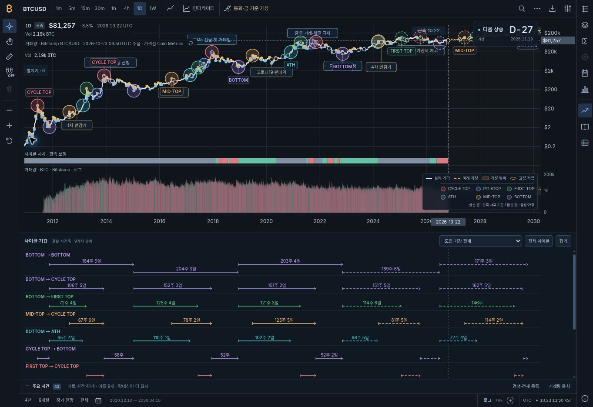
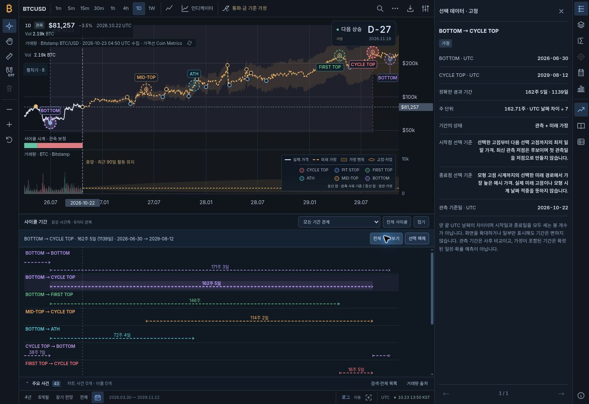
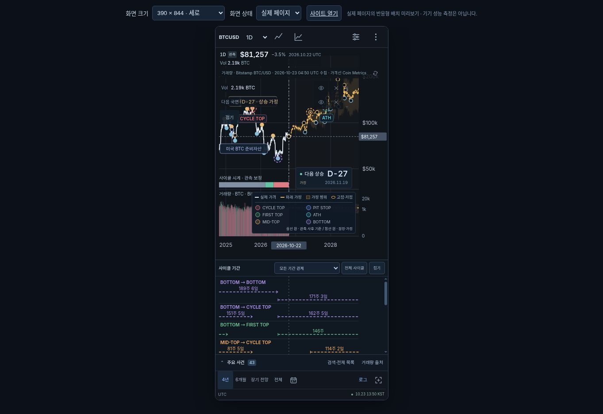
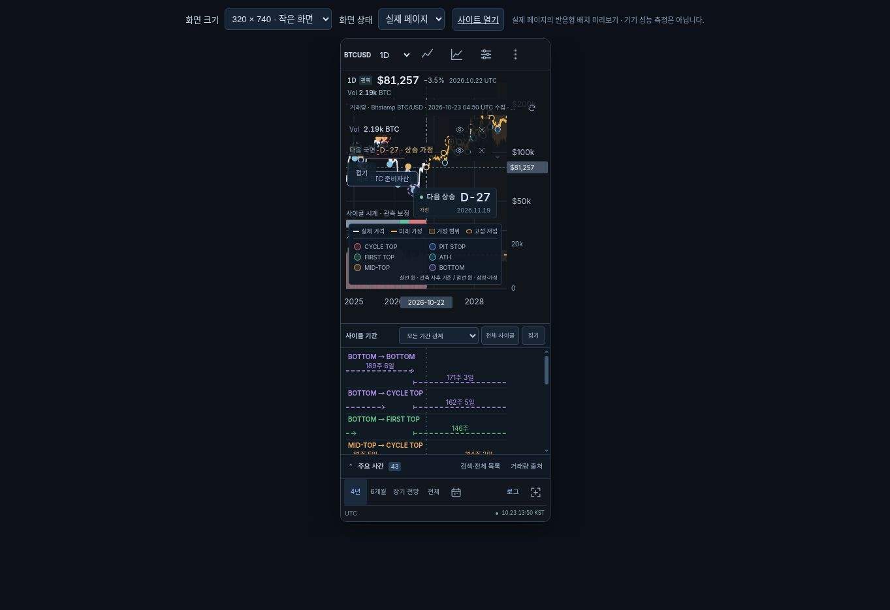

# 사이클 기준점·기간 연결 화면 검증

final result: passed

**상태: passed — 요청된 사이클 표시·연결 선택·반응형 범례 범위**  
검토일: 2026-10-23 UTC · 자산 버전: `1.11.0-milestones.3`

이 기록은 실제 브라우저에서 렌더링한 개발 미리보기와 사용자가 제공한 두 이미지를 비교한 결과다. 배포 완료를 나타내는 문서는 아니다. 최종 배포 상태는 해당 커밋의 GitHub Actions 결과로 별도 확인한다.

## 비교 대상과 판단 기준

첫 이미지의 `Insights from Bitcoin Halvings (v.3)`는 여섯 종류의 색상 원과 아홉 종류의 기간 관계를 표현한다. 두 번째 이미지는 같은 여섯 색 범례만 확대한 것이다. 원본의 흰 배경·정적인 주 수를 복제하는 대신 기존 앱의 어두운 차트, 관측 데이터와 조건부 미래 경로에 같은 의미 체계를 연결하는 것이 이번 검토 범위다. 원본의 주 수와 실제 UTC 날짜 차이의 구분은 [방법론](docs/CYCLE_MILESTONES.md)에 보존한다.

| 원본의 의미 | 실제 화면에서 확인한 표현 | 결과 |
|---|---|---|
| CYCLE TOP / PIT STOP / FIRST TOP / ATH / MID-TOP / BOTTOM | 붉은색 / 파란색 / 초록색 / 청록색 / 주황색 / 보라색 원. 전체 보기에 6종류 모두 존재 | 통과 |
| 색상 원이 해당 가격 지점에 놓임 | 좌표 이동 없이 원래 UTC 날짜·가격에 배치. 겹친 유형은 동심원. 주별 선의 일별 기준점 연결도 자동 회귀 검사 | 통과 |
| 아홉 관계의 수평 기간 비교 | 같은 날짜축의 9개 행, 관계 필터, 내부 스크롤. 전체 보기에서 30개 원·44개 기간 | 통과 |
| 기준점과 기간의 연결 | 기간 선택 시 두 원·세로 날짜 안내선·해당 구간 음영이 함께 강조됨 | 통과 |
| 두 번째 이미지의 범례 | 기존 실제 가격·미래 가정·가정 범위·고점·저점 범례 아래에 여섯 색 원을 함께 표시 | 통과 |
| 관측과 미래 가정 구분 | 관측 사후 기준은 실선, 잠정·가정은 점선. 상세에 실제 가격 출처와 선정 기준을 표시 | 통과 |

원본과 구현의 이미지를 같은 검토 세션에서 직접 비교했다. 원본에는 있지만 현재 선정 규칙을 만족하지 않는 PIT STOP 등을 표시 수를 맞추기 위해 추가하지 않는다. 최신 관측이나 시나리오가 달라지면 원·기간의 수와 위치도 달라진다.

## 실제 브라우저 검증

Chrome 개발 미리보기, 데스크톱 1363×936 및 기존 `mobile-preview.html`의 실제 앱 iframe 390×844 / 320×740에서 확인했다. 모바일 에뮬레이션은 반응형 배치 검증이며 실기기 성능 측정이 아니다.

| 확인 항목 | 관측 결과 |
|---|---|
| 전체 사이클 | 2010-12-10–2030-04-10 표시 범위. 원 30개, 기간 44개, 유형 6개, 관계 행 9개 |
| 전체 보기 시간축 | 가격 SVG와 기간 SVG의 물리적 너비가 모두 1,281px. 스크롤바가 기간축을 축소하지 않음 |
| 미래 기간 선택 | `BOTTOM → CYCLE TOP`, 2026-06-30 → 2029-08-12, 1,139일 = 162주 5일 |
| 전체 구간 보기 | 두 끝점을 포함한 2026-03-30–2029-11-12로 확대. 실제 두 원과 두 안내선 유지 |
| 선택 후 시간축 | 상세 패널이 열린 961px SVG에서 가격 안내선 x=72.29 / 818.71, 기간선도 `M72.29,91H818.71`로 일치 |
| 화면 밖 끝점 | 2022-11-09 → 2025-10-06 기간을 일부만 표시할 때 1,062일을 유지. 실제 화면 안의 2025-10-06 원·안내선만 표시하고 구간 음영은 경계에서 자름 |
| 시나리오 교체 | 기준 수요의 선택 기간을 수요 훼손 가정으로 변경하면 기존 선택 요약·강조 원·음영 제거. 현재 가정에서 다시 계산한 지점만 남음 |
| 주별·캔들 | 1W 및 캔들 전환 완료 후에도 표시 범위의 원 5개, 관계 행 9개, 범례 6개 유지 |
| 키보드 | 320px에서 기간선에 Enter로 선택. 상세에 2022-11-09 → 2025-10-06, 1,062일 표시 |
| 모바일 선택 확대 | 320px에서 두 원을 함께 표시. 가격 안내선 x=24.972 / 237.028, 기간선도 같은 x 좌표. 요약과 두 조작 버튼이 화면 안에 있음 |
| 패널 제어 | 모바일 관계 선택 및 접기 동작 확인. 접을 때 본문 `hidden=true` |
| 앱 콘솔 | 데스크톱 앱 오류 없음. 모바일에서 포착된 오류는 브라우저 확장 프로그램 메타데이터 전송 오류이며 앱 스크립트 오류는 확인되지 않음 |

### 모바일 범례 실측

| 실제 iframe 크기 | body / scrollWidth | 가격 / 기간 SVG 너비 | D-day 아래→범례 위 간격 | 여섯 범례 |
|---|---|---|---:|---|
| 390×844 | 390 / 390px | 390 / 390px | 13px | 모두 보임 |
| 320×740 | 320 / 320px | 320 / 320px | 13px | 모두 보임 |

320px에서 관계 선택·전체 사이클·접기 조작부의 오른쪽 끝은 각각 211.06px / 273px / 313px였다. 가로 넘침 없이 조작 가능하다. 작은 화면의 지표 목록과 기간 행은 내부 스크롤을 사용한다.

## 확인하며 수정한 문제

- 기간 패널에 세로 스크롤바가 생기면 SVG가 가격 차트보다 10px 좁게 표시되어 같은 날짜의 위치가 약 8px 어긋났다. 두 SVG의 실제 너비를 일치시켜 해결했다.
- 주별·픽셀 축약에서 일별 기준점이 제거되어 원과 가격선이 분리될 수 있었다. 표시 중인 유효 기준점의 원래 관측을 선의 연결점으로 보존한다.
- 화면 밖 끝점이 가격 렌더러에서 미리 제거되면 선택 구간의 음영도 사라졌다. 전체 원본 끝점으로 구간을 계산한 뒤 표시 범위만 자르도록 수정했다.
- 미래 저점 탐색 창이 일부만 제공되었는데도 전체 창을 검토한 것처럼 표시될 수 있었다. 실제 사용 구간·요청한 끝 날짜·부분 창 상태를 구분한다.
- 관측 가격이 미래 모형 기준으로 선정된 경우와 잠정 고점에 의존하는 FIRST TOP/PIT STOP의 상태가 충분히 구분되지 않았다. 가격 출처와 선정 규칙 출처 및 잠정 상태를 별도로 전달한다.

## 자동 검증

[기계 판독 기록](docs/data/cycle-reference-verification.json)에 실행 결과와 코드 해시를 보존한다.

- 50개 테스트 파일 직접 실행: **node:test 405개 + 자체 검사 44개 = 449개 통과**, 실패·취소·건너뜀 0.
- 별도 `npm test` 실행: 파일 단위 50/50 통과. 이를 개별 사례 수와 중복 합산하지 않는다.
- `verify:cycle`, `verify:performance`, `verify:static`, standalone 빌드 및 정적 검증 통과.
- 성능 검사: SVG 요소 101개, 120개 미만 기준 충족. 캔들 및 거래량 자료 5,545개를 보존.
- `verify:formal`: 고정된 TLC 1.7.4 해시 검증, 유한 상태 소유권 모델 통과, 깨진 모델과 실제 코드 변이의 예상 실패 확인. 가격 정확성이나 시장 예측을 증명하는 검사는 아니다.
- 독립 코드 검토에서 추가 차단 결함 없음.

## 내보내기와 검토 한계

통합 차트의 기존 SVG 내보내기는 현재 가격 SVG의 선택 음영·원·날짜 안내선을 복제하고 기간 SVG와 여섯 색 범례를 추가한다. 자동 검사와 코드 연결을 검토했다. `모든 기간 관계`일 때 스크롤 아래의 행과 접힌 기간 본문도 내보내기에 포함되며, 한 관계 필터를 선택하면 해당 관계만 포함된다.

**이번 로컬 브라우저의 실제 파일 다운로드 재검증은 blocked**: 다운로드 이벤트 대기가 시간 초과되었고 새 SVG 파일이 동기화된 것을 확인하지 못했다. 앱 콘솔 오류는 없었다. 이를 다운로드 성공으로 기록하거나 이전 세션의 SVG를 이번 결과물로 사용하지 않았다. 이는 요청된 차트 화면 표시 검증과 별도로 남긴 제한이다. 기존 PNG 기능은 별도의 비교 차트용이며 이번 통합 SVG 검증 범위에 포함하지 않는다.

현재 화면에서 기준일 이후의 원·기간은 선택한 예시 경로의 분류다. 2030년 이후의 장기 가치평가 지점을 반복 4년 사이클로 만들지 않는다. 전체 이미지의 모든 기간에 같은 숫자가 반복된다는 이유로 모델의 날짜나 가격을 바꾸지 않았다.

## 실제 캡처

### 전체 사이클

### 미래 기간 연결 선택

### 모바일 390×844

### 모바일 320×740

