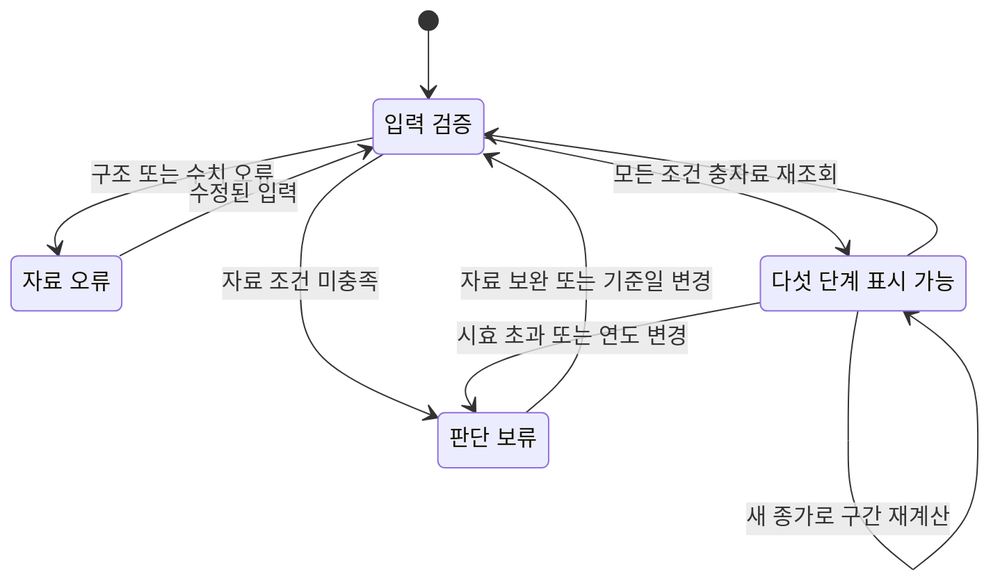

# 자산별 연초 대비 위치 — 계산·판단 규칙

확인일: 2026-10-25 UTC. 구현: [`dist/asset-comparison.js`](../dist/asset-comparison.js).

이 표는 17개 자산의 실제 일별 종가로 **과거 각 연도의 연초 대비 상승·하락 범위와 올해의 가격 위치**를 비교한다. 마지막 열은 요청된 다섯 단계인 **적극 매수 · 분할 매수 · 중립 · 분할 매도 · 적극 매도**를 표시한다. 조건을 충족하지 못하면 `판단 보류`로 표시한다.

참고 이미지의 평균 계산 원식은 제공되지 않았다. 아래 정의는 이번 구현에서 명시적으로 선택한 재현 가능한 해석이다. 이미지의 숫자를 복사하거나, 알 수 없는 원식을 그대로 재현했다고 주장하지 않는다. 평균 낙폭을 MDD로 부르지 않는다.

## 1. 가격과 날짜의 기준

- 가격은 모두 USD 표시의 **주식분할을 반영한 일별 종가**다. Yahoo Finance 응답의 `quote.close`를 사용한다. 배당·분배금 재투자를 반영하는 `adjclose`와 섞지 않는다.
- 세션 날짜는 미국 거래소의 `America/New_York` 날짜다. 일별 거래소 자료이므로 주말·휴일을 보간하지 않는다.
- 수집기는 조회 UTC 날짜보다 앞선 세션만 확정 관측으로 보존한다. 엔진은 공급받은 확정 일별 관측을 계산하며, 장중 호가를 종가로 만들지 않는다.
- 계산 기준일 `asOfDate` 이후의 관측은 모든 계산에서 제외한다. 옵션을 생략하면 번들의 시간대가 명시된 `retrievedAt`에서 UTC 날짜를 얻는다. 공개 화면은 **오늘의 UTC 날짜**를 전달해야 저장된 예전 자료가 최신 판단처럼 남지 않는다.
- 날짜·가격의 구조 오류, 비양수·비유한 가격, 역순·중복 날짜, 중복 티커, 잘못된 통화·관측 주기·가격 조정 방식은 오류로 중단한다. 숫자 연산이 오버플로·언더플로를 일으켜도 결과를 정상 숫자로 꾸미지 않는다.

Yahoo는 `Adjusted close`가 분할과 배당 분배를 반영한다고 설명한다. 따라서 가격 기준을 구분하는 것이 필요하다. 원자료 수집·상장일·좁은 구간 재조회 검증은 [자료 설명](ASSET_COMPARISON_DATA.md) 및 [수집 보고서](data/asset-comparison-acquisition.json)에 기록한다. [Yahoo 가격 정의](https://help.yahoo.com/kb/SLN28256.html)

### 분배금 때문에 가격 낙폭과 투자 손실이 다른 실제 사례

Yahoo의 PDBC 좁은 구간 응답에서 2021-12-02 종가는 `20.290000915527344`, 다음 거래일 2021-12-03 종가는 `14.899999618530273`이다. 같은 응답은 12월 3일 분배금 `5.39`를 기록한다. 종가만 보면 약 **−26.56%**지만 현금 분배를 포함한 투자자의 손실과 같은 뜻은 아니다. 이 두 날짜의 공급자 배당 조정 종가는 약 `10.27994919`와 `10.27994823`으로 거의 같다. 이는 서로 다른 가격 정의를 섞으면 안 되는 구체적인 예다. [Yahoo 원응답 요청](https://query1.finance.yahoo.com/v8/finance/chart/PDBC?period1=1638316800&period2=1639180800&interval=1d&events=history%2Csplits%2Cdividends)

해당 원응답 SHA-256은 `20bb66857fef202f9b6f47d67a30a8559c9a3175dd23247d138a17004a93df4d`다. 이번 표는 일관된 **가격 비교**를 위해 종가 기준을 유지한다. 특히 PDBC, TLT, IEF 등 분배가 있는 상품의 평균 낙폭·판단을 배당 포함 총수익률이나 실제 손실률로 해석하면 안 된다.

## 2. 연도별 표본과 평균

비교 기준일의 연도를 $Y$, 이전 연도 $y$의 시간순 관측 종가를 $P_{y,1},\ldots,P_{y,n_y}$라 한다. 해당 연도의 기준가는 첫 관측 거래일 종가 $B_y=P_{y,1}$다.

$$
U_y=100\left(\frac{\max_i P_{y,i}}{B_y}-1\right),\qquad
D_y=100\left(\frac{\min_i P_{y,i}}{B_y}-1\right)
$$

$B_y$ 자체가 관측 집합에 있으므로 항상 $U_y\geq0$, $D_y\leq0$다. 상승한 연도만 골라 상승 평균을 내거나 하락한 연도만 골라 낙폭 평균을 내지 않는다. 예를 들어 연초 이후 한 번도 연초 종가 아래로 내려가지 않았다면 그해 $D_y$는 0으로 평균에 포함된다.

$$
S=\{y\mid y<Y,\ n_y>0\},\qquad N=|S|,\qquad
U=\frac{1}{N}\sum_{y\in S}U_y,\qquad
D=\frac{1}{N}\sum_{y\in S}D_y
$$

`평균 상승`은 $U$, `평균 낙폭`은 $D$다. 거래일 수로 가중하지 않고 **각 관측 연도에 같은 비중**을 준다. 현재 연도 $Y$는 평균과 표본 연수에서 제외한다. 일별 가격 평균, 연말 수익률 평균, CAGR, 상승 연도 조건부 평균과는 서로 다른 지표다.

### 최초 상장·관측 연도의 부분기간

참고 이미지의 AAPL 46년처럼 최초 상장 연도의 짧은 기간도 표본에 포함한다. 이는 완전한 12개월 표본 46개라는 뜻이 아니다. 화면은 표본 연수 옆의 표시와 최초 관측일로 부분기간 포함 사실을 밝힌다.

처음 관측한 날짜가 그해 1월 7일 이후면 `samplePartialFirstYear=true`로 표시한다. 이는 일별 거래소 달력 전체를 재구축하지 않는 실용적인 표시 규칙이다. 1월 첫 주에 시작된 기록의 완전성을 독립적으로 인증한다는 뜻은 아니다. 현재 17개 자산의 최초 관측은 모두 이 부분기간 표시 대상이다.

자료가 없는 연도를 채워서 표본을 늘리지 않는다. 예를 들어 2021·2022·2024·2025만 있다면 표본은 4년이며 2023년을 결측으로 표시하고 판단을 보류한다. 일부 날짜만 가진 과거 연도는 관측된 표본으로 남지만, 확인된 공백이 있으면 판단에 사용하지 않는다.

### 2026년 비교에서 확보한 표본

2026-10-25 수집 번들에는 **17개 자산, 97,987개 일별 종가, 현재 연도를 제외한 384개 연도 표본**이 있다. 모든 자산의 최근 확정 종가는 2026-10-23이고, 올해 첫 관측 종가는 2026-01-02다. 아래 연수는 최초 부분연도를 포함한다. [계산 입력](../dist/data/asset-comparison.json)

| 자산 | 첫 표본 연도 | 마지막 표본 연도 | 표본 연수 |
| --- | ---: | ---: | ---: |
| SPY | 1993 | 2025 | 33 |
| QQQ | 1999 | 2025 | 27 |
| NVDA | 1999 | 2025 | 27 |
| AAPL | 1980 | 2025 | 46 |
| GOOG | 2004 | 2025 | 22 |
| MSFT | 1986 | 2025 | 40 |
| AMZN | 1997 | 2025 | 29 |
| META | 2012 | 2025 | 14 |
| AVGO | 2009 | 2025 | 17 |
| PLTR | 2020 | 2025 | 6 |
| TSLA | 2010 | 2025 | 16 |
| HOOD | 2021 | 2025 | 5 |
| TLT | 2002 | 2025 | 24 |
| IEF | 2002 | 2025 | 24 |
| GLD | 2004 | 2025 | 22 |
| SLV | 2006 | 2025 | 20 |
| PDBC | 2014 | 2025 | 12 |

PDBC의 최초 관측은 **2014-11-07**이며 2014년의 37개 종가를 확보했다. 같은 포함 규칙을 적용하면 2014–2025는 **12개 연도**다. 참고 이미지의 11이라는 값에 맞추기 위해 실제 표본을 삭제하지 않았다.

## 3. 평균 낙폭과 MDD의 구분

이번 표의 평균 낙폭은 **각 연도 첫 종가에서 그해 최저 종가까지**의 변화다. MDD는 **먼저 발생한 고점에서 그 이후의 저점까지**의 최대 하락이다. 시간 순서가 필요하다. MathWorks의 MDD 문서도 고점에서 이후 저점까지의 하락과 기간 인덱스를 함께 설명한다. 이 문서는 손실 크기를 양수로 표시하는 문헌과 달리, 표의 하락 표기와 일치하도록 MDD를 음수로 저장한다. [MathWorks MDD 정의·예제](https://www.mathworks.com/help/finance/maximum-and-expected-maximum-drawdown.html)

$$
H_{y,j}=\max_{1\leq i\leq j}P_{y,i},\qquad
MDD_y=100\min_j\left(\frac{P_{y,j}}{H_{y,j}}-1\right)
$$

예를 들어 종가가 `100 → 150 → 90 → 120`이면 연초 대비 최저 낙폭은 **−10%**, MDD는 `150 → 90`의 **−40%**다. `100 → 50 → 200`이면 MDD는 **−50%**다. 나중에 나온 200을 이전의 50과 연결해 −75%라고 계산하면 시간 순서를 위반한다.

감사 용도로 각 `samples`에 `mddPct`, `mddPeakDate`, `mddTroughDate`를 보존하고, 연도별 MDD의 산술평균을 `meanMddPct`로 내보낸다. **이 값은 판단 경계에 사용하지 않는다.** 또한 각 연도 안에서 고점을 새로 추적하므로 전체 보유기간을 가로지르는 한 번의 MDD와도 다르다. 과거 평균 낙폭이나 평균 MDD는 앞으로 발생 가능한 손실의 상한이 아니다.

### 시간 순서를 지키는 선형 알고리즘의 근거

고정된 $j$에서 양수인 $P_{y,j}/P_{y,i}$를 가장 작게 만드는 과거 $P_{y,i}$는 $i\leq j$의 최대 가격이다. 따라서 다음 두 표현은 같다.

$$
\min_j\left(\frac{P_{y,j}}{H_{y,j}}-1\right)
=\min_{1\leq i\leq j\leq n_y}\left(\frac{P_{y,j}}{P_{y,i}}-1\right)
$$

구현은 현재까지의 최대 가격을 유지하여 한 번 순회한다. 독립 검증기는 가능한 모든 시간순 쌍을 직접 검사하여 같은 결과인지 비교한다. 이는 알고리즘과 정의의 일치에 대한 근거이며 가격 예측의 근거가 아니다.

## 4. 올해 위치와 다섯 단계

올해 첫 확정 관측 종가를 $B_Y$, 기준일까지의 최근 확정 종가를 $C_t$라 하면,

$$
r=100\left(\frac{C_t}{B_Y}-1\right)
$$

이번 화면은 **1월 첫 거래일 종가 기준**이므로 전년 마지막 거래일 종가를 분모로 쓰지 않는다. 다른 서비스의 일반적인 연초 수익률과 숫자가 다르면 기준일 차이를 먼저 확인해야 한다. 코드의 `ytdPct`는 이 문서에서 정의한 $r$이다.

충분한 자료가 있고 $D<0<U$일 때 다음 규칙을 적용한다.

| 마지막 열 | 코드 ID | 정확한 구간 | 의미 |
| --- | --- | --- | --- |
| 적극 매수 | `strong-buy` | $r\leq D$ | 과거 평균 낙폭 경계에 도달하거나 더 하락 |
| 분할 매수 | `buy` | $D<r\leq D/2$ | 평균 낙폭의 절반부터 평균 낙폭 경계 전까지 |
| 중립 | `neutral` | $D/2<r<U/2$ | 상승·하락 양쪽 절반 경계 사이 |
| 분할 매도 | `sell` | $U/2\leq r<U$ | 평균 상승의 절반부터 평균 상승 경계 전까지 |
| 적극 매도 | `strong-sell` | $r\geq U$ | 과거 평균 상승 경계에 도달하거나 더 상승 |

**절반 경계와 다섯 단계 명칭은 해석을 쉽게 하기 위한 운영 규칙**이다. 데이터에 맞춰 최적화한 수익률 임계값이나 통계적으로 검증된 성공 확률이 아니다. `적극`은 이 표의 평균 범위 바깥이라는 뜻이다. `분할`은 매매 회수·주문 금액·비중을 정하는 수학적 최적화 결과가 아니다.

판단은 반올림하지 않은 숫자로 실행한다. 화면에 `50.00%`로 보이더라도 실제 값이 50%보다 조금 작으면 50% 경계 아래 단계에 남을 수 있다. 표시용 소수점 반올림을 계산 입력으로 다시 사용하지 않는다.

### 빠짐과 중복이 없다는 근거

$D<0<U$이면 $D<D/2<U/2<U$이다. 위 다섯 구간은 실수 전체를 나누고, 각 경계의 등호를 한쪽에만 배정했다. 따라서 유효한 $r$은 정확히 하나의 단계에 속한다. $U=0$ 또는 $D=0$이면 이러한 엄격한 경계 순서가 없어지므로 임의로 중립을 출력하지 않고 판단을 보류한다.

새 관측은 여러 경계를 한 번에 넘을 수 있다. 예컨대 중립에서 적극 매도로 바로 바뀔 수 있으며, 단계별 순차 이동을 강제하지 않는다. 가격이 경계를 오가면 단계도 바뀔 수 있다. 이전 라벨을 유지시키는 별도 지연·확인 규칙은 없다.

## 5. 판단을 보류하는 조건과 상태 전이

다음 중 하나면 숫자를 확보한 범위까지만 보여주고 마지막 열은 `판단 보류`가 된다.

- 과거 표본이 **5개 연도 미만**이다. 최초 부분연도도 1개로 센다. 5개는 최소 표시 운영 기준이며 통계적 신뢰성 보증이 아니다.
- 올해 첫 관측 기준가 또는 올해의 최근 종가가 없다.
- 최근 종가가 기준일보다 **7일 넘게** 오래되었다. 7일은 주말·휴일을 감안한 보수적 운영 기준이며 공식 거래소 휴장 달력의 대체물이 아니다.
- 공급자가 알려준 `missingDates`, 관측이 전혀 없는 과거 연도, 관측 사이 **7일 초과** 간격이 있다.
- 올해 첫 관측이 1월 7일 이후라 올해 초 자료를 갖추지 못했다.
- 상승·낙폭 중 한쪽 평균 범위가 없거나 현재 변화율을 유효하게 계산할 수 없다.

`coverage.status='observed'`는 위 검사에서 알려진 공백을 찾지 못했다는 뜻이다. 모든 역사적 거래소 세션의 존재를 독립 인증한다는 뜻은 아니다. 공급자에 표시되지 않은 짧은 내부 결측은 추가 거래소 달력 없이는 검출할 수 없다. `coverage.missingYears`, `missingDates`, `gapCount`, `issues`를 감사에 남긴다.

아래는 **데이터에 따라 판단을 표시할 수 있는지**의 상태 전이다. 시장이 상승·횡보·하락할 순서를 예측하는 상태 모형이 아니다. `표시 가능` 상태의 마지막 열은 위 다섯 구간 중 하나다.



엔진은 이전 화면 상태를 읽지 않는 순수 함수다. 같은 번들과 같은 기준일에는 같은 결과가 나온다. 새해에 기준가가 아직 없다면 작년 기준가를 올해 기준가처럼 재사용하지 않는다. 과거 기준일을 넣는 기능은 **날짜 이후의 관측 배제**를 보장하지만, 당시에 알려졌던 공급자 데이터의 원본 버전을 복원하는 것은 아니다. 이후 정정된 가격·기업행위 자료까지 배제한 시점별 백테스트로 주장할 수 없다.

## 6. 해석 범위

서로 다른 자산의 평균에는 서로 다른 역사 구간이 들어간다. AAPL 46년과 HOOD 5년은 같은 시장 환경의 표본이 아니다. 최초 부분연도, 극단적 상승 연도, 분배금, 최근 구조 변화가 평균에 영향을 줄 수 있다. 평균보다 낮다는 사실만으로 저평가나 반등 확률을 증명하지 못한다.

과거 **한 해 전체의** 최고·최저와 아직 진행 중인 올해의 위치를 비교한다. 1월과 10월에 남은 기간이 다른 점을 보정하지 않는다. 올해 남은 상승 여력이나 고점·저점 날짜 예측으로 해석하면 안 된다. 현재 선택된 17개 자산만 보므로 상장폐지 자산까지 포함한 생존편향 없는 투자전략 검증도 아니다.

가격 표와 다섯 단계가 제공하는 것은 정의된 과거 범위에 대한 위치다. 미래 수익성·적정 투자비중을 주장하려면 별도의 기간 분리 평가, 거래비용, 분배금과 세금, 위험 예산 및 전략 검증이 필요하다. 이번 검증 결과는 그런 검증을 대신하지 않는다.

## 7. 재현과 검증

```sh
node tests/asset-comparison.test.mjs
node scripts/verify-asset-comparison.mjs
node scripts/verify-asset-comparison.mjs --json
node scripts/verify-asset-comparison.mjs --as-of=2026-01-01
```

2026-10-25 실행에서 다음을 확인했다.

- **23개 테스트 통과.** 실제 17개 자산, 최초 부분연도, 연도 동일 가중, 평균 낙폭과 MDD 구분, 모든 경계와 인접값, 표본 부족, 시효, 알려진 결측, 미래 관측 배제, 입력 불변성, 잘못된 수치·날짜·가격 정의를 검사했다. 새해 첫 거래일 전에는 전날의 신선한 연말 종가가 있어도 정확히 판단을 보류하는지 확인한다. 검증기는 모든 자산에 무조건 다섯 단계 중 하나를 강요하지 않고 자료 조건에 맞는 표시·보류를 독립 계산한다.
- **360개 유한 가격 경로**를 전수 검사했다. 값 집합 `{50,100,150}`, 경로 길이 2–5의 모든 조합에서 독립적인 모든 시간순 쌍의 MDD와 구현을 비교했다. 이산 영역 밖의 모든 실수 경로까지 자동 증명했다는 의미는 아니다.
- **262개 경계·가격 사례**에서 다섯 구간의 단일 소속과 고정 경계에 대한 단계 순서를 확인했다.
- 실제 **97,987개 종가·384개 연도 표본**을 별도 계산법으로 재계산했다. 독립 검증기는 연도별 극값과 모든 시간순 가격 쌍을 사용하고 엔진 내부 계산 함수를 가져오지 않는다.
- **14개 고장 변이 모두 의도한 단언에서 검출**했다. 올해를 평균에 포함, 전년 말 기준가 사용, 시간 순서 없는 MDD, 낙폭과 MDD 혼동, 표본·시효·미래 필터 제거, 절반 경계 변경, 반올림 후 판단, 없는 연도 추가, 거래일 수 가중, 알려진 결측 무시, 월별 자료 허용, 경계 등호 누락을 각각 주입했다. 구문 오류나 무관한 예외를 검증 성공으로 세지 않았다.
- 고장 변이 검증 후 원본 구현을 다시 실행해 같은 결과를 확인했다. 실제 번들의 순수 계산은 최초 측정 약 **75ms**, 검증 후 측정 약 **30ms**였다. 이는 Node에서 JSON 파싱·통신·화면 그리기를 제외한 단일 실행 측정이며 브라우저 성능 보증이 아니다.

실제 구현은 전체 관측을 순회하고 연도별 요약을 만든다. 시간 복잡도는 관측 수와 확인할 연도 수에 선형이며, 모든 고점·저점 쌍을 실제 화면에서 계산하지 않는다. 모든 쌍 비교는 독립 검증기에만 존재한다. `--json` 보고서에는 실행 시점의 엔진·원자료 SHA-256, 표본별 결과와 실제 측정 시간이 포함된다.

## 8. 외부 근거와 자체 설계의 구분

- **공급자 사실:** Yahoo 가격 정의, 일별 원응답, 상장·관측 시작일, PDBC 분배금 사건. 가격 원자료의 별도 구간 재요청은 같은 공급자 내 일치 검사다. 다른 공급자 가격 전체와 교차 검증했다고 주장하지 않는다.
- **일반적인 MDD 정의:** [MathWorks 문서](https://www.mathworks.com/help/finance/maximum-and-expected-maximum-drawdown.html), [Magdon-Ismail 외 연구](https://work.caltech.edu/pub/Magdon-Ismail2004drawdown.pdf). 이 자료가 이번 매수·매도 경계를 승인하거나 수익성을 증명하지는 않는다.
- **이번 제품의 명시적 설계:** 최초 연도 포함, 연도 동일 가중, 올해 첫 종가 기준, 평균의 절반 경계, 최소 5개 연도, 7일 시효, 다섯 단계 명칭. 위 식·코드·테스트로 재현 가능하게 공개한다.
