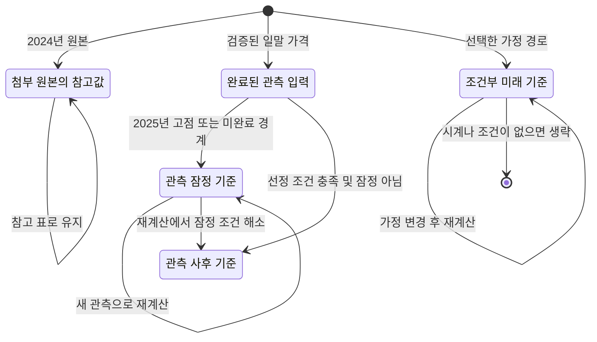

# 통합 차트의 사이클 기준점과 기간 비교

최초 기능의 검토 기준: **2026-10-22 UTC까지 완료된 Coin Metrics 일말 가격 5,941개**. 최초 구현의 기준 커밋은 `468589cf37f590f426f021fb40e4f205168285ef`이며, 아래 시나리오 개수와 초기 검증 이력은 당시 그 데이터에 기준점 모듈을 실행한 결과다. 현재 동작 설명에는 2026-10-23 후속 개선을 반영했고, 그 변경의 검증 근거는 마지막 절에서 별도로 연결한다. 배포 완료 여부를 나타내는 문서는 아니다.

이 기능은 사용자가 제공한 차트의 **여섯 종류 원형 표시와 아홉 종류 기간 관계**를 통합 차트에 연결한다. 기간은 앱의 실제 날짜로 계산한다. 미래 표시는 선택한 예시 가격 경로에서 다시 선정한다. 원본 그림의 반복 주 수나 예정 가격을 관측 데이터에 맞춰 강제로 재현하지 않는다.

구현 근거는 [기준점 엔진](../dist/cycle-milestones.js), [표시·상세 정보 모듈](../dist/cycle-milestones-view.js), [통합 차트 연결](../dist/lab-view.js)이다. 기존 거시 사이클과 일별 방향 전환의 정의는 [시장 구조 방법론](MARKET_STRUCTURE_METHOD.md)과 [시장 구조 엔진](../dist/market-structure.js)을 따른다.

## 1. 화면에서 확인하는 방법

1. **비트코인 통합 차트**의 일별 또는 주별 화면을 연다. `표시 설정`에서 **사이클 주요 지점 · 여섯 색 원**과 **사이클 기간 비교 · 아홉 관계**를 각각 켜거나 끌 수 있다. 두 항목은 기본적으로 켜져 있고 지표 관리에서도 제공된다.
2. 가격 차트의 원을 누르면 해당 원을 강조하고, 기간 패널에서 그 점이 시작점 또는 끝점인 관계를 함께 강조한다. 선택 정보에는 기준점 이름, 정확한 UTC 날짜, USD 가격, 관측·잠정·가정 상태와 선정 기준이 나온다. 원은 키보드로도 선택할 수 있다.
3. 오른쪽 아래 기존 가격 범례에 **CYCLE TOP / PIT STOP / FIRST TOP / ATH / MID-TOP / BOTTOM** 색상 범례가 함께 표시된다. 범례는 색상과 선의 의미를 설명하며 개별 유형 필터 버튼은 아니다.
4. 가격 차트 아래 **사이클 기간** 패널에서 아홉 관계를 같은 시간축으로 비교한다. `모든 기간 관계` 선택 상자로 한 관계만 볼 수 있고, `접기`·`펼치기`로 패널 본문을 조절한다. **전체 사이클**은 관측 역사와 현재 가정에서 실제로 제공하는 근거리 기준점 전체를 한 화면에 맞춘다. 2050년까지의 장기 가치평가 날짜를 새로운 사이클로 만들어 넣지 않는다. 표시 설정으로 기간 패널 전체를 끌 수도 있다.
5. 기간 선을 누르면 두 끝점의 원을 함께 강조하고 가격 차트에 옅은 선택 구간과 점선 날짜 안내선을 표시한다. 선택 정보에서 두 끝점의 날짜와 정확한 **몇 주 몇 일 / 전체 일수**를 확인하며, **전체 구간 보기**로 양 끝점이 모두 보이도록 화면 범위를 맞출 수 있다. **선택 해제**는 강조를 없앤다. 확대·이동으로 선의 일부만 보이더라도 계산 기간은 원래 양 끝 날짜의 차이로 유지된다.
6. **첨부 이미지와 계산 기준 비교**를 펼치면 원본의 주 수 표와 앱의 선정 규칙을 함께 읽을 수 있다. 미래 가정을 변경하면 해당 가정의 가격 경로에 맞춰 미래 표식과 기간도 다시 계산된다.

분·시간 차트에는 일말 자료로 정의한 사이클 표식을 억지로 적용하지 않는다. 주별 화면에서도 이 기능의 기준점 날짜와 가격은 Coin Metrics의 일말 관측을 기준으로 하며, 거래소 장중 고점·저점으로 바뀌지 않는다. 주간 마지막 가격으로 선을 줄여 그릴 때에도 표시하는 기준점의 정확한 일별 날짜·가격은 선의 연결점으로 보존한다. 미래 가정선에도 같은 규칙을 적용하며 원을 주말 좌표로 옮기거나 새로운 가격을 보간해 만들지 않는다. 거래소 캔들의 OHLC는 바꾸지 않는다.

같은 날짜·가격에 두 의미가 겹치면 동심원으로 각각의 색상을 보존한다. 좁은 화면에서는 원을 유지하면서 글자 밀도를 조절하고, 선택한 두 끝점의 이름을 우선 배치한다. 가격 차트의 선택 음영은 화면 경계에서 잘리지만 끝점의 원은 실제 좌표에만 그린다. 화면 밖 끝점을 경계로 끌어와 가짜 위치를 만들지 않으며, 자료에 없는 끝점도 추가하지 않는다. 기간 패널은 가격 SVG의 실측 너비를 함께 사용하므로 세로 스크롤바가 차지하는 폭 때문에 날짜의 가로 위치가 달라지지 않도록 한다.

## 2. 여섯 기준점의 정확한 정의

### 공통 전제

기준점은 **사후 비교용으로 선택한 날짜**다. 가격이 그날 관측되었다는 사실과 그날 이미 `CYCLE TOP` 또는 `FIRST TOP`이라는 의미를 알 수 있었다는 주장은 다르다. 모든 표시에는 `selectionIsRetrospective: true`가 붙는다.

12% 확인 고점은 기존 일별 방향 전환 알고리즘의 고점 피벗을 말한다. 후보 고점에서 가격이 12% 하락한 후 그 고점이 확인된다. 원이 놓이는 **고점 발생일**과 상세 정보의 **조건 확인일**은 별도 날짜다. 이 확인일은 지역 고점의 12% 조건이 성립한 날이며, 전체 사이클에서 특정 의미를 갖는다는 해석이 그때 완전히 알려졌다는 뜻이 아니다.

| 표식 | 색상 | 관측 구간 선정 규칙 | 주의할 점 |
|---|---|---|---|
| **CYCLE TOP** | 붉은색 `#f27781` | 2011·2013·2017·2021·2025년 각각의 최고 UTC 일말 가격 | 2025년 고점과 아직 끝나지 않은 연도의 고점은 잠정 기준이다. 달력 연도 최고값이 최종 시장 사이클 고점이라는 증명은 없다. |
| **BOTTOM** | 보라색 `#b293ee` | 선택한 고점부터 다음 선택 고점까지의 최저 일말 가격. 가장 최근 구간은 현재 관측 종료일까지의 최저값 | 최신 저점은 후보이며 이후 더 낮은 가격이 나오면 바뀐다. 첫 관측일을 저점으로 만들지 않는다. |
| **MID-TOP** | 주황색 `#f3ae63` | 직전 저점부터 해당 상승 구간 안의 반감기까지 가장 높은 일말 가격 | 저점·고점 사이에 해당 반감기가 없거나 별도 중간 지점을 만들 수 없으면 표시하지 않는다. |
| **ATH** | 청록색 `#5bcbd8` | 직전 선택 사이클 고점의 일말 가격을 저점 이후 처음 초과한 날짜 | 모든 사상 최고가를 하나씩 표시하는 기능이 아니다. 원본의 ‘지속 ATH’ 또는 ‘ATH 이동’ 가정과도 구분한다. |
| **FIRST TOP** | 초록색 `#67c78f` | 선택한 최종 고점 연도 **1–6월**의 12% 확인 고점 중 최고 가격. 반감기와 ATH 회복 중 늦은 날짜 이후이고, 최종 고점보다 **90일 이상** 앞서야 함 | ‘첫 번째 작은 되돌림’이 아닌 전반기 주요 고점이다. 최종 고점과의 간격을 사용하는 사후 규칙이며 MID-TOP과 같은 지점을 중복 선택하지 않는다. |
| **PIT STOP** | 파란색 `#6d9dff` | FIRST TOP 이후, 최종 고점 **60–150일 전** 구간의 마지막 12% 확인 고점 | 원본의 파란 원은 저점이 아닌 중간 반등 고점이다. 13주를 정확히 만들기 위한 날짜는 사용하지 않는다. 조건을 만족하는 별도 고점이 없으면 생략한다. |

FIRST TOP의 전반기 창, 90일 간격, PIT STOP의 60–150일 창은 그림에 있는 주요 국면을 일관되게 비교하기 위한 **명시적인 분류 규칙**이다. 통계적으로 최적화된 매매 규칙이나 자연법칙으로 추정한 수치가 아니다. 같은 값을 가진 후보가 여럿이면 기존 날짜 순서를 따라 첫 최고값을 유지한다.

FIRST TOP과 PIT STOP은 선택한 최종 고점의 연도와 간격에 의존하므로, 그 고점이 잠정 기준이면 두 중간 고점도 `provisional`을 이어받는다. 예를 들어 이미 관측된 2025년 FIRST TOP이라도 2025년 CYCLE TOP의 잠정 해석에 의존하는 동안은 점선 원으로 표시한다. 12% 조건 확인일이 존재한다는 이유만으로 사이클 역할까지 확정하지 않는다.

### 현재 관측에서의 대표 결과

| 고점 연도 | 시작 BOTTOM | FIRST TOP | PIT STOP | CYCLE TOP | 다음 BOTTOM |
|---|---|---|---|---|---|
| 2011 | 초기 관측 부족으로 생략 | — | — | 2011-06-08 | 2011-11-18 |
| 2013 | 2011-11-18 | 2013-04-09 | 2013-09-01 | 2013-12-04 | 2015-01-14 |
| 2017 | 2015-01-14 | 2017-06-11 | 2017-09-01 | 2017-12-16 | 2018-12-15 |
| 2021 | 2018-12-15 | 2021-04-13 | 2021-09-06 | 2021-11-08 | 2022-11-09 |
| 2025 | 2022-11-09 | 2025-01-21 | 조건에 맞는 고점 없음 | 2025-10-06 · 잠정 | 2026-06-30 · 후보 |

2025-08-13의 지역 고점은 2025-10-06보다 54일 앞선다. 따라서 현재의 PIT STOP 60–150일 규칙에는 들어가지 않는다. 표식을 채우기 위해 이 예외만 별도로 완화하지 않는다.

2022년 BOTTOM이 11월 9일인 것은 현재 앱의 Coin Metrics 일말 가격 기준이다. 다른 거래소의 종가나 장중 저점과 날짜가 다를 수 있다. 이 기능에서 원본 이미지나 다른 공급자의 날짜로 몰래 교체하지 않는다.

## 3. 아홉 기간 관계와 계산

| 관계 ID | 화면 표시 | 시작점 | 끝점 |
|---|---|---|---|
| `bottom-bottom` | BOTTOM → BOTTOM | 이번 사이클 시작 저점 | 다음 저점 |
| `bottom-cycle-top` | BOTTOM → CYCLE TOP | 시작 저점 | 선택한 사이클 고점 |
| `bottom-first-top` | BOTTOM → FIRST TOP | 시작 저점 | 전반기 주요 고점 |
| `mid-top-cycle-top` | MID-TOP → CYCLE TOP | 중간 고점 | 선택한 사이클 고점 |
| `bottom-ath` | BOTTOM → ATH | 시작 저점 | 이전 고점 최초 회복일 |
| `cycle-top-bottom` | CYCLE TOP → BOTTOM | 선택한 사이클 고점 | 다음 저점 |
| `first-top-cycle-top` | FIRST TOP → CYCLE TOP | 전반기 주요 고점 | 선택한 사이클 고점 |
| `ath-cycle-top` | ATH → CYCLE TOP | 이전 고점 최초 회복일 | 선택한 사이클 고점 |
| `pit-stop-cycle-top` | PIT STOP → CYCLE TOP | 후반기 중간 고점 | 선택한 사이클 고점 |

시작·종료 날짜를 UTC 자정의 정수 일수로 바꾼 뒤 계산한다.

```text
days  = utcDay(endDate) − utcDay(startDate)
weeks = days / 7
```

예를 들어 2011-11-18 → 2013-12-04는 **747일 = 106주 5일**이다. 원본 그림에 적힌 152주를 이 구간에 덮어쓰지 않는다. 이 차이는 계산 오류를 숨기는 대신 원본과 현재 앱의 기준점이 다름을 드러낸다.

양 끝을 모두 포함해 세는 주봉 개수가 아니라 **두 날짜 사이의 경과 시간**이다. 윤년과 월 길이 차이를 UTC 일수에 반영한다. `weeks`는 내부에서 소수로 보존하고, 화면에서는 주·일 표현 및 반올림한 주 수를 함께 제공한다. 시작점과 끝점이 같거나 역순이면 기간을 만들지 않는다.

축 확대, 이동, 모바일 폭, 화면 밖 잘림은 기하 정보만 바꾼다. 화면에 보이는 부분 길이를 전체 기간으로 재계산하지 않는다. 아홉 관계는 선택 가능한 분류 전체이며, 모든 사이클에 반드시 아홉 개의 유효한 기간이 존재한다는 뜻은 아니다.

## 4. 첨부 이미지의 출처와 비교값

원본 이미지의 표시 정보를 아래와 같이 보존한다.

- 제목: **Insights from Bitcoin Halvings (v.3)**
- 작성자: **ilay_ / @ilay_vp**
- 표시된 게시 시각: **2024-08-06 22:33 UTC+3**
- 종목·주기: **Bitcoin Liquid Index · 1W · BNC**
- 근거: 사용자가 제공한 TradingView 차트 이미지

아래 값은 **원본에 적힌 주 수**이며 현재 데이터에서 다시 계산한 값이 아니다. `MILESTONE_SOURCE_REFERENCE.usedForCalculation`은 `false`다.

| 원본 관계 · 주 | 2011–2013 | 2015–2017 | 2019–2021 | 2022–2025 |
|---|---:|---:|---:|---:|
| BOTTOM → BOTTOM | 214 | 204 | 204 | 204 |
| BOTTOM → CYCLE TOP | 152 | 152 | 152 | 152 |
| BOTTOM → FIRST TOP | 122 | 122 | 122 | 122 |
| MID-TOP → CYCLE TOP | 124 | 80 | 124 | 80 |
| BOTTOM → ATH | 113 | 113 | 104 | 113 |
| CYCLE TOP → BOTTOM | 63 − 2 | 50 | 50 | 50 |
| FIRST TOP → CYCLE TOP | 30 + 2 | 30 | 30 | 30 |
| ATH → CYCLE TOP | 38 + 2 | 38 − 2 | 47 | 58 / 56 · 대안 38 + 1 |
| PIT STOP → CYCLE TOP | 13 | 13 + 2 | 13 − 2 | 13 + 2 |

원본의 주봉 날짜, BLX 지수, 저점 선택과 앱의 일말 관측 정의는 동일하지 않다. 특히 원본 첫 저점은 2011년 초 부근인데 앱의 2013년 상승 구간은 2011-11-18 저점에서 시작한다. 따라서 같은 영어 명칭을 사용하더라도 원본 주 수와 앱의 경과 주 수가 모두 같을 수는 없다.

원본의 2025·2026년 날짜와 가격 주석은 **2024년 8월 당시 미래 가정**이다. 현재 날짜가 그 이후라는 이유만으로 그 가정을 실제 관측으로 승격하지 않는다. 원본 표는 비교용으로 유지하고, 가격과 날짜는 현재 관측 및 선택한 모형에서 각각 가져온다. 반복 숫자는 미래 주기의 수학적 증명이 아니다.

## 5. 미래 가정의 기준점과 범위

`buildCycleMilestones`는 이미 선택된 모형의 `path`와 `nominalClock`을 받는다. 관측값, 시나리오 가격, 모델의 날짜를 수정하지 않고 그 경로 위에 표식만 만든다.

1. 시작점은 최신 관측 저점 후보다.
2. **CYCLE TOP**은 시작 저점부터 모형의 `effectivePeakDate`까지, 선택한 경로에서 가장 높은 가격이다. 그 날짜가 아직 관측되지 않은 미래일 때만 새로운 미래 고점 표식을 만든다. 모형 시계의 날짜 자체가 반드시 최고 가격인 것은 아니다.
3. 다음 **BOTTOM**은 선택한 예시 고점 이후부터 `nextLowDate`까지 제공된 가격 경로의 최저 예시 가격이다. 경로가 다음 저점 시계보다 일찍 끝나면 **부분 구간 후보**로 표시하며 완성된 창의 저점으로 취급하지 않는다. 고점 이후에 별도 날짜를 얻을 수 없으면 다음 저점을 만들지 않는다.
4. 미래 **MID-TOP**은 시작 저점에서 모형 고점 시계까지 첫 1/3 구간의 최고 예시 가격이다. 미래 반감기 발생일을 추정한 표시가 아니다.
5. **ATH**는 직전 관측 사이클 고점을 선택한 예시 경로가 처음 초과하는 날이다. 미래 FIRST TOP은 그 회복일과 첫 1/3 경계 이후의 전반기 주요 고점이며, 90일 간격 조건을 적용한다. PIT STOP은 같은 60–150일·12% 확인 규칙으로 선택한다.

모든 미래 원의 가격은 해당 날짜의 `forecast.path` 값과 정확히 같아야 한다. `forecast.asOf`가 관측 종료일과 다르거나 시작 가격·날짜가 마지막 관측과 다르면 오류로 거부한다. 서로 다른 데이터 개정판이나 기준일을 조용히 섞지 않는다.

다음 저점의 선택 창은 `windowStart`에 예시 고점 날짜, `windowEnd`에 실제로 제공된 창의 종료일, `requestedWindowEnd`에 모형의 `nextLowDate`를 기록한다. `selectionWindowComplete: false`이면 그 BOTTOM과 연결된 기간 모두 부분 구간 후보로 표시하고, 상세 정보에서 실제 종료일과 요청한 종료일을 구분한다. 원이 놓이는 날짜는 그 창 안에서 고른 최저 가격의 날짜이므로 `windowEnd`와 같을 필요가 없다. `futureStatus.completeWindow`와 `futureStatus.through`도 창의 완결 여부와 실제 경로 종료일을 전달한다.

현재 데이터의 근거리 시계는 고점 기준일 **2029-08-15**, 다음 저점 기준일 **2030-08-15**다. 이 날짜는 조건부 시계이고 실제 미래 고점·저점 날짜로 확정되지 않았다. 표식의 실제 예시 날짜는 그 창에서 선택한 가격 경로에 따라 달라질 수 있다. 고점 이후 창의 모든 가격이 그 고점보다 낮다는 제약을 가격선에 강제하지도 않는다.

**2030년 이후부터 2050년까지 고정 4년 사이클을 자동 반복하지 않는다.** 장기 모형의 연말 경제 가치평가 기준은 고점·저점 예측이 아니다. 근거리 시계가 없거나 만료되었거나 경로가 해당 고점 시계까지 이어지지 않으면 미래 사이클 표식을 생략하고 이유를 제공한다. 조건을 만족하지 못한 ATH·FIRST TOP·PIT STOP도 임의의 날짜로 채우지 않는다.

### 다섯 시나리오 실행 결과

2026-10-22 관측, `seed: 20261022`, `sampleCount: 128`, `blockDays: 28` 기준으로 실제 `buildLongHorizonForecast`와 새 모듈을 함께 실행했다. 다음은 **경로 전체 기준**이며 화면 범위에 따라 보이는 원·선의 수는 줄어들 수 있다.

| 시나리오 | 전체 원 | 전체 기간 | 미래 원 | 미래 유형 |
|---|---:|---:|---:|---|
| `base` | 30 | 44 | 5 | MID-TOP, ATH, FIRST TOP, CYCLE TOP, BOTTOM |
| `accelerated` | 30 | 44 | 5 | ATH, MID-TOP, FIRST TOP, CYCLE TOP, BOTTOM |
| `wait` | 30 | 44 | 5 | MID-TOP, ATH, FIRST TOP, CYCLE TOP, BOTTOM |
| `late` | 30 | 44 | 5 | MID-TOP, ATH, FIRST TOP, CYCLE TOP, BOTTOM |
| `stress` | 28 | 40 | 3 | MID-TOP, CYCLE TOP, BOTTOM |

관측만 계산하면 **25개 원, 36개 기간**, 전체 역사에서 **6/6 표식 유형과 9/9 관계 유형**을 포함한다. 기본·확대·완만·낮은 채택 경로에는 현재 규칙을 만족하는 별도 미래 PIT STOP이 없다. 수요 훼손 경로는 직전 고점 회복 조건을 만족하지 않아 ATH·FIRST TOP·PIT STOP도 생략한다. 없는 항목을 억지로 추가하지 않는 동작 자체가 검토 결과에 포함된다.

`accelerated`의 ATH와 MID-TOP은 모두 2027-06-04에 있다. 이 경우 가격·날짜를 이동시키지 않고 서로 다른 반지름의 원으로 두 의미를 표시한다. 위 숫자와 날짜는 최신 관측 또는 모형이 바뀌면 함께 갱신되어야 하며 예측 적중률이 아니다.

## 6. 상태와 재계산 흐름

아래 그림은 **표시 상태를 이해하기 위한 흐름도**다. 실행 코드 전체의 형식 검증 결과나 비트코인 사이클의 증명으로 해석하지 않는다.



`Reference`에서 관측으로 이어지는 자동 전이는 없다. `Conditional`도 시간이 흘렀다는 이유만으로 관측이 되지 않는다. 새 관측을 얻으면 실제 데이터에서 기준점을 다시 계산한다. 이 그림의 화살표는 저장된 객체를 자동 승격하는 상태 머신이 아니라 `buildCycleMilestones`를 다시 실행했을 때 가능한 분류 결과를 설명한다. 잠정 기준 역시 이후 조건을 충족한 데이터로 다시 계산되어야 하며 단순히 시간이 지났다고 확정하지 않는다. 현재 구현은 2025년 연도 최고값을 계속 잠정 기준으로 다루므로, **2025년 고점에는 잠정 조건 해소 화살표를 적용하지 않는다.** 시간이 지나면 이를 최종 사이클 고점으로 확정하는 별도 규칙은 없다.

| 상태 | 가격 출처 | 선과 원 | 해석 |
|---|---|---|---|
| 관측 사후 기준 | 실제 일말 가격 | 실선 | 이미 관측된 자료에서 사후 선정한 기준 |
| 관측 잠정 기준 | 실제 일말 가격 | 점선 | 가격은 관측되었지만 최종 사이클 위치는 아직 후보 |
| 관측 가격 · 가정 기준 | 실제 일말 가격 | 점선 | 가격·날짜는 관측되었으나 해당 역할을 선택한 규칙은 현재 미래 가정에 속함 |
| 미래 가정 | 선택한 예시 경로 | 점선 | 관측되지 않은 가격과 날짜의 조건부 분류 |
| 부분 구간 후보 | 제공된 부분 경로 | 점선 | 요청한 다음 저점 시계까지 경로가 없어, 현재 창에서 고른 후보와 연결 기간 |
| 관측 + 미래 가정 기간 | 서로 다른 상태의 두 끝점 | 점선 | 관측 저점에서 예시 고점까지 등 미래 조건을 포함한 기간 |
| 첨부 원본 참고값 | 2024년 원본 주석 | 별도 참고 표 | 현재 관측이나 계산 입력으로 사용하지 않음 |

내부 `kind`는 **가격의 출처**를 나타내며 `observed`, `scenario`, 기간에 한해 `mixed`를 사용한다. **기준점 선택의 출처**는 별도 `selectionKind: 'observed' | 'scenario'`로 보존한다. 관측 날짜의 실제 가격을 미래 가정의 창에서 골랐다면 `kind: 'observed'`와 `selectionKind: 'scenario'`가 함께 있을 수 있으며, 화면에는 **관측 가격 · 가정 기준**으로 표시한다. 가정 사이클의 기간도 양 끝 가격이 모두 관측값이라는 이유만으로 관측 규칙의 결과로 승격하지 않는다.

`provisional`과 `selectionWindowComplete`는 이 두 출처와 별도 정보다. 원의 색은 의미 유형을, 선의 형태는 잠정·가정 상태를 나타내므로 같은 종류의 원이라도 상태에 따라 선 형태가 다를 수 있다. 가정을 바꾸면 선택은 새 모형의 기준점·기간 ID에서 다시 해석하며, 새 경로에 없는 이전 선택이나 날짜가 맞지 않는 끝점을 계속 표시하지 않는다.

## 7. 검증 범위와 재현

데이터 규칙의 집중 테스트는 [cycle-milestones.test.mjs](../tests/cycle-milestones.test.mjs), 순수 SVG·상세 정보 표시의 집중 테스트는 [cycle-milestones-view.test.mjs](../tests/cycle-milestones-view.test.mjs)다. 자동 갱신으로 최신 후보 저점이 바뀌어도 고정된 과거 회귀 사례가 흔들리지 않도록 데이터 규칙 테스트는 기존 `btc-daily-2026-10-20.json` fixture를 사용한다. 위 다섯 시나리오 수치는 별도로 **2026-10-22까지 5,941개 관측이 있는** `dist/data/btc-daily.json`을 실행해 확인했다.

다섯 시나리오의 개수는 저장소 루트에서 다음 코드로 다시 계산할 수 있다. 출력에는 실행 시점의 관측 종료일을 함께 남긴다.

```sh
node --input-type=module <<'JS'
import fs from 'node:fs';
import { buildLongHorizonForecast } from './dist/long-horizon-forecast.js';
import { buildCycleMilestones } from './dist/cycle-milestones.js';
const data = JSON.parse(fs.readFileSync('./dist/data/btc-daily.json', 'utf8'));
for (const scenario of ['base', 'accelerated', 'wait', 'late', 'stress']) {
  const forecast = buildLongHorizonForecast(data, {
    scenario, seed: 20261022, sampleCount: 128, blockDays: 28,
  });
  const result = buildCycleMilestones(data, { forecast });
  console.log(JSON.stringify({
    asOf: result.asOf, scenario,
    markers: result.markers.length, intervals: result.intervals.length,
    future: result.markers.filter(item => item.kind === 'scenario')
      .map(item => ({ type: item.type, date: item.date })),
    futureStatus: result.futureStatus,
  }));
}
JS
```

```sh
node tests/cycle-milestones.test.mjs
node tests/cycle-milestones-view.test.mjs
```

직접 실행에서 데이터 규칙 **11개**, 표시 규칙 **13개**가 통과했다. 아래 최종 전체 검사에 포함된 사례이며 중복 합산하지 않는다. 데이터 규칙에서 검증한 불변 조건은 다음과 같다.

- 역사 전체에서 여섯 유형과 아홉 관계를 모두 제공하며 기준점 ID가 중복되지 않는다.
- 모든 관측 원의 날짜·가격은 해당 날짜의 원자료와 정확히 같다.
- 모든 기간은 양의 정수 UTC 일수이며 주 수는 그 값의 1/7이다.
- 2025년 고점과 최신 저점을 확정 기준으로 잘못 표시하지 않는다.
- 과거 `asOf`로 잘라 계산한 결과는 그 시점까지의 데이터만 전달한 결과와 같다.
- 미래 원은 선택한 시나리오의 실제 경로 값을 사용하며 가정 변경을 반영한다.
- 관측과 미래가 섞인 기간에는 조건부·잠정 상태가 유지된다.
- 시계가 없거나 만료되면 장기 가치평가 날짜를 가짜 사이클 고점으로 바꾸지 않는다.
- 잘못된 UTC 날짜, 다른 기준일, 다른 마지막 관측 가격을 거부한다.
- 짧은 자료나 부분 사이클에서는 없는 기준점을 생략하며 역순·0일 기간을 만들지 않는다.
- 2021년 FIRST TOP·PIT STOP이 4월 13일·9월 6일의 주요 국면을 가리키며, 첫 작은 되돌림을 FIRST TOP으로 고르지 않는다.

특히 **날짜는 같지만 마지막 관측 가격이 1% 다른 모형**을 전달하는 테스트는 수정 전 `Missing expected exception`으로 실패했다. 모형 시작 날짜·가격 일치 검사를 추가한 뒤 통과했다. 이는 데이터 개정판 혼용 방지를 실행 코드로 확인한 사례다.

표시 모듈의 13개 사례는 아홉 관계의 기본 표시·빈 상태, 관계 필터, 겹친 기간의 별도 줄 배치, 좁은 구간의 숫자 생략, 윤년을 포함한 정확한 기간, 화면 밖 구간 잘림, 조밀한 모바일 폭의 글자 경계·충돌 방지, 관측·가정 구분, 같은 날짜·가격의 두 색 동심원, 입력 문자열 이스케이프와 상세 정보를 검사한다. 이는 실제 표시 함수를 실행한 **SVG 기하·마크업 검사**이며 브라우저의 실제 글꼴 배치, 입력 이벤트 전달, 기기별 화면 검수와는 구분한다.

### 최초 기능의 최종 코드 검증 결과 · 이력

최종 작업 트리에서 `tests/*.test.mjs` **48개 파일을 각각 직접 실행**했다. 파일 수와 개별 검사 사례 수를 구분한 결과는 다음과 같다.

| 검사 | 결과 | 범위 |
|---|---:|---|
| `node:test` 개별 사례 | **384개 통과** | 기존 회귀 검사와 새 기준점·표시 검사 |
| 자체 assertion 스크립트 사례 | **44개 통과** | `node:test` 집계 밖에서 직접 실행되는 기존 자동 검사; 사람이 브라우저를 조작한 수동 검사 수가 아님 |
| 개별 자동 검사 합계 | **428개 통과 · 실패 0개** | 48개 파일의 위 두 종류 사례를 합산 |
| `npm run verify:static` | **통과** | 정적 사이트 구조·참조 검사 |
| `npm run verify:cycle` | **통과** | 현재 관측 자료와 저장된 사이클 보정 산출물의 일치 검사 |
| `npm run verify:formal` | **통과** | 기존 요청 소유권 유한 모형과 실제 제어기의 회귀·음성 대조 검사 |

정적·보정·형식 검증 게이트는 위 428개에 추가로 합산하지 않는다. 전체 직접 실행과 게이트는 저장소 루트에서 다음과 같이 재현한다.

```sh
for test_file in tests/*.test.mjs
do
  node "$test_file" || exit 1
done
npm run verify:static
npm run verify:cycle
npm run verify:formal
```

`verify:formal`의 대상은 **최대 세 요청 세대와 두 간격(`1m`, `5m`)으로 한정한 기존 `NoStaleDisplay` 요청 소유권 모형**이다. 정상 모형에서 취소·교체된 요청이 뒤늦게 표시 결과를 덮어쓰지 않는 조건을 확인하며, 소유권 방어를 제거한 모형과 실제 제어기에서는 예상한 반례·assertion 실패가 나와야 게이트가 통과한다. 새 사이클 기준점의 분류 흐름도, SVG 표시 전체 또는 금융 모형을 형식적으로 증명한 결과가 아니다. [형식 검증의 경계·반례·재현 절차](formal-state/README.md), [검증 실행 코드](../scripts/verify-market-state.mjs)

이번 결과는 **2026-10-22 관측 자료에 대한 코드와 유한 모형 검증**이다. 모든 입력·부동소수점 경로·화면 상태를 증명하거나 미래 가격·사이클의 정확성을 입증하지 않는다. 브라우저 실측은 아래 별도 항목에 기록하며, 모바일 실기기 성능 측정은 포함하지 않는다.


### 공개 배포 후 상호작용 점검

첫 기능은 [PR #4](https://github.com/twoimo/bitcoin-cycle-atlas/pull/4)로 병합했고 [Pages 배포](https://github.com/twoimo/bitcoin-cycle-atlas/actions/runs/39914821348)가 통과했다. 실제 HTTPS 사이트에서 기간 관계 필터, 1,062일 기간 상세, 키보드 표식 선택, 분봉에서 일봉 전용 표시 제외, SVG 저장을 확인했다. 브라우저에서 저장한 SVG에는 가격·기간 2개 패널, 6종 범례, 중복 없는 ID가 포함되었고 조작용 tab stop은 제거되었다.

이 과정에서 발견한 모바일 범례/D-day 겹침, 작업 화면 저장 시 기간 설정 누락, 기간 축의 거친 연도 눈금을 후속 수정했다. 기간 눈금은 가격 차트와 동일한 UTC 달력 간격을 사용한다. 저장·공유 상태 왕복과 달력 좌표 검사를 회귀 사례에 추가했다. 모바일 스타일 수정 후의 실측 결과는 실제 배포 화면에서 별도로 확인해야 하며, 코드 테스트를 기기 성능 검증으로 대신하지 않는다.

## 8. 2026-10-23 후속 개선

[PR #5](https://github.com/twoimo/bitcoin-cycle-atlas/pull/5) 이후의 후속 구현은 **전체 사이클 → 기간 선택 → 양 끝점 확인 → 전체 구간 보기** 흐름, 주별 가격선의 정확한 기준점 연결, 잠정·가정·부분 구간 상태의 구분을 보완한다. 앞 절의 초기 검사 개수와 공개 배포 이력은 그대로 보존하며, 이를 후속 변경의 새 실행 결과로 재사용하지 않는다.

- [cycle-selection.test.mjs](../tests/cycle-selection.test.mjs): 현재 모형의 양 끝점 해석, 선택한 원에 연결된 기간, 가정 교체 뒤 오래된 선택 제거, 양 끝점을 포함하는 화면 맞춤과 전체 사이클 범위.
- [cycle-price-alignment.test.mjs](../tests/cycle-price-alignment.test.mjs): 실제 가격 렌더러에서 주별 관측·미래 선의 기준점 좌표 보존, 거래소 캔들 가격과 기준점 가격의 분리, 선택 표시 전달과 범위 잘림.
- [cycle-milestones-view.test.mjs](../tests/cycle-milestones-view.test.mjs), [cycle-milestones.test.mjs](../tests/cycle-milestones.test.mjs): 선택된 두 원의 좌표·동심원·접근성, 연결 기간 강조, 가정 규칙으로 고른 관측 가격, 부분 저점 창과 잠정 상태 전파.
- [design-qa.md](../design-qa.md): 이번 후속 변경의 화면별 확인 근거, 실제 검증 결과와 한계. 브라우저 결과와 검사 개수는 해당 기록을 기준으로 확인한다.

선택 범위 계산은 [cycle-selection.js](../dist/cycle-selection.js), 주별 연결점 보존은 [atlas-price-chart.js](../dist/atlas-price-chart.js)에 있다. 이 개선은 원본 이미지의 주 수를 계산 입력으로 바꾸거나 원본의 미래 가격 주장을 실제 관측으로 바꾸지 않는다.
