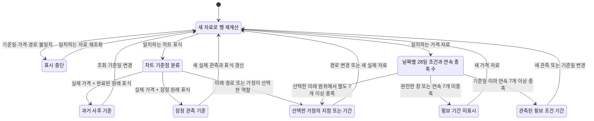

# 사이클 판단표의 검증 범위

## 결과

`node scripts/verify-cycle-decision.mjs`는 **실제 JavaScript 공개 함수**에 유한한 입력 집합을 넣고 독립 계산과 비교한다. 현재 구현은 PASS이며 **27개 의도적 결함**을 각각 예정된 실패로 탐지했다. 기존 9개 결함 검사를 보존하고 횡보 기간·미래 경계·공유 사이클 소속에 관한 18개 검사를 추가했다. 이 검증은 시장 예측, 수익성, 고점·저점 적중률 또는 무한한 입력 영역에 대한 수학적 증명이 아니다.

기준 저장소 커밋은 `3a1be8370a9fd9a71861be3f929493370f08a5ef`이다. 검토한 `dist/cycle-decision.js`의 SHA-256은 `7dad7868a73f43aaea1ca656bf9223a7a4fdabe1d88da75b6d2b59be12ebb0a9`이며 실행 환경은 Node `v24.22.1`이다. 현재 소스의 정확한 SHA-256과 사용한 Node 버전은 매 실행 결과에 출력한다. 커밋 이후에는 프로젝트의 `verify-cycle-decision` 스킬에 기록된 대응 검토 커밋도 확인한다.

## 중요한 발견과 수정

독립 검토에서 미래 경로가 이미 관측된 가격에 새로운 역할을 부여한 지점이 표에서 사라지는 경우를 찾았다. 예를 들어 실제로 관측한 가격이라도 **선택한 미래 가정의 고점 회복 지점**으로 선택되었다면 해당 역할은 가정이다. 기존 초안은 역사 행에서 이를 제외하고 미래 날짜만 추가하여 그 지점을 양쪽에서 빠뜨렸다.

수정된 표는 이 지점을 포함하되 `evidenceKind: scenario`로 남긴다. 날짜와 가격이 실제 값인지는 별도의 `kind: observed`로 표현한다. 해당 조건부 행의 수익률과 MDD는 `null`이며, 그 행을 사후 확정 관측으로 승격하지 않는다. 반대로 원래의 관측 기준점을 미래 시나리오가 출발점으로 재사용하는 경우에는 역사 행을 중복 생성하지 않는다.

횡보 기간은 기준점 도착 행과 다른 계약을 가진다. `phaseId: range`, `action.scope: period`이며 각 날짜의 직전 **28개 연속 일말 가격**에 폭 12% 이하·첫날 대비 등락 절댓값 6% 이하 조건을 적용한다. 그 조건을 **7개 이상의 연속된 종료일 관측**에서 충족해야 한 기간으로 표시한다. 시작일은 첫 충족 종료일이고, `minimumRunKnownAt`은 일곱 번째 충족일이다. 28일 이동 창의 시작으로 기간을 소급하거나 첫 충족일에 이미 7일의 유지 여부를 알았다고 표현하지 않는다.

관측 기간의 MDD는 표시된 첫 충족일과 마지막 충족일 사이에만 계산한다. 독립 반례는 이동 창의 준비 자료에 112→100의 약 10.714% 하락을 두고 표시 기간은 100으로 유지한다. 올바른 기간 MDD는 0%이며, 준비 자료를 끌어오는 결함은 탐지된다. 기간 전체의 가격 폭이나 수익률과 매일 갱신한 28일 조건은 서로 다른 값이다.

관측과 미래 기간은 `asOf`에서 분리하고 양쪽에 각각 7개 최소 조건을 적용한다. 미래 시작 직전의 관측값은 최대 27개 준비 값으로만 사용할 수 있다. 이 혼합 창은 `kind: mixed`, 근거는 계속 `evidenceKind: scenario`이며 실현 성과는 비워 둔다. 미래 기간은 선택한 경로와 `futureStatus.available === true`, 명시된 `futureStatus.through`가 있을 때만 계산한다. 임의의 더 긴 경로나 누락된 표시 경계가 실제 성과 또는 미래 기간을 만들어서는 안 된다.

자료 종료나 결측 때문에 기간의 끝을 알 수 없으면 `rightCensored: true`를 유지한다. 다음 날짜에 완전한 창의 가격 조건이 깨졌을 때만 해당 기간의 종료를 확인한다. 공유 저점은 사실 행 하나를 유지하면서 `cycleIds`에 앞·뒤 원천 사이클을 모두 남긴다. 조건부 기준점과 기간은 제공된 `scenarioId`를 유지한다.

## 검사하는 약속

| 약속 | 독립 검사 방법 | 위반할 때 생기는 오해 |
| --- | --- | --- |
| MDD는 표시 기간 안에서 먼저 나온 고점과 뒤의 저점으로 계산한다. | 모든 시간 순서의 가격 쌍을 비교하는 별도 oracle과 대조한다. | 저점보다 늦은 최고값을 분모로 쓰거나 과거 전체 손실을 끌어올 수 있다. |
| 구간 수익률과 날짜가 차트의 실제 기준점과 일치한다. | 원시 날짜 차이와 양 끝 가격 비율로 대조한다. | 표와 차트가 서로 다른 기간을 말할 수 있다. |
| 미래 가정과 가정이 선택한 관측 역할은 실현 성과를 만들지 않는다. | 관측·가정 혼합 지점과 미래 지점에 대해 provenance와 빈 성과 필드를 검사한다. | 미래 수익률을 이미 벌어들인 결과처럼 읽게 된다. |
| 결측과 짧은 이력은 횡보가 아니다. | 28개 관측의 경계, 모든 내부 결측 위치, 폭·등락 기준 경계를 확인한다. | 판단할 수 없는 자료가 안정적인 시장으로 보일 수 있다. |
| 현재 상태는 미래 가격이나 선택한 가정에 바뀌지 않는다. | 동일 과거에 다른 미래 가격을 붙이고 과거 기준일로 호출한다. 조건부 경로 유무도 대조한다. | 미래 정보를 보고 과거 신호를 바꾸는 오류가 생긴다. |
| 잠정 관측과 미완료 가정 창은 강한 단계가 아니다. | 고점·저점, 가격 방향, 부분 창 조합을 확인한다. | 미완료 지점을 확정된 강한 신호로 오해하게 된다. |
| 기준일과 경로가 다르면 계산을 중단한다. | 기준일, 관측 가격, 미래 경로 가격, 연결 가격을 각각 바꾼 입력을 거부하는지 확인한다. | 다른 시나리오의 날짜·가격이 현재 표에 섞인다. |
| 횡보 기간은 7개 연속 충족 종료일에서 시작·종료하고 일곱 번째 날에 표시 요건을 알 수 있다. | 독립 UTC 달력 창과 모든 가격 쌍의 폭 비교로 충족 날짜를 만든 뒤 공개 행과 대조한다. | 준비 기간을 횡보 기간으로 소급하거나 7일 유지 여부를 미리 알았다고 오해하게 된다. |
| 관측 횡보의 MDD는 그 기간 안의 가격만 사용한다. | 준비 창에만 손실이 있는 사례와 표시 기간의 모든 순서 쌍을 대조한다. | 기간 이전 하락을 해당 횡보의 손실로 읽게 된다. |
| 관측과 미래는 기준일에서 분리하고 미래는 선택한 차트 범위만 사용한다. | 기준일 전후 6·7개 충족 조합, 긴 미래 경로, 경계 누락·비활성, 미래 결측을 확인한다. | 실제 관측이 미래 유지 조건을 대신 채우거나 근거리 밖의 가정이 사실 행에 섞인다. |
| 종료를 확인할 수 없는 기간은 끝이 확정되지 않은 상태로 남긴다. | 가격 이탈, 자료 종료, 결측을 별도로 만들고 `rightCensored`를 대조한다. | 자료가 끝난 것을 횡보 종료라는 관측으로 읽게 된다. |
| 공유 저점과 걸쳐 있는 기간은 모든 원천 사이클 소속을 보존한다. | 사이클 순서를 바꾸고 가정이 같은 저점을 재사용해도 소속과 행 수를 대조한다. | 한 사이클을 선택하면 공유 저점이나 그 기간이 사라질 수 있다. |

## 유한 범위와 결과

- 가격 수준 `50, 100, 200`으로 이루어진 길이 2~6의 **모든 1,089개 경로**를 검사한다.
- 길이 4의 **81개 구간** 앞뒤에 큰 가격과 작은 가격을 붙여 기간 외 값이 MDD에 들어가지 않는지 확인한다.
- **36개 현재 관측 창**을 검사한다. 28개 관측, 27개 관측, 강한 추세, 범위·등락 경계, 27개 내부 결측 위치를 포함한다.
- **33개 기준일**에서 실제로 자른 과거 자료와 미래를 바꾼 전체 자료의 `asOf` 계산을 비교한다.
- 미래 창의 완결 여부와 개별 표식의 부분 창 여부 4가지 조합에서 **12개 조건부 행**을 검사한다.
- **4개 잠정 고점·저점 조합**, **6개 잘못 연결된 자료**를 검사한다.
- **53개 관측 기간 입력**을 검사한다. 1~42개 길이의 일정 가격, 준비 창에만 손실이 있는 구간, 가격 이탈·재진입, 추세, 폭·등락 경계와 교대 가격을 포함한다.
- 96일 자료의 **66개 결측 위치**와 7개 최소 조건 부근의 **17개 과거 기준일**을 확인한다.
- 관측 길이 28·33·34·40개와 미래 길이 0~10개 조합 등을 포함한 **48개 미래 기간 입력**을 확인한다. 실제 부분과 미래 부분은 각각 최소 조건을 충족해야 한다.
- 명시된 경계, 실제 경로보다 앞·뒤인 경계, 경계 누락, 비활성 상태를 포함한 **17개 미래 범위 사례**와 **8개 미래·준비 창 결측 사례**를 확인한다.
- 공유 저점의 사이클 순서·조건부 재사용 4가지와 두 사이클에 걸친 관측 기간을 합한 **5개 소속 사례**를 검사한다.

각 검사에는 실제 공개 함수 `buildCycleDecisionTable`을 사용한다. 판정식을 따로 복사해서 그 복사본만 검증하지 않는다. MDD 기준값은 실행 구현의 선행 최고값 누적 방식 대신 모든 순서 쌍을 열거한다. 기간 기준값은 UTC 달력의 28개 날짜가 모두 있는지 확인하고 각 창의 모든 가격 쌍을 비교하여 폭 조건을 판정한다. 실제 구현의 `sidewaysRuns` 또는 내부 도우미를 호출하거나 복사하지 않는다. 날짜 기준값은 독립적인 UTC 날짜 차이이며, 가격 변화 기준값은 양 끝 가격 차이와 시작 가격으로 구한다.

1,089개 짧은 가격 경로와 81개 짧은 구간은 정의한 유한 집합에서 전수 검사한다. 긴 횡보 기간 사례는 명시한 길이·가격 형태·결측 위치의 **유한 경계 사례**이며 모든 가능한 장기 가격 경로를 전수 검사했다는 뜻이 아니다.

## 결함 탐지 확인

검증기는 소스 문자열을 메모리에서 복제해 아래 변경을 하나씩 적용하고 **같은 공개 함수 검증**을 다시 실행한다. 운영 소스 파일은 수정하지 않는다. 변경 대상이 정확히 한 군데가 아니면 검증을 중단하여 오래된 mutation이 조용히 통과하지 않게 한다.

| 의도적 결함 | 탐지 결과 |
| --- | --- |
| 기간 전체의 최고값을 미리 알아 MDD의 선행 고점으로 사용 | 탐지 |
| 표시 시작일 대신 자료 첫날부터 MDD 계산 | 탐지 |
| 횡보 판정에서 연속 관측 조건 제거 | 탐지 |
| 과거 기준일의 미래 가격 자르기 제거 | 탐지 |
| 조건부 지점을 과거 확정 지점으로 분류 | 탐지 |
| 미래 가정에 가짜 실현 수익률·MDD 0% 채우기 | 탐지 |
| 잠정 여부·미완료 창을 무시하고 강한 단계 허용 | 탐지 |
| 관측 기준점의 가격 일치 검사 제거 | 탐지 |
| 선택한 미래 경로의 가격 일치 검사 제거 | 탐지 |
| 기간 시작을 첫 충족일 대신 28일 준비 창 시작으로 소급 | 탐지 |
| 7개 최소 충족 조건을 1개로 완화 | 탐지 |
| 기간의 연속된 날짜 조건 제거 | 탐지 |
| 기간의 등락 절댓값 6% 조건 제거 | 탐지 |
| 기간의 가격 폭 12% 조건 제거 | 탐지 |
| 7개 유지 여부를 첫 충족일에 이미 알 수 있다고 기록 | 탐지 |
| 관측 기간 MDD에 준비 창 가격 포함 | 탐지 |
| 자료가 끝난 진행 기간의 종료를 확정으로 기록 | 탐지 |
| 미래 기간에 가짜 실현 수익률·MDD 0% 채우기 | 탐지 |
| 미래 기간을 실제 관측 근거로 승격 | 탐지 |
| 기준일의 관측·미래 기간 분리 제거 | 탐지 |
| 미래 기간의 차트 종료 경계 제거 | 탐지 |
| 누락된 차트 종료 경계를 임의의 미래 경로 마지막 날로 대체 | 탐지 |
| 비활성 미래 범위 상태를 무시하고 기간 생성 | 탐지 |
| 공유 저점의 원천 사이클 소속 덮어쓰기 | 탐지 |
| 두 사이클에 걸친 관측 기간의 소속을 하나로 축소 | 탐지 |
| 미래 기간의 선택 시나리오 ID 누락 | 탐지 |
| 조건부 기준점의 선택 시나리오 ID 누락 | 탐지 |

모든 결함 검사가 끝나면 수정하지 않은 운영 함수를 다시 검사한다. 결과는 다시 PASS여야 한다. 범위 밖의 실패나 원래 구현의 실패를 결함 탐지 성공으로 대체하지 않는다.

## 상태 전이

다음 그림은 **표의 기준점·가격 조건 기간이 새 자료로 재계산되는 분류 과정**이다. 매수부터 매도까지 시장이 항상 순서대로 움직인다는 그림이 아니다. 순수 동기 함수의 실제 조건을 정리한 문서이며 별도의 TLA+ 모델 검사 결과가 아니다.



`buildCycleDecisionTable`의 입력 검사는 표시 중단 조건에, `makeRow`의 `evidenceKind`는 기준점의 세 근거 상태에 대응한다. `sidewaysRuns`와 `rangeRow`는 날짜별 조건을 묶어 `observed-period` 또는 `scenario`로 분류한다. 관측·미래 분리와 범위 제한은 공개 함수가 적용한다. 종료 확정 여부는 기간 행의 `rightCensored` 메타데이터로 따로 보존한다.

`currentObservation`은 이 분류와 별도로 마지막 28개 관측만 읽는다. 현재 한 날짜의 조건 충족에는 기간 표시용 7개 최소 조건을 적용하지 않는다. 따라서 현재 조건은 충족해도 아직 횡보 기간 행이 없을 수 있다. 새 관측 없이 조건부 지점이나 기간이 저절로 과거의 사실이 되는 전이는 없다.

Mermaid 원본은 `docs/formal-cycle-table/provenance.mmd`에 있다. 브라우저 렌더링·모바일 배치·색상 대비와 표 개수는 별도 UI 검증 대상이다.

## 재실행

```sh
node scripts/verify-cycle-decision.mjs
```

Node 24 이상으로 실행한다. 이 검사에는 Java나 외부 서비스가 필요하지 않다. 유한 집합을 실제 코드에서 확인하는 방식이므로 순수 JavaScript 변환의 오류를 검출하는 데 직접적이며, 별도 상태 기계를 작성할 때 생기는 구현과 모델의 차이를 줄인다.

차트 기준점 정의, 가격 출처 자체의 정확성, 28일·12%·6%·7개 유지 기준의 통계적 타당성, 투자 수익성, 투자 비중, 거래 비용, 장중 최대 손실은 이 PASS가 보증하지 않는다. 기준점은 사후 선택이고 미래 경로는 조건부 가정이라는 설명을 유지해야 한다.
