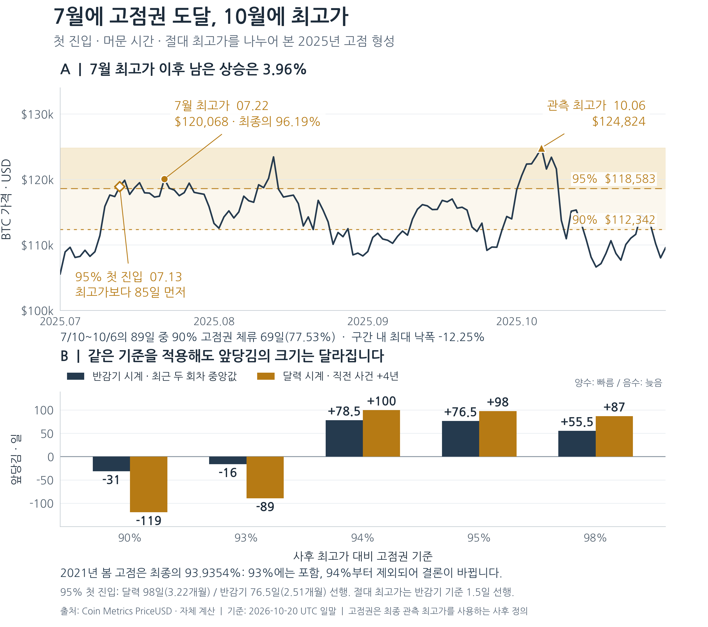
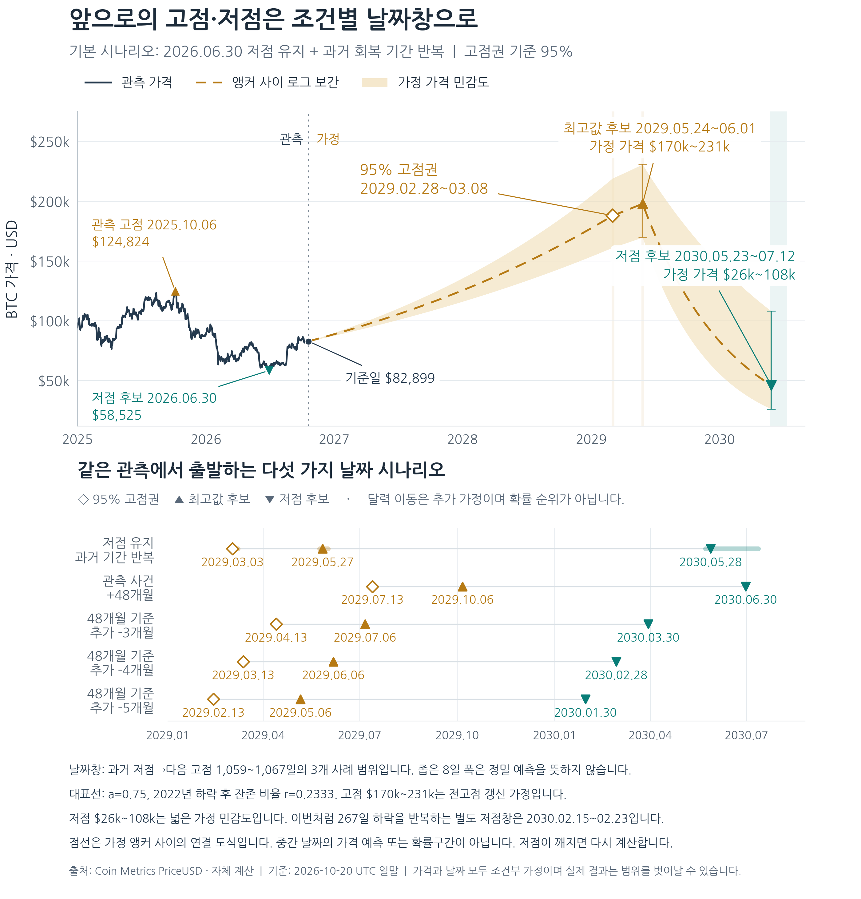

# 비트코인 고점권과 다음 전환 시점

## 2025년 7월의 의미, 2026년 저점 후보, 미래 고저점 시나리오

**가격 분석 종료: 2026-10-20 UTC 일말 / 자료 재검증: 2026-10-21 UTC**

> **7월에 이미 고점 가까이 도달했다는 관찰은 맞습니다. 다만 고점권 진입의 앞당김과 절대 최고가의 앞당김은 다르게 측정됩니다.**

2025년 7월 최고 일말가는 10월 최고 일말가의 **96.19%**였습니다. 최종 관측 고점의 95%에 처음 도달한 7월 13일을 직전 회차의 같은 사건과 달력 4년으로 비교하면 **98일, 약 3.22개월** 빠릅니다. 반감기 이후 경과일로 최근 두 회차와 비교하면 **76.5일, 약 2.51개월** 빠릅니다. 어느 시계를 쓰는지에 따라 답이 달라집니다.

반면 절대 최고가 날짜인 2025년 10월 6일은 최근 두 회차의 반감기 정렬 중앙값보다 **1.5일** 빠를 뿐입니다. 90% 고점권 기준에서는 2021년 봄의 쌍봉 때문에 이번 진입이 오히려 늦습니다. 따라서 전체 시장 주기가 일정하게 3~5개월 압축됐다는 결론까지 확대할 수는 없습니다.

| 질문 | 이번 자료에서 확인한 답 |
|---|---|
| 7월에 사실상 고점권이었나? | 넓은 90% 고점권에는 해당. 95% 이내에서 3개월 내내 머문 것은 아님 |
| 저점·회복도 빨라졌나? | 6월 30일 후보 저점은 최근 두 회차 대비 99.5일, 상승 확인은 136일 선행 |
| 지금의 큰 구조는? | 고점 아래 379일째지만, 관측 저점 이후 112일간 +41.65% 반등한 상태 |
| 다음 거시 고점은 언제인가? | 저점 유지 모델의 역사 기간 환산은 2029년 5월 말. 48개월 반복은 10월 6일 |
| 미래를 수학적으로 보장하나? | 날짜 항등식·모델 계산은 검산 가능. 미래의 고점·저점 확정은 불가능 |

## 현재 관측의 기준점

관측 최고 일말가는 **2025-10-06 / $124,824.45**, 그 이후 최저 후보는 **2026-06-30 / $58,525.08**, 최신 값은 **2026-10-20 / $82,898.91**입니다. 최신 가격은 최고가보다 **33.59% 아래**, 저점 후보보다 **41.65% 위**입니다. 최고가 회복에는 현재 가격에서 **50.57% 상승**이 필요합니다.

이 보고서는 고점권·고점·저점·추세 확인을 각각 분석하고, 미래 그래프에는 **가정을 명시한 날짜와 가격 범위**를 표시합니다. 보고서의 정확한 날짜는 계산을 재현하기 위한 출력이며 그날 전환이 일어날 확률을 뜻하지 않습니다. 별도 표시가 없는 수치는 Coin Metrics 원자료의 자체 계산입니다. 일별 가격은 UTC 하루의 마지막 기준가격이며 장중 고가·저가와 다릅니다. [1, 3]

<!-- PAGEBREAK -->

# 1. 2025년 7~10월: 고점권에 먼저 도달한 과정

## 7월 고점 이후 남은 상승은 약 4%

7월 최고 일말가는 **7월 22일 $120,068.01**입니다. 10월 6일 관측 최고가 $124,824.45의 **96.1895%**이며, 그 사이 최고값을 더 높인 폭은 **3.9615%**였습니다. “가격 수준은 이미 7월에 최고가 가까이 왔다”는 해석을 직접 뒷받침합니다.

| 사건 정의 | 첫 해당일 | 최고가보다 앞선 기간 | 의미 |
|---|---|---:|---|
| 최종 관측 고점의 90% 이상 | 2025-07-10 | 88일 | 넓은 고점권 첫 진입 |
| 최종 관측 고점의 95% 이상 | 2025-07-13 | 85일 | 좁은 고점권 첫 진입 |
| 최종 관측 고점의 98% 이상 | 2025-08-13 | 54일 | 최고가에 더 가까운 진입 |
| 절대 최고 일말가 | 2025-10-06 | 0일 | 현재까지 관측한 최대값 |

이 85~88일은 **같은 사이클 내부의 진입일과 최고가 사이 간격**입니다. 이전 사이클보다 빨라진 정도를 알려면 이전 사이클의 같은 임계값 진입일과 다시 비교해야 합니다. 7월 진입과 과거의 절대 최고가를 직접 비교하면 사건 정의가 달라집니다.

## 횡보 구간의 폭과 실제 체류 비율

7월 10일~10월 6일에는 89개 일말 관측이 있습니다. 그중 **69개, 77.53%**가 최종 고점의 90% 이상이었지만, 95% 이상은 **16개, 17.98%**였습니다. 해당 구간의 가격 범위는 약 **$108,316~$124,824**, 구간 내 최대 낙폭은 **−12.25%**였습니다.

“7일 중 5일 이상 임계값 위”라는 지속 조건을 적용하면 90% 고점권은 **7월 14일** 확인됐지만, 95% 고점권은 **10월 6일**에야 확인됩니다. 따라서 “넓은 고점권에서 약 3개월 등락하며 최고가를 갱신했다”가 자료에 가까운 표현입니다. “3개월 내내 최고가의 5% 이내에 있었다”는 표현은 맞지 않습니다.

## 과거보다 완만했던 마지막 90일

| 고점 연도 | 최고가 전 90일 수익률 | 연율화 변동성 | 구간 최대 낙폭 |
|---|---:|---:|---:|
| 2013 | +827.46% | 125.63% | −18.40% |
| 2017 | +429.13% | 95.29% | −21.77% |
| 2021 | +48.48% | 66.90% | −23.01% |
| 2025 | **+14.56%** | **29.92%** | **−12.25%** |

각 행은 최고가일까지 동일한 90개 일별 로그수익률을 사용하며, 변동성은 표본 표준편차에 √365를 곱했습니다. 고점 형성이 과거의 마지막 급등보다 완만했다는 설명은 지지됩니다. 4개 사례만으로 변동성이 영구적으로 낮아진다거나 주기가 일정하게 짧아진다고 증명할 수는 없습니다.

<!-- PAGEBREAK -->

# 2. 고점권 비교 그래프



## 그래프에서 구별할 세 사건

**첫 진입일**은 임계값을 하루라도 넘은 날입니다. **지속 확인일**은 정해진 체류 조건을 만족한 뒤 알 수 있는 날짜입니다. **절대 최고가일**은 선택한 관측 구간에서 가장 높은 값이 나온 날입니다. 세 사건이 같은 날일 필요는 없습니다.

2025년에는 7월의 95% 첫 진입과 10월의 최고가 사이가 85일이었습니다. 그러나 2021년에는 봄의 가격이 그해 최종 최고가의 **93.9354%**에 이미 도달했습니다. 그래서 90% 규칙으로는 2021년 봄을 포함하고, 95% 규칙으로는 봄을 제외합니다.

고점권을 93%에서 94%로 조금만 올려도 2021년의 첫 진입이 봄에서 가을로 이동합니다. 이 불연속 때문에 95% 기준의 조기 진입 결과만으로 “매번 고점이 더 빨라진다”는 추세를 만들면 안 됩니다.

**분모에 사용한 최종 관측 고점은 사후에 정해집니다.** 그래프의 진입 마커는 당시 그날에 최종 고점권임을 알아낼 수 있었다는 실시간 신호가 아닙니다. 더 높은 최고가가 관측되면 임계가격과 최초 진입일을 다시 계산합니다.

<!-- PAGEBREAK -->

# 3. 앞으로의 거시 고점·저점 날짜

## 서로 다른 가정의 결과를 나란히 비교

다음 표는 모두 **95% 고점권 첫 진입**을 사용합니다. 미래 고점권은 그 미래 고점 수준에 먼저 도달하는 사건이며, 절대 최고가와 별도 날짜로 표시합니다. 새 반감기의 정확한 날짜를 임의로 고정하지 않았습니다.

| 날짜 모델 | 다음 95% 고점권 | 다음 절대 고점 | 그 이후 저점 |
|---|---|---|---|
| 현재 저점 유지·과거 기간 환산 | 2029-02-28~03-08 | **2029-05-24~06-01** | **2030-05-23~07-12** |
| 관측 사건 +48개월 | 2029-07-13 | 2029-10-06 | 2030-06-30 |
| +48개월에서 추가 3개월 선행 | 2029-04-13 | 2029-07-06 | 2030-03-30 |
| +48개월에서 추가 4개월 선행 | 2029-03-13 | 2029-06-06 | 2030-02-28 |
| +48개월에서 추가 5개월 선행 | 2029-02-13 | 2029-05-06 | 2030-01-30 |

첫 행은 **2026년 6월 30일 후보가 이번 사이클의 저점으로 유지되는 경우**입니다. 과거 저점에서 다음 고점까지 걸린 기간은 2015→2017년 **1,067일**, 2018→2021년 **1,059일**, 2022→2025년 **1,062일**입니다. 이를 현재 저점 후보에 더하면 위 고점 범위가 나옵니다. 마지막 1,062일은 현재 관측 고점이 유지된다는 조건도 포함합니다.

```
다음 고점_j = 2026-06-30 + 과거 저점→다음 고점 기간_j
다음 저점_jk = 다음 고점_j + 과거 완결 하락 기간_k
```

완료된 과거 하락 기간은 **364·366·406일**입니다. 고점 날짜와 이 기간을 조합해 2030년 5~7월 저점 범위를 계산했습니다. 이번에 관측된 **267일**의 짧은 하락까지 반복한다고 별도로 가정하면 저점은 **2030-02-15~02-23**으로 달라집니다. 두 하락기간 가정을 한 개의 확정 날짜로 합치지 않았습니다.

## 세 가지 주의점

첫째, 1,059~1,067일이라는 좁은 역사 범위는 **예측의 정밀도나 신뢰구간이 아닙니다**. 사례가 3개뿐이고 시장 구조의 불확실성은 이 범위보다 훨씬 클 수 있습니다. 표의 정확한 날짜는 산술적 재현성을 위한 값입니다.

둘째, +48개월 모델은 이미 이번의 이른 7월 진입과 6월 저점을 출발점으로 사용합니다. 추가 3~5개월은 **앞당김이 다음에도 더 누적된다는 별도 가정**입니다. 현재의 앞당김을 한 번 더 기계적으로 빼면 같은 효과를 중복 반영할 수 있습니다.

셋째, 현재 저점의 달력상 132일 앞당김에 같은 저점→고점 기간을 더하면 다음 고점에도 같은 132일이 전파됩니다. 이는 독립적으로 가속을 다시 검증한 결과가 아니라 날짜 가정의 귀결입니다. 저점 유지 모델에는 추가 3~5개월을 빼지 않았습니다. 이번 저점의 이른 날짜가 이미 결과에 반영돼 있습니다. 미래 가격이 현재 저점을 다시 깨거나 더 높은 최고가로 사건 기준이 바뀌면 관련 날짜를 다시 산출해야 합니다.

<!-- PAGEBREAK -->

# 4. 미래 고저점 그래프



## 점선과 음영을 읽는 방법

**관측 가격은 실선**, 미래는 명시한 사건 사이의 **점선 연결**로 표시합니다. 고점·저점 마커는 시나리오의 계산 결과이며 미래에 관측된 사실이 아닙니다. 날짜 범위는 과거 사례의 최소~최대 또는 달력 가정의 차이이고, 가격 범위는 성장·낙폭 가정의 차이입니다. 어느 음영도 80%·95% 확률구간을 뜻하지 않습니다.

대표 점선은 **$197,854 고점·$46,162 저점**을 잇는 표시용 조합입니다. 가장 가능성이 높은 경로를 추정한 결과가 아닙니다. 연결식과 가격 가정은 10장, 가까운 고저점의 별도 경로는 11장에서 설명합니다.

<!-- PAGEBREAK -->

# 5. 자료와 고저점 선택 규칙

## 하나의 일관된 일별 가격 계열

자료는 **Coin Metrics Community API의 btc / PriceUSD / 1d**입니다. 2010-07-18~2026-10-20의 **5,939개** 가격을 사용했습니다. 내부 결측·중복은 없고 모든 값이 양의 유한수입니다. 표시된 UTC 하루가 끝난 기준가격이므로 거래소 장중 최고가·저가와 날짜나 수준이 다를 수 있습니다. [1, 3]

원본은 2026-10-21에 조회하고 전체 5,939개를 같은 날 **10:40 UTC**에 재대조해 모두 일치함을 확인했습니다. 별도로 2025년 7월 이후 477개도 **10:39:14 UTC**에 대조했습니다. 초기 GitHub CSV는 2026-05-23에서 끝나 최신 구간과 섞지 않았습니다. 보간·합성·미완료 당일 가격은 사용하지 않았습니다.

## 반감기와 달력 4년은 다른 시계

| 실제 반감기 UTC | 블록 높이 | 새 블록 보상 | 직전 이후 간격 |
|---|---:|---:|---:|
| 2012-11-28 | 210,000 | 25 BTC | — |
| 2016-07-09 | 420,000 | 12.5 BTC | 1,319일 |
| 2020-05-11 | 630,000 | 6.25 BTC | 1,402일 |
| 2024-04-20 | 840,000 | 3.125 BTC | 1,440일 |

반감기의 프로토콜 기준은 **210,000블록**입니다. “반드시 같은 달에 고점을 찍는다”는 규칙은 아닙니다. 2020년 5월 11일의 4년 후와 실제 2024년 반감기는 21일 차이이므로, 달력 기준 앞당김과 반감기 정렬 앞당김이 같지 않습니다. [2]

## 역사 고점과 현재 후보를 구분

| 반감기 구간 | 선택한 고점 날짜 | 고점 USD | 후속 저점 날짜·USD |
|---|---|---:|---|
| 2012 | 2013-12-04 | 1,134.93 | 2015-01-14 / 175.64 |
| 2016 | 2017-12-16 | 19,640.51 | 2018-12-15 / 3,185.07 |
| 2020 | 2021-11-08 | 67,541.76 | 2022-11-09 / 15,758.29 |
| 2024·진행 중 | 2025-10-06 | 124,824.45 | 2026-06-30 / 58,525.08·후보 |

역사 고점은 **2013·2017·2021년 각각의 최고 일말값**, 후속 저점은 해당 고점 뒤부터 다음 반감기 전날까지의 최소값입니다. 현재 고점은 2024년 반감기 이후 관측 최고값이고 저점 후보는 그 이후 관측 최소값입니다. 역사 고점 연도와 완결 구간의 저점 선택에는 사후 정보가 들어갑니다.

2020년 반감기부터 다음 반감기 전날까지 무조건 최대값을 고르면 2024년 3월의 가격이 선택됩니다. 이 보고서의 2021년 고점 정의와 혼용하지 않았습니다. 2022년 저점도 이 일별 자료의 11월 9일이며, 다른 기준의 장중 저점 날짜를 대신 넣지 않았습니다.

<!-- PAGEBREAK -->

# 6. 고점권 앞당김의 수학과 임계값 민감도

## 동일한 사건을 비교하는 식

P*를 선택된 관측 최고값, H를 해당 반감기, q를 고점권 비율이라고 둡니다. 가격이 qP* 이상이 된 첫 날짜를 τ(q)로 정합니다.

```
τ(q) = min{t ≥ H : P(t) ≥ qP*}
d(q) = τ(q) - H
반감기 앞당김 = 과거 d(q)의 중앙값 - 현재 d(q)
달력 앞당김 = 직전 τ(q)의 4주년 - 현재 τ(q)
```

양수는 이번 사건이 빠름, 음수는 늦음을 뜻합니다. 2025년 95% 첫 진입은 **H+449일**입니다. 2017년·2021년의 같은 사건은 각각 H+525일·H+526일이어서 **(525+526)/2−449 = 76.5일** 빠릅니다.

| 고점 연도 | 90% 첫 진입 | 95% 첫 진입 | 절대 최고가 |
|---|---|---|---|
| 2013 | 2013-11-29 / H+366 | 2013-11-29 / H+366 | 2013-12-04 / H+371 |
| 2017 | 2017-12-15 / H+524 | 2017-12-16 / H+525 | 2017-12-16 / H+525 |
| 2021 | 2021-03-13 / H+306 | 2021-10-19 / H+526 | 2021-11-08 / H+546 |
| 2025 | 2025-07-10 / H+446 | 2025-07-13 / H+449 | 2025-10-06 / H+534 |

직전 95% 사건은 2021년 10월 19일입니다. 4주년인 2025년 10월 19일에서 이번 7월 13일까지는 **98일**입니다. 평균 달력월 30.436875일로 나누면 **3.22개월**입니다. 같은 직전 회차를 반감기로 정렬하면 77일이고, 최근 두 회차 중앙값을 쓰면 76.5일, **2.51개월**입니다. 시계 변경과 표본 변경을 구별해야 합니다.

| 고점권 비율 | 이번 첫 진입 | 최근 두 회차·반감기 앞당김 | 직전 +4년·달력 앞당김 |
|---|---|---:|---:|
| 90% | 2025-07-10 | **−31일** | **−119일** |
| 93% | 2025-07-11 | −16일 | −89일 |
| 94% | 2025-07-11 | +78.5일 | +100일 |
| 95% | 2025-07-13 | **+76.5일** | **+98일** |
| 98% | 2025-08-13 | +55.5일 | +87일 |

2021년 4월 13일 가격은 $63,445.64, 그해 최고가의 **93.9354%**였습니다. 93%→94%에서 봄 고점이 포함되거나 제외되는 차이가 큽니다. 독립 계산에서는 80~99%를 점검했고, 사이트에서는 90·93·94·95·98%를 직접 바꿔 비교할 수 있습니다. 몇 개의 임계값이 같은 결론을 주더라도 같은 가격 자료에서 나온 결과라 독립적인 증거 횟수로 셀 수 없습니다.

첫 진입과 마지막 고점 구간도 다릅니다. 90% 구간의 이탈 허용을 14일→7일로 줄이면 마지막 구간 시작은 7월 10일→9월 10일로 이동합니다. 95%는 30일을 허용해도 10월 2일부터입니다.

<!-- PAGEBREAK -->

# 7. 저점은 얼마나 빨랐나: 132일의 분해

## 달력 기준으로 정확하게 성립하는 항등식

직전 저점은 **2022-11-09**, 그 4주년은 **2026-11-09**입니다. 현재 저점 후보 **2026-06-30**은 132일 빠릅니다. 이 기준일은 날짜 가설의 비교점이며 예상 저점일이나 적중한 예언이 아닙니다.

직전 고점 2021-11-08의 4주년과 이번 고점 2025-10-06은 33일 차이입니다. 직전 고점→저점은 366일, 이번 고점→저점 후보는 267일입니다.

```
저점 앞당김 = 고점 앞당김 + 하락 기간의 감소
132일 = 33일 + (366일 - 267일)
      = 33일 + 99일
```

132일 중 33일은 고점 자체의 달력상 이동, 99일은 관측 하락 기간의 단축입니다. 날짜 차이의 **항등식**이므로 같은 입력에서 반드시 성립합니다. 그 원인이 반감기인지, 유동성인지, 시장 참여자 변화인지를 식별하거나 다음에도 반복됨을 증명하는 식은 아닙니다.

| 직전 사건과 4년 비교 | 고점 앞당김 | 후속 저점 앞당김 | 해석 |
|---|---:|---:|---|
| 2013→2017 | −12일 | 30일 | 고점은 오히려 늦음 |
| 2017→2021 | 38일 | 36일 | 약 한 달 차이 |
| 2021→2025 | 33일 | **132일·후보** | 최근 하락 기간 단축이 큼 |

달력 4주년 저점을 3~5개월 앞당긴 가설 구간은 **2026-06-09~08-09**입니다. 6월 30일 후보는 그 안에 있습니다. 이는 관측과 가정의 일치이며 신뢰구간이 아닙니다. 반감기 정렬로 직전 저점의 H+912일을 적용한 기준일은 **2026-10-19**이고, 그 기준에서는 후보가 **111일** 빠릅니다. 132일과 111일의 21일 차이는 실제 반감기 날짜의 달력 이동과 일치합니다.

## 약 1년 미회복과 1년 하락은 다르다

```
최고가 이후 379일 = 고점→저점 후보 267일 + 이후 112일
```

2025년 10월 6일~2026년 6월 30일의 관측 낙폭은 **−53.11%**입니다. 이후 10월 20일까지는 **+41.65%** 반등했습니다. 따라서 최고가를 회복하지 못한 기간이 1년을 넘었다는 설명은 맞지만, 379일 내내 하락했다는 설명은 회복 구간을 섞습니다.

현재는 과거 최고가 아래에 있으면서도 최근 후보 저점에서 회복 중일 수 있습니다. “장기 최고가 미회복”과 “중기 추세 상승 조건”은 동시에 성립할 수 있는 다른 관측입니다. 새 저점이 발생하면 관측 하락 기간과 후보 날짜를 다시 계산합니다.

<!-- PAGEBREAK -->

# 8. 반감기 정렬과 저점 분석의 강건성

## 고점·저점·상승 확인을 같은 기준으로 비교

H+는 해당 반감기 이후의 UTC 날짜 차이입니다. 상승 확인은 선택된 저점 이후 처음 성립한 **200일 기하평균 위 14일 연속** 조건입니다. 확인 신호의 계산은 당시까지의 값으로 가능하지만, 최종 저점 뒤 신호를 고르는 행위에는 사후 정보가 들어갑니다.

| 반감기 구간 | 고점 H+ | 저점 H+ | 상승 확인 날짜·H+ |
|---|---:|---:|---|
| 2012 | 371 | 777 | 2015-07-12 / 956 |
| 2016 | 525 | 889 | 2019-04-15 / 1,010 |
| 2020 | 546 | 912 | 2023-01-26 / 990 |
| 2024·현재 | 534 | 801·후보 | 2026-09-01 / 864 |

최근 두 구간 저점의 중앙값은 **900.5일**이므로 현재 H+801은 **99.5일, 약 3.27개월** 빠릅니다. 상승 확인 중앙값은 **1,000일**이고 현재 H+864이므로 **136일, 약 4.47개월** 빠릅니다. 고점의 중앙값은 535.5일이라 현재는 1.5일 차이입니다.

| 비교 표본 | 고점 앞당김 | 저점 후보 앞당김 | 상승 확인 앞당김 |
|---|---:|---:|---:|
| 직전 2020 구간·n=1 | 12일 | 111일 | 126일 |
| 최근 2016·2020·n=2 | **1.5일** | **99.5일** | **136일** |
| 2012·2016·2020·n=3 | −9일 | 88일 | 126일 |

전체 3개 구간을 넣으면 저점의 앞당김은 **88일, 약 2.89개월**로 줄어듭니다. “3개월 이상”이라는 경계는 표본 선택에 민감합니다. 20% 반등을 14일 유지하는 보조 확인은 현재 H+865이며, 위 세 기준에서 각각 **125·121·117일** 빠릅니다.

## 추세선·연속일 설정을 바꾼 결과

| 평균·기간 | 연속 요건 | 이번 확인일 | 최근 두 회차 대비 |
|---|---:|---|---:|
| 기하평균 150일 | 14일 | 2026-09-01 | 132.5일 선행 |
| 기하평균 200일 | 7일 | 2026-08-25 | 136일 선행 |
| 기하평균 200일 | 14일 | 2026-09-01 | 136일 선행 |
| 기하평균 200일 | 30일 | 2026-09-17 | 136일 선행 |
| 기하평균 250일 | 14일 | 2026-09-02 | 135.5일 선행 |
| 산술평균 200일 | 14일 | 2026-09-01 | 136일 선행 |

전체 12개 설정은 기하평균 150·200·250일 및 산술평균 200일에 7·14·30일을 적용합니다. 앞당김은 **132.5~136일**, 이번 확인일은 **2026-08-25~09-18**입니다. 같은 가격으로 설정을 바꾼 강건성 점검이며 12회의 독립 실험이나 성공 확률이 아닙니다.

<!-- PAGEBREAK -->

# 9. 실제로 알 수 있었던 확인일과 실패 사례

## 고점·저점 날짜와 확인 날짜를 분리

P(t)는 일별 가격입니다. 그날을 포함한 최근 200개 가격의 기하평균을 계산한 뒤, 평균 위나 아래에 있는 관측이 14일 연속인지 확인합니다.

```
G_200(t) = exp{[ln P(t) + ... + ln P(t-199)] / 200}
상승 확인: 14일 연속 P(t) > G_200(t)
하락 확인: 14일 연속 P(t) < G_200(t)
```

| 관측 또는 조건 | 사건·구간 시작 | 지속 확인일 | 해석 |
|---|---|---|---|
| 관측 최고가 | 2025-10-06 | 별도 최종성 확인 없음 | 이후 더 높아질 수 있음 |
| 기하평균 하향 | 2025-11-03 | 2025-11-16 | 하락 추세 조건 확인 |
| 당시 최고가 대비 20% 이상 하락 | 해당 상태 지속 | 2025-11-27 | 반등 보조 조건 활성화 |
| 관측 저점 후보 | 2026-06-30 | 별도 최종성 확인 없음 | 이후 더 낮아질 수 있음 |
| 기하평균 상향 | 2026-08-19 | **2026-09-01** | 저점 후보 이후 63일 |
| 당시 저점 대비 20% 이상 반등 | 2026-08-20 | **2026-09-02** | 저점 후보 이후 64일 |

9월 1일 확인은 빨라도 **9월 2일 00:00 UTC 이후** 일말 값이 게시됐을 때 알 수 있습니다. 게시 지연도 별도 존재합니다. 8월 19일에 앞으로 14일 지속될 것을 안다는 의미가 아닙니다.

10월 20일 현재 기하평균은 **$72,186.20**, 최신 가격은 그보다 **14.84% 위**입니다. 평균 위의 구간은 63일째, 20% 반등 조건은 62일째이며 마지막 확인 방향은 상승입니다. 상태 확인과 최종 저점 증명은 구별합니다.

## 2026년 5월의 반등 확인도 최종 저점을 보장하지 못했다

2월 5일 당시 관측 저점은 **$63,494.69**였습니다. 4월 30일부터 그 값보다 20% 이상 높은 가격이 이어져 **5월 13일**에 14일 지속이 확인됐습니다. 그러나 **6월 5일 $60,907.61**로 그 저점을 처음 깼고, 6월 30일 더 낮은 현재 후보가 나타났습니다. 6월 4일 $63,639.25는 아직 이전 저점보다 높았습니다.

이 사례에서 5월 확인은 계산 오류가 아닙니다. 그때 **반등 조건이 성립했다**는 말은 맞았지만 **최종 바닥을 확정했다**는 결론은 틀렸습니다. 같은 방식으로 하락 조건이 확인됐다고 이전 최고가를 다시 넘을 수 없게 되는 것은 아닙니다.

후보 저점이 깨지면 저점 정렬의 미래 날짜와 과거 경로 재생을 다시 계산합니다. 더 높은 최고가가 나타나면 고점권 임계가격·첫 진입일·고점 간 성장률을 갱신합니다. 평균을 하루 이탈한 것과 14일 반대 방향 확인, 기존 극값을 갱신한 것은 각각 다른 사건입니다.

<!-- PAGEBREAK -->

# 10. 미래 가격의 계산식과 민감도

## 다음 최고가를 갱신한다는 조건의 가격 모형

직전 관측 고점 Q0는 **$67,541.76**, 현재 관측 고점 Q1은 **$124,824.45**입니다. 두 고점의 배율 Q1/Q0는 **1.8481079배**입니다. 다음 구간에서 이 로그 성장의 α만큼을 유지한다고 가정합니다.

```
Q_next(α) = Q1 × (Q1 / Q0)^α
α ∈ {0.50, 0.75, 1.00}
```

| 로그 성장 유지 가정 | α | 다음 고점 계산값 | 의미 |
|---|---:|---:|---|
| 직전의 50% 유지 | 0.50 | **$169,692.77** | 성장 둔화 가정 |
| 직전의 75% 유지 | 0.75 | **$197,854.15** | 그래프 대표 표시값 |
| 직전의 100% 유지 | 1.00 | **$230,689.06** | 같은 배율 반복 |

α는 통계적으로 추정한 계수나 사건 확률이 아닙니다. 50·75·100%는 계산 변화를 보기 위한 가정입니다. 이 셋 모두 **전고점 갱신을 가정**하므로, 더 낮은 고점으로 끝나는 경로·장기 횡보·새로운 하락을 포괄하지 않습니다. $169,693~$230,689는 그 가정들 사이의 범위이며 미래 가격의 하한·상한이 아닙니다.

## 다음 저점은 어떤 낙폭을 반복하느냐에 더 민감

r을 고점 대비 후속 저점의 가격 잔존비율로 두면 **L_next = Q_next × r**입니다. 완료된 역사 구간의 r과 이번의 아직 미확정 r을 따로 적용했습니다.

| 낙폭을 가져온 구간 | 잔존비율 r | 가정한 고점 대비 낙폭 | α 전체의 다음 저점 범위 |
|---|---:|---:|---:|
| 2013→2015 | 15.48% | −84.52% | $26,261~35,701 |
| 2017→2018 | 16.22% | −83.78% | $27,519~37,411 |
| 2021→2022 | 23.33% | −76.67% | $39,591~53,822 |
| 2025→2026 현재 후보 | 46.89% | −53.11% | $79,562~108,161 |

전체 조합의 범위는 **$26,261~$108,161**입니다. 넓은 폭 자체가 낙폭 가정에 대한 민감도를 보여 줍니다. 이번 후보의 완만한 낙폭이 반복될 것이라는 가정은 확정된 과거 3개 구간과 동등한 역사 사실이 아닙니다.

대표 저점 $46,161.72는 α=0.75와 가장 최근 완료 구간의 r=0.23331184를 선택한 값입니다. 최빈값·기대값·중앙 예측으로 추정하지 않았습니다. 이 가격은 **다음 거시 고점 이후의 별도 하락 시나리오**이며 현재 2026년 저점의 확정 가격을 새로 예측한 것이 아닙니다.

그래프는 가정한 두 사건의 가격 A·B를 **log P(t) = (1−w) log A + w log B**로 연결합니다. w는 두 가정 날짜 사이의 경과일 비율입니다. 이는 도식용 보간이며 중간 날짜의 일별 등락·변동성·국지 고점을 예측하지 않습니다. 실제 미래가 표시 범위를 벗어날 수도 있습니다.

<!-- PAGEBREAK -->

# 11. 가까운 고저점은 과거 경로 재생으로 확인

## 현재를 100으로 놓고 과거 수익률만 옮기기

현재는 후보 저점으로부터 **112일째**입니다. 각 과거 저점으로부터 같은 112일이 지난 날을 찾고 그 이후 실제 수익률을 현재에 옮깁니다. 미래 가격의 달러 목표와 혼동하지 않도록 이 화면은 **현재=100 지수**를 사용합니다.

```
d = 현재 날짜 - 현재 저점 후보 날짜 = 112일
I_j(h) = 100 × P(b_j + d + h) / P(b_j + d)
가격 불변 기준선: I_flat(h) = 100
```

b_j는 2015·2018·2022년의 선택된 저점 날짜입니다. 예를 들어 과거 같은 단계에서 20% 올랐다면 지수 120으로 표시합니다. 현재 저점이 유지되고 과거의 동일 단계 이후 수익률 순서가 다시 나타난다는 조건입니다. 임의의 일별 가격을 새로 만들어 넣거나 상승률을 시장 규모에 맞춰 축소한 모형은 아닙니다.

## 각 재생 경로의 첫 내부 고점과 그 뒤 저점

마커는 그 역사 경로 안에서 충분한 선행 움직임과 반대 방향 **20% 반전**이 관측된 내부 극값에만 붙입니다. 미래 끝점에서 단순히 가장 높거나 낮다는 이유로 전환점을 붙이지 않습니다.

| 재생 기준 | 첫 내부 고점 날짜·지수 | 그 뒤 내부 저점 날짜·지수 |
|---|---|---|
| 2015년 저점 이후 | 2026-12-26 / **135.73** | 2027-02-07 / **92.36** |
| 2018년 저점 이후 | 2027-01-09 / **255.01** | 2027-02-09 / **187.27** |
| 2022년 저점 이후 | 2027-03-03 / **133.14** | 2027-05-02 / **106.46** |

이 날짜들은 과거 수익률 시퀀스를 옮긴 좌표입니다. “12월 26일에 고점이 확정된다”는 실시간 예측이 아닙니다. 해당 경로 안에서도 반전 확인은 고점일보다 늦습니다. 사이트는 후보 날짜와 그 경로의 확인 날짜를 구분합니다.

## 거시 모형과 섞지 않는 이유

730일 전체를 그대로 재생한 마지막 지수는 각각 **666.66·1,164.78·356.80**입니다. 과거의 큰 상승률을 축소 없이 반복하면 매우 큰 결과가 나온다는 점을 숨기지 않았습니다. 이는 성장 체감을 별도로 가정한 앞의 거시 가격 범위와 모형 자체가 다릅니다.

따라서 이 재생선들을 거시 가격 밴드에 섞어 하나의 “종합 기대 경로”를 만들지 않았습니다. 공통점과 분산을 보는 탐색 도구로 사용합니다. 세 경로의 최소~최대는 과거 사례 범위이며 확률구간이 아니고, 실제 미래는 모두의 바깥에 있을 수 있습니다.

이 재생은 고점·저점 후보가 어디로 옮겨지는지 확인하는 데 유용하지만, **어느 과거 경로가 반복될지 선택하는 능력**을 제공하지는 않습니다. 다음 페이지의 과거 검증에서도 기간별 성능이 달랐습니다.

<!-- PAGEBREAK -->

# 12. 검증 결과와 수학적으로 말할 수 있는 범위

## 당시 데이터만 사용한 두 번의 과거 재생

**2019-03-31과 2023-03-31**에서 각각 자료를 잘랐습니다. 그때까지 관측한 저점 후보와 이미 완료된 과거 구간만 사용해 미래 90·180·365일을 계산했습니다. 여러 재생이 있으면 기하평균을 사용하고, 같은 날짜의 가격을 계속 유지하는 기준선과 비교했습니다. 2025년 이후 결과는 이 검증에 넣지 않았습니다. [5]

| 예측 기간 | 재생 모형 평균 절대백분율오차 | 가격 불변 기준의 오차 | 더 작은 오차 |
|---|---:|---:|---|
| 90일 | **44.35%** | **36.06%** | 가격 불변 |
| 180일 | **56.22%** | **29.13%** | 가격 불변 |
| 365일 | **20.39%** | **47.73%** | 재생 모형 |

```
절대백분율오차 = |예측값 / 실제값 - 1| × 100
각 행 = 두 기준일의 오차 평균, n = 2
```

특히 2023년 3월 31일 기준 180일 재생은 **$46,083**을 계산했으나 실제는 **$26,336**이었습니다. 가격 불변 기준은 $28,515였습니다. 이 사례의 재생 오차는 **74.98%**, 불변 기준은 **8.27%**로 차이가 큽니다. 잘 맞은 365일 결과만 골라 예측력이 입증됐다고 말할 수 없습니다.

기준일은 사후에 선택한 2개이고 3개의 예측 기간도 같은 두 시장 국면을 공유합니다. 6개의 독립 실험이 아닙니다. 이 검증은 **730일 성능·2029/2030년 사건 날짜·α 가격 가정·밴드의 확률 포함률**을 검증하지 않았습니다. 평균 로그오차 등 다른 기준의 값도 JSON에 보존했습니다.

## 증명 가능한 것과 가정이 필요한 것

날짜 차이의 **132=33+99**, 같은 임계값의 선행일 계산, 조건을 고정한 가격식의 결과는 재현·검산할 수 있습니다. 점선 보간식은 양의 가격을 연결하며 시작·끝 조건을 정확히 만족합니다. 이것이 미래가 그 경로를 따른다는 증명은 아닙니다.

관측 종료일 T까지 가격이 똑같은 두 경로를 생각하면, 하나는 이후 현재 저점을 유지하고 다른 하나는 다음 날 더 낮아질 수 있습니다. T까지 자료만 쓰는 계산은 두 경로를 구별할 수 없으므로 추가 가정 없이 최종 저점이라고 증명할 수 없습니다. 미래 최고가에도 같은 논리가 적용됩니다.

따라서 제공하는 것은 **사실의 검산, 반례를 포함한 가설 점검, 조건부 미래 시나리오**입니다. 임계값·표본·날짜 모형을 바꿨을 때 결론이 달라지는 정도를 공개했고, 현재보다 더 높은 최고가나 낮은 저점이 나오면 수정할 수 있도록 계산 규칙을 남겼습니다.

<!-- PAGEBREAK -->

# 근거 자료, 재현 방법, 사이트 반영

## 원자료와 방법론 출처

**[1] Coin Metrics, Price: USD Denominated Closing Price.** PriceUSD의 일별 값은 표시된 UTC 날짜의 말일 가격입니다. 장중 극값과 구별합니다.
https://gitbook-docs.coinmetrics.io/network-data/network-data-overview/market/price

**[2] Bitcoin.org, Bitcoin Halving.** 실제 반감기 날짜·블록·보상 및 210,000블록 주기를 확인했습니다.
https://bitcoin.org/en/halving

**[3] Coin Metrics Community Data.** 공식 공개 데이터 제공·배포 조건과 원자료 출처입니다.
https://gitbook-docs.coinmetrics.io/packages/coin-metrics-community-data
https://github.com/coinmetrics/data

**[4] Creative Commons, CC BY-NC 4.0.** 출처·변경 표시와 비상업 조건입니다. 분석 데이터는 Coin Metrics 제공, 변환과 통계는 본 구현의 계산입니다.
https://creativecommons.org/licenses/by-nc/4.0/

**[5] Hyndman & Athanasopoulos, Forecasting: Principles and Practice, 제5장.** §5.10의 과거 정보만 쓰는 시계열 검증과 §5.5의 확률 예측구간 정의를 참고했습니다. 이 문헌이 비트코인 특정 날짜나 본 가격 모형을 검증한 것은 아닙니다.
https://otexts.com/fpp3/toolbox.html

## 자료와 계산의 재현

공개 API는 아래 주소에서 `assets=btc`, `metrics=PriceUSD`, `frequency=1d`, `start_time=2010-07-18`, `end_time=2026-10-21`, `page_size=10000`으로 조회했습니다.
https://community-api.coinmetrics.io/v4/timeseries/asset-metrics

전체 원본 SHA-256: `693094ea9309268ef608b97a4eaebac26eae2f8a128629c5c09416ffa8f9fb93`.

소스의 `dist/data/btc-daily.json`을 입력으로 사용합니다. 저점·확인 분석은 `cycle-timing.js`, 고점권은 `peak-zones.js`, 미래 시나리오는 `forecast-engine.js`에서 계산합니다. 결과는 `docs/CYCLE_TIMING_RESULTS.json`, `PEAK_ZONE_RESULTS.json`, `FORECAST_RESULTS.json`에 기록합니다. 고점권과 주요 저점 지표는 별도 Python 계산으로 대조했습니다.

## 원본 사이트 조사와 구현 범위

원본 직접 요청은 HTTP 503이었습니다. 2024년 이용 기록·차트 이미지에서 반감기·저점·고점·전고점 돌파의 네 비교 기준, 가격 정규화와 로그 축을 확인했습니다. Wayback의 2024년 UI 셸은 남아 있었지만 차트 계산 소스와 원래 데이터 공급자는 복원하지 못했습니다. 이용자 기록은 제작자의 공식 방법론으로 간주하지 않았습니다.
https://bitcointalk.org/index.php?topic=5512441.0

새 화면은 비교 차트와 고점권·저점·미래 시나리오를 통합하고 원자료·내보내기·방법론을 도구 메뉴로 모았습니다. 역사 비교선은 관측값이고 미래 점선은 조건부 도식입니다. 원본 수치의 완전한 복제보다 출처와 규칙을 확인할 수 있는 독립 구현입니다.

**작성·검증일 2026-10-21 / 가격 관측 종료 2026-10-20 UTC.** 이 날짜 이후 실제 가격은 본 결론에 포함하지 않았습니다.
