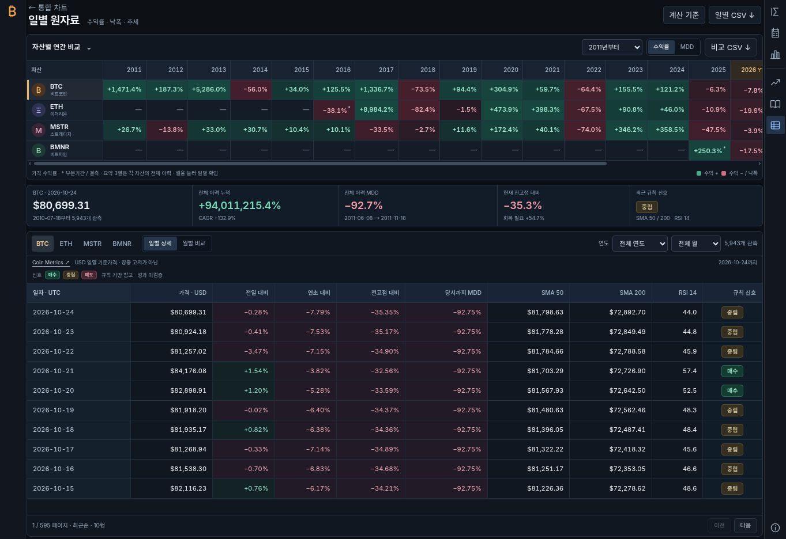
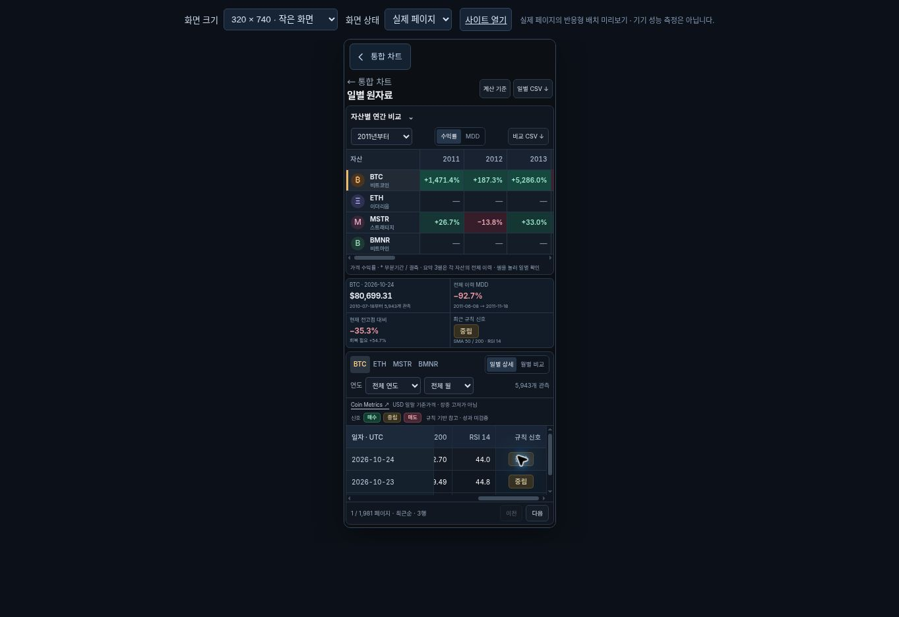

# v1.22.0 · 일별 원자료와 수익률 비교

작성일: 2026-10-25 KST. 기준 데이터 리비전: `aa73c8c96be7679ef2b5d8e8adde1887a2544475`. 기능 통합 커밋은 `e4e7bb79ec331a1227af689200d9ab8810b79738`이며, 공개 CI·Pages 배포와 실제 화면 검증을 완료했다. v1.22.1은 동일한 화면·계산 코드에 누락된 릴리스 설명 문서를 보완한 패키지다.

## 사용자에게 달라지는 점

첫 번째 첨부 이미지의 자산 × 연도 비교 구성을 적용했다. 기존 BTC·ETH·MSTR·BMNR의 실제 관측을 사용하며, 두 번째 이미지는 보조 참고로 사용했다. 이미지 속 ETF나 확인되지 않은 수익률을 원자료로 입력하지 않았다.

- 연간 수익률 히트맵에서 네 자산의 연도별 결과를 비교한다. 같은 표를 연내 MDD로 전환할 수 있다.
- 선택 자산의 월별 비교와 일별 상세를 제공한다. 연도·월 셀에서 해당 일별 관측으로 이동한다.
- 일별 표에는 직전 관측 대비·연초 대비·전고점 대비·당시까지 MDD·SMA 50/200·RSI 14·규칙 신호를 표시한다.
- 자료의 기준일·출처·가격 정의와 부분기간·결측 상태를 표시한다. 일별 CSV와 비교 CSV에도 계산 근거를 담는다.
- 자산별 전체 누적 수익률·CAGR·MDD, 현재 고점 대비 낙폭과 이전 고점 회복에 필요한 상승률을 함께 확인한다.

수익률 셀의 초록·빨강은 이미 발생한 상승·하락을 뜻한다. 별도 신호 셀은 매수에 초록, 중립에 황색, 매도에 빨강, 자료 부족에 회색을 사용한다. `매수·중립·매도`는 아래 조건을 만족했는지를 뜻한다. 색상에 텍스트를 함께 사용하며, 수익률 색상 자체를 매매 지시로 해석하지 않도록 범례를 분리했다.

## 신호의 정확한 규칙

규칙 버전은 `sma50-sma200-rsi14-v1`이다. SMA는 관측 종가의 단순평균이며 RSI는 14개 가격 변화로 초기화하고 Wilder 방식으로 갱신한다.

| 표시 | 충족 조건 |
| --- | --- |
| 매수 | 종가 > SMA 200, SMA 50 > SMA 200, 50 ≤ RSI 14 < 70. |
| 매도 | 종가 < SMA 200, SMA 50 < SMA 200, RSI 14 < 50. |
| 중립 | 필요한 지표는 준비됐으나 위 조건이 모두 성립하지 않음. |
| 자료 부족 | 200개의 연속 유효 관측을 채우지 못했거나 확인된 결측으로 지표를 다시 준비하는 구간. |

주식은 실제 거래 세션, 암호화폐는 완료된 일별 관측을 사용한다. 휴장일을 가짜 가격으로 채우지 않는다. 지표와 신호는 각 날짜까지의 관측에서 먼저 계산하고 이후 연도·페이지 필터를 적용한다. 미래 데이터를 추가해 과거 판정이 바뀌지 않도록 검사한다.

**이 조합의 수익성·적중률은 백테스트로 검증하지 않았다.** 이는 앱이 명시한 추세 관찰 규칙이다. 큰 MDD를 단독 매수 근거로 사용하지 않으며, 신호를 알게 된 종가에 이미 체결할 수 있었다고 가정하지 않는다. RSI·SMA의 일반적 정의를 확인한 것과 이 조합의 투자 성과를 입증한 것은 별개의 문제다.

## 수익률과 MDD의 범위

연간 수익률은 전년 마지막 유효 종가를 기준으로 계산한다. 이전 기준점이 없는 첫 기간은 부분기간으로 표시한다. 진행 중인 연도는 최신 완료 관측까지의 YTD다. CAGR는 실제 경과일에 `365.2425`일/년 규약을 적용하고, 첫 달력상 기념일 전에는 제공하지 않는다. 2월 29일의 첫 기념일은 다음 해 2월 28일로 처리한다.

| 화면 항목 | 계산 범위 |
| --- | --- |
| 연간·월간 MDD 셀 | 직전 기간의 마지막 기준 종가부터 해당 기간의 마지막 관측까지. |
| 일별 ‘전고점 대비’ | 자산의 첫 관측부터 해당 날짜까지의 최고 종가 대비 낙폭. |
| 일별 ‘당시까지 MDD’ | 첫 관측부터 해당 날짜까지 발생한 최대 낙폭. |
| 오른쪽 요약 3열과 상단 요약 | 각 자산의 전체 관측 이력. 표시 연도·월 필터를 바꿔도 기준을 유지한다. |

MDD는 선행 고점에서 후행 저점까지 시간 순서를 보존한 **종가 기준** 최대 손실이다. 전체 최고·최저를 단순히 나누지 않는다. 연간 MDD에 전년 마지막 종가를 포함하여 연초 갭 하락도 반영한다. 전체 이력 요약은 자산마다 시작일이 달라 같은 투자기간의 순위가 아니다.

## 검증 결과

pstack의 병렬 분할과 실제 산출물 확인 원칙을 적용했다. 이 세션에서 이용 가능한 에이전트들이 계산 엔진·화면·출처 연구를 나누어 맡았고 root가 자료 연결과 통합 검토를 수행했다. 별도 Grok·Claude 실행이나 플러그인 설치를 했다고 주장하지 않는다.

| 검증 | 작성 시점 결과 | 증거 범위 |
| --- | --- | --- |
| 새 기능 직접 테스트 | 엔진 18개, 자료 연결 5개, UI 11개 통과 | 계산 경계·인과성·결측·출처 정체성·표와 CSV 등. |
| 전체 `npm test` | **실제 테스트 942개 통과** | 테스트 파일 수가 아닌 테스트 사례 수. root의 전체 실행 결과. |
| 독립 Python 결과 비교 | 네 자산 **17,237개 관측**에 대한 독립 산식 비교 완료 | 계산 검증이며, 모든 관측 가격의 외부 공급자 재검증을 뜻하지 않는다. |
| BTC 외부 가격 대조 | Coinbase 실제 API **6개 날짜** 확인 | 연말·최신 종가의 제한된 표본. 전체 데이터 검증으로 확대 해석하지 않는다. |
| 기존 검증 게이트 | research·eth-events·treasury-paths·cycle·performance 통과 | root의 통합 실행 결과. |
| 정형 검증 | 통과 | 고정된 TLC 1.7.4 SHA-256 확인, 유한 상태 모델과 의도적으로 잘못된 구현의 음성 대조까지 검증. 금융 성과나 전체 프로그램의 수학적 증명이 아니다. |
| static·standalone | 통과 | 정적 파일 639개·참조 276개, 모듈 96개·8,276,705바이트 독립 HTML. 소스와 포함된 자료·스타일 일치 확인. |
| 브라우저·배포 화면 | 통과 | 1363×936 데스크톱, 390×844·320×740·390×430 iframe 뷰포트에서 확인. 연간 MDD 전환·연도 셀 연결·자산/월별 전환·부분기간·계산 기준·페이지 이동·CSV 실다운로드 검증. |

직접 외부 대조한 BTC 날짜는 2020-12-31, 2021-12-31, 2023-12-31, 2024-12-31, 2025-12-31, 2026-10-23이다. Coinbase와 Coin Metrics 종가의 상대 차이는 이 표본에서 절댓값 최대 0.310381%였다. Coinbase는 단일 거래소의 마지막 체결가이고 Coin Metrics는 기준 가격이므로 정의가 다르다.

첫 이미지의 2021년 BTC 수익률은 약 +66%다. 현재 Coin Metrics 자료로는 **+59.720367%**, 독립 Coinbase 종가로는 **+59.403630%**였다. 이미지의 원자료·기준일을 확인할 수 없어 이미지를 오류라고 단정하지 않았고, 앱 값을 이미지 숫자에 맞추지 않았다. 세부 자료와 재현 산식은 [연구 문서](DAILY_DATA_RESEARCH.md), 요청·응답 해시는 [교차검증 기록](data/daily-data-crosscheck-2026-10-25.json)에 있다.

## 해석에 필요한 제한

- **ETH:** Coinbase 자료는 2016-05-18부터 시작하고 최초 구간에 이틀의 결측이 있다. 보간하지 않으며 결측 구간의 실제 최대 손실은 관측 MDD보다 클 수 있다.
- **MSTR:** 1998년 이후 이력은 BTC 전략 이전 닷컴 시기를 포함한다. 전체 이력 MDD를 현재 재무 전략만의 결과로 읽으면 안 된다.
- **BMNR:** 이 번들은 2025-06-05 이후 거래소 관측이다. 더 오래된 OTC 시기를 대표하지 않으며 표본이 짧다.
- **수익률:** 주식은 제공자 분할조정 종가의 가격수익률이다. 배당 재투자·세금·수수료·스테이킹 보상을 포함하지 않는다. 이미지의 자산별 총수익률과 같은 기준이라고 가정하지 않는다.
- **비교 기간:** 전체 이력의 누적·CAGR·MDD는 각 자산의 시작일과 끝일을 함께 읽어야 한다. 표시 연도 제한은 전체 이력 요약을 동일기간 비교로 바꾸지 않는다.

## 공개 배포 및 화면 검증

| 항목 | 확인 결과 |
| --- | --- |
| 기능 통합 커밋 | [e4e7bb79](https://github.com/twoimo/bitcoin-cycle-atlas/commit/e4e7bb79ec331a1227af689200d9ab8810b79738), [PR #22](https://github.com/twoimo/bitcoin-cycle-atlas/pull/22). 원격 tree `5ed6f0d0662d87b189bca5dd799b770b4a1b4b72`가 로컬 검증 tree와 일치. |
| 공개 CI | [PR 실행 40145843595](https://github.com/twoimo/bitcoin-cycle-atlas/actions/runs/40145843595), [main 실행 40145987512](https://github.com/twoimo/bitcoin-cycle-atlas/actions/runs/40145987512) 모두 성공. |
| Pages | [배포 40145987688](https://github.com/twoimo/bitcoin-cycle-atlas/actions/runs/40145987688) 성공. [실제 원자료 페이지](https://twoimo.github.io/bitcoin-cycle-atlas/?page=data)를 2026-10-25 00:17–00:22 UTC에 직접 확인. |
| 일별 CSV | 브라우저 다운로드 파일을 파싱해 BTC 2021-12-31→2021-12-01의 31행·21열, 출처와 미검증 신호 상태, 첫 행 연초 수익률 `59.72036712689128%` 일치 확인. |
| 연간 CSV | 네 자산·2011–2026년 범위의 45행·15열 확인. 없는 자산·연도의 관측을 생성하지 않음. |
| 좁은 화면 | 문서 폭이 각각 390px·320px를 넘지 않음. 320px에서 일별 표 내부가 626px 가로 이동한 뒤에도 날짜가 왼쪽에 고정되고 규칙 신호가 보임. |
| 짧은 창 | 390×430에서 문서 높이 430px 유지. 원자료 영역은 높이 378px·스크롤 내용 615px로 내부 세로 스크롤 제공. |
| 오류 확인 | 검사한 브라우저 콘솔에서 사이트 코드의 오류 없음. 확장 프로그램의 메타데이터 전송 로그는 앱 오류에서 제외. |

실화면의 BTC는 기존 온라인 자료 갱신으로 2026-10-24까지 5,943개 관측을 가져왔다. 독립 계산 기록은 고정된 저장소 자료의 2026-10-23까지 5,942개 BTC 관측을 사용한다. 날짜가 다른 두 스냅샷의 마지막 가격·현재 DD·누적 수익률이 다른 것은 정상이다. 각 출처와 관측 종료일을 화면에 유지한다.

화면 크기 검수는 공개 페이지의 실제 반응형 iframe 렌더링이다. 실물 휴대전화의 터치 하드웨어나 네트워크 성능을 측정한 결과로 표현하지 않는다. 가로 이동 과정에서 자동화 마우스 입력이 한 번 시간 초과했으나, 재관측으로 실제 스크롤 위치와 날짜 고정·신호 표시를 확인했다.

### 데스크톱

### 320px 모바일, 규칙 신호 열 확인

최초 Release 실행은 버전별 설명 파일 `docs/RELEASE_V1_22.md` 누락으로 패키징 단계에서 중단되었으며, 게시 단계는 실행되지 않았다. 해당 문서를 추가한 v1.22.1에서 기존 자동 릴리스 절차로 패키지와 체크섬을 검증한다. 이 보완으로 화면·계산 코드의 검증 대상은 변경되지 않는다.
