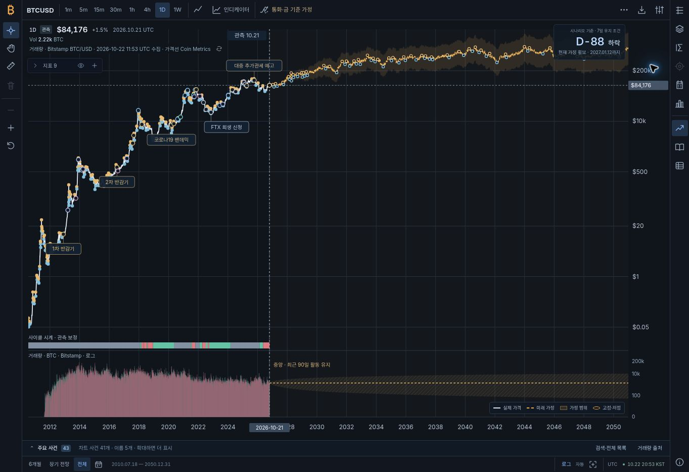
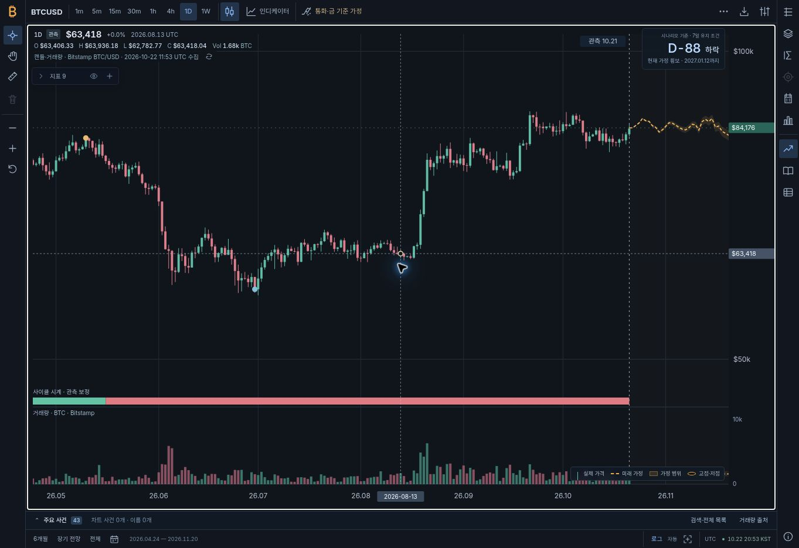
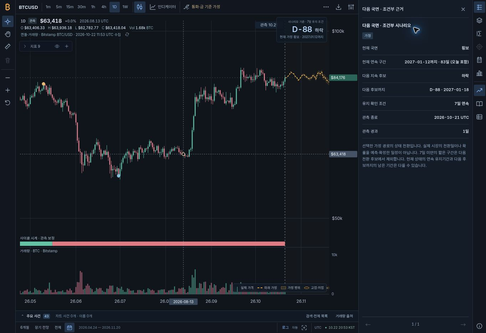
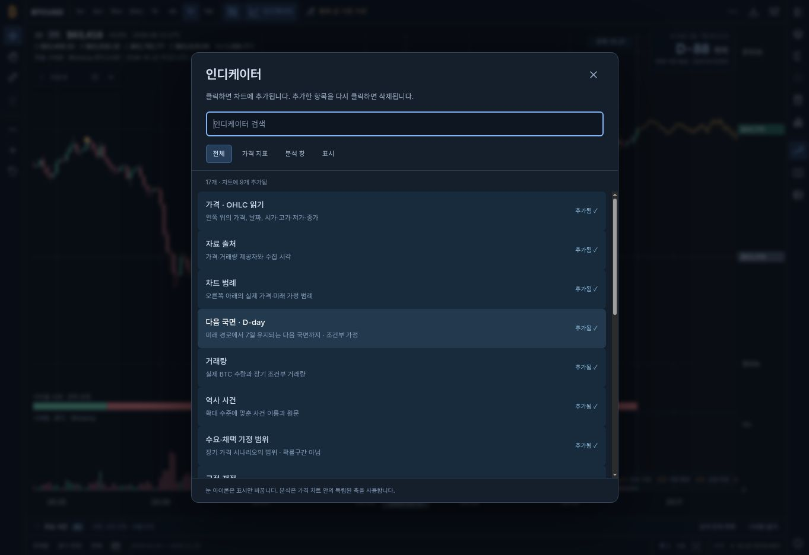

# v1.9 인디케이터·성능·사이클 시계 검증

검증일: 2026-10-22 UTC. 최종 기능 소스: [`8ddc2d2d56695f0153255c3e3acd73a594f07cbf`](https://github.com/twoimo/bitcoin-cycle-atlas/commit/8ddc2d2d56695f0153255c3e3acd73a594f07cbf), v1.9.2. 관측 기준일은 2026-10-21 UTC이며 일말 가격 5,940개를 사용했다. 이 문서는 화면·계산 일치와 실행 성능을 검증한다. 미래 시장 결과의 적중률을 평가한 문서가 아니다.

## 변경 범위

- 하단 분석 도크와 탭을 제거하고 상단 검색 가능한 인디케이터 창으로 교체했다. 항목 클릭은 추가, 재클릭은 삭제다. 차트 안의 목록에서 개별 숨김·표시·제거와 전체 숨김·표시를 제공한다.
- 가격·OHLC·거래량·날짜와 출처를 차트 좌측 상단에 통합했다. 별도 단위의 연구는 추가했을 때만 차트 내부 창으로 표시한다. 기본 화면에는 연구 창을 추가하지 않는다.
- 일반 가격·캔들·분석 선택과 명시적 상세 열기를 구분했다. 일반 선택은 우측 패널 상태를 유지한다. 이미 열린 선택 상세만 값을 갱신하고 설정·거래량 등 다른 패널은 그대로 둔다.
- 우측 상단에 같은 미래 경로의 다음 7일 이상 유지 상태 후보를 표시했다. 현재 연속 상태의 종료일에는 연도도 표시한다. D-day 상세는 별도 선택 소유권을 가지며 가격의 고정 날짜를 바꾸지 않는다.
- 해당 날짜까지 관측한 자료만 사용하는 사이클 시점 보정을 추가하고 가까운 미래 단계 시계에 연결했다. 미래 날짜에 관측 색 띠를 그리지 않는다.
- 날짜 검색·SVG 생성·재계산 범위를 줄이고, 배포 자료 확인과 사이클 산출물 검증을 CI/CD에 연결했다.

## 실제 브라우저 검수

공개 [사이트](https://twoimo.github.io/bitcoin-cycle-atlas/)에서 Chrome 1363×936 화면을 직접 조작했다. v1.9.1에서 패널 상태 조합을 검수한 뒤, 분석 이벤트 수정이 포함된 v1.9.2를 다시 열어 실제 일봉·분봉·분석 선택과 최종 배치를 확인했다. DOM의 모듈 진입점도 `app.js?v=1.9.2`로 대조했다. 아래는 자동 DOM 모형이 아닌 공개 브라우저에서 확인한 결과다.

| 동작 | 확인 결과 |
|---|---|
| 기본 배치 | 문서·뷰포트 1363×936 일치. 차트 1281×833, 문서 가로·세로 넘침 없음 |
| 하단 분석 제거 | 이전 분석 도크 DOM 없음. 기본 연구 창 0개, 기본 인디케이터 9개 |
| 검색·재클릭 | 17개 항목 검색 가능. 4년 비교 추가 시 9→10개, 같은 항목 재클릭 시 10→9개로 제거 |
| 여러 분석 | 4년 비교와 월·분기를 함께 차트 내부에 표시. 개별 숨김·삭제 후 나머지 창 유지 |
| 전체 숨김·표시 | 가격 읽기·출처·범례·D-day를 함께 숨기고 복원. 패널은 닫힌 상태 유지 |
| 일반 가격 클릭 | 날짜·값만 고정. 2031-12-12 선택 후 우측 패널은 계속 닫힘, 차트 폭 1281px 유지 |
| 실제 일봉 클릭 | 2026-08-13 캔들의 O/H/L/C·거래량 표시. 패널 자동 열기 없음 |
| 열린 선택 상세 | 방향키로 2031-12-12→13 이동할 때 열린 상세의 값만 갱신 |
| 열린 설정 | 차트의 다른 날짜를 골라도 `settings` 패널 유지 |
| 분봉 | Coinbase 완료 1분봉의 실제 O/H/L/C·BTC 수량 표시. 클릭·방향키·Enter로 선택해도 닫힌 패널 유지 |
| 분석 클릭 | 거래량 패널을 연 상태에서 월·분기 2024-09 선택. 안내는 +7.3%로 갱신하고 패널 종류는 `volume`, 가격 날짜는 2026-10-21 유지 |
| 분석 상세 연결 | 이어서 우측 데이터 버튼을 누르면 2024-09·+7.3%의 분석 상세 표시 |
| 분석 키보드 | 패널을 닫고 월·분기 ArrowRight·Enter를 누르면 2024-10·+11.2% 선택, 패널은 계속 닫힘 |
| 별도 검증 렌더러 | CryptoCon의 실제 클릭도 분석 선택·안내를 갱신하고 거래량 패널을 유지. 데이터 버튼에서 같은 선택의 근거 표시 |
| D-day 명시적 열기 | ‘다음 국면 · 조건부 근거’ 표시. 패널 도킹과 확대 후 유지, 가격 고정 날짜를 바꾸지 않음 |
| D-day에서 가격 선택 | 실제 가격을 다시 선택하면 열린 상세가 가격 정보로 전환 |
| 폭 변화 | 우측 패널을 열면 차트 폭 1281→961px, 닫으면 복원. 관측 읽기·D-day·범례는 차트 안에 유지 |

처음 실사이트 검수에서 두 가지 추가 결함을 발견해 수정했다. 하나는 D-day 근거를 도킹 재렌더가 일반 가격으로 덮는 문제였고, 다른 하나는 분석 요약만 갱신되고 실제 선택 소유권은 이전 가격에 남는 문제였다. 두 번째 문제는 캡처 리스너의 임시 플래그를 microtask로 지우는 실행 순서에 의존했다. 렌더러가 사용자 선택 여부를 직접 전달하도록 바꾸고 실제 포인터로 재검수했다. [선택 계약](../dist/inspection-policy.js), [분석 회귀](../tests/analysis-dock.test.mjs)

이번 버전에서는 실제 휴대전화·모든 보조기술의 인증 검수는 수행하지 않았다. TradingView 공개 화면과 공식 도움말의 지표 숨김·제거·범례 조작을 참고했으나, 계정 생성 화면 뒤의 지표 라이브러리를 직접 검증했다고 주장하지 않는다. 라이선스 차트 제품 전체를 탑재한 작업이 아니다. [공개 조사 범위](TRADINGVIEW_DEEP_AUDIT.md), [공식 지표 관리 안내](https://www.tradingview.com/support/solutions/43000506677-how-do-i-remove-or-customize-an-indicator/)

### 최종 화면

## 자동 검사

| 검사 | 최종 로컬 결과 |
|---|---|
| `npm test` | 29개 테스트 파일 통과, 실패·건너뜀 0 |
| 정적 상대 경로 | 65개 배포 파일, 111개 참조 통과 |
| 사이클 산출물 | 2026-10-21·5,940개 관측, 실제 적용 −52일 확인 |
| 성능 회귀 게이트 | 원자료 선택 보존·이진 탐색 읽기 예산·SVG 예산 통과 |
| 단일 HTML | 46개 모듈·5,940개 관측 포함, 8,239,716바이트, 외부 로컬 참조 검사 통과 |
| 패치 검사 | `git diff --check` 통과 |

분석 선택의 회귀는 최초/복원 렌더와 사용자 클릭·키보드·이전/다음·날짜 선택을 모든 분석 및 CryptoCon 하위 보기에서 구별한다. D-day 회귀는 실제 운영의 128개 후보 설정으로 생성한 경로와 실제 플롯에 넘긴 경로가 같은 상태·날짜를 사용하는지 검사한다. DOM 통합 검사는 실제 HTML·모듈·자료에 제어한 레이아웃을 사용했고, 실제 브라우저의 배치·이벤트 검수와 구분했다.

최종 기능 커밋의 [CI 39784761118](https://github.com/twoimo/bitcoin-cycle-atlas/actions/runs/39784761118)와 [Pages 39784761128](https://github.com/twoimo/bitcoin-cycle-atlas/actions/runs/39784761128)는 모두 성공했다. 이 문서와 화면은 해당 소스의 공개 배포 후 남긴 증거이며 계산 코드·입력 가격을 변경하지 않는다.

## 고정 스냅샷의 사이클 시계와 D-day

| 항목 | 2026-10-22 한국 날짜 기준 |
|---|---|
| 완료된 과거 참조 구간 | 3개 |
| 실제 미래 단계 시계 이동 | −52일 |
| 현재 가정 상태 | 횡보 |
| 현재 연속 구간 | 2027-01-12까지, 오늘 포함 83일 |
| 다음 7일 이상 지속 후보 | 2027-01-18 하락, D-88 |
| 해당 후보의 연속 길이 | 27일 |
| 후보 사이에서 제외한 짧은 구간 | 2개 |

D-day는 대표 경로 한 개의 상태 표시다. 운영 설정은 `sampleCount:128`, `blockDays:28`, `seed:20261022`이다. 16개 후보로 축소한 개발 검사에서는 대표 경로가 달라 D-33이 나왔으며, 이를 운영 날짜로 인용하지 않도록 운영 설정 회귀를 추가했다. 두 설정의 사이클 시계 보정은 −52일로 같다. 후보 수·가정·자료가 달라지면 대표 경로와 D-day도 달라질 수 있다. 확률이나 시장 전환의 확정 날짜를 부여하지 않는다. [계산·운영 회귀](../tests/scenario-countdown.test.mjs)

사이클 보정의 40% 하락·14일 확인, 20% 반등·14일 확인, 표본 축소, 30일 완화, 하루 2일·총 ±180일 제한은 공개한 설계값이다. 과거 평가의 8개 출발점은 독립적인 8개 시장 결과가 아니며, 평가 가능한 서로 다른 완료 결과는 1개다. 이 결과로 예측 우월성을 주장하지 않는다. [전체 수식·시간 순서·한계](CYCLE_CALIBRATION_MODEL.md)

## 점근적 분석과 측정 범위

날짜 창은 `O(log N + V)`, 반복 측정의 날짜 탐색은 `O(log N)`으로 바꿨다. 전체 관측/미래 자료는 모델·자료 객체별로 한 번 준비하고 재사용한다. 조밀한 선은 픽셀별 첫점·끝점·최저·최고값을 보존하며, 캔들·거래량 도형은 색별 경로로 묶는다. 선택 값은 원래 자료에서 읽는다. 전체 기간을 그리는 계산은 여전히 `O(N)`이다.

동일 입력과 경로·1280×720·Node SVG 생성 경계의 중앙값은 다음과 같다. **브라우저 paint·레이아웃·입력 지연 측정이 아니다.**

| 작업 | 수정 전 | 수정 후 |
|---|---:|---:|
| 전체 기간 선 생성 | 305.41ms | 34.64ms |
| 전체 기간 캔들 생성 | 883.27ms | 64.84ms |
| 1년 캔들 생성 | 87.09ms | 2.88ms |
| 전체 캔들 SVG 요소 | 33,705 | 450 |

CI는 머신 부하에 민감한 밀리초 목표 대신 읽기 수와 요소 수를 검사한다. 9개 가시 행을 조회할 때 1,024 / 16,384 / 131,072개 입력의 읽기는 29 / 37 / 43회였다. 별도 구조 게이트에서는 실제 5,544개 캔들·거래량 도형을 91개 SVG 요소로 유지하며 처음·중간·마지막 선택의 원자료 일치를 확인했다. 이 게이트는 위 벤치마크와 표시 옵션이 다르므로 91과 450을 같은 조건의 수치로 비교하지 않는다. [전체 조건·원시 JSON](CHART_PERFORMANCE.md)

## 자동 갱신

일말 자료 갱신 작업은 하루 네 번 완료 자료를 확인하고 사이클 산출물을 재생성·검증한 뒤 같은 작업에서 Pages를 배포하도록 구성했다. 가격이 같으면 불필요한 모형 재계산을 피하고, 같은 기준일의 더 새로운 수동 자료를 오래된 백그라운드 응답이 덮지 않게 했다. 열린 페이지는 보이는 상태에서 6시간 간격으로 공개 스냅샷을 확인하고, D-day는 한국 날짜가 바뀔 때 갱신한다. 실제 관측 기준일과 수집 시각은 별도 표시한다. [갱신 작업](../.github/workflows/refresh-data.yml), [브라우저 자료 정책](../dist/published-data.js)

예약 시각은 실행 보장이 아니며, 새로 바꾼 예약 작업이 실제 실행된 기록과 일반 소스 CI/Pages 성공을 구분해야 한다. 연구 보고서와 과거 검증 수치를 매번 자동 재작성하지 않는다.
