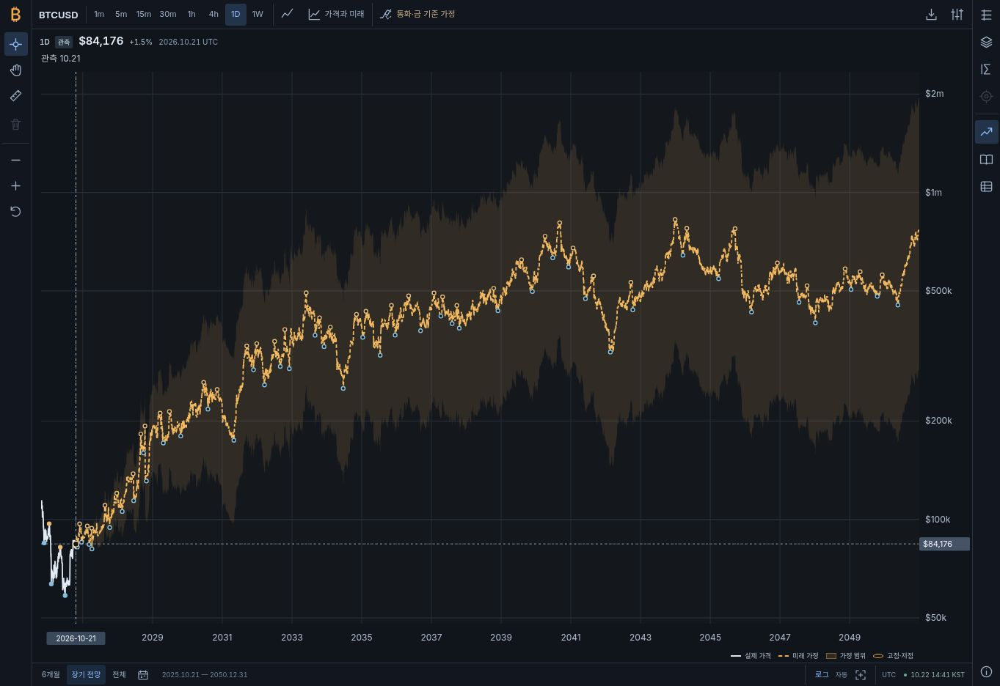
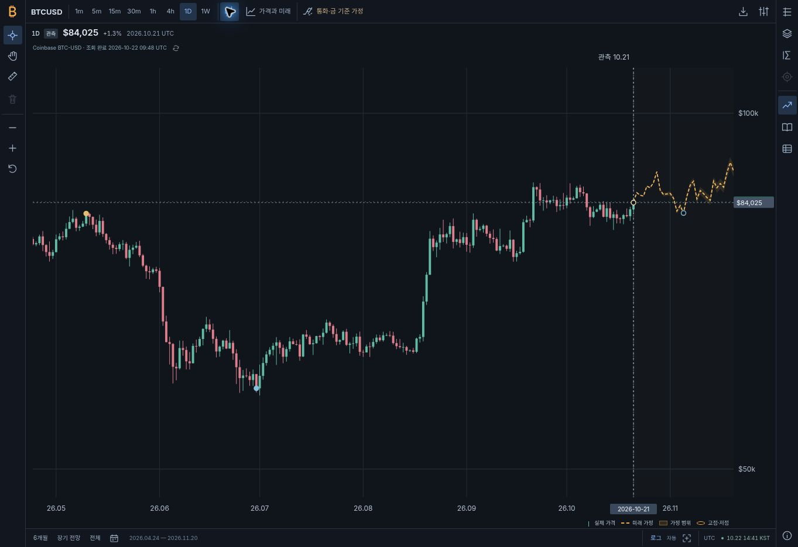

# v1.6 장기 전망·실제 캔들 검증

검증일: 2026-10-22. 기능 커밋: `641d42f66f83053d2a6aa236b59b5047355a00e5`. 배포 캐시 보완: `5ef1a1ddd9e7abad123f5c5e9ab7ef56f16667f8`.

## 구현 범위

- 고정 3년 표시 제한을 제거하고 적격 원문의 마지막 목표 연도인 2050-12-31까지 자동 표시한다. 미래 연수 선택기는 추가하지 않는다.
- 원문 목표값, 앱의 파생·스트레스 가정, 흔들림을 포함한 예시 가격 경로를 구분한다. 새 장기 모형은 검증된 미래 적중률을 주장하지 않는다.
- 상단에서 1m·5m·15m·30m·1h·4h·1D·1W와 선·캔들을 전환한다. 캔들은 실제 완료된 Coinbase BTC-USD OHLCV만 사용한다.
- 범례는 차트 오른쪽 아래에서 가격축 공간을 남긴다.
- 일·주 장기 차트에 관측 종료일 이후의 거래소 봉을 끼워 넣거나 미래 캔들을 합성하지 않는다.
- 최초 캔들 전환 시 최근 실제 구간으로 맞추고 하단 장기 전망으로 전체 미래를 복원한다.

## 자동 검증

다음 명령을 실행했다.

```sh
npm test
node --test --test-isolation=none --test-reporter=tap tests/*.test.mjs
node scripts/verify-static.mjs
node scripts/build-standalone.mjs build/Bitcoin_Cycles_Comparison.html
node scripts/verify-static.mjs --standalone build/Bitcoin_Cycles_Comparison.html
git diff --check
```

격리 해제 실행은 **106개 보고 항목, 106개 성공, 0개 실패**였다. 이전 테스트 중 일부는 파일 단위 assertion 묶음이며 항목 수를 시장의 독립 표본 수와 혼동하지 않는다. 새로운 장기 모형의 이름 있는 행동 테스트는 12개, 자료 요청 제어 테스트는 8개다.

검증은 가격 경계의 연속성, 출처 연도에 따른 종료일, 원문 가격의 보존, 미래 관측의 배제, 재현성, 수익률 블록의 정보 시점, 경제 가정 범위, 스트레스 출처 구분, 표시 경로의 전환점, 정수 사토시 공급 산술을 포함한다. 자료 제어에서는 실패 시 저장 자료의 원래 수집 시각 보존, 잘못된 OHLC 거부, 간격 변경·취소 후 늦은 응답 차단, 새로고침 복구를 확인한다.

정적 검증은 GitHub Pages 프로젝트 하위 경로의 **48개 파일·79개 참조**를 확인했다. 독립 실행 HTML에는 5,940개 완료 일말 관측과 8개 간격의 검증된 OHLC 저장 자료, 32개 모듈이 포함됐다. 이 빌드는 약 5.54 MB다.

## 독립 교차검토

조사·발행량/모형·차트 구현을 병렬로 진행한 뒤 담당이 다른 검토자가 가격·변동성의 의미와 통합 계약을 재검토했다. 검토 중 혼합·스트레스 값을 기관의 공식 목표처럼 표시하던 문제, 채택 가정이 기존 단기 시계를 함께 바꾸던 문제, 캐시된 간격으로 돌아갈 때 진행 중 요청이 취소되지 않던 문제를 찾아 수정했다.

통합 코드 검토에서는 5개 경제 시나리오와 선택적 단기 모형이 없는 입력의 설명 생성, 74개 선택자 대상, 초기화 순서, 선택 이벤트·차트 입력의 계약을 확인했다. 리서치 인덱스는 100개 중복 없는 주자료와 27개 보조 자료를 불러오며 새 장기 주장 13개를 필터로 볼 수 있다.

## 공개 배포와 브라우저

공개 사이트 [Bitcoin Cycle Atlas](https://twoimo.github.io/bitcoin-cycle-atlas/)의 실제 데스크톱 브라우저에서 다음 동작을 확인했다. 검증 시각은 2026-10-22 09:48–09:55 UTC다.

| 확인 항목 | 실제 결과 |
| --- | --- |
| 기본 장기 전망 | `2025.10.21 — 2050.12.31`이 표시되며 미래 연수 선택기가 없다. |
| 상단 간격 | 1m·5m·15m·30m·1h·4h·1D·1W가 표시된다. |
| 일봉 캔들 | 실제 Coinbase OHLC 181개가 표시됐으며 마지막 봉은 2026-10-21이다. 최초 전환에서 최근 180일과 이후 30일로 확대됐다. |
| 관측 경계 | 일봉의 마지막 완료 관측 뒤에는 미래 점선이 이어지며 미래 캔들은 표시되지 않는다. |
| 15분 봉 | Coinbase 조회가 완료되고 2026-10-22 09:30 UTC 완료 봉까지 표시됐다. 방향키로 이전 봉을 선택하자 OHLC·시가 대비 변화율·UTC 시간이 함께 갱신됐다. |
| 선·캔들 전환 | 같은 15분 자료를 캔들과 실제 종가 선으로 전환했다. |
| 4시간 봉 | 집계 자료 조회가 완료되고 2026-10-22 04:00 UTC 완료 봉의 OHLC가 표시됐다. 미래 가격 경로와 장기 날짜 범위는 분·시간 화면에서 표시되지 않는다. |
| 장기 화면 복원 | 일봉으로 돌아온 뒤 장기 전망이 2050-12-31까지 복원됐다. |
| 오른쪽 아래 범례 | 장기·일봉 화면에서 범례가 차트 오른쪽 아래에 있고 오른쪽 가격축 공간을 침범하지 않는다. 분·시간 화면에서는 실제 자료의 범례만 표시한다. |
| 모델과 검증 | 2050년 종료 근거, 기관 원문 기준선, 예시 경로의 의미, 확정 주기 종료일이 없다는 설명이 실제 상세 패널에 나타났다. |
| 장기 자료 필터 | `장기 전망·금·변동성`을 선택하면 13 / 100개, `WisdomTree` 검색 시 2 / 100개, 초기화하면 전체 100개 자료가 표시됐다. |
| 오류 확인 | 화면에 NaN·undefined가 없고 앱 오류 표시가 숨겨져 있었다. 수집된 경고·오류 37개는 모두 브라우저 확장 프로그램의 메타데이터 메시지였고 앱 출처의 메시지는 없었다. |

일별 장기 관측은 Coin Metrics, 실제 OHLC는 Coinbase BTC-USD를 사용하므로 같은 날짜의 가격이 완전히 같다고 가정하지 않는다. 예를 들어 검증 시 2026-10-21 관측은 각각 약 $84,176과 $84,025로 나타났고, 캔들 쪽은 Coinbase 출처와 OHLC를 명시했다. 이 차이를 제거하려고 실제 봉의 가격을 장기 자료에 맞춰 변형하지 않는다.

브라우저 검증 중 이전 모듈이 캐시에 남는 현상을 확인하여 변경된 진입점·모듈·스타일에 릴리스 쿼리를 추가했다. 공개 화면에서 신규 간격, 장기 종료일과 모델 설명이 로드된 것을 확인했으며 독립 실행 HTML 빌드도 버전 쿼리가 있는 모듈 경로를 처리한다.

- 기능 CI: [성공한 실행](https://github.com/twoimo/bitcoin-cycle-atlas/actions/runs/39757418910)
- 기능 Pages 배포: [성공한 실행](https://github.com/twoimo/bitcoin-cycle-atlas/actions/runs/39757418756)
- 캐시 보완 CI: [성공한 실행](https://github.com/twoimo/bitcoin-cycle-atlas/actions/runs/39758024849)
- 캐시 보완 Pages 배포: [성공한 실행](https://github.com/twoimo/bitcoin-cycle-atlas/actions/runs/39758024779)

### 실제 화면

장기 전망과 오른쪽 아래 범례:



실제 일봉 캔들, 관측 경계 뒤의 미래 점선, 오른쪽 아래 범례:



## 검증의 한계

구현 검증은 미래 가격의 정확도를 증명하지 않는다. 현재 원문을 과거 가격에 붙이는 방식은 당시 알려진 정보만의 백테스트가 아니며, 과거 단기 모형의 평가를 새 장기 모형에 재사용하지 않는다. 거래소 API의 미래 가용성이나 실제 모바일 기기 전체의 동작도 이 검증이 보장하지 않는다.
