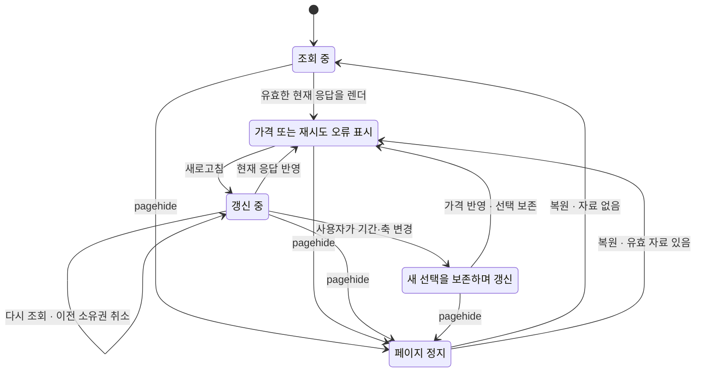

# 시스템 심층 감사 · 2026-10-25 · v1.23.0

## 결론

**재현한 화면·수치 경계 결함을 수정했고, 반복 계산 병목 두 곳을 줄였다. 최종 통합 977개 테스트와 11개 검증·빌드 명령이 통과했다.** 별도 검토자는 추가 수치 반례 두 건과 형식 모델·검증기의 누락을 찾아 수정 후 재검증했다. 확인한 범위에 미해결 검토 지적은 없다. 모든 가능한 입력과 실행 순서에서 결함이 없다는 판정은 아니다.

시작 기준은 v1.22.1, `64c8207cb044d8990289c5a7d39972e21b74c240`이다. 수정 runtime은 [`1ad3be543e870e74f10708c266f19572b217d25f`](https://github.com/twoimo/bitcoin-cycle-atlas/commit/1ad3be543e870e74f10708c266f19572b217d25f)에 고정했다. 이 commit의 27개 배포 파일 blob과 전체 tree를 검사한 로컬 내용과 대조했다. 동작 수정은 6개 JavaScript 모듈이며, 나머지는 브라우저가 새 의존성을 받도록 한 v1.23.0 URL 전파다. 검증 스킬·모델·보고서는 별도 commit으로 관리한다.

공개 CI·Pages·릴리스의 완료 여부는 해당 PR 및 [Actions](https://github.com/twoimo/bitcoin-cycle-atlas/actions), [v1.23.0 릴리스](https://github.com/twoimo/bitcoin-cycle-atlas/releases/tag/v1.23.0)의 실제 상태를 따른다. 아래의 로컬 실행 증거가 아직 끝나지 않은 외부 배포의 성공을 대신하지 않는다.

## pstack 병렬 점검 방식

사용자가 지정한 [공식 pstack](https://github.com/cursor/plugins/tree/main/pstack)의 commit `9580c23696ac8d7abed0c166f2f9918800afb819`에서 `swarm`, `bug-fix`, `perf-issue`, `benchmark-checklist`, `create-formal-verification-skill`, `maintain-formal-verification-skill`, `statechart`를 읽고 적용했다. 성능·수치/재무·비동기 상태를 병렬 분담하고 파일 소유권을 나눴다. 이어 별도의 수치/캐시 reviewer와 스킬 cold reviewer가 반례를 찾고 실제 명령을 실행했다. 이 환경에서 제공되는 에이전트를 사용했으며, 사용하지 않은 Cursor 실행기나 특정 외부 모델의 결과로 표현하지 않는다.

성능 시간 측정은 다른 전체 테스트·TLC 작업을 멈춘 뒤 별도 실행했다. 수정자는 회귀가 녹색이라는 이유만으로 완료하지 않았고, reviewer가 찾은 다음 세부 문제까지 닫았다.

- 양의 subnormal 비율을 먼저 나눈 뒤 로그를 취하면 원래 입력 정보가 사라지는 경계.
- 정확한 기울기가 최대 유한값 이하인데 중간 반올림 때문에 거절되는 경계.
- 제품에는 없는 즉시 loading guard를 모델에 둬 연속 refresh 순서를 빠뜨린 문제와, skipped replay를 성공으로 셀 수 있던 검증기 문제.

## 실제로 바꾼 동작

| 영역 | 재현한 문제 | 수정과 검증 |
| --- | --- | --- |
| ETH 정보 창 | 버튼을 누르면 `esc is not defined`로 대화상자가 열리지 않음 | 누락된 HTML escape 함수를 정의했다. 기존 공개 사이트의 실제 클릭과 콘솔 오류로 독립 재현했고, 전체 initializer의 클릭 경로로 회귀 검사한다 |
| ETH 초기 준비 | 취소된 초기화의 마지막 frame이 복원 직후 빈 화면을 준비 완료로 공개할 수 있음 | 실제 가격 또는 재시도 가능한 오류가 렌더된 뒤 한 번만 `atlas:ready`를 발행한다 |
| ETH 페이지 이탈 | 늦은 초기화·resize callback이 숨긴 페이지에 화면이나 준비 상태를 발행할 수 있음 | `pagehide`에서 소유권을 취소하고 `schedule`·`render`에 suspension 검사를 적용한다. persisted `pageshow`에서 복원한다 |
| ETH 조회 중 조작 | 가격 응답이 조회 대기 중 사용자가 바꾼 날짜·가격축을 초기화함 | 요청 시작 시 navigation revision을 캡처한다. 새 자료의 경계는 갱신하면서 나중의 사용자 선택을 보존한다. 일·주·분봉 통합 경로를 재생했다 |
| 일별 원자료 반복 작업 | 일별 페이지를 옮길 때 보이지 않는 월별 히트맵까지 매번 생성함 | 월별 모드일 때만 해당 표를 생성한다. 월별 보기를 열면 현재 자산·필터·지표로 그린다 |
| 비교 화면 반복 작업 | 이미 보유한 일·주 국면과 전환점을 redraw마다 다시 계산함 | 기존 분석 결과를 재사용한다. 가격 자료 객체나 threshold가 바뀌면 기존 무효화 경로로 재계산한다 |
| 기간별 자료 품질 | 12월 30일 다음 관측이 1월 2일이어도 이전 12월·연도가 완전한 자료로 표시됨 | 이후 기간 관측이 확인한 이전 기간 말일 결측을 반영한다. 명시된 같은 누락일을 중복 합산하지 않는다. 주식 휴장일은 누락 세션으로 추정하지 않는다 |
| 달력 연산 | `0099-12-31 + 1개월`이 `2000-01-31`, 지원 범위 초과가 잘린 날짜가 됨 | 정수 월 좌표·Gregorian 윤년으로 이동하고 0000–9999년 범위 밖은 명시적으로 거절한다 |
| 수치 연산 경계 | 유한 답의 중간식 overflow, subnormal 로그 정보 손실, 최대값 부근 기울기의 이중 반올림 | 중앙값·기울기·로그수익률·기하평균의 안정식을 적용한다. 실제 표현할 수 없는 최종 결과는 `RangeError`로 구별한다 |

마지막 행의 극단 입력은 실제 BTC 시세에서 22% 오류를 발견했다는 뜻이 아니다. 독립 반례의 로그 중점은 `MIN_VALUE`와 `1.5` 사이에서 기존값이 약 22.4745% 컸다. 수정 후 로그 중점·변동성·되돌림이 별도 오라클과 일치했다. 최대값 부근 기울기는 binary64를 BigInt 유리수로 변환하여 정확한 답이 MAX 이하인지 확인했다. 상세 입력·이전 결과·수정 결과는 [독립 검토](SYSTEM_INDEPENDENT_REVIEW_2026_10_25.md)에 있다.

## 성능 측정

Node v24.22.1에서 실제 controller, 계산, 표 문자열과 SVG renderer를 실행했다. baseline 의존성 위에 성능 수정 view 두 파일만 바꿔 다른 수치·상태 변경의 영향을 분리했다. 각 구현 2회 warmup 후 **7회 교대 실행**했으며 중앙값과 범위를 보존했다. 입력은 BTC·ETH·MSTR·BMNR의 17,237개 관측이다.

| 작업 구간 | 이전 중앙값 | 수정 후 중앙값 | 감소 |
| --- | ---: | ---: | ---: |
| 일별 표 80회 페이지 이동 | 1,149.90 ms | 335.46 ms | **70.83%** |
| 일별 첫 표시·4자산·월별 전환을 포함한 전체 경로 | 1,452.71 ms | 532.84 ms | 63.32% |
| 비교 화면 26회 redraw | 1,540.93 ms | 229.37 ms | **85.11%** |
| 비교 첫 분석을 포함한 전체 경로 | 2,724.30 ms | 1,310.05 ms | 51.91% |

일별 표에서 숨겨진 월별 생성은 80회에서 0회로 줄었다. 비교 redraw에서 직접 rolling-state·전환점 재계산은 각각 26회에서 0회로 줄었다. 실제 사용자가 보는 작업을 건너뛴 것이 아닌지 확인하기 위해 일별 표시 snapshot 97개와 비교 snapshot 27개, 요청된 SVG draw 26회, 결과 문자열 hash를 대조했다. 출력은 동일하고 양쪽 오류는 0이었다.

이는 **Node 계산·표/SVG 생성 구간**이다. inert DOM 경계를 쓰므로 네트워크, HTML 파싱, 브라우저 layout·paint, 모바일 기기의 프레임 시간을 측정하지 않았다. 최종 앱 전체가 이 비율만큼 빨라졌다고 확대하지 않는다. 비교 화면 첫 분석은 1,117.32 → 1,071.56 ms로 범위가 겹쳐 개선이 입증되지 않았다. 약 1.1초의 첫 계산 비용은 남아 있다.

별도 reviewer는 늦은 다른 자산 응답, retry, 같은 날짜의 새 가격 객체, destroy 뒤 완료, RAF 전 두 자료 변경과 threshold 변경, frozen 캐시의 8회 redraw, 숨겼다가 여는 경로를 검사했다. [측정 방법과 원시 표본](SYSTEM_PERFORMANCE_AUDIT_2026_10_25.md) · [성능 JSON](data/system-performance-audit-2026-10-25.json)

## 수학적 주장과 독립 계산

### MDD와 지표

양수 가격의 음수 표기 MDD는 `100 × min(P_trough / P_peak − 1)`, 단 `peak ≤ trough`다. 특정 저점에서 이전 최고점을 분모로 쓰면 가능한 비율 중 최솟값이므로 시간순 running peak 방식은 모든 순서쌍 탐색과 대수적으로 같다. 손실의 부호를 뒤집는 것과 회복 수익률은 다르다. 50% 하락을 복구하려면 100% 상승이 필요하다.

별도 구현은 역방향의 이후 최저점으로 모든 자료의 MDD를 대조하고, 생성 시계열 300개에서는 모든 순서쌍을 직접 열거했다. 17,237개 관측의 SMA50·SMA200·RSI14, 연도 59개·월 680개의 수익률·MDD를 독립 계산했다. 네 자산의 전체 일별 분석 결과 및 BTC 전체 rolling/monthly 결과는 정상 자료에서 baseline과 완전히 같았다.

| 자산 | 종가 관측 수 | 전체 관측기간 MDD |
| --- | ---: | ---: |
| BTC | 5,942 | −92.7486334547% |
| ETH | 3,809 | −94.0116304238% |
| MSTR | 7,137 | −99.8562300358% |
| BMNR | 349 | −90.1407404299% |

각 시작일과 고점·저점 날짜는 [수치 감사](SYSTEM_NUMERICAL_AUDIT_2026_10_25.md)에 있다. 마지막 관측은 2026-10-23이다. 서로 시작일이 다른 전체 이력 MDD이며, 장중 최대 손실·배당 재투자 총수익률·미관측 날짜의 손실을 복원하지 않는다.

### 재무·사이클·미래 경로

보통주 잔여가치 `코인수량×가격 + 현금 + 기타자산 − 선순위청구권`에서 발행·비용·원금 상환의 자산과 청구권 변화를 따로 검산했다. 400개 생성 상태의 1,200개 연산과 legacy 경로 검사는 현재 UI 일별 재무 경로 검사를 대신하지 않는다. 최종 UI 경로의 별도 gate는 2050년까지 **53,010개 재무 전이와 26,505개 ETH 잔차**를 검사했다. [최종 입력·소스와 계산 결과](data/treasury-path-verification-2026-10-25.json)

`고점 선행 + 하락기간 단축 = 저점 선행`은 날짜 차를 분해한 항등식이다. `33 + 99 = 132일`의 일관성에서 반감기의 가격 인과성이나 미래 저점의 정확성이 따라오지는 않는다. 다섯 cutoff의 과거 리본과 fixed-asOf 단기 경로가 뒤에 붙인 미래 관측으로 바뀌지 않는지 확인했다. 장기 8,836개 경로점의 유한성 및 외부 조건 두 개의 가격 기준도 대조했다.

기본 수치 검증기의 **324,467회**는 scalar 비교·유한성 검사 횟수다. 독립 시장 표본 수나 테스트 케이스 수가 아니다. 별도 reviewer는 달력 34,356개 경우, 80개 결측 시계열의 1,451개 기간, 일별 prefix 325회·rolling prefix 10회, 정상 시계열 12개의 전체 출력 동등성을 검사했다. [수치 receipt](data/system-numerical-audit-2026-10-25.json) · [별도 reviewer receipt](data/system-independent-review-2026-10-25.json)

매수·중립·매도는 공개된 SMA/RSI 관찰 규칙이며, 수수료·슬리피지·체결 시각을 반영한 수익성 증명이 아니다. 재표집 경로의 10–90% 범위를 현실의 80% 확률구간으로 부를 근거도 없다. 이런 해석의 경계는 유지했다. [수치 감사의 1차 자료와 검증 한계](SYSTEM_NUMERICAL_AUDIT_2026_10_25.md#1차-자료)

## 상태전이와 검증 스킬

새 프로젝트 스킬 `verify-eth-state`는 실제 코드, TLA+ 모델, 전체 initializer 재생, 실제 코드 변이와 상태전이도를 함께 검증한다. `verify-market-state`와 `verify-equity-state`는 이전 sync 이후의 소스 diff를 읽고, covered action/await/guard가 변하지 않았음을 확인한 뒤 실행 증거와 sync commit을 갱신했다. [모델 유지 증거](data/system-formal-maintenance-2026-10-25.json)

아래는 수정한 ETH 동작을 설명하는 축약도다. 숫자·전체 실패 경로는 공식 pstack 산출물을 기준으로 읽는다.

상태가 정지했거나 요청 소유권을 잃은 callback은 화면을 발행하지 않는다. `atlas:ready`는 유효한 첫 표시에서 한 번만 발생한다. 실제 TLA+는 자료 유무·오류·ready·request generation·navigation revision을 별개 변수로 표현하며 위 그림보다 세밀하다.

| 모델 | 생성 상태 | 고유 상태 | 남은 queue | 최종 결과 |
| --- | ---: | ---: | ---: | --- |
| MarketRequests | 5,955 | 2,081 | 0 | PASS |
| EquityLoad | 303,261 | 46,252 | 0 | PASS |
| EthLoad | 11,109 | 2,243 | 0 | 여섯 invariant PASS |

ETH의 경계는 요청 세대 3개, daily/weekly, automatic/custom range class다. 실제 코드를 실행한 회귀는 **17/17 PASS**, 불변 baseline에서는 **10 PASS / 7 예상 FAIL**, 실제 임시 코드의 보호 제거 **9개 모두 의도한 assertion 실패**, 복원 후 **17/17 PASS**였다. skip·cancel·todo가 있는 실행을 PASS로 받지 않는 것도 실제 skip 변이로 확인했다.

공식 `statechart` 도구를 baseline 10회·fixed 7회 TLC 실행으로 생성하고, 독립 reviewer가 다시 생성해 Mermaid 4개·PNG 4개·stories·summary의 byte 단위 일치를 확인했다. baseline graph는 3,503개 상태·12,879개 전이이며, 읽기용 cover chart는 10개 상태·12개 전이를 그린다. reader graph의 상태 4개·전이 34개가 생략되므로 축약 그림을 전체 탐색 그래프로 부르지 않는다.

[공식 상태전이도 PNG](formal-eth/statechart/chart.png) · [3개 실패 이야기](formal-eth/statechart/stories.md) · [모델과 코드 대응](formal-eth/README.md) · [스킬 cold review](FORMAL_SKILL_REVIEW_2026_10_25.md)

이 검증은 유한 범위의 안전성 검증이다. 무제한 요청, 네트워크 완료 보장, 특정 브라우저의 BFCache 스케줄링, pixels, 수학 산식과 미래 가격 정확도를 증명하지 않는다. 숨긴 페이지의 callback을 허용하는 것은 방어 조건을 검사하기 위한 과대근사다. history focus의 실제 활성 조건·캐시된 daily 자료·microtask 경계도 대응 문서에 명시했다.

## 최종 통합 실행

[최종 통합 receipt](data/system-integrated-verification-2026-10-25.json)는 107개 runtime 모듈 해시, 명령별 실제 종료 상태, 전체 테스트 수와 출력 해시를 기록한다. 검사 중 runtime 해시가 바뀌지 않았음도 확인했다.

| Gate | 결과 |
| --- | --- |
| `npm test` | **977 PASS**, fail/cancel/skip/todo 모두 0 |
| 연구 생성물·ETH 사건 검사 | PASS |
| 일별 재무 경로 검사 | PASS |
| 수치 오라클과 별도 reviewer 오라클 | PASS |
| 시장·주식·ETH 형식 검증 및 변이 | PASS |
| 사이클·차트 성능 구조 검사 | PASS |
| 정적 파일·참조 검사 | PASS — 639 files / 276 references |
| 단일 HTML 빌드·검증 | PASS — 8,281,921 bytes / 96 modules |

별도 정적 의미 검사는 107개 최상위 배포 JavaScript에 14개 오류 규칙을 적용했다. 미정의 참조는 수정 후 0이었다. 남은 루프 경고 네 개는 감소하는 행 수 및 페이지 진행/취소 조건을 읽어 두 위치의 오탐으로 분류했다. [정적 검토와 공개 UI의 수정 전 재현](data/system-static-audit-2026-10-25.json)

재실행은 [릴리스 노트](RELEASE_V1_23.md)의 명령을 따른다. 새 수치 오라클 두 개와 ETH 형식 검증은 CI·Pages·릴리스 gate에 포함했다. 로컬 scratch 경로나 과거 git checkout은 기본 실행의 전제가 아니며, baseline differential 비교에만 선택적으로 사용한다.

## 남는 범위

비교 화면 첫 분석 비용은 남아 있다. 실제 브라우저·기기별 p95 지연 및 메모리 전체 프로파일은 이번 시간 측정의 범위 밖이다. 전체 binary64 입력과 모든 누락 패턴을 전수 검사하지 않았다. 가격 원천의 모든 역사 개정, 장중 가격, 배당과 실전 매매 성과도 새로 보증하지 않았다. 새 검증을 CI에 남겼으므로 후속 변경은 같은 반례와 오라클·모델을 다시 통과해야 한다.
