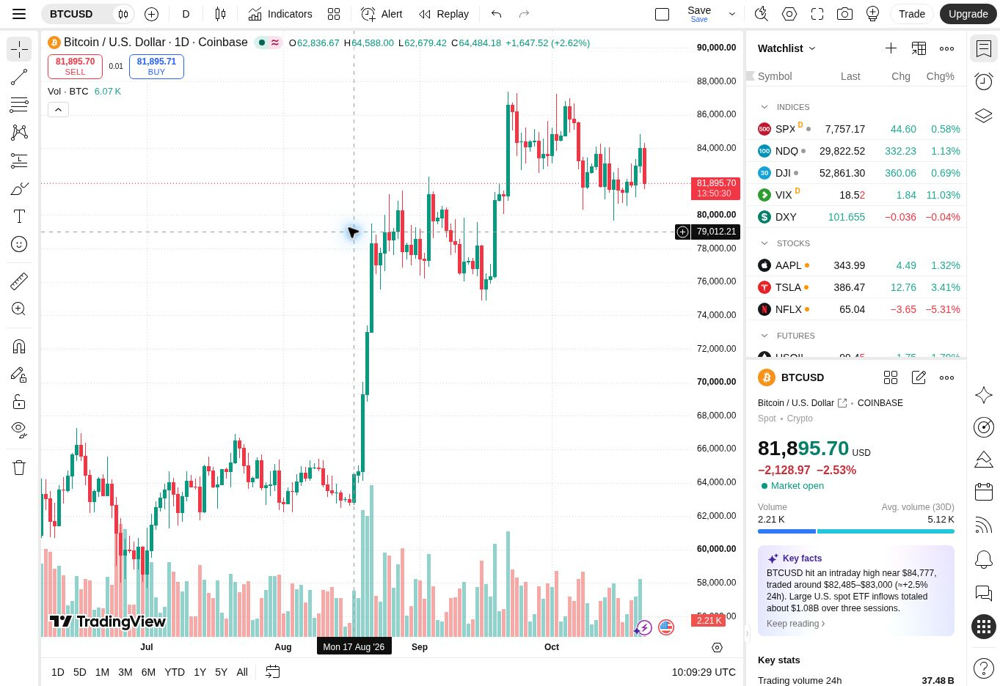

# TradingView 화면 조사와 차트 작업공간 개선

조사·구현일: 2026-10-22 UTC. 기준 코드: `f48c0d79a7922c7f460057629ae58e8a8b12c004`. 제품 버전: 1.7.0.

## 결론과 작업 범위

사용자가 지정한 TradingView의 실제 공개 차트를 열고 BTC/USD Coinbase 1D를 선택했다. DOM·접근성 트리·실제 화면을 읽어 다섯 영역과 상태 표시를 확인했다. Atlas의 가격 연구 목적에 맞춰 조작, 데이터 읽기, 사건 탐색, 출처 검증을 보강했다. 가격 전망의 출처 기반 표시 끝은 기존 2050년이며, 예측 연수를 고르는 UI를 추가하지 않았다.

사용자가 첨부한 첫 이미지의 범례를 두 번째 이미지의 위치처럼 **플롯 안쪽 오른쪽 아래, 날짜축 위**로 옮겼다. 가격축과 날짜축에는 범례를 겹치지 않는다. 거래량 패널을 켠 경우에도 전체 플롯의 하단 모서리를 기준으로 위치한다.

## 조사 방법과 직접 확인한 범위

직접 접근한 페이지: https://www.tradingview.com/chart/ . 공개 기본 화면에서 종목 검색을 열고 `COINBASE:BTCUSD` 현물을 선택했다. 당시 화면의 상단 시가·고가·저가·종가, 커서 위치의 날짜·값, 일봉 캔들, 하단 BTC 거래량과 우측 관심종목/종목 상세가 보였다. 실제 화면은 아래 캡처에 보존했다.

이후 차트의 우클릭을 시도하자 계정 생성 안내가 표시되었다. Escape와 바깥 클릭으로 닫히지 않아 로그인 이후의 메뉴나 거래 기능을 직접 검증했다고 기록하지 않는다. 아래 조작 분석은 **직접 관측**, **공식 문서 확인**, **Atlas 구현 검증**을 구분한다. 비공개 통신을 호출하거나 계정 장벽을 제거하지 않았다.

원본 서비스의 DOM과 자산 URL은 관측했고, 비공개 내부 JS 상태·사용자 세션·사설 시세 프로토콜은 사용하지 않았다. 이 작업은 TradingView 라이브러리를 탑재하거나 라이선스 제품의 기능 전체를 복제한 것이 아니다.

## 다섯 영역의 분석과 반영

| 영역 | TradingView에서 확인한 정보 구조 | Atlas에서 발견한 부족 | 반영한 동작 |
|---|---|---|---|
| 상단 메뉴 | 종목, 간격, 캔들 형태, 지표, 알림, 재생, 레이아웃, 설정, 저장 | 선택 봉의 OHLC가 툴팁에 치우쳤고 빠른 조작 진입점이 부족 | 8개 간격 유지, 선/캔들 전환, OHLC·BTC 거래량 읽기, 간격 키보드 이동, 빠른 조작 메뉴 |
| 좌측 도구 | 십자선, 그리기 계열, 측정, 확대, 잠금·숨김 등 | 분·시간봉 이동과 확대가 비활성 | 십자선·이동·휠 확대·좌클릭 드래그를 분·시간봉에도 적용. 일·주봉 측정 유지 |
| 중앙 차트 | 가격과 거래량, 동기화된 날짜축, 커서 값, 가격축 | 거래량 패널 및 역사적 사건이 없었음 | 실제 BTC 거래량 별도 패널, 동기화 십자선, 적응형 사건 라벨과 원문 연결 |
| 우측 패널 | 관심종목, 종목 상세, 데이터 창 등 | 선택 자료와 모델 외 역사/거래량 근거 탐색이 부족 | 사건 검색·7개 분류·전체 목록, 사건 날짜 근거, 가격·거래량 출처와 수집시각·검증 범위 |
| 하단 패널 | 표시기간, 날짜 이동, 시간대, 패널 진입 | 기간 도구만 있고 사건 탐색 경로가 없음 | 표시 구간에 맞춰 갱신되는 사건 타임라인, 검색·전체 목록과 거래량 출처 바로가기 |

전체 가격·전망 범위가 처음부터 보이도록 기본 화면을 2010년의 가격 자료 시작부터 출처 기반 미래 끝까지 설정했다. 캔들을 처음 선택하면 식별 가능한 최근 구간으로 확대하는 기존 동작을 유지하며, 하단 ‘전체’로 과거와 미래를 함께 본다.

## 마우스·키보드 조작

| 동작 | Atlas의 구체적 동작 | 근거·한계 |
|---|---|---|
| 휠 | 포인터 위치를 기준으로 날짜 범위 확대/축소 | TradingView 공식 안내의 상호작용을 참고. 브라우저 자체 Ctrl/Meta 확대는 가로채지 않음 |
| 가로 휠 / Shift+휠 | 같은 폭으로 좌우 이동 | 실제 UTC 날짜 또는 Unix 초 간격으로 계산 |
| 좌클릭 드래그 | 가로 5px 이상의 실제 드래그만 이동으로 판정 | 단순 클릭은 값 선택. 드래그 후 발생하는 잔여 클릭만 억제 |
| 호버 | 봉/날짜의 가격, OHLC, BTC 거래량과 십자선 동기화 | 누락된 봉을 만들지 않고 가장 가까운 실제 봉을 선택 |
| 클릭 | 값을 고정하고 우측 상세 표시 | 사건 라벨 클릭은 사건 원문/날짜 해석 표시 |
| 우클릭 / Shift+F10 / 상단 더보기 | 확대·축소·기본·전체 범위·현재 위치 자료 복사 | 메뉴를 열기만 해서는 클립보드를 변경하지 않음. 복사 위치는 실제 메뉴 anchor로 계산 |
| 더블클릭 / 0 / Alt+R | 기본 범위 복원 | **Atlas의 선택**. TradingView에서 더블클릭은 대상에 따라 설정/패널 최대화 등 의미가 달라 그대로 같다고 설명하지 않음 |
| + / − | 확대/축소 | 차트에 초점이 있을 때 |
| Shift+← / Shift+→ | 같은 폭으로 이동 | 일반 ←/→는 기존 값 탐색 유지 |
| C / H / M | 십자선 / 이동 / 두 점 측정 | M은 일·주별 가격 화면에 제공 |
| Alt+L / Alt+G / Alt+Z / ? | 로그 전환 / 날짜 이동 / 차트 초점 / 사용법 | 입력창·선택창·상세 패널의 타이핑과 충돌하지 않음 |

포인터 취소, Escape, 창 이탈, 레이아웃 변경, 간격 변경 후 오래된 프레임, 캡처 해제를 처리한다. 분·시간봉은 숫자 Unix 초 범위를 사용하고 봉이 없는 구간의 시간 간격을 보존한다. 새 자료의 범위가 바뀌면 기존 화면 폭을 제한하고, 서로 겹치지 않으면 새 자료 범위로 복원한다.

## HTML·CSS·JS·DOM 관측

관측 당시 데스크톱 화면은 1363×936이었다. DOM에서 캔버스 11개와 SVG 223개를 확인했다. 이는 특정 세션/화면의 관측치이며 서비스의 고정 구현 사양이 아니다. 차트/지표는 캔버스, 메뉴와 도구는 DOM·SVG 요소가 혼합되어 있었다. 상단·좌측·하단 도구의 `role=toolbar`와 버튼 라벨, 팝업 상태 등의 접근성 정보가 노출됐다.

외곽 상단 도구 영역은 x=52, y=0, 폭=1311, 높이=38; 좌측 도구는 폭52; 하단 도구는 x56, y898, 폭957, 높이38; 우측 레일은 x1318, 폭45였다. 우측 관심종목/상세 패널이 가격 영역과 별도로 배치됐다. 중첩 toolbar가 있으므로 각 사각형의 넓이를 더해 화면 비중을 계산하지 않는다.

공개 DOM에서 `static.tradingview.com/static/bundles/`의 버전 해시를 포함한 JS와 CSS 자산을 확인했다. 예: `runtime.c6ae1860d117eeada135.js`, `71680.6afec436a2262b3035b2.css`. 해당 배포 파일의 내용이나 사설 API를 복사하지 않았다.

Atlas는 기존 **ES modules + SVG** 구조를 유지한다. 변경의 핵심은 다음과 같다.

- CSS grid로 다섯 영역과 도킹 우측 패널을 유지한다. 작은 화면에서는 패널을 오버레이로 열고 초점·닫기를 관리한다.
- 가격, 보조 지표, 거래량의 레이아웃을 하나의 순수 함수로 계산한다. 높이가 작으면 활성 보조 패널과 제목 간격을 함께 축소한다.
- 실제 플롯 경계를 SVG 데이터 속성으로 노출해 휠·드래그가 도구나 축을 침범하지 않게 한다.
- 범례의 위치를 고정된 페이지 하단이 아니라 렌더러가 계산한 플롯 끝에 연결한다.
- 사건 라벨은 화면의 픽셀 위치에서 충돌을 검사한다. 편집 우선순위에 따라 읽을 수 있는 이름만 노출하며 나머지도 클릭 가능한 점과 전체 목록으로 접근한다.
- 비동기 자료 요청은 요청 식별자를 검사한다. 취소된 저장본/이전 조회가 새 데이터로 보이는 것을 방지한다.

## API와 데이터 계약

| 인터페이스 | 용도 | 적용한 경계 |
|---|---|---|
| Bitstamp `GET /api/v2/ohlc/btcusd/` | 1D OHLC와 BTC 거래량 원본 | step=86400, 페이지 최대1000, UTC 완료 봉, 원문 조회시각과 SHA256 기록 |
| Bitstamp 동일 OHLC의 step=3600 / 900 | 최근 완료7일의 일봉 합계 검증 | 해상도별 합계를 정수 satoshi로 비교 |
| Bitstamp `/api/v2/markets/`, `/api/v2/transactions/btcusd/` | 현물·base BTC 확인, 공개 체결 수량 대조 | 체결과 1분 봉의 공통 완료 구간만 사용 |
| Coinbase `/products/BTC-USD/candles` | 기존 분·시간봉의 실제 OHLCV | 최초 화면에는 저장본을 즉시 표시, 원래 수집시각 유지. 명시적 새로고침과 배포 자동갱신 제공 |
| Kraken `/0/public/OHLC` | 다른 현물 거래소와 범위·수량 비교 | 진행 중인 마지막 봉 제외. 거래소 간 물량 일치를 요구하지 않음 |
| 앱 `data/btc-volume.json` | 검증된 역사 일봉과 검증 원문 | 브라우저가 공식 거래소 전체 이력을 반복 수집하지 않음. 갱신 실패 시 마지막 검증본 유지 |
| TradingView Advanced Charts Datafeed API / UDF | 공식 통합 규약 연구 | 소비자 사이트의 무료 시세 API가 아님. 이 앱의 시세 제공자로 연결하지 않음 |

공식 UDF에는 `/config`, `/symbols`, `/history`, `/marks`, `/timescale_marks` 등의 계약이 설명되어 있다. 이는 개발자가 자기 백엔드를 구현할 때의 규약이다. `/history`의 `from/to`는 UTC 초, `to`는 제외 경계이며 `countback`을 고려해야 한다. Datafeed API의 `getBars`, `getMarks`, `getTimescaleMarks`와 원문 날짜/관측 자료의 분리 원칙을 참고했다. 실제 TradingView 웹앱의 내부 HTTP/WebSocket endpoint를 확인하거나 재사용했다는 뜻은 아니다.

## 역사 사건과 거래량의 근거

사건 원장은 39개, 분류7개, 출처 참조83개/고유 URL74개이다. 블록 사건은 원장 시간, 기업 사건은 공시일, 정책 사건은 공개/시행일, 상품 사건은 승인/거래일을 구분한다. 정확한 시간 원문이 없는 사건을 분봉의 뉴스 시각으로 만들지 않는다. 전 세계 관심의 수치 순위가 아니라, 프로토콜·주요 제도·시장사에서 비중이 큰 사건을 선정한 편집 원장이다.

주봉에서도 사건의 x축 날짜와 y축 기준은 해당 사건일의 Coin Metrics 일말 가격으로 유지한다. 사건을 다음 일요일 종가에 옮기지 않는다. 2009 제네시스와 2010 피자 거래처럼 가격 자료보다 이른 사건에는 가격을 생성하지 않고 목록에서 근거를 확인하게 한다. 라벨 색은 분류이며 호재·악재 점수가 아니다. 인과관계나 매매 신호로 표시하지 않는다.

거래량은 Bitstamp의 2011-08-18~2026-10-21 실제 5,544일, 내부 누락/중복0, 원문에 존재하는 실제0 거래량33일이다. 앱에서 누락을0으로 채운 봉은 없다. 완성 주봉791개는 월요일~일요일7일을 합하며 주봉 끝의 일요일에 표시한다. 가격 지수화·로그 전환은 BTC 거래량 단위를 바꾸지 않는다.

최근7일은 1시간/15분 합계와 OHLC가 정확히 일치했다. 공개 체결1,680건이 포함된59분에서는 체결량과1분 거래량이 일치했다. Kraken7일 및 Coinbase180일 대조는 거래소의 수량 범위 비교이다. Coinbase 저장본 내부에는 작은 해상도별 차이가 있어 그대로 기록했다. 전체15년의 모든 체결을 감사했다거나 전 세계 거래량을 확보했다고 설명하지 않는다.

자세한 원장은 [사건 연구](BITCOIN_EVENTS_RESEARCH.md), [거래량 검증](VOLUME_METHOD.md), [차트 조작 연구](CHART_INTERACTION_RESEARCH.md)에 있다.

## 병렬 작업과 독립 검토

사용자가 지정한 [pstack](https://github.com/cursor/plugins/tree/main/pstack)의 `swarm`과 `principle-prove-it-works`를 공개 소스 snapshot `d1453c11d1dde9714d4c313c97d3a68432265c7f`에서 읽었다. 현재 실행 환경의 3개 병렬 작업자를 사용해 사건 원장, 거래량 검증, 차트 조작을 분리하고, 주 작업자가 화면과 데이터 흐름을 통합했다. 전용 Cursor 실행기나 특정 외부 모델을 실행했다고 주장하지 않는다.

완료한 뒤 서로 다른 작업자가 데이터 집계·취소·출처 검증, 사건 레이아웃·주봉 날짜, 데이터 요청 경합을 독립 검토했다. 발견한 결함을 고친 다음 원래 반례를 회귀 테스트로 남겼다. Product Design의 화면 감사 절차로 실제 참고 화면과 기존 화면을 대조했다. 사용자 지정 레퍼런스가 충분해 별도 디자인 선택 질문으로 작업을 중단하지 않았다.

## 검증 단계

- [x] 실제 TradingView 공개 화면과 Atlas 기준 화면 캡처·검토
- [x] 공식 문서·사건 출처·거래량 원문 확인
- [x] 병렬 구현 및 독립 코드 검토
- [x] 날짜·UTC 경계·단위·출처·회귀 테스트
- [x] 정적 참조 검증 및 가격/거래량을 포함한 단일 HTML 빌드
- [ ] 공개 배포와 브라우저의 실제 마우스·패널·범례 확인 — 최종 기록에서 갱신

## 주요 공식 문서

- [Supercharts 설정](https://www.tradingview.com/support/solutions/43000748166-how-to-configure-your-supercharts/)
- [Advanced Charts Datafeed API](https://www.tradingview.com/charting-library-docs/latest/connecting_data/Datafeed-API/)
- [UDF adapter](https://www.tradingview.com/charting-library-docs/latest/connecting_data/UDF/)
- [Advanced Charts 단축키](https://www.tradingview.com/charting-library-docs/latest/getting_started/Shortcuts/)
- [Lightweight Charts scale options](https://tradingview.github.io/lightweight-charts/docs/next/api/interfaces/HandleScaleOptions)
- [Bitstamp API](https://www.bitstamp.net/api/)
- [Coinbase candles](https://docs.cdp.coinbase.com/api-reference/exchange-api/rest-api/products/get-product-candles)
- [Coinbase volume 정의](https://docs.cdp.coinbase.com/api-reference/exchange-api/rest-api/products/get-product-stats)
- [Kraken OHLC](https://docs.kraken.com/api-reference/market-data/get-ohlc-data)
