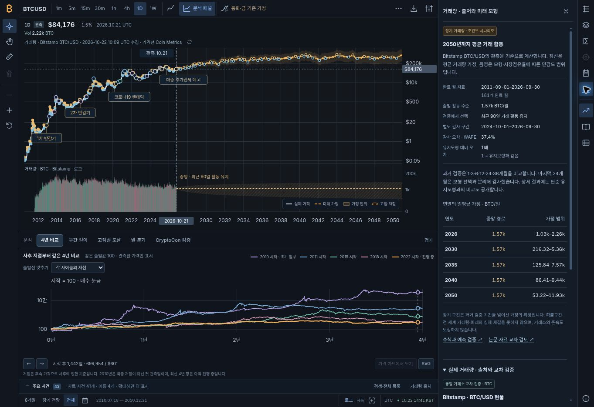
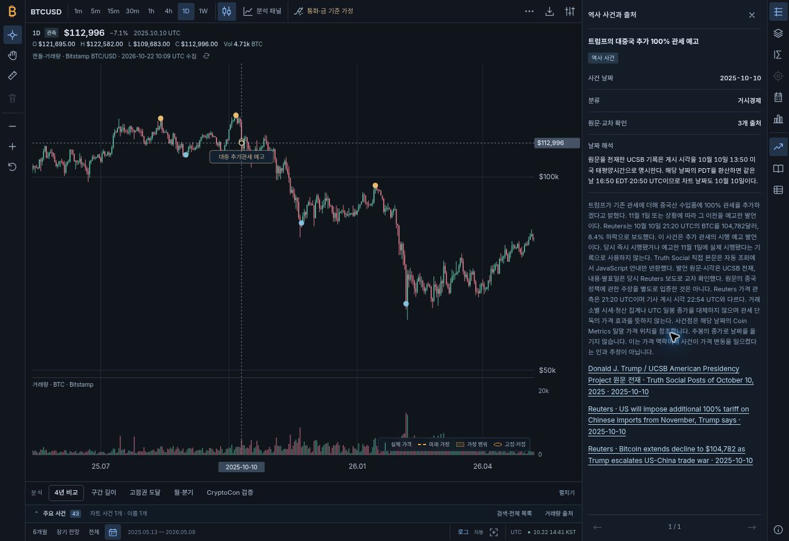
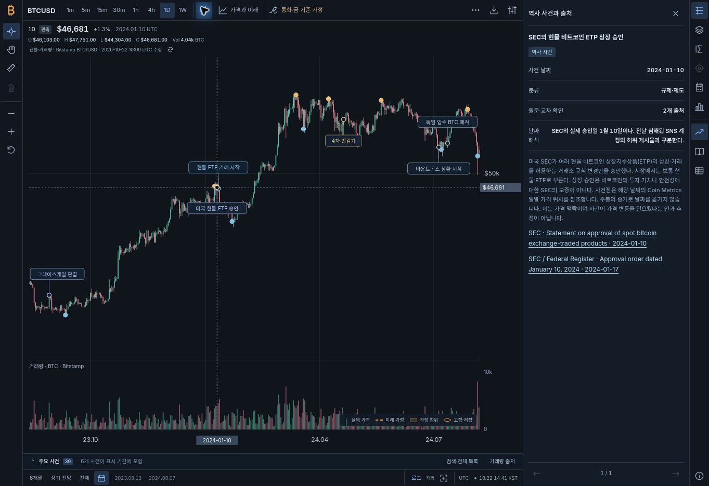

# 차트 작업공간 검증 기록: 1.8.0 실측·1.8.1 재확인·1.8.2 마감

기록일: **2026-10-22 UTC**. **1.8.0 공개 배포에서 실제 Chrome 데스크톱 검수를 수행했다.** 주 가격 차트·하단 분석·사건·거래량·출처·URL 보존을 확인했고, 발견한 세 결함은 **1.8.1의 공개 배포에서 원래 반례를 다시 수행해 모두 통과했다.** 마지막 화면 검토에서 발견한 긴 ‘날짜 해석’ 설명의 배치도 **1.8.2 공개 배포에서 보완·실측을 완료했다.** 두 수정 버전의 CI·Pages는 모두 성공했으며, 최종 실제 캡처를 아래에 보존한다. 실제 모바일 검수는 미완료다.

## 배포와 검사 대상

| 대상 | 커밋 | CI | GitHub Pages | 브라우저 증거 |
|---|---|---|---|---|
| 기능 통합 1.8.0 | [`5c4c1643ac68bed99c7061a49e943088b3dcadd8`](https://github.com/twoimo/bitcoin-cycle-atlas/commit/5c4c1643ac68bed99c7061a49e943088b3dcadd8) | [39769483105](https://github.com/twoimo/bitcoin-cycle-atlas/actions/runs/39769483105) **success** | [39769483127](https://github.com/twoimo/bitcoin-cycle-atlas/actions/runs/39769483127) **success** | Chrome 1363×936 실측 완료. 발견한 결함은 아래 별도 기록 |
| 검수 수정 1.8.1 | [`a46c5e98ce5f0fc3d1847a56fdaae1b8df92f50d`](https://github.com/twoimo/bitcoin-cycle-atlas/commit/a46c5e98ce5f0fc3d1847a56fdaae1b8df92f50d) | [39770503989](https://github.com/twoimo/bitcoin-cycle-atlas/actions/runs/39770503989) **completed / success** | [39770504008](https://github.com/twoimo/bitcoin-cycle-atlas/actions/runs/39770504008) **completed / success** | **실제 1.8.1 HTML 확인 후 수정 3종 PASS**, 해당 재확인 구간의 앱 출처 경고·오류 0개 |
| 상세 배치 보완 1.8.2 | [`8af46b3ee24f1d5772fd37af7d1e34727f410513`](https://github.com/twoimo/bitcoin-cycle-atlas/commit/8af46b3ee24f1d5772fd37af7d1e34727f410513) | [39771216949](https://github.com/twoimo/bitcoin-cycle-atlas/actions/runs/39771216949) **completed / success** | [39771216941](https://github.com/twoimo/bitcoin-cycle-atlas/actions/runs/39771216941) **completed / success** | **`app.js?v1.8.2` 확인 후 긴 설명 배치·관세 사건·통합 화면 실측 PASS**. 모형 변경 없음 |

공개 주소: [Bitcoin Cycle Atlas](https://twoimo.github.io/bitcoin-cycle-atlas/). 최초 통합 준비 기준은 `c35bdeb309a186c08393ef92a89eb97e08d0ed3b`다. 이하의 수치와 상태는 각각 표시한 커밋에만 귀속한다. 다음 데이터 자동 갱신 뒤 관측 종료일·저장본 크기가 달라지면 해당 실행의 결과와 구분해야 한다.

## 자동 검증의 실제 결과

| 검사 | 1.8.0 기능 통합 | 1.8.1 검수 수정 | 1.8.2 상세 배치 보완 | 범위 |
|---|---|---|---|---|
| 전체 Node 테스트 | **185/185 PASS**, 실패 0개, **19,108.844ms** | **187/187 PASS**, 실패 0개, **19,305.720ms** | **CI PASS**, 187개 검사 구성 유지 | 실행한 코드·자료·회귀 조건의 검사. 미래 정확도를 입증하지 않음 |
| 정적 사이트 검사 | **PASS — 56개 파일·95개 로컬 참조** | **PASS — 56개 파일·95개 로컬 참조** | **PASS — 56개 파일·95개 로컬 참조** | JS·JSON·정적 경로와 프로젝트 하위 경로의 참조 유효성 |
| 단일 HTML 생성·검사 | **PASS — 38개 모듈·7,555,737 bytes·가격 5,940개** | **PASS — 38개 모듈·7,559,757 bytes·가격 5,940개** | **PASS — 38개 모듈·7,560,234 bytes·가격 5,940개** | 가격·OHLC·거래량 저장본을 내장한 산출물의 생성·정적 검사 |
| 실제 거래량 저장본 | **1.7.0 검증본 유지** | **같은 검증본 유지** | **같은 검증본 유지** | 실제 거래량 자료는 변경하지 않았음. 아래에 보존한 `refresh-volume --verify` 결과를 참조하며, 전체 15년을 새로 감사했다고 주장하지 않음 |

위 최종 수치는 릴리스 담당자가 실제 실행하고 전달한 결과다. **187/187과 19,305.720ms는 1.8.1의 로컬 실측**이며, 1.8.2는 같은 테스트 구성·모형 코드를 유지한 **CI 실행의 성공**을 확인했다. 통합 과정에서 독립 재실행한 사건 10개·오버레이 23개·분석 도크 6개 검사도 통과했으나, 이 부분 검사 39개를 전체 테스트 수에 다시 더하지 않는다. 사건 원장·조사 문서의 구문·공백 검사도 통과했다. 배포 자동화의 성공과 실제 마우스·키보드 조작의 성공은 별도로 확인한다.

이번 통합의 **미래 거래량 모형 검증도 PASS**다. 모형 검사 **12개**, 미래 점 **8,837개**, JSON에 기록된 원본 해시와 결과의 재현을 확인했다. 이 검사는 저장된 실제 자료로 가정을 재계산하는 절차이며, 외부 거래소의 전체 과거 체결을 새로 대조하거나 미래 거래량의 정확도를 입증하는 검사가 아니다.

## 1.8.0 공개 Chrome에서 확인한 동작

환경: **공개 배포 1.8.0, Chrome, 1363×936**. 실제 브라우저 담당자가 화면·DOM·마우스·키보드로 확인한 결과다. 날짜·관측 시각은 별도 표기가 없으면 UTC다.

| 확인 항목 | 실제 확인 결과 |
|---|---|
| 최초 범위와 사건 | canonical 주소의 첫 화면은 **2010-07-18–2050-12-31**. 차트 **41개 마커·5개 이름·36개 숨긴 이름**, 전체 원장 **43개**. 가격 자료보다 이른 두 사건은 전체 목록에 보존 |
| 실제·미래 거래량 구분 | **실제 막대 5,544개·미래 가정 점 8,837개**. BTC 로그 축과 관측/가정 표시를 확인. 미래 점 개수를 실제 체결이나 관측 수로 세지 않음 |
| 상단 읽기 값과 출처 | 읽기 영역 **y=48, 높이 35px**, 출처 영역 **y=87, 높이 19px**로 둘 사이 **4px 간격**. 해당 데스크톱 화면에서 문구 겹침 없음 |
| 범례 위치 | **플롯 안쪽 오른쪽 아래** 유지. 페이지 바닥이나 분석 도크로 이동하지 않음 |
| 주 가격과 분석 5개 | 4년 비교·구간 길이·고점권 도달·월·분기·CryptoCon 검증을 각각 열었을 때 **주 가격 높이 493px·분석 도크 340px** 유지. 분석이 주 가격 SVG를 대체하지 않음 |
| 분석 하위 보기·날짜 연결 | 기간·고점·4년 비교 및 CryptoCon 목표 보기 표시 확인. 달력 날짜가 없는 **4년 비교의 ‘가격 차트에서 보기’는 비활성**. 월·분기 지표 요약의 별도 오류는 아래 수정 추적 표에 기록 |
| 관세 사건 검색 | **‘관세빔’ 검색 4/43개**. 10월 10일 사건 선택 시 **2025-05-13–2026-05-08** 범위, 사건 날짜 **2025-10-10**, 출처 **3개**, 원문의 PDT와 UTC 관측 설명을 확인 |
| 사건과 분석 선택 분리 | 위 관세 사건 상세를 연 상태에서 분석 전환·접기를 해도 **사건 상세가 보존**됨 |
| 확대에 따른 이름 변화 | 차트 **빈 공간 위 휠**로 **2020-12-19–2034-02-14: 24개 사건·5개 이름**, 다음 **2023-07-24–2028-11-27: 13개 사건·6개 이름** 확인. 같은 동작을 사건 라벨 위에서 했을 때의 차단 문제는 아래 별도 기록 |
| 숨긴 이름 접근 | 이름이 생략된 ‘ETF 거래 개시’ 사건 SVG 그룹에 키보드 포커스를 두면 미리보기의 **visibility=visible**을 확인 |
| 거래량 근거 패널 | **완료 월 181개**, 마지막 **24개월을 후보 선택과 분리한 감사**, 화면의 **WAPE 37.4%**, 연말별 가정 표를 확인. 이 수치는 2050년 거래량 정확도가 아님 |
| 마지막 미래 날짜의 상세 | **2050-12-31: 1,566.71 BTC/일**, 가정 범위 **53.22–11,933.85 BTC/일**. 달러 환산 **1,112,366,672 USD/일** 표시. 이는 기준 가격×가정 수량이며 실제 체결 거래대금이 아님 |
| 주봉 거래량 | **실제 791개·미래 1,261개**. **2050-12-25** 선택에서 **약 10,967 BTC/주**, 적용 기간 **12월 19–25일** 확인 |
| 분·시간봉과 선택 복귀 | **1h 실제 봉 180개·미래 거래량 0개**, Coinbase 원래 수집시각 **09:23 UTC**. 분석 항목 선택 후 가격 차트의 **Home** 키로 가격 선택 소유자가 복원됨 |
| URL·페이지 이동 | 리서치(`page=evidence`)를 왕복해도 **캔들·1h·도크 접힘·CryptoCon targets·분기 지표** 상태 유지 |
| 빠른 조작 메뉴 | **Shift+F10**으로 열고 **Escape**로 닫기 정상 |

1.8.0은 실제 검수 중 오류가 발견된 버전이다. 위에서 확인한 기능 범위를 ‘앱의 모든 조작과 콘솔에 오류가 없다’는 판정으로 확대하지 않는다. 출처 숫자·기간·단위와 모형 정의는 [역사 사건 연구](BITCOIN_EVENTS_RESEARCH.md), [실제 거래량 검증](VOLUME_METHOD.md), [거래량 모형](VOLUME_FORECAST_MODEL.md)에 연결된다.

## 발견한 결함과 1.8.1 재확인

| 1.8.0에서 발견한 문제 | 1.8.1의 수정 내용 | 수정 후 실제 확인 |
|---|---|---|
| 월·분기 지표를 바꿔도 요약의 첫 값이 수익률로 남음 | 선택한 지표에 맞는 요약 값·표시 순서 수정 | **PASS** — 분기 `realizedVolPct`에서 요약과 접근성 이름 **‘가격 흔들림 · 연간 환산 25.9%’**가 상세 값과 일치 |
| 역사 사건 라벨 위의 휠 조작이 차단됨 | 사건 레이어 위에서도 가격 차트 휠 확대가 동작하도록 처리 | **PASS** — FTX 2022 라벨 중앙의 실제 휠 조작으로 **2010-07-18–2050-12-31 → 2018-06-22–2034-12-02**, **28개 사건·5개 이름**으로 변경 |
| 전역 `[data-mode]` 수신기가 분석 도크 클릭을 레거시 모드로 처리해 상태 오염·앱 오류 발생 | 전역 수신기의 대상 범위를 레거시 모드 버튼으로 한정 | **PASS** — 분석 5개 탭을 모두 클릭하고 리서치 페이지를 왕복한 뒤 **`?chart=cryptocon`** 유지, 잘못된 `mode` 매개변수 없음 |

세 수정은 `a46c5e98ce5f0fc3d1847a56fdaae1b8df92f50d`에 반영했고 187개 자동 검사를 통과했다. 첫 canonical 주소 이동에서는 브라우저에 캐시된 1.8.0 HTML이 나타났다. 최신 문서를 다시 불러와 **실제 1.8.1 HTML을 확인한 뒤** 위 세 반례를 재수행했다. 그 재확인 시작 이후 앱 출처의 **경고·오류는 0개**였다. 이전 버전에서 발생한 오류와 확장 기능 로그를 최신 버전의 통과 판정에 섞지 않았다.

## 1.8.2 상세 읽기 배치와 최종 실제 화면

최종 화면 검토에서 긴 ‘날짜 해석’ 설명이 항목명을 세로로 눌러 읽기 어려워지는 문제를 발견했다. 1.8.2는 **설명형 값이 80자를 넘으면 항목명 아래 전폭 문단으로 배치**하고, 짧은 값과 나란히 놓인 항목명은 축소되지 않도록 보완했다. 이 변경은 상세 읽기 화면에 한정하며 가격·거래량 모형을 바꾸지 않는다.

공개 Chrome **1363×936**에서 **`app.js?v1.8.2` 로드 확인 후** 다음을 재확인했다.

| 확인 항목 | 실제 확인 결과 |
|---|---|
| 긴 날짜 설명 배치 | 행의 `display:block`, 항목명 폭 **43.44px**로 정상 가로 표시. 설명 값은 **299px 전폭·왼쪽 정렬**로 항목명 아래에 표시 |
| 관세 사건과 캔들 | **‘관세빔’ 검색 4개** 재확인. 10월 10일 사건 선택 시 **캔들 보기·2025-05-13–2026-05-08 범위·2025-10-10 사건 날짜** 확인 |
| 통합 화면 | 선 보기 **2010-07-18–2050-12-31**, **4년 비교 도크·거래량 정보 패널**을 동시에 열고 주 가격 유지 확인 |
| 사건 이름의 폭 대응 | 최종 통합 캡처는 **41개 사건·4개 이름**. 우측 패널로 플롯 폭이 좁아져 전체 폭에서 확인한 5개보다 이름 하나를 덜 표시하며, 사건 원장 수는 43개 유지 |
| 실제·미래 거래량 | 동일한 관측 저장본의 **실제 5,544개·미래 가정 8,837개** 유지 |
| 콘솔 | 해당 검수 시작 이후 **앱 출처 경고·오류 0개** |

아래 두 이미지는 최종 공개 **1.8.2**에서 확보했다. 첫 이미지는 주 가격·4년 비교·거래량 근거가 함께 열린 상태다. 둘째 이미지는 관세 사건의 캔들과 날짜 해석·원문 출처를 보여 준다.





캡처 파일 크기: `Workbench_Integrated_20261022.jpg` **153,938 bytes**, `Workbench_Tariff_20261022.jpg` **132,152 bytes**. 저장된 두 이미지를 열어 위 화면 내용과 연결 경로를 확인했다.

| 최종 검수 항목 | 상태 |
|---|---|
| 1.8.1 CI·Pages 완료 | **PASS — 두 실행 모두 completed / success** |
| 수정 3종의 실제 브라우저 재확인 | **PASS — 실제 1.8.1 HTML에서 원래 반례 재수행** |
| 1.8.1 재확인 구간의 앱 출처 콘솔 | **PASS — 경고·오류 0개**. 캐시된 구버전의 오류와 확장 기능 로그는 구분 |
| 1.8.2 배포와 최종 화면 증거 | **PASS — CI·Pages success, 실제 버전 확인, 긴 설명 배치 실측, 최종 캡처 2개 확인** |
| 실제 모바일 뷰포트·터치 | **미확인**. 순수 좌표·크기 검사 또는 데스크톱 확대 키를 모바일 검수로 대체하지 않음 |

## 1.7.0 공개 배포의 보존된 증거

이하의 자동 검사·Chrome 관측·화면 캡처는 1.7.0에서 확보했다. 당시 날짜·출처 문구가 겹치는 작은 시각적 문제 1건이 발견됐으며, 이후 공개된 1.7.1 보완의 별도 실측 결과는 아직 이 기록에 반영하지 않았다. 실제 모바일 뷰포트 확인도 미완료다.

## 배포 식별 정보

| 항목 | 기록 |
|---|---|
| 제품 버전 | **1.7.0** |
| 배포 브랜치 / 커밋 | `main` / [`e61a8480df4b26ca4b1f6b72ed4250a963df8e42`](https://github.com/twoimo/bitcoin-cycle-atlas/commit/e61a8480df4b26ca4b1f6b72ed4250a963df8e42) |
| 공개 화면 | [Bitcoin Cycle Atlas](https://twoimo.github.io/bitcoin-cycle-atlas/) |
| CI | [실행 39764140860](https://github.com/twoimo/bitcoin-cycle-atlas/actions/runs/39764140860) — **success** |
| GitHub Pages | [실행 39764141116](https://github.com/twoimo/bitcoin-cycle-atlas/actions/runs/39764141116) — **success** |

이 절의 자동 검사 수치와 아래 실제 기능 확인은 **위 1.7.0 커밋**에 해당한다. 1.7.1 보완이나 새 1.8.0 통합의 통과 근거로 대신 사용하지 않는다. 이후 자동 데이터 갱신으로 관측 종료일이나 저장본 크기가 바뀌면 해당 갱신 결과와 구별해야 한다.

## 자동 검증의 실제 결과

| 검사 | 결과 | 확인 범위 |
|---|---|---|
| Node 자동 테스트 | **155개 통과, 실패 0개** | 릴리스 실행 로그 `/tmp/btc-release-tests.log` 확인. 취소·건너뜀·TODO도 각각 0개 |
| 정적 사이트 검사 | **PASS — 53개 파일, 90개 로컬 참조** | JS 구문, JSON, 정적 경로 및 GitHub Pages 프로젝트 하위 경로에서의 참조 유효성 |
| 단일 HTML 생성·검사 | **PASS — 36개 모듈, 7,142,558 bytes, 가격 관측 5,940개** | ES modules와 가격·OHLC·거래량 저장본을 포함한 독립 실행 파일 생성 및 정적 검사 |
| `node scripts/refresh-volume.mjs --verify` | **PASS** | 저장된 검증 원문을 사용한 오프라인 재계산. 실제 결과는 아래에 기록 |

테스트 로그의 집계는 `tests 155`, `pass 155`, `fail 0`, `cancelled 0`, `skipped 0`, `todo 0`, `duration_ms 18995.599983`이다. 단일 HTML의 가격 관측 5,940개는 거래량 일봉 개수와 다른 지표다. 정적 검사와 빌드 성공만으로 실제 마우스 조작이나 외부 API의 현재 접근 성공을 판정하지 않는다.

거래량 재검증의 실제 출력:

```json
{"status":"PASS","source":"Bitstamp","bars":5544,"firstDate":"2011-08-18","lastDate":"2026-10-21","gapCount":0,"hourlyDays":7,"quarterHourlyDays":7,"unitMinutes":59,"independentDays":7}
```

독립 검토에서는 완성 주봉 **791개 전부**를 실제 일봉의 정수 사토시 합으로 별도 계산하여 **차이 0개**를 확인했다. 최종 응답 중 취소 처리, 일봉 출처 URL의 해상도 검증, 공식 문서 URL 검증을 원래 실패 입력으로 다시 확인했다. 선택적 비교 자료가 없으면 `PASS`가 아니라 `NOT_COMPARED`와 `null` 지표를 반환한다. 상세 근거는 [거래량 검증 문서](VOLUME_METHOD.md)에 있다.

## 공개 배포의 실제 브라우저 확인

환경: **공개 배포 1.7.0, Chrome, 1363×936**. 실제 화면·마우스·키보드·DOM을 확인했다. 아래 날짜와 시간은 UTC다.

| 확인 항목 | 실제 확인 결과 |
|---|---|
| 최초 범위·사건 수 | 기본 범위 **2010-07-18~2050-12-31**. 차트 사건 **37개**, 이름 라벨 **21개**, 전체 원장 **39개**. 가격 자료보다 이른 2개 사건은 원장에서 확인 |
| 범례 위치 | 실제 캡처에서 **플롯 안쪽 오른쪽 아래, 날짜축 위**에 표시. 거래량 패널과 우측 사건 상세가 열린 상태에서도 위치 유지 |
| 사건 검색·날짜 이동 | `ETF` 검색 결과 **4/39개**. 2024-01-10 카드를 선택하면 **2023-08-13~2024-08-07**로 확대 |
| 사건 직접 클릭·출처 | 실제 SVG 사건 라벨을 클릭하면 사건 상세, 날짜 해석, **1차 출처 2개**가 열림. 프로토콜 분류는 원장 **9개**, 차트 마커 **8개** |
| 일봉·주봉 캔들과 거래량 | **1D Bitstamp 캔들·거래량 5,544개**, **1W 거래량 791개** 확인. 주봉에서도 사건일 **2024-01-10·2024-04-20**이 일요일로 이동하지 않음 |
| 분·시간 간격 | **1m·5m·15m·30m·1h·4h 모두 실제 봉 180개씩** 표시. Coinbase 저장본과 **09:23 UTC** 수집시각 확인 |
| 휠 확대·드래그 | 1h에서 휠 조작으로 **2026-10-14 20:00~10-22 09:00 → 10-17 16:00~10-20 17:00**. 이어 170px 드래그로 **10-17 05:00~10-20 06:00**로 이동. 드래그 후 상세 읽기 패널이 잘못 열리지 않음 |
| 빠른 조작 메뉴·복사 | 우클릭 위치 **2026-10-18 22:00**의 정확한 OHLC, **293.052818 BTC**, 출처·수집시각을 복사. **Shift+F10**으로 메뉴 열기, **Escape**로 닫기 확인 |
| 거래량 토글·범위 복원 | 거래량 끄기/켜기에서 표시 막대 **0개 ↔ 5,544개**. 네이티브 더블클릭으로 **2010~2050 전체 범위** 복원 및 상세 읽기 패널 닫힘 |
| 하단 사건·출처 패널 | 하단 사건 목록을 열면 차트 크기가 조정됨. 출처 패널이 **Coinbase ↔ Bitstamp** 전환에 맞춰 수집 메타데이터와 검증 한계를 표시 |
| 콘솔 | 확인 세션에서 **앱 출처의 콘솔 오류 없음**. 앞서 나타난 브라우저 확장 기능 출처의 로그는 앱 오류 판정에서 제외 |

아래는 공개 배포에서 확보한 실제 화면이다. Bitstamp 일봉 캔들·거래량, 사건의 날짜와 원문 2개, 플롯 안쪽 하단 오른쪽 범례를 함께 확인할 수 있다.



### 남은 확인과 시각적 보완

| 항목 | 상태·한계 |
|---|---|
| 날짜·출처 문구의 일부 겹침 | 1.7.0 실제 검토에서 발견. 이후 1.7.1이 공개됐으나 수정 후 별도 실측은 이 기록에 아직 반영하지 않았음. 1.8.0 실제 화면에서는 읽기 영역과 출처 사이 4px 간격을 확인했으며, 위 최신 실측 표에 기록 |
| 실제 모바일 뷰포트 | **미확인**. 브라우저 확대/축소 키가 뷰포트 크기를 바꾸지 않았으므로 모바일 확인의 근거로 사용하지 않음 |
| 좁은 화면의 자동 검사 | 순수 레이아웃 계산의 **380/260 크기 경계 테스트**는 통과했으나 실제 모바일 브라우저·터치·작은 화면 렌더링 확인을 대체하지 않음 |

## 출처·접근·해석의 한계

- **TradingView 직접 관측 범위:** 공개 `COINBASE:BTCUSD` 일봉 화면의 DOM·접근성 정보·실제 표시를 조사했다. 우클릭 시 계정 생성 안내가 나타나 로그인 이후의 메뉴·거래 기능은 직접 검증하지 않았다. 비공개 통신, 사용자 세션, 내부 상태를 사용하지 않았으며 계정 장벽을 제거하지 않았다. 공식 Datafeed/UDF 문서는 구현 규약을 참고한 것이고, TradingView의 무료 시세 공급 연결이나 라이선스 라이브러리 탑재를 뜻하지 않는다.
- **시세 접근 범위:** 분·시간 봉은 기존 Coinbase 관측 저장본과 명시적 새로고침을 사용한다. 조사 중 추가 Coinbase 역사 요청은 HTTP 403을 반환해 중단했다. 기존 저장본은 원래 수집시각을 유지하며, 현재 브라우저에서 새 요청이 성공했다고 이 기록에서 주장하지 않는다. 새 역사 거래량은 별도의 공식 공개 소스인 Bitstamp로 수집했다.
- **거래량의 의미:** Bitstamp BTC/USD 현물 한 거래소에서 거래된 BTC 수량이다. 세계 전체 거래량·달러 거래대금·온체인 전송량이 아니다. 최근 7일의 해상도별 일치와 59분의 체결 단위 검증을 전체 15년의 외부 감사로 확대하지 않는다. Kraken·Coinbase 대조는 거래소별 수량 비교이며, Coinbase 보조 자료의 실제 해상도별 차이 4건은 그대로 공개한다.
- **가격 계열과 사건의 의미:** Coin Metrics 종가 선·예측, Bitstamp 일·주 캔들, Coinbase 분·시간 캔들의 출처를 구분한다. 1.7.0의 사건 39개(1.8.0부터 43개)는 날짜와 원문 근거를 둔 편집 원장으로, 세계적 관심의 측정 순위나 가격 인과·매매 신호가 아니다. 원문에 정확한 시각이 없는 사건을 분봉 뉴스 시각으로 만들지 않는다.
- **예측 검증 범위:** 출처 기반 전망의 표시 끝은 기존 2050년이며 예측 연수를 고르는 UI를 추가하지 않았다. 이번 조작·데이터 검증의 통과는 미래 가격이나 4년 주기의 종료 연도를 확정한다는 뜻이 아니다.

조사 방법·직접 관측과 공식 문서의 구분은 [TradingView 심층 조사](TRADINGVIEW_DEEP_AUDIT.md), 사건별 날짜·출처는 [역사 사건 연구](BITCOIN_EVENTS_RESEARCH.md)에 기록했다.
