# 모바일 캡처 전체 갤러리

TradingView 모바일 웹 19장, Atlas 모바일 웹 37장, 합계 **56장**. 수신 PNG 1개와 CSV 1개는 별도 [exports](04-coverage.md#실제-수신-파일)에 기록한다. 시도·차단·첫 사용 안내도 보존하며 모두 기능 성공으로 합산하지 않는다.

## MT01 · TradingView 모바일 웹 첫 화면

- 입력: 새 Chrome 탭에서 /chart/ 열기
- 관찰: AAPL 1D Candles, 터치용 최소 legend와 좌측 그리기 도구 표시
- 환경: TradingView mobile web on Android AVD; 1440×3120px
- 캡처 시각: 2026-10-23T10:12:23.145Z (UTC)

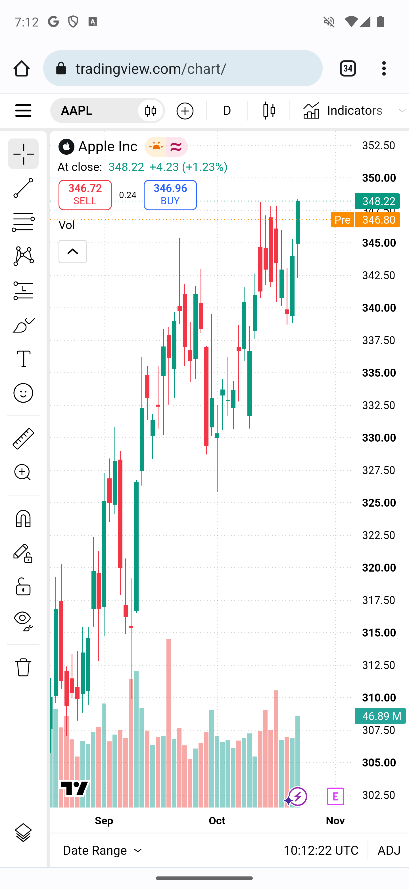

## MT02 · 종목 검색 전체 화면

- 입력: 상단 AAPL 누르기
- 관찰: 전체 화면 검색 창과 거래소별 종목 선택을 관찰
- 환경: TradingView mobile web on Android AVD; 1440×3120px
- 캡처 시각: 2026-10-23T10:12:46.225Z (UTC)

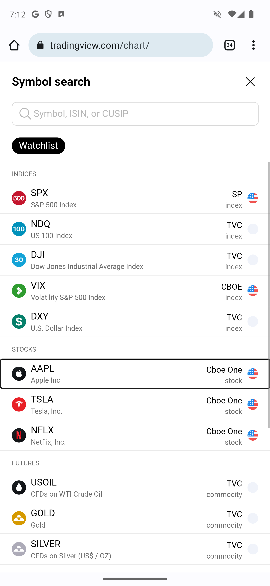

## MT03 · BTCUSDT 검색과 소프트 키보드

- 입력: 검색 필드에 BTCUSDT 입력
- 관찰: BINANCE를 포함한 거래소별 검색 결과와 키보드가 표시됨
- 환경: TradingView mobile web on Android AVD; 1440×3120px
- 캡처 시각: 2026-10-23T10:13:50.549Z (UTC)

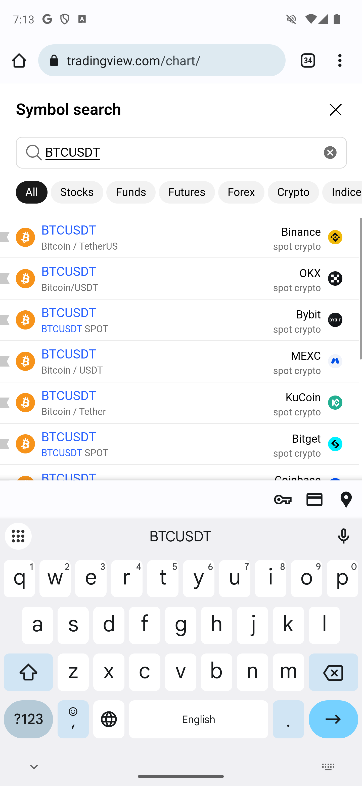

## MT04 · BTCUSDT 1D 모바일 기본 차트

- 입력: 검색 결과에서 BINANCE BTCUSDT 선택
- 관찰: 종목 전환·키보드 닫힘·최근 가격 기본 표시를 확인
- 환경: TradingView mobile web on Android AVD; 1440×3120px
- 캡처 시각: 2026-10-23T10:14:00.115Z (UTC)

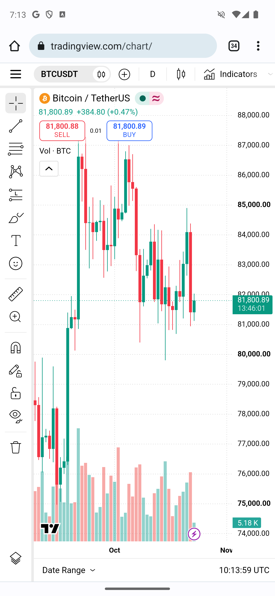

## MT05 · 첫 길게 누르기 사용 안내

- 입력: 가격 차트 내부를 800ms 길게 누르기
- 관찰: 첫 길게 누르기는 Long tap to track values / Got it! 안내만 표시했다. OHLC 추적 성공 증거는 MT06이다.
- 환경: TradingView mobile web on Android AVD; 1440×3120px
- 캡처 시각: 2026-10-23T10:14:12.067Z (UTC)

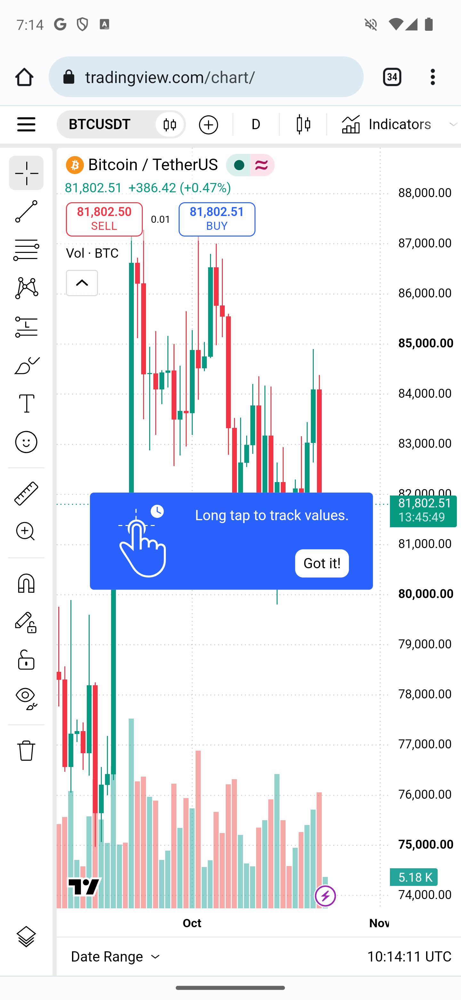

## MT06 · OHLC 값 추적 활성화

- 입력: 첫 안내를 닫은 뒤 같은 지점을 다시 길게 누르기
- 관찰: 추적 상태에서 OHLC 행과 거래량 숫자가 표시됨
- 환경: TradingView mobile web on Android AVD; 1440×3120px
- 캡처 시각: 2026-10-23T10:14:35.212Z (UTC)

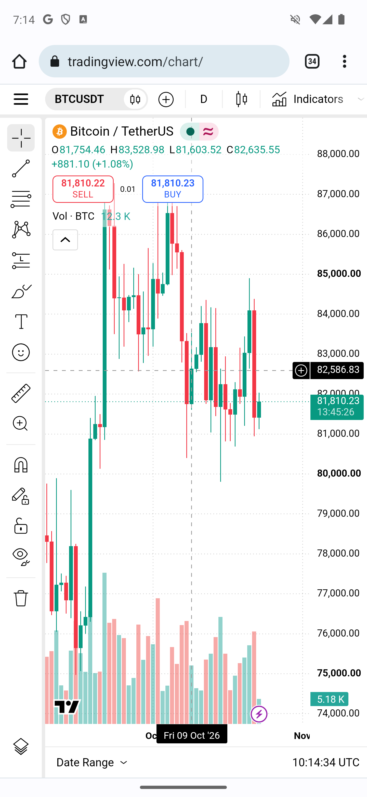

## MT07 · 추적 포인터 가로 이동

- 입력: 추적 상태에서 한 손가락 가로 드래그
- 관찰: 선택 봉 OHLC 변경과 차트 이동 여부를 비교
- 환경: TradingView mobile web on Android AVD; 1440×3120px
- 캡처 시각: 2026-10-23T10:14:45.131Z (UTC)

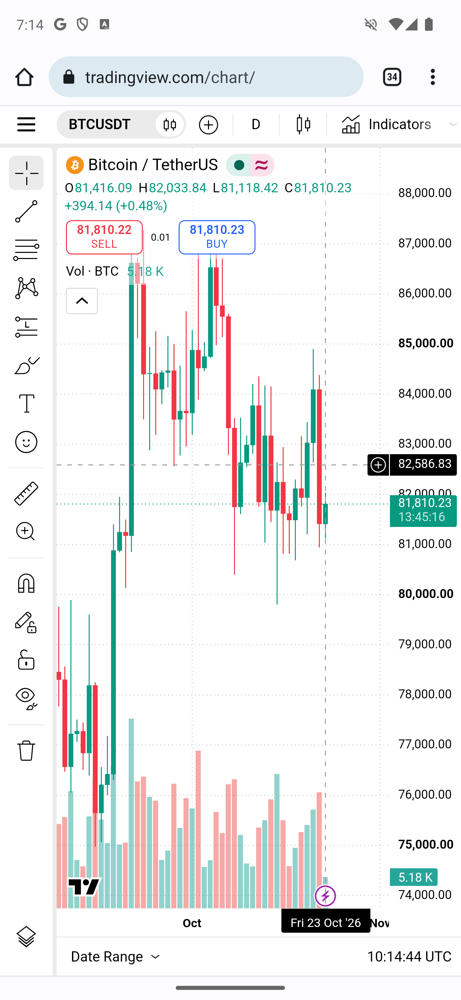

## MT08 · 값 추적 종료

- 입력: 차트 빈 지점 단일 탭
- 관찰: OHLC 상세가 사라지고 최근 가격 요약으로 복귀
- 환경: TradingView mobile web on Android AVD; 1440×3120px
- 캡처 시각: 2026-10-23T10:14:56.011Z (UTC)

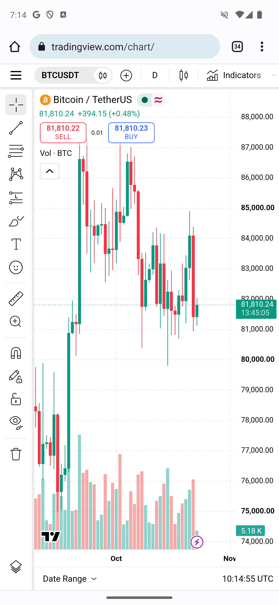

## MT09 · 한 손가락 과거 이동

- 입력: 추적 종료 상태에서 오른쪽으로 드래그
- 관찰: 추적값 이동과 다른 동작인 차트 가로 이동을 캡처
- 환경: TradingView mobile web on Android AVD; 1440×3120px
- 캡처 시각: 2026-10-23T10:15:13.888Z (UTC)

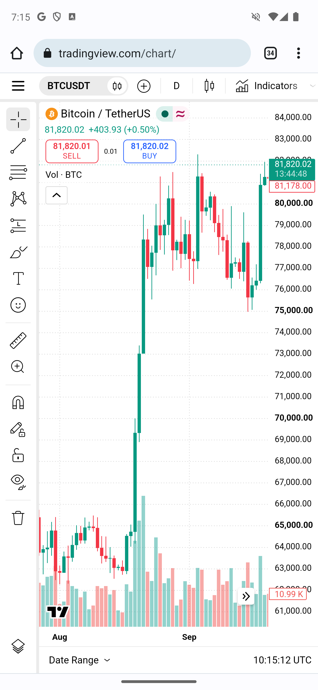

## MT10 · 가격축 길게 누르기

- 입력: 오른쪽 가격축을 800ms 길게 누르기
- 관찰: 가격축 문맥 메뉴와 자동·로그·선형 옵션을 열람
- 환경: TradingView mobile web on Android AVD; 1440×3120px
- 캡처 시각: 2026-10-23T10:15:25.324Z (UTC)

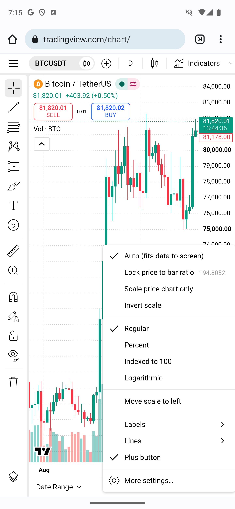

## MT11 · 로그 가격축 전환

- 입력: 가격축 메뉴에서 Logarithmic 선택
- 관찰: 메뉴 종료와 로그 축 시각 변화 기록
- 환경: TradingView mobile web on Android AVD; 1440×3120px
- 캡처 시각: 2026-10-23T10:15:37.173Z (UTC)

## MT12 · 가격축 수동 확대

- 입력: 오른쪽 가격축을 위로 드래그
- 관찰: 촛대와 Y축 간격 변화를 기록
- 환경: TradingView mobile web on Android AVD; 1440×3120px
- 캡처 시각: 2026-10-23T10:15:54.643Z (UTC)

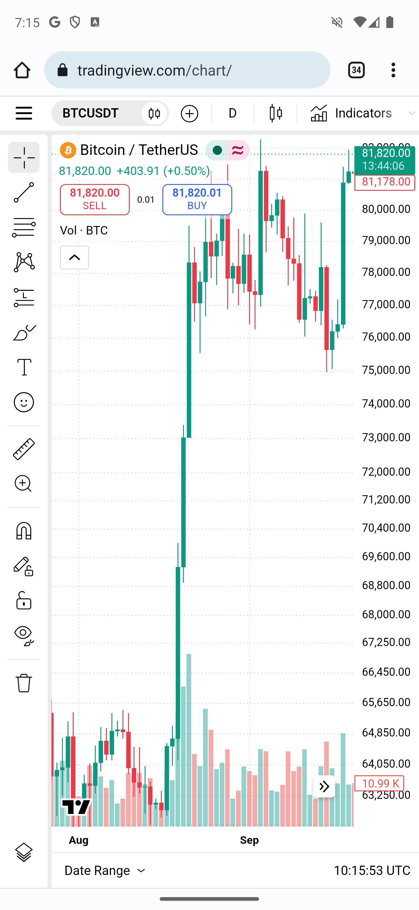

## MT13 · 수동 축 이후 자동 맞춤 메뉴

- 입력: 수동 스케일 이후 가격축 길게 누르기
- 관찰: Auto와 Logarithmic 선택 상태는 캡처로 확인
- 환경: TradingView mobile web on Android AVD; 1440×3120px
- 캡처 시각: 2026-10-23T10:16:19.316Z (UTC)

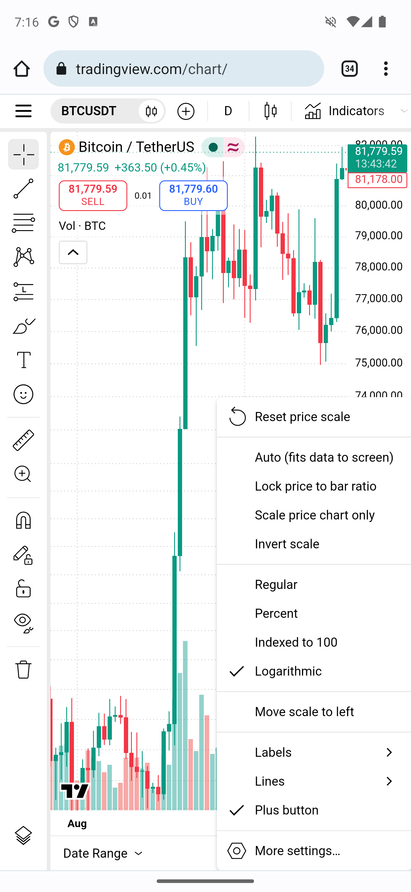

## MT14 · 가격축 초기화

- 입력: Reset price scale 선택
- 관찰: 수동 축 크기 해제와 차트 맞춤 복원 확인
- 환경: TradingView mobile web on Android AVD; 1440×3120px
- 캡처 시각: 2026-10-23T10:16:30.395Z (UTC)

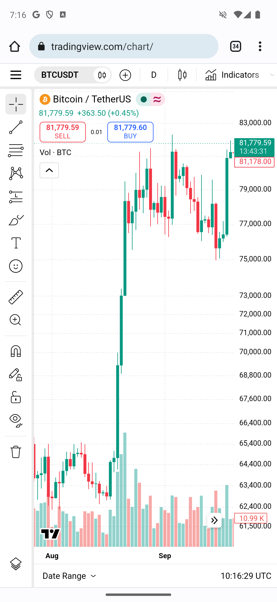

## MT15 · 봉 간격 선택 목록

- 입력: 상단 D 간격 버튼 누르기
- 관찰: 분·시간·일·주와 즐겨찾기 메뉴를 구분
- 환경: TradingView mobile web on Android AVD; 1440×3120px
- 캡처 시각: 2026-10-23T10:16:41.278Z (UTC)

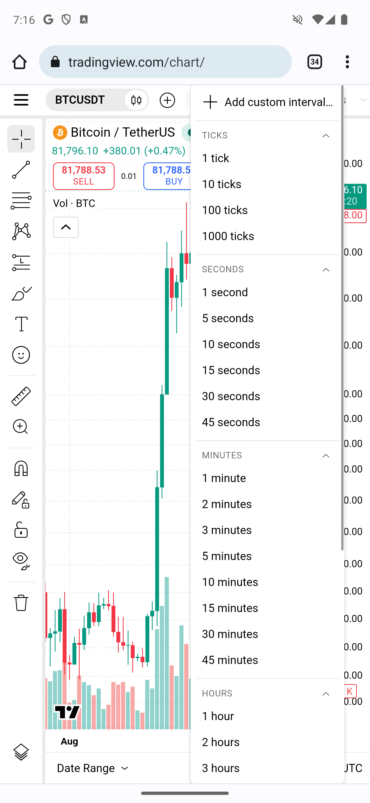

## MT16 · 1시간봉 선택 수락과 가입 시트

- 입력: 간격 목록에서 1 hour 선택
- 관찰: 상단 1h·접근성 설명 1 hour로 변경됐지만 이미 가입 시트가 차트 하단을 막았다. 가림 없는 1시간봉 조작 검증은 아니다.
- 환경: TradingView mobile web on Android AVD; 1440×3120px
- 캡처 시각: 2026-10-23T10:16:51.883Z (UTC)

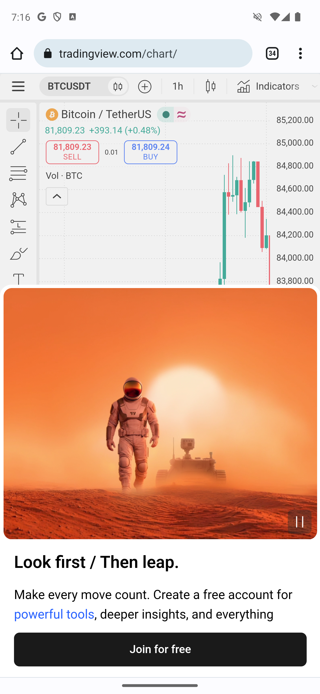

## MT17 · 차트 유형 열기 시도, 가입 안내에 차단

- 입력: 상단 Candles 아이콘 누르기
- 관찰: Candles 메뉴를 누르려 했지만 가입 안내가 유지됐다. 차트 유형 목록을 확인하지 못했다.
- 환경: TradingView mobile web on Android AVD; 1440×3120px
- 캡처 시각: 2026-10-23T10:17:02.673Z (UTC)

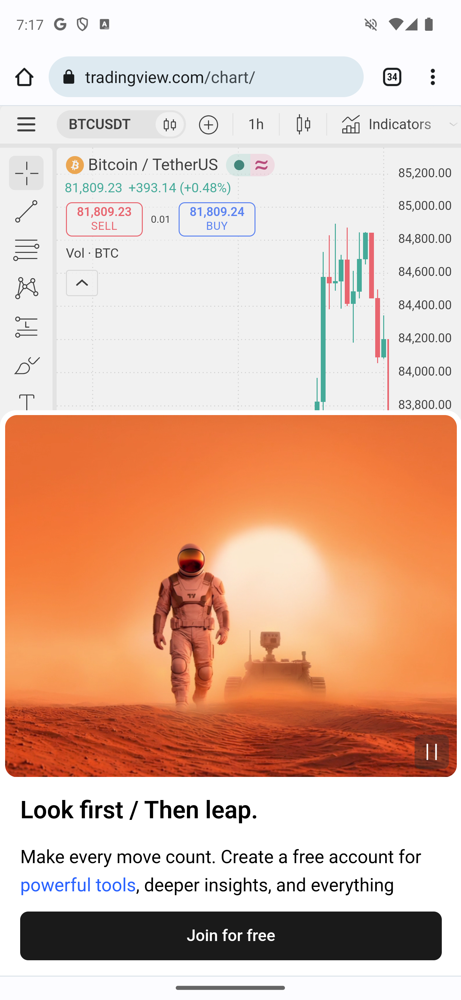

## MT18 · 이탈 전 저장되지 않은 변경 경고

- 입력: 가입 시트에서 Android Back 사용
- 관찰: Chrome Leave site 경고를 확인하고 아직 이탈하지 않음
- 환경: TradingView mobile web on Android AVD; 1440×3120px
- 캡처 시각: 2026-10-23T10:18:04.380Z (UTC)

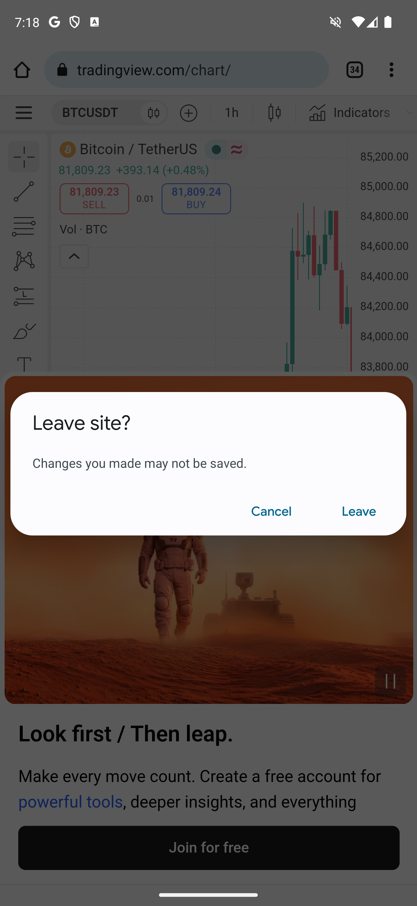

## MT19 · 가입 안내가 막은 후속 조사

- 입력: Leave site에서 Cancel 선택
- 관찰: 차트 복귀, 가입 안내 유지. 계정 생성·가입·결제 없이 중단
- 환경: TradingView mobile web on Android AVD; 1440×3120px
- 캡처 시각: 2026-10-23T10:18:08.719Z (UTC)

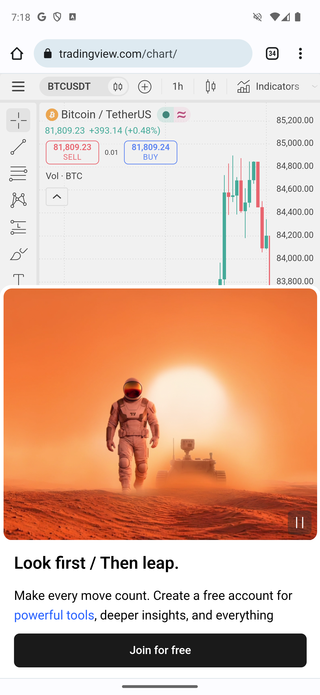

## MA01 · Atlas 첫 화면과 브라우저 번역 배너

- 입력: 별도 새 Chrome 탭에서 공개 Atlas URL 열기
- 관찰: 공개 1D 선 화면, 8개 연구 지표 목록 접힘. 번역 배너가 하단 조작을 가린 상태이며 MA02에서 닫았다.
- 환경: Atlas mobile web on Android AVD; 1440×3120px
- 캡처 시각: 2026-10-23T10:19:18.084Z (UTC)

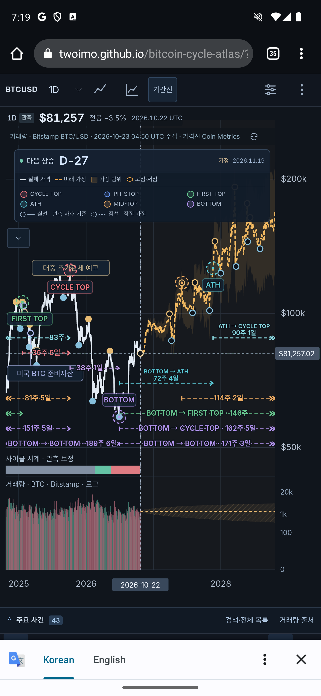

## MA02 · 브라우저 배너 없는 Atlas 초기 상태

- 입력: 번역 배너 Close 누르기
- 관찰: 차트 하단 버튼이 모두 드러나고 1D·선·8개 지표 목록 접힘을 관찰
- 환경: Atlas mobile web on Android AVD; 1440×3120px
- 캡처 시각: 2026-10-23T10:19:50.242Z (UTC)

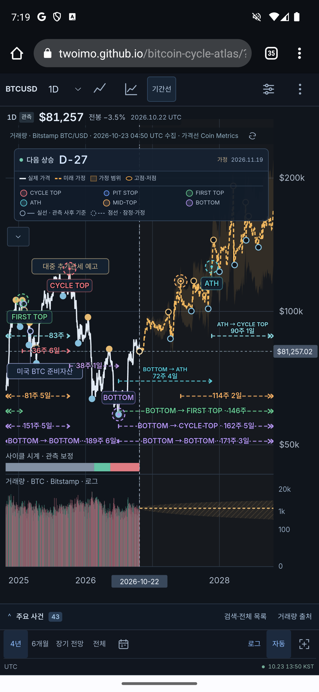

## MA03 · Atlas 모바일 1D 캔들

- 입력: 상단 선 표시 아이콘 눌러 캔들로 변경
- 관찰: Bitstamp OHLC·거래량과 Coin Metrics 선 가격의 출처 차이를 확인
- 환경: Atlas mobile web on Android AVD; 1440×3120px
- 캡처 시각: 2026-10-23T10:20:10.483Z (UTC)

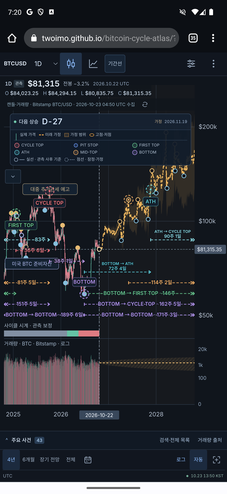

## MA04 · Atlas 단일 탭으로 봉 선택

- 입력: 차트 빈 지점 한 번 누르기
- 관찰: 과거 봉 OHLC 선택을 고정하고 상세 패널이 자동으로 열리지 않는지 확인
- 환경: Atlas mobile web on Android AVD; 1440×3120px
- 캡처 시각: 2026-10-23T10:20:19.626Z (UTC)

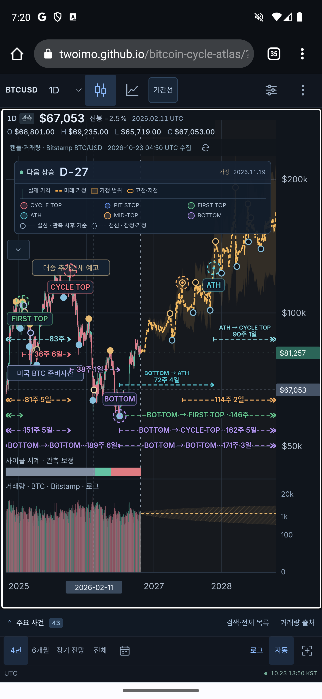

## MA05 · Atlas 길게 누르기 빠른 메뉴

- 입력: 가격 차트 빈 지점을 800ms 길게 누르기
- 관찰: 길게 누른 위치의 빠른 메뉴가 열렸다. 봉 선택 OHLC는 이전 2026-02-11을 유지했다. 메뉴 위치와 고정 선택은 구분한다.
- 환경: Atlas mobile web on Android AVD; 1440×3120px
- 캡처 시각: 2026-10-23T10:20:28.951Z (UTC)

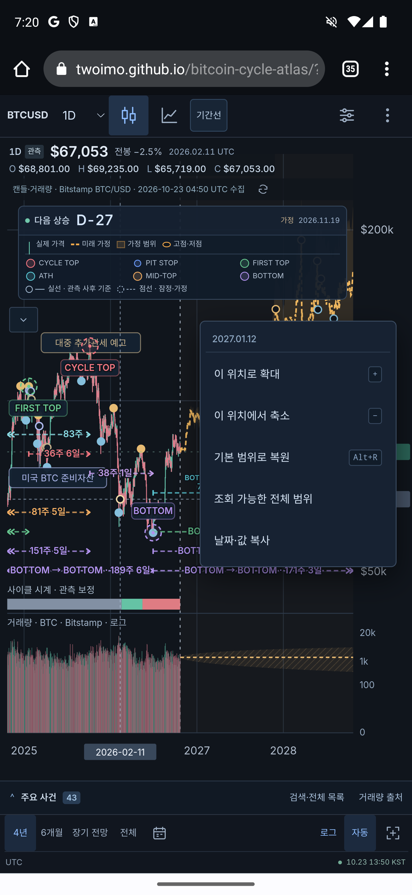

## MA06 · 빠른 메뉴의 위치 중심 확대

- 입력: 이 위치로 확대 선택
- 관찰: 메뉴 닫힘과 시간 범위 확대를 기록
- 환경: Atlas mobile web on Android AVD; 1440×3120px
- 캡처 시각: 2026-10-23T10:20:43.307Z (UTC)

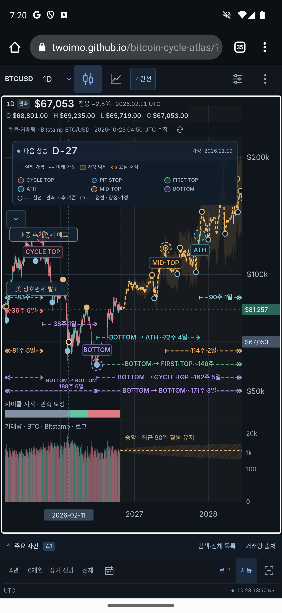

## MA07 · Atlas 한 손가락 이동

- 입력: 가격 차트 빈 구간에서 오른쪽 가로 드래그
- 관찰: 시간 눈금 이동과 선택/읽기 상태를 기록
- 환경: Atlas mobile web on Android AVD; 1440×3120px
- 캡처 시각: 2026-10-23T10:20:51.994Z (UTC)

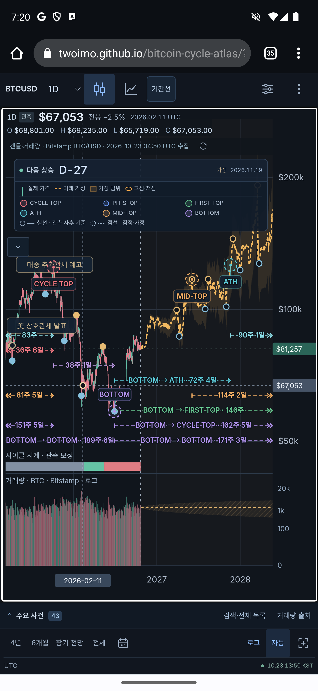

## MA08 · Atlas 가격축 수동 확대

- 입력: 오른쪽 가격축을 위로 드래그
- 관찰: 수동 가격축 상태와 Auto 꺼짐을 확인
- 환경: Atlas mobile web on Android AVD; 1440×3120px
- 캡처 시각: 2026-10-23T10:21:11.831Z (UTC)

## MA09 · Atlas 자동 가격축 복원

- 입력: 수동 범위 상태의 Auto 버튼 누르기
- 관찰: 가격축 자동 맞춤 켜짐으로 복귀
- 환경: Atlas mobile web on Android AVD; 1440×3120px
- 캡처 시각: 2026-10-23T10:21:19.197Z (UTC)

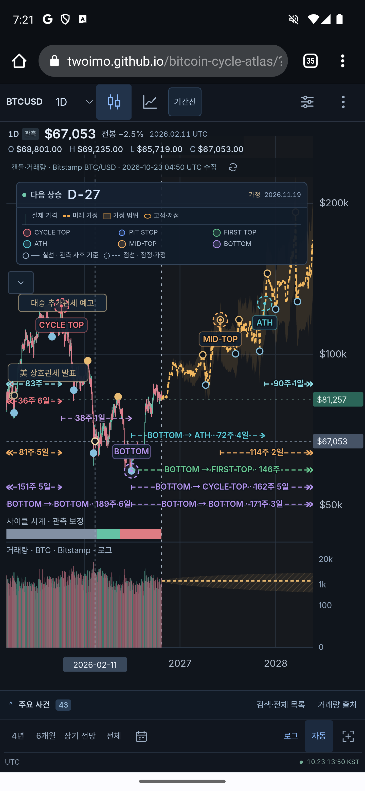

## MA10 · Atlas 지표 목록 펼침

- 입력: 8개 지표 펼치기 버튼 누르기
- 관찰: 이름·값·눈·제거와 내부 스크롤 목록 확인
- 환경: Atlas mobile web on Android AVD; 1440×3120px
- 캡처 시각: 2026-10-23T10:21:28.437Z (UTC)

## MA11 · 거래량 숨김, 목록 유지

- 입력: 거래량 행 눈 아이콘 누르기
- 관찰: 눈을 눌러 거래량을 숨겼다. 버튼 이름은 거래량 표시로 바뀌고 8개 목록에 남았다.
- 환경: Atlas mobile web on Android AVD; 1440×3120px
- 캡처 시각: 2026-10-23T10:21:39.806Z (UTC)

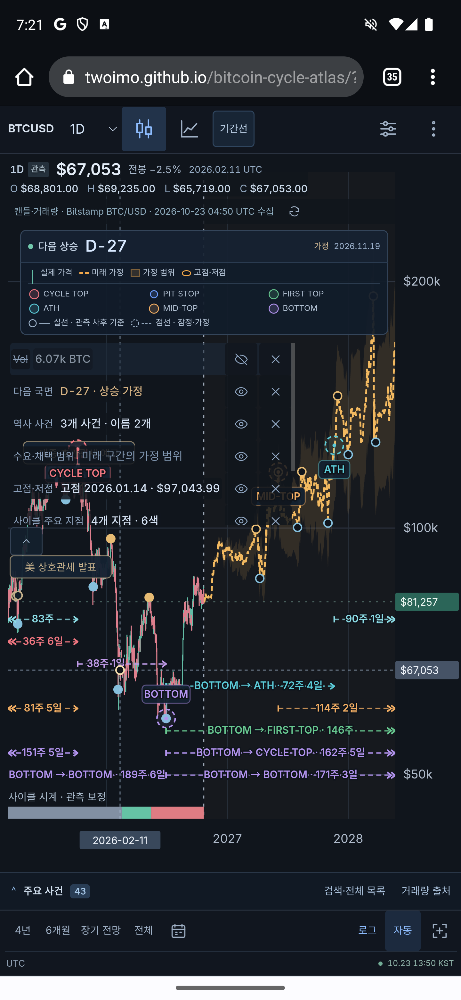

## MA12 · 거래량 복원

- 입력: 거래량 표시 버튼 누르기
- 관찰: 같은 8개 목록에서 숨기기 버튼과 거래량 pane 복귀
- 환경: Atlas mobile web on Android AVD; 1440×3120px
- 캡처 시각: 2026-10-23T10:21:59.561Z (UTC)

## MA13 · 모바일 인디케이터 라이브러리

- 입력: 상단 인디케이터 버튼 누르기
- 관찰: 검색·추가됨·즐겨찾기·템플릿·분류·닫기 조작 확인
- 환경: Atlas mobile web on Android AVD; 1440×3120px
- 캡처 시각: 2026-10-23T10:22:09.683Z (UTC)

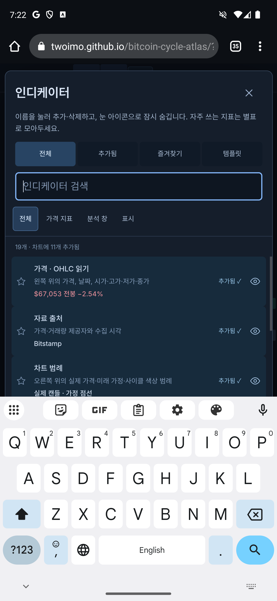

## MA14 · 키보드를 연 지표 검색

- 입력: 지표 검색에 cycles 입력
- 관찰: 4년 비교 검색 결과와 키보드가 함께 보임
- 환경: Atlas mobile web on Android AVD; 1440×3120px
- 캡처 시각: 2026-10-23T10:22:25.079Z (UTC)

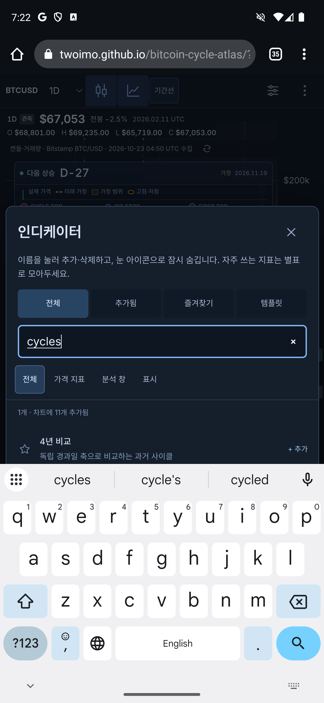

## MA15 · 4년 비교 추가 수락

- 입력: 검색 결과의 4년 비교 차트에 추가 누르기
- 관찰: 추가 수 11→12와 차트에서 삭제 버튼으로 변경 확인
- 환경: Atlas mobile web on Android AVD; 1440×3120px
- 캡처 시각: 2026-10-23T10:22:41.570Z (UTC)

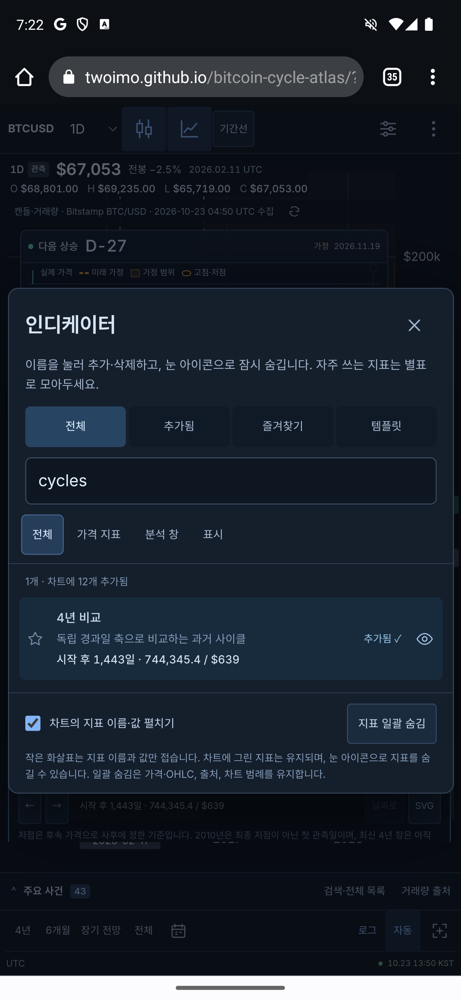

## MA16 · 모바일 연구 창과 주 차트

- 입력: 인디케이터 대화상자 닫기
- 관찰: 독립 축 4년 비교 pane과 최소화·닫기·설정 조작을 확인
- 환경: Atlas mobile web on Android AVD; 1440×3120px
- 캡처 시각: 2026-10-23T10:22:51.297Z (UTC)

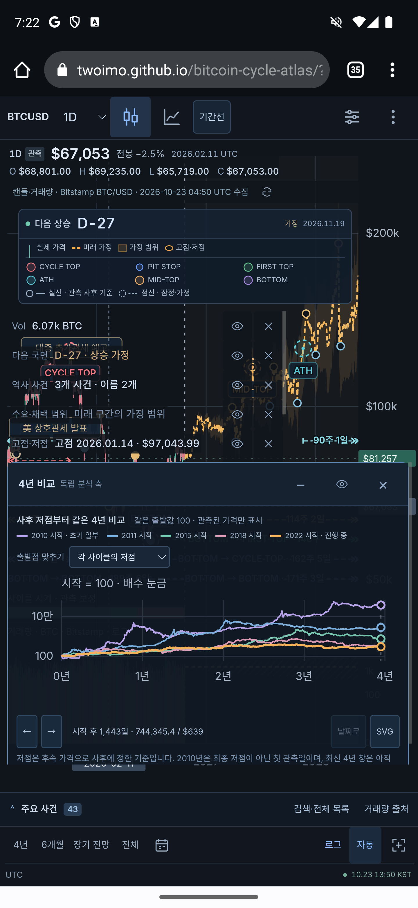

## MA17 · 4년 비교 pane 최소화

- 입력: 4년 비교 분석 창 접기 누르기
- 관찰: 제거하지 않고 제목·펼치기·눈·삭제 조작이 남음
- 환경: Atlas mobile web on Android AVD; 1440×3120px
- 캡처 시각: 2026-10-23T10:23:20.709Z (UTC)

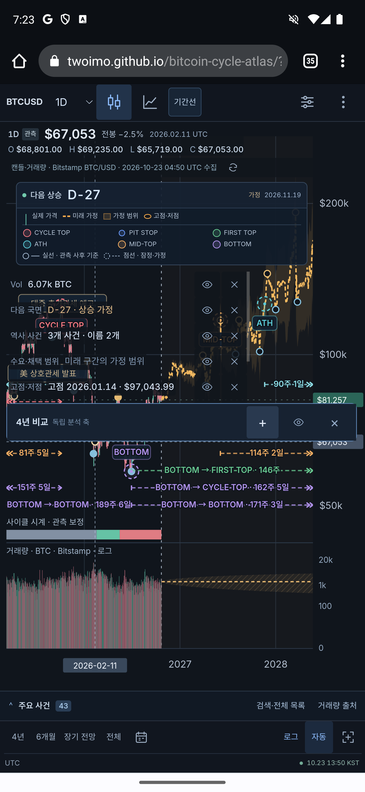

## MA18 · 연구 pane 복원

- 입력: 4년 비교 분석 창 펼치기 누르기
- 관찰: 독립 그래프와 접기 버튼 복원 확인
- 환경: Atlas mobile web on Android AVD; 1440×3120px
- 캡처 시각: 2026-10-23T10:23:32.260Z (UTC)

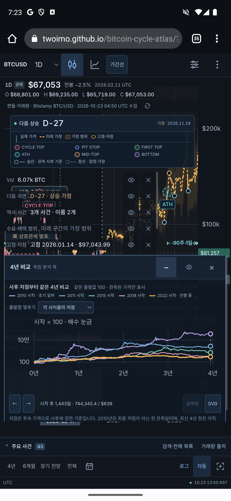

## MA19 · 임시 연구 지표 제거

- 입력: pane 제목의 4년 비교 삭제 누르기
- 관찰: 연구 창이 사라지고 목록 9→8로 복원
- 환경: Atlas mobile web on Android AVD; 1440×3120px
- 캡처 시각: 2026-10-23T10:23:40.877Z (UTC)

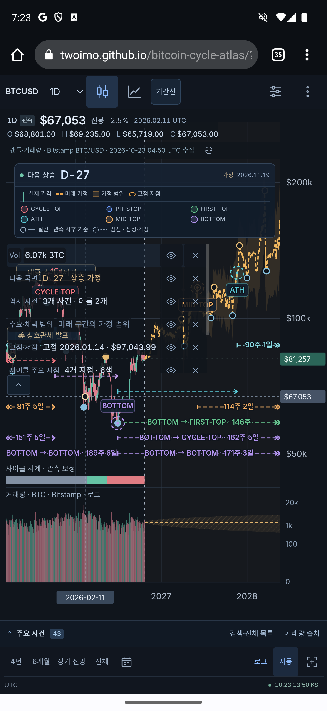

## MA20 · 네이티브 간격 선택

- 입력: 상단 1D 간격 메뉴 누르기
- 관찰: Android 선택 창에 8개 간격이 표시됨
- 환경: Atlas mobile web on Android AVD; 1440×3120px
- 캡처 시각: 2026-10-23T10:24:12.375Z (UTC)

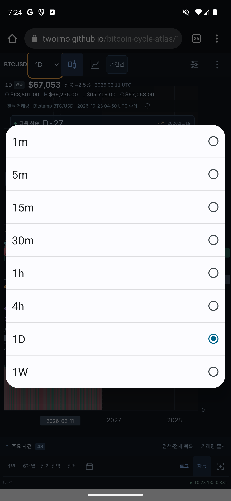

## MA21 · Atlas 1h 저장 자료 화면

- 입력: 네이티브 선택 창에서 1h 선택
- 관찰: 1h 전환 시 Coinbase 저장 자료 2026-10-23 04:50 UTC와 선택 03:00 UTC를 표시했다. 최신 조회 완료로 부르지 않는다.
- 환경: Atlas mobile web on Android AVD; 1440×3120px
- 캡처 시각: 2026-10-23T10:24:22.594Z (UTC)

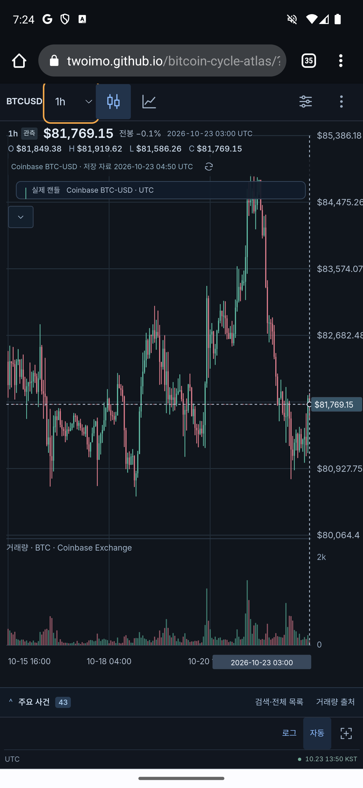

## MA22 · 시간봉 갱신 요청

- 입력: 거래소 캔들 새로 조회 누르기
- 관찰: 새 조회 상태와 저장 자료 유지 여부를 기록
- 환경: Atlas mobile web on Android AVD; 1440×3120px
- 캡처 시각: 2026-10-23T10:25:04.118Z (UTC)

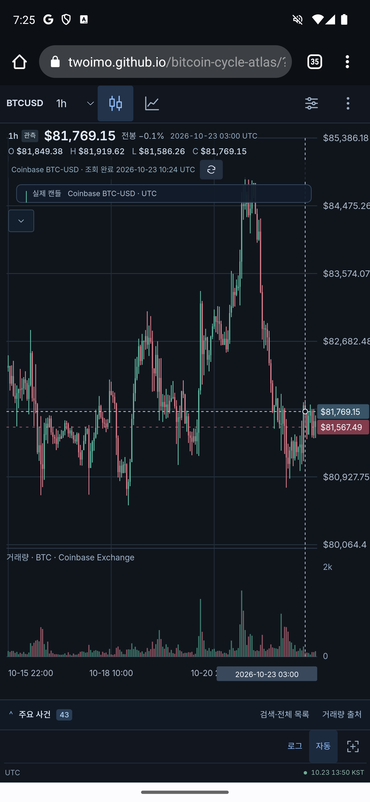

## MA23 · 갱신 뒤 시간봉 단일 탭 선택

- 입력: 오른쪽 최근 구간에서 단일 탭
- 관찰: 조회 완료 10:24 UTC 상태에서 선택 봉은 05:00 UTC가 됐다. 선택 시각·보이는 범위·최신 수신 봉은 별개다.
- 환경: Atlas mobile web on Android AVD; 1440×3120px
- 캡처 시각: 2026-10-23T10:25:16.654Z (UTC)

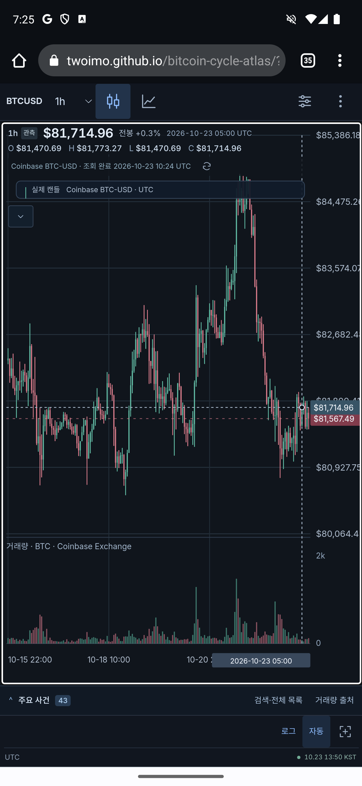

## MA24 · 모바일 차트 도구 트레이

- 입력: 상단 차트 도구 누르기
- 관찰: 이동·측정·자석·확대·축소·복원 접근 경로 확인
- 환경: Atlas mobile web on Android AVD; 1440×3120px
- 캡처 시각: 2026-10-23T10:25:32.010Z (UTC)

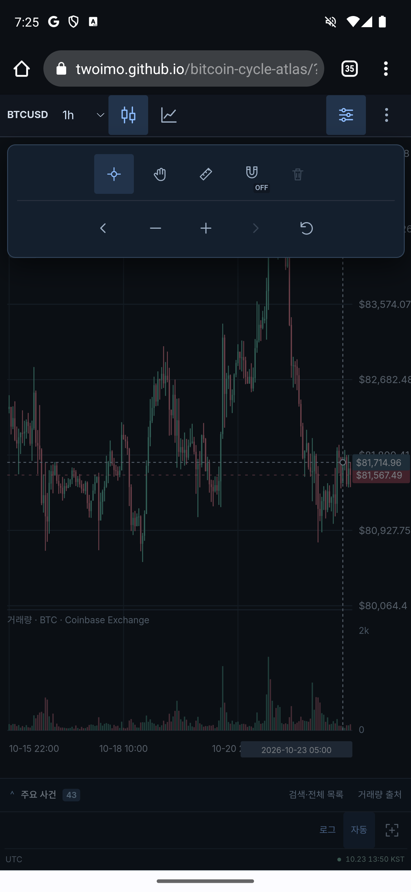

## MA25 · 두 지점 측정 시작

- 입력: 측정 도구를 선택한 뒤 차트 첫 지점 단일 탭
- 관찰: 측정 시작점 표시와 두 번째 점 대기 상태 기록
- 환경: Atlas mobile web on Android AVD; 1440×3120px
- 캡처 시각: 2026-10-23T10:25:52.992Z (UTC)

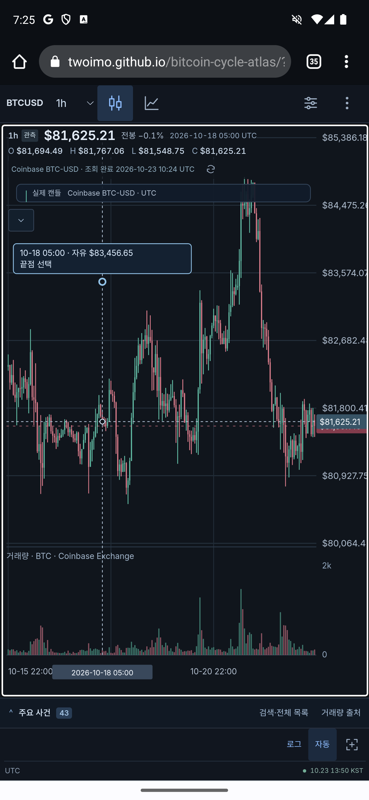

## MA26 · 두 지점 측정 완료

- 입력: 두 번째 차트 지점 단일 탭
- 관찰: 측정 가격차·수익률·시간 간격은 화면으로 확인
- 환경: Atlas mobile web on Android AVD; 1440×3120px
- 캡처 시각: 2026-10-23T10:26:04.814Z (UTC)

## MA27 · 모바일 자석 메뉴

- 입력: 도구 트레이의 자석 설정 누르기
- 관찰: 키보드 수정키 없이 끄기·약한·강한 자석을 선택할 수 있음. 이번에는 선택 변경 안 함
- 환경: Atlas mobile web on Android AVD; 1440×3120px
- 캡처 시각: 2026-10-23T10:26:27.450Z (UTC)

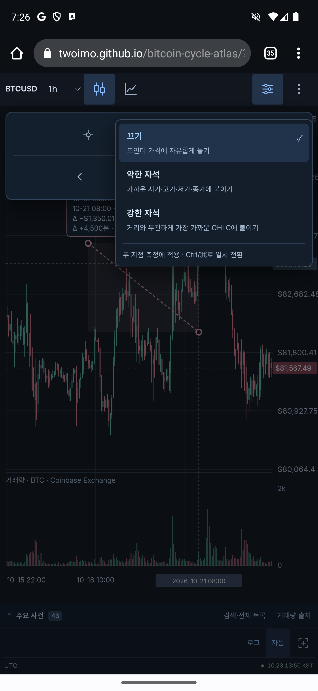

## MA28 · 모바일 정보 트레이와 과대 아이콘

- 입력: 상단 정보와 설정 누르기
- 관찰: 차트 설정·SVG 저장·빠른 조작·작업 화면의 큰 아이콘을 확인했다. 트레이에 PNG·CSV 직접 버튼이 모두 보인다는 뜻은 아니다.
- 환경: Atlas mobile web on Android AVD; 1440×3120px
- 캡처 시각: 2026-10-23T10:26:52.213Z (UTC)

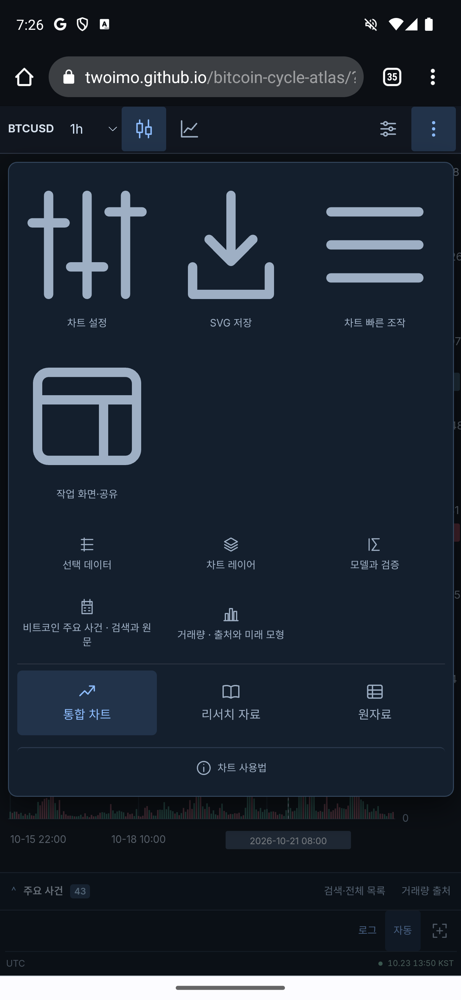

## MA29 · 모바일 차트 설정 패널

- 입력: 정보 트레이에서 차트 설정 선택
- 관찰: 보기·가격 단위 선택과 처음 화면 버튼을 확인했다. 이 패널에 PNG·CSV 내보내기 버튼이 있는 것은 아니다.
- 환경: Atlas mobile web on Android AVD; 1440×3120px
- 캡처 시각: 2026-10-23T10:27:17.868Z (UTC)

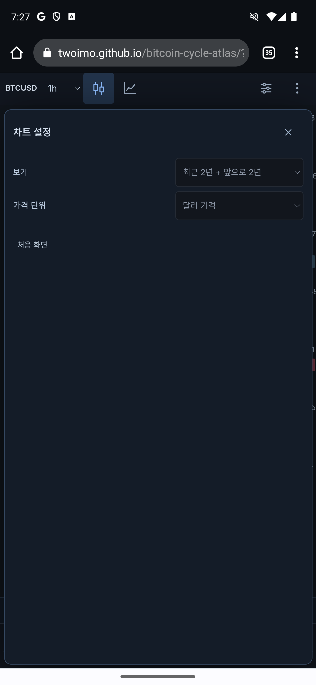

## MA30 · SVG 라벨 버튼이 PNG를 수신

- 입력: SVG 저장이라고 표시된 모바일 버튼 누르기
- 관찰: SVG 저장 버튼 실행 뒤 PNG 저장 메시지와 File downloaded를 확인했다. 수신 파일의 PNG magic·914×1684·SHA-256을 별도로 검증했다.
- 환경: Atlas mobile web on Android AVD; 1440×3120px
- 캡처 시각: 2026-10-23T10:28:20.867Z (UTC)

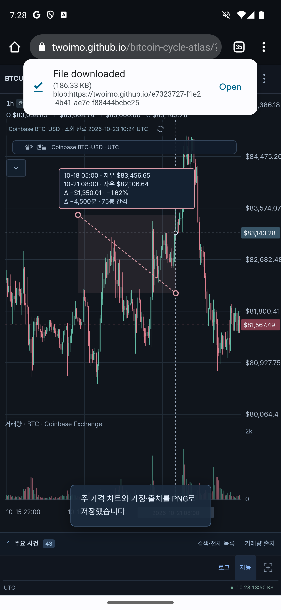

## MA31 · 모바일 작업 화면 빠른 검색

- 입력: 정보 트레이에서 작업 화면·공유 선택
- 관찰: 빠른 검색·저장·공유 두 탭과 소프트 키보드를 확인했다. 이 첫 화면에서 CSV 명령은 아직 검색하지 않았다.
- 환경: Atlas mobile web on Android AVD; 1440×3120px
- 캡처 시각: 2026-10-23T10:29:18.168Z (UTC)

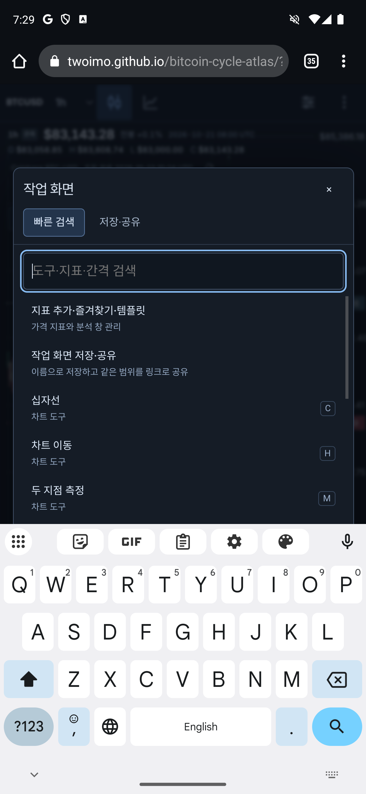

## MA32 · 키보드가 열린 저장·공유

- 입력: 작업 화면의 저장·공유 탭 선택
- 관찰: 이름 저장 필드와 빈 저장 목록이 보였다. 하단 링크는 키보드에 가려졌으며 실제 저장·복사는 하지 않았다.
- 환경: Atlas mobile web on Android AVD; 1440×3120px
- 캡처 시각: 2026-10-23T10:29:33.417Z (UTC)

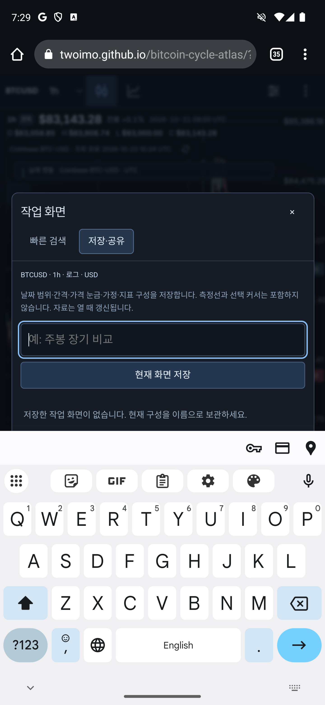

## MA33 · 키보드를 닫은 저장·공유

- 입력: Android Back으로 소프트 키보드만 닫기
- 관찰: 뒤로가기는 키보드만 닫고 대화상자를 유지했다. 현재 링크와 링크 복사가 드러났다. 여기에는 SVG·CSV 버튼이 없고 CSV는 빠른 검색으로 접근했다.
- 환경: Atlas mobile web on Android AVD; 1440×3120px
- 캡처 시각: 2026-10-23T10:29:43.266Z (UTC)

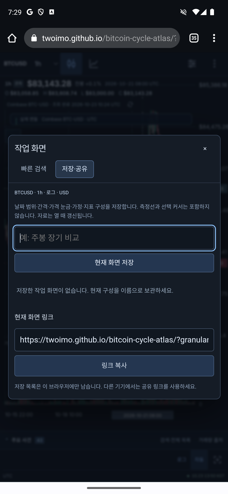

## MA34 · CSV 내보내기 명령 검색

- 입력: 빠른 검색 입력에 CSV 입력
- 관찰: 관측 CSV 저장 명령의 실제 노출 여부 확인
- 환경: Atlas mobile web on Android AVD; 1440×3120px
- 캡처 시각: 2026-10-23T10:30:12.445Z (UTC)

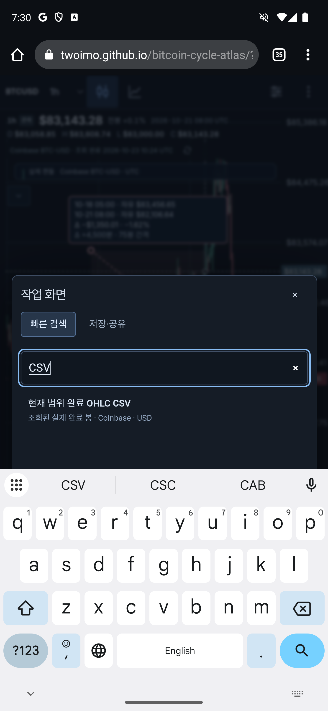

## MA35 · 모바일 실제 OHLC CSV 다운로드

- 입력: 현재 범위 완료 OHLC CSV 명령 선택
- 관찰: Chrome 수신 안내와 다운로드 파일을 별도로 검증
- 환경: Atlas mobile web on Android AVD; 1440×3120px
- 캡처 시각: 2026-10-23T10:30:26.474Z (UTC)

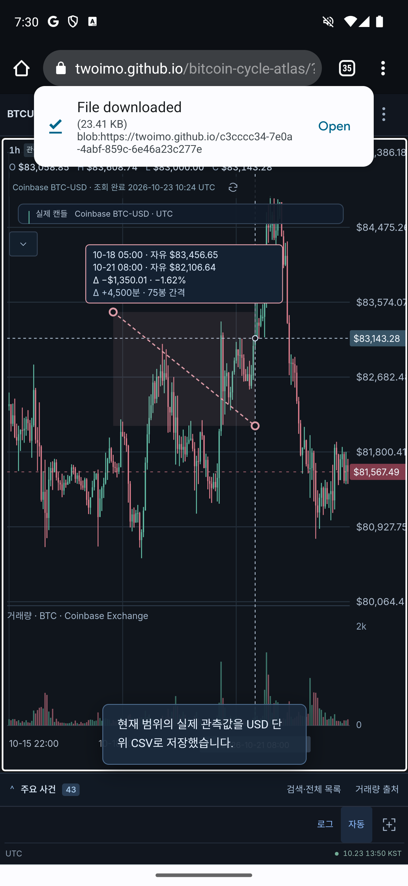

## MA36 · Android 실제 가로 회전 레이아웃

- 입력: 에뮬레이터를 시계 방향으로 90도 회전
- 관찰: 3120×1440으로 회전, Android app bounds 941×404dp. 좌우 레일·간격 버튼이 다시 나타났다. 가로 방향의 모든 제스처 테스트는 아니다.
- 환경: Atlas mobile web on Android AVD; 3120×1440px
- 캡처 시각: 2026-10-23T10:31:34.399Z (UTC)

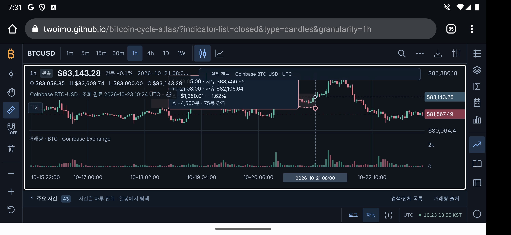

## MA37 · 원래 세로 방향 복원

- 입력: 추가 3회 90도 회전하여 시작 방향으로 복원
- 관찰: 1440×3120 세로 레이아웃 복원. 이후 ROTATION_0, 자동회전 1·user_rotation 0을 확인하고 소유 탭 두 개를 닫았다.
- 환경: Atlas mobile web on Android AVD; 1440×3120px
- 캡처 시각: 2026-10-23T10:31:58.850Z (UTC)

